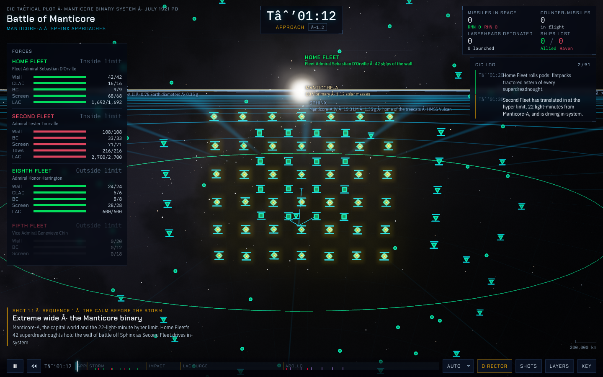
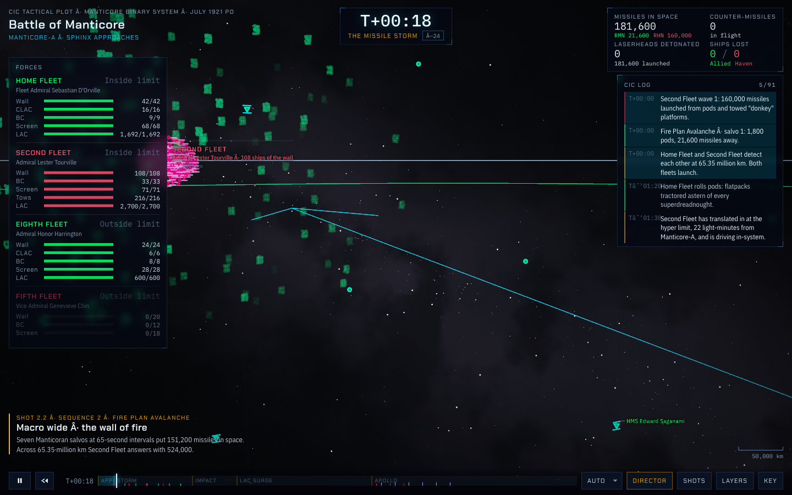
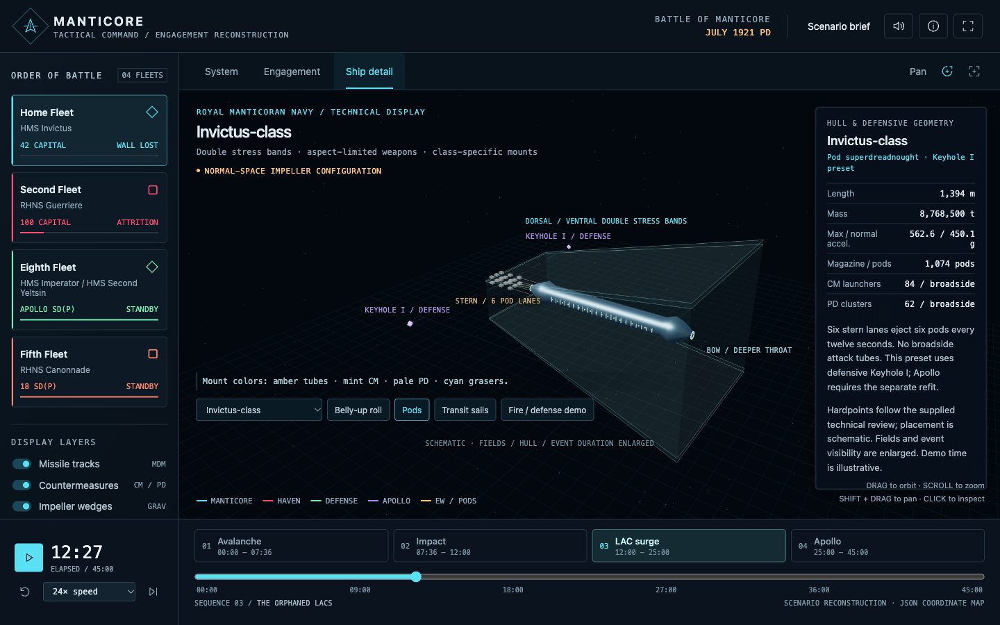
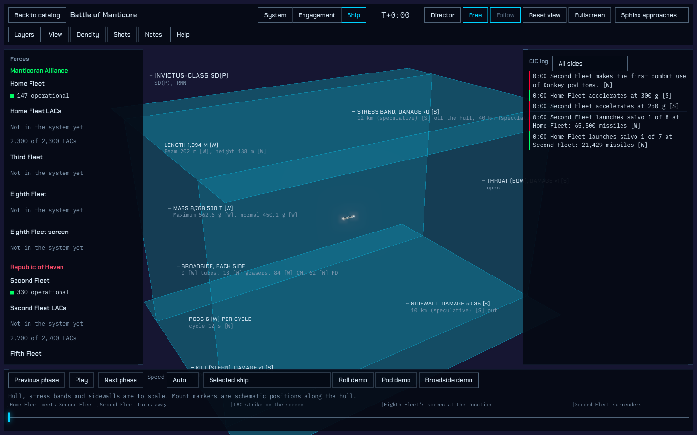
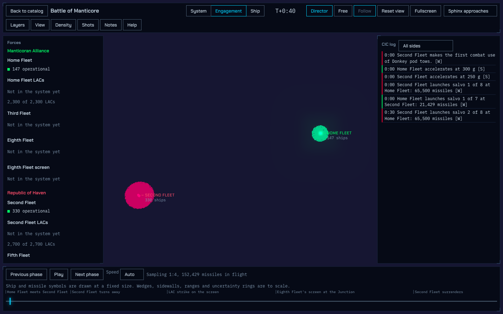
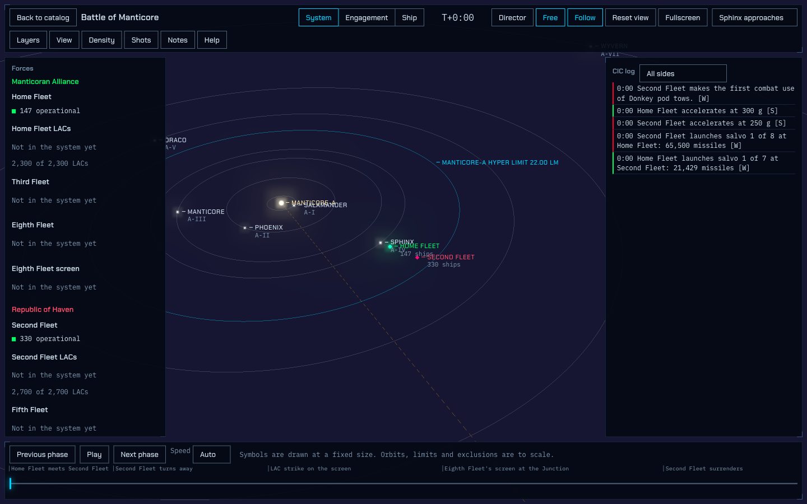
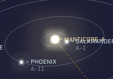
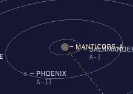
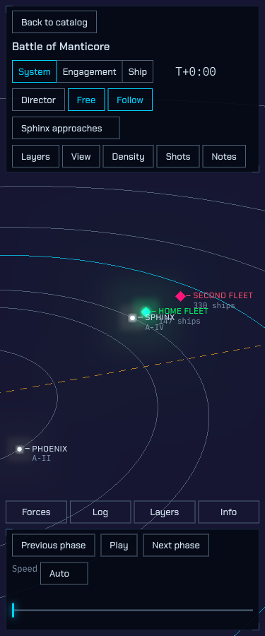

# honor-cic: design evidence

Collected on 2026-10-07. Revision and deployment boundaries are in [00-scope.md](00-scope.md).

The owner asked for A's cinematic presentation with B's tactical and ship-scale clarity. The current app has much of the required behavior, but its presentation does not communicate that behavior well. This report distinguishes observed defects, source-supported explanations, and unresolved causes.

## Reference comparison

| Surface | A contributes | B contributes | Current app |
| --- | --- | --- | --- |
| Battle presentation | Scene-led composition, title/clock hierarchy, force-composition bars, narrative shots | Tactical framing and scale context | Large shared panels dominate; important subjects can sit behind them |
| Formations and missiles | Readable fleet structure, salvo density, varied launch/flight/impact storytelling | Tactical meaning and distance cues | Formations and density controls exist, but wide shots often become colored blobs |
| Ship inspection | More differentiated ship-facing and damage effects | Legible tapered hull, mounts, pod lanes, Keyhole markers, focused controls | A box hull is secondary to very large defensive planes |
| Reuse and truthfulness | Visual reference, not a data authority | Tactical reference, not an unconditional canon authority | Multiple scenario packs, deterministic replay, provenance, and actual/perceived filtering should survive |

A's presentation is the visual target, not a license to copy its tactical values or ship every decorative treatment. B labels schematic enlargement; that distinction matters when making a hull readable without falsifying defensive dimensions.

Archived reference-source citations used in the comparison:

- A: `siteA/app.inline.pretty.js:3828-3833,5431-5808,5875-5877,6444-6453,6530-6535`.
- B: `siteB/scene.pretty.js:54-181,2265-2335,2395-2410,6487-6565`.

These archives are session evidence. The findings below include their substantive observations so the handoff does not depend on access to those files.

## P1: innovative

The catalog opens both Manticore and a separate non-canon training engagement. Training has its own theater and shot, four cruisers per side, and a 1,200-second duration. This is a useful improvement over a single fixed battle script, rather than evidence of a novel interaction pattern.

Sources: `src/ui/catalog.ts:31-56`; `scenarios/training/meta.json:3-8,18-23`; observed catalog navigation and training System/Engagement views.

No survey of five or more peer products was conducted. A claim of unique interaction design would be unsupported.

## P2: useful

Playback, scale navigation, filtering, density selection, and ship demos work in the sampled flows. The main failure is making their results legible.

- Default Ship framing gives the defensive envelope most of the screen while the hull remains small. Inspecting the hull requires working around the initial framing.
- Ship adds a class selector and three demos inside the existing transport instead of replacing battle-wide controls with a technical workspace.
- Wide Engagement shots obscure fleet structure with overlapping point symbols and missile glow.
- A free-camera opening frame puts Second Fleet behind the right panel. Some director shots also overlap their subjects with HUD rectangles.

Sources: `src/render/scales/ship-view.ts:151-173,202-203`; `src/ui/viewer/hud.ts:110-120,163-168,208-212,299-311`; `src/render/scales/engagement-view.ts:181-290,319-406,433-442`.

### Recorded interaction checks

These are the actions exercised during the audit, not a claim that every dynamic row or every possible state was tested.

| Action | Observed result |
| --- | --- |
| Catalog scenario links | Manticore and Training routes load |
| System / Engagement / Ship tabs | The rendered scale changes |
| Director / Free / Reset | Camera mode or framing changes |
| Fullscreen | Enters and exits fullscreen |
| Play at 1x / Pause | Battle time advances, then stops |
| Next / Previous phase | Advances to 714 seconds, then returns to zero in the sampled opening |
| Time slider ArrowRight | Advances zero to 0.1 seconds |
| Seven layer toggles | Each corresponding store field changes |
| Actual / Perceived and commander selection | Picture/commander state changes |
| Reduce motion checkbox | Preference state changes |
| Density 1:1, 1:2, 1:4, 1:8, 1:16 | Render sampling changes; the 86,929-missile readout at the sampled time remains unchanged |
| Haven log filter | Shows Haven entries |
| Shot selection | Jumps to the selected narrative moment |
| Help / Notes and Escape | Dialog opens/closes and focus returns to the trigger |
| Home Fleet selection | Opens the inspector |
| Six inspector provenance controls | Each reveals/closes inline source text and updates `aria-expanded` |
| Show class | Switches to Ship |
| Saganami-C class choice | Class and specification labels change |
| Roll / Pod / Broadside demos | Progress advances while battle replay is paused |
| Mobile Forces / Log | Drawers open and close |
| Mobile Layers / Info | Opens the relevant menu/help surface |
| Unknown scenario route | Explicit error with Back to catalog |

Follow's presence and disabled-state rules were inspected; the audit does not claim a separate exhaustive pointer-tracking check. Its existing behavior must be retained in a redesign.

## P3: aesthetic

### Hull and defensive geometry

The hull is `BoxGeometry(l,b,h)` with a dark unlit material, opacity 0.85, and edge wireframe. The defensive planes use class dimensions. Camera fit uses `Math.max(l,len) * 1.4`, so a much larger envelope controls the default framing.

This explains the poor hierarchy. It does not establish that the physical dimensions are wrong. A hull-focused inspection view plus a separate true-scale envelope is preferable to silently shrinking the envelope.

Sources: `src/render/scales/ship-view.ts:151-173,202-203`; current Ship screenshot; B's ship-detail screenshot.

### Black level

The intended void is `#020208`; CSS also resolves to `rgb(2,2,8)`. In the captured System view, the dominant background pixel was `#161632`.

The same PNG region, `[320,110,1050,745]`, was compared under reversible runtime changes:

| Runtime condition | Dominant background |
| --- | --- |
| Baseline System | `#161632` |
| Body and unit points hidden | `#161632` |
| Explicit scene background `#020208` | `#020208` |
| Explicit scene background black | `#000000` |

This isolates clear/background handling in the rendering path. It rules out accumulated point glow as the explanation for the uniform purple field. The exact internal transfer/compositing stage was not fully traced.

Sources: `src/render/palette.ts:3-20`; `src/render/engine.ts:22-31`; captured runtime scene properties and PNG histograms.

### Square-looking halos

Celestial bodies use circular shape 0. Stations and carriers intentionally use square shape 3. The latter are tactical symbols, not the cause of the star-halo complaint.

The fragment shader has a radial mask and an alpha discard. The engine already has `RenderPass`, `UnrealBloomPass`, and `OutputPass`; logarithmic-depth support is also present. None should be reported as missing.

Reducing point emission to 8% while retaining the circular mask removed the bright rectangular-looking halo and left a circular core. This implicates the bright-point/additive/bloom path. It does not prove which blur, threshold, sampling, or compositing operation creates the contour.

Sources: `src/render/points.ts:3-35`; `src/render/scales/system-view.ts:114-120`; `src/render/engine.ts:26-31`; reversible runtime diagnostic.

All runtime diagnostic changes were restored. No shader or palette edits were made.

### Formation and cinematic language

Current wide shots often read as round green/pink masses. Salvos can merge into bright patches. The issue is presentation of existing formations and samples, not missing formation data or missing density controls.

Current director motion mainly provides broad subject framing and eased/orbital moves. A's reference sequence has more differentiated macro/micro, pod, missile-tracking, impact, and damage moments. Some A captures were taken before camera easing had fully settled, so individual captured frames are not treated as perfect composition.

Sources: `src/render/director.ts:83-115`; `src/render/scales/engagement-view.ts:181-290,319-406,433-442`; current and reference salvo captures; archived A camera/effect ranges above.

The LAC shot begins at 30:06, but the corrected dogfight occurs at 30:53-30:57 and the graser pass at 31:08-31:10. Shot pacing must reveal those short events without changing their simulated duration.

### Token inventory

The source report identified a base gap of `0.5rem` and body type of `0.875rem`, approximately 8px and 14px under a 16px root. These are inferred base values, not a complete measured spacing/type scale.

Seventeen distinct CSS color literals were counted, including neutrals, opacity variants, and semantic colors. That is not seventeen decorative hues. The tactical palette has written meanings in `DESIGN.md`.

Sources: `src/ui/styles.css:1-22,25-31`; `DESIGN.md` Palette and Typography.

## P4: understandable

The scale names and core transport are identifiable. Two picture concepts, Actual and Perceived, need the View-menu explanations; the top-level Density label only becomes specific after opening Missile density. The audience can reasonably learn naval vocabulary, but the UI should not depend on guessing what a control affects.

Notes is a more concrete readability defect: the dialog displays literal Markdown headings, emphasis markers, and backticks. Its source inserts `pack.notes` as text.

Sources: `src/ui/viewer/hud.ts:90-98,131-153`; `src/ui/viewer/model.ts:99-108,120-139`; observed Notes dialog.

No first-time-user comprehension study was run. These are expert-review findings, not measured user success rates.

## P5: unobtrusive

At 1440x900, the sampled opening Engagement layout measured:

| Region | x | y | Width | Height |
| --- | --- | --- | --- | --- |
| Header | 8 | 8 | 1,424 | 86 |
| Forces | 8 | 102 | 288 | 653.30 |
| Right panels | 1,080 | 102 | 352 | 653.30 |
| Footer | 8 | 763.30 | 1,424 | 128.70 |

This leaves the scene competing with tall side panels and wide strips. In Ship, the same shell competes with the hull and its projected annotations. The defect is scale-independent composition, not simply panel color or corner shape.

Sources: measured HUD rectangles; `src/ui/viewer/hud.ts:110-120,163-168,208-212,299-311`; current Ship and walls screenshots.

A projection probe found 97 of 477 in-canvas symbol centers behind matched HUD rectangles at the LAC shot. These are sprite centers, not a verified count of living ships. The probe supports safe-area-aware framing, not a tactical loss calculation.

At 375px width, the header was 235.75px high and the footer 143.30px high. Navigation consumes substantial vertical space even though the sampled page has no horizontal overflow.

## P6: honest

The app labels P primary, W wiki, D derived, and S speculative values. Training is explicitly non-canon. Density changes the rendering sample rather than the reported missile quantity. Actual/perceived filtering exists in the model. Provenance controls reveal inline sources.

The catalog's blanket description of fleet actions rebuilt from novels/reference works is slightly broader than a catalog that also contains a non-canon training example. The card itself corrects that impression. No deceptive flow, hidden cost, fabricated testimonial, or fake scarcity was found in the inspected scope.

Sources: `src/ui/catalog.ts:31-48`; `src/ui/viewer/model.ts:99-108,120-139,164-197`; `src/ui/viewer/panels.ts:11-21`; `scenarios/training/meta.json:3-8`; `scenarios/training/notes.md:1-3`; density interaction check.

Two audit corrections are important:

- Evidence buttons are inline disclosures, not dead modal buttons. Click again to close. Escape clearing selection does not establish a broken disclosure.
- Lack of a custom focus trap is not evidence that native modal dialogs lack focus containment. Native `showModal()` behavior was exercised.

## P7: long-lasting

The recorded language is specific to the product: a dark-space plot, square-corner console brackets, leader-tick labels, Chakra Petch display type, condensed Plex body text, and monospaced numerical data. There is no evidence that these choices depend on a particular year's interface fashion.

Dark mode and scene bloom have a content reason. The purple background defect should not be mistaken for intentional branding. Likewise, semantic side/weapon colors should not be removed merely to satisfy a generic small-palette preference.

Sources: `DESIGN.md` Identity, Theme, Typography, Shape, and Identity motif; `src/ui/styles.css:1-31`; `src/render/palette.ts:3-20`.

The existing owner decision about all-panel blur remains unresolved. The recorded default is solid panels, with blur only on modal scrims. The audit does not choose a new policy.

## P8: thorough

### States

| State | Evidence | Assessment |
| --- | --- | --- |
| Empty | Catalog empty message; no-contact text in source | Present; not every empty combination was exercised |
| Loading | Worker progress and loading shell | Present in source/runtime measurements |
| Error | Unknown route, validator error path, WebGL fallback path | Unknown route exercised; WebGL failure not forced |
| Success | Loaded catalog/replay, ship demos, inspector | Present but visually rough: clipped context and raw Notes |
| Focus | `:focus-visible`, menu focus return, native dialogs | Present; sampled keyboard checks work |
| Disabled | Follow and other guarded controls | Present; disabled faint text is not ordinary body-text evidence |

Sources: `src/ui/catalog.ts:3,31-56`; `src/ui/viewer/viewer.ts:29-62,109-115`; `src/ui/viewer/hud.ts:90-92,261-268`; `src/ui/styles.css:35-50,87-138,175-204`; recorded interaction table.

### Responsive and accessibility limits

- At widths 375, 860, 1100, and 1440, sampled System layouts had document/body widths equal to the viewport and no detected horizontal overflow.
- Mobile primary controls had 32px boxes and sampled effective hit areas of 32px, without enlarging pseudo-elements. Desktop fleet-row buttons were 24px. The mobile targets do not meet the direction's 44px floor.
- At 375px, two visible Layers entry points were present.
- Focused System-tab ArrowRight did not select Engagement. Native activation and other tested keys worked; this is a tab-interaction gap, not evidence that the whole app is mouse-only.
- The source report found no skip link. Semantic header/aside/nav/footer elements exist; zero explicitly assigned landmark roles does not mean zero semantic landmarks.

Sources: runtime layout/hit-area measurements; `src/ui/viewer/hud.ts:68-71,110-120,208-212,222-245`; `index.html:1-18`.

Computed contrast checks:

| Pair | Ratio | Meaning |
| --- | --- | --- |
| `#8199B0` on sampled `#060A16` panel | 6.70:1 | Passes normal-text AA for this pair |
| `#4F6378` on that panel | 3.19:1 | Sampled live example was disabled Follow; not a normal-text failure |
| `#8199B0` on `#135C76` cyan field | 2.52:1 | Illustrates projected-label risk; exact live pairing across all frames remains unverified |

The fonts used in the captured UI were loaded. Unused unloaded weights are not a fallback-font defect.

No blanket WCAG conformance claim is made. A redesign still needs full dynamic-background contrast, keyboard/assistive-technology, touch, and 200% zoom coverage.

## P9: environmentally friendly

These are measurements of the captured build in fresh browser contexts, without network/CPU throttling:

| Metric | Catalog | Battle |
| --- | --- | --- |
| Initial raw/decoded JavaScript | 723,855 bytes | 907,174 bytes |
| Gzip JavaScript payload | 188,386 bytes | 239,167 bytes |
| Resource requests | 8 | 9 |
| Controls-ready proxy, three runs | 446.9 / 260.5 / 239.0ms | 586.0 / 574.6 / 676.8ms |

The battle total includes a 183,319-byte solver worker. The catalog eagerly pays for the viewer entry bundle. No scenario JSON or source maps were requested in these captured loads.

Sources: raw runtime evidence keys `initial_js_bytes`, `primary_network_request_count`, and readiness measurements; `src/main.ts:2-6,11-17`; `src/app/solve-client.ts:13-23`.

### Paused rendering

All sampled paused image comparisons had zero changed pixels and zero running CSS/Web Animations. Rendering nevertheless continued:

| Settled view | Interval | Engine renders |
| --- | --- | --- |
| Catalog | 3,001.5ms | 0 |
| System | 3,001.8ms | 88 |
| Engagement | 3,071.1ms | 79 |
| Ship | 3,001.6ms | 78 |
| Narrow Engagement | 3,053.1ms | 73 |

The renderer includes bloom/postprocessing. Rendering unchanged frames is a resource issue even though the sampled screen is visually still.

Sources: `src/render/engine.ts:26-31,42-50`; runtime evidence `idle_animation_count` and `performance_findings`.

### Motion and lifecycle

Fresh reduced-motion preference suppressed meaningful director orbit. Changing the media preference after viewer mount changed `matchMedia` but did not suppress the sampled existing orbit. The exact interaction with explicit user overrides was not traced, so this remains a behavior to investigate.

Returning to the catalog disposed the engine and stopped callbacks/renders. Leaving during replay calculation did not cancel the worker immediately: it finished 315.7ms after navigation, then terminated, without mounting a stale viewer.

Sources: `src/render/director.ts:83-115`; `src/render/engine.ts:53-55`; `src/main.ts:11-17`; `src/app/solve-client.ts:13-23`; runtime lifecycle evidence.

The environment used Chromium 153 with ANGLE/SwiftShader on a shared Apple M5 Pro host under high load. Render wall time is not physical-device CPU time, energy use, guaranteed frame rate, or field TTI. Hidden-tab suspension was not established because the headless tabs remained visible.

## P10: as little design as possible

Five battle-wide groups can leave the default Ship workspace without breaking class inspection: forces, CIC log, theater selection, missile density, and director-shot selection. They should remain available where relevant, rather than occupy every scale.

The confirmed narrow-screen duplicate is Layers. Keyboard alternatives and responsive access paths are not automatically duplication defects.

Sources: `src/ui/viewer/hud.ts:110-120,163-168,208-212,299-311`; observed Ship and 375px layouts.

The structural report inventoried 37 shell control templates, but that is neither a trustworthy visible-control total nor a complexity threshold. Conditional groups, repeated data rows, and class demos make the total state-dependent. Maximum component nesting depth and a complete dead-prop/unused-import count were not established. None of those unmeasured values is used in scoring.

## Audit boundary and acceptance status

This is an evidence report, not delivery approval for the current UI. Its mobile target sizes, scene hierarchy, Ship framing, Notes formatting, and rendering artifacts remain unresolved.

No application implementation, shader rewrite, new visual identity, or new ship asset was produced. The screenshots are existing audit captures. Source reports were reconciled with direct runtime observations; unsupported claims about dead disclosures, missing OutputPass, missing logarithmic depth, absent fonts, and missing native dialog focus behavior were rejected.
