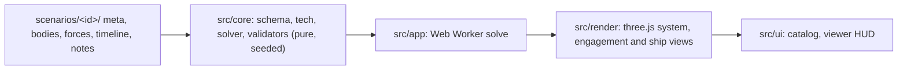

# honor-cic

Replays of Honorverse fleet battles, rebuilt from the novels and reference works. Every number in the app carries its evidence label.

- **Three scales.** System shows stars, orbits, hyper limits and fleets. Engagement shows formations, sampled missile clouds, laserheads, wedges and Apollo links. Ship shows the class model to scale, with roll and pod demos.
- **Director or free camera.** Each battle pack scripts its own shots. Drag the plot to take the camera, and press `D` to give it back.
- **Actual or perceived.** Show ground truth, or one commander's delayed sensor picture with contact ages and uncertainty rings.
- **Missile density.** Choose 1:1 to 1:16. The readout always shows the ratio in use.
- **CIC log, forces and inspector.** Ship status, lost subsystems, and the source behind every figure.

## Quick start

```bash
npm install
npm run dev        # http://localhost:5173
```

| Script | What it does |
|---|---|
| `npm run dev` | Development server |
| `npm test` | Unit tests (Vitest) |
| `npm run typecheck` | TypeScript, no emit |
| `npm run validate` | Static and replay checks for every scenario pack |
| `npm run calibrate -- <id>` | Tunes a pack's S-labelled defense inputs toward its canon interception share |
| `npm run e2e` | Playwright on desktop and phone, WebGL through SwiftShader |
| `npm run build` | Production build into `dist/` |
| `npm run deploy` | Build and deploy to Cloudflare Pages |

## How it is built



- `src/core` never touches the DOM or three.js and never calls `Math.random`; `tests/architecture.test.ts` enforces this. Given a pack, the solver produces the same replay every time, and the renderer samples it as a pure function of time, so scrubbing is exact.
- Ship and missile figures come from the project's technical reference, `docs/honorverse-master-technical-specification.md` (cited in code as `MTS §n`).

## Evidence policy

| Label | Meaning |
|---|---|
| P | Primary: novel or author statement |
| W | Wiki or reference work |
| D | Derived by calculation from sourced inputs |
| S | Speculative: reconstruction or provisional value |

- An unknown value is `null` and shows as "unknown". It is never zero.
- Every S value needs an `uncertainty` note explaining the assumption.
- The solver never forces a canon outcome it cannot reach. A canon arrival that needs more than the missile profile allows fails validation instead of breaking physics.

## Adding a scenario

1. Copy `scenarios/training/` to `scenarios/<id>/` and set `meta.json` `id` to `<id>`.
2. Fill in the files:

   | File | Holds |
   |---|---|
   | `meta.json` | Title, date, sides and colours, frame, phases, theaters, director shots, sources |
   | `bodies.json` | Stars, planets, termini, with hyper limits and exclusions |
   | `forces.json` | Fleets and LAC groups: classes, counts, formation, state anchor, presence |
   | `timeline.json` | Fire plans, beam attacks, ranges, rolls, escapes, canon outcomes |
   | `notes.md` | Reconstruction choices and caveats, shown in the viewer's Notes dialog |

3. Run `npm run validate`. Fix the data until there are no errors. Warnings explain S choices.
4. If the battle states an interception share, run `npm run calibrate -- <id>` and record every changed value in `notes.md`.
5. Run `npm run dev` and open `http://localhost:5173/#/battle/<id>`. The catalog lists the pack automatically.

Side colours must reach 4.5:1 contrast on `#020208`.

## Deploy

Cloudflare Pages, project `honor-cic`:

```bash
npx wrangler login   # once per machine
npm run deploy
```

From GitHub Actions instead (no local Cloudflare login): add the repository secrets `CLOUDFLARE_API_TOKEN` (permission Account, Cloudflare Pages, Edit) and `CLOUDFLARE_ACCOUNT_ID`. Every push to `main` then deploys through `.github/workflows/deploy.yml`, or run it by hand from the Actions tab.

Locally behind a TLS-intercepting proxy, point Node at the proxy's root certificate with `NODE_EXTRA_CA_CERTS` and use the same two variables instead of `wrangler login`.

`public/_headers` sets the content security policy and asset caching.

## Fan project

The Honorverse belongs to David Weber. This is a non-commercial fan tool. It reproduces no text from the novels beyond short factual citations, and it links to its sources.
