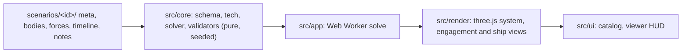

# honor-cic

Honorverse fleet-action reconstructions, plus a non-canon Training example. Every number in the app carries its evidence label.

- **Three workspaces.** System keeps navigation and system context compact. Engagement keeps formations, sampled missile clouds, laserheads, wedges and Apollo links in the foreground, with forces, log and inspector opened only when needed. Ship is a class-inspection workspace with hull or defensive-envelope framing, class figures, and roll, pod and broadside demos. Its replay controls are opt-in. Compact plots retain identity, dimensions and active-demo labels; Class figures and sources keeps accelerations, all mount aspects, capacities and defensive dimensions accessible.
- **Director or free camera.** Each battle pack scripts its own shots. Drag the plot to take the camera, and press `D` to give it back. In free camera, **Follow** (`G`) keeps your angle and distance while the view moves with the selected fleet or the current engagement.
- **Actual or perceived.** Show ground truth, or one commander's delayed sensor picture with contact ages and uncertainty rings.
- **Missile density.** Engagement offers 1:1 to 1:16. The readout always shows the ratio in use. On narrower screens, theater, density and shots move into Controls.
- **CIC log, forces and inspector.** Ship status, lost subsystems, and the source behind every figure.
- **Motion and idle.** Paused plots redraw only after a control, resize or camera change; their drawing buffer stays available for repaints and captures. Active replay, demos and camera settling still animate. The live device reduced-motion setting is followed until you make an explicit choice in View; reduced-motion demos have a manual position slider.

## Quick start

```bash
npm install
npm run dev        # http://localhost:5173
```

| Script | What it does |
|---|---|
| `npm run dev` | Development server |
| `npm test` | Unit tests (Vitest) |
| `npm run typecheck` | TypeScript, no emit |
| `npm run validate` | Static and replay checks for every scenario pack |
| `npm run calibrate -- <id>` | Tunes a pack's S-labelled defense inputs toward its canon interception share |
| `npm run e2e` | Playwright on desktop and phone, WebGL through SwiftShader |
| `npm run build` | Production build into `dist/` |
| `npm run deploy` | Build and deploy to Cloudflare Pages |

## How it is built



- `src/core` never touches the DOM or three.js and never calls `Math.random`; `tests/architecture.test.ts` enforces this. Given a pack, the solver produces the same replay every time. Scrubbing samples that replay at the exact requested time. Engagement spreads individual ship glyphs around their true fleet centres for readability, labelled `formation spread [S]`; this display-only spacing changes no positions, counts, ranges or picking identities. Portrait starts frame the fleet separation vertically, with directional formation budgets that keep glyphs and neighboring fleets distinct.
- Ship and missile figures come from the project's technical reference, `docs/honorverse-master-technical-specification.md` (cited in code as `MTS §n`).
- The catalog loads without the plot renderer. Entering a battle loads the viewer, then computes the replay in a worker. Leaving the route cancels solving and disposes its controls, observers and rendering schedule; stale load or solve results cannot mount.
- Director + Auto uses event-focused cinematic pacing. Manual speeds and Free + Auto keep their existing behavior.

## Controls and accessibility

The scale tabs have one Tab stop; Left/Right, Home and End change scales. Controls contains Director, Free, Follow, Reset view, Fullscreen, Notes and Help. Layers appears once. Escape closes contextual panels and menus and returns focus to their opener; Notes and Help use native dialogs.

All controls have at least 44×44 CSS-pixel targets and visible cyan focus. Workspaces reflow at phone, intermediate and desktop widths, reserving the measured HUD footprint when framing the plot and placing labels. Sources also open by keyboard or tap. Notes format headings, lists, emphasis, code and HTTP(S) links; embedded HTML remains text.

## Evidence policy

| Label | Meaning |
|---|---|
| P | Primary: novel or author statement |
| W | Wiki or reference work |
| D | Derived by calculation from sourced inputs |
| S | Speculative: reconstruction or provisional value |

- An unknown value is `null` and shows as "unknown". It is never zero.
- Every S value needs an `uncertainty` note explaining the assumption.
- The solver never forces a canon outcome it cannot reach. A canon arrival that needs more than the missile profile allows fails validation instead of breaking physics.

## Adding a scenario

1. Copy `scenarios/training/` to `scenarios/<id>/` and set `meta.json` `id` to `<id>`.
2. Fill in the files:

   | File | Holds |
   |---|---|
   | `meta.json` | Title, date, sides and colours, frame, phases, theaters, director shots, sources |
   | `bodies.json` | Stars, planets, termini, with hyper limits and exclusions |
   | `forces.json` | Fleets and LAC groups: classes, counts, formation, state anchor, presence |
   | `timeline.json` | Fire plans, beam attacks, ranges, rolls, escapes, canon outcomes |
   | `notes.md` | Reconstruction choices and caveats, shown in the viewer's Notes dialog |

3. Run `npm run validate`. Fix the data until there are no errors. Warnings explain S choices.
4. If the battle states an interception share, run `npm run calibrate -- <id>` and record every changed value in `notes.md`.
5. Run `npm run dev` and open `http://localhost:5173/#/battle/<id>`. The catalog lists the pack automatically.

Side colours must reach 4.5:1 contrast on `#020208`.

## Deploy

Cloudflare Pages, project `honor-cic`:

```bash
npx wrangler login   # once per machine
npm run deploy
```

From GitHub Actions instead (no local Cloudflare login): add the repository secrets `CLOUDFLARE_API_TOKEN` (permission Account, Cloudflare Pages, Edit) and `CLOUDFLARE_ACCOUNT_ID`. Every push to `main` then deploys through `.github/workflows/deploy.yml`, or run it by hand from the Actions tab.

Locally behind a TLS-intercepting proxy, point Node at the proxy's root certificate with `NODE_EXTRA_CA_CERTS` and use the same two variables instead of `wrangler login`.

`public/_headers` sets the content security policy and asset caching.

## Fan project

The Honorverse belongs to David Weber. This is a non-commercial fan tool. It reproduces no text from the novels beyond short factual citations, and it links to its sources.
