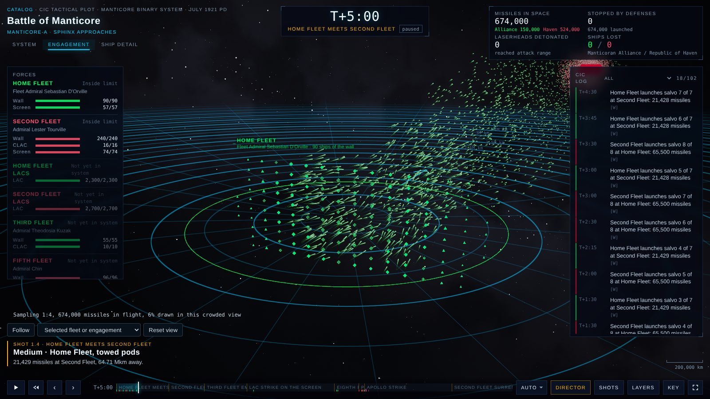
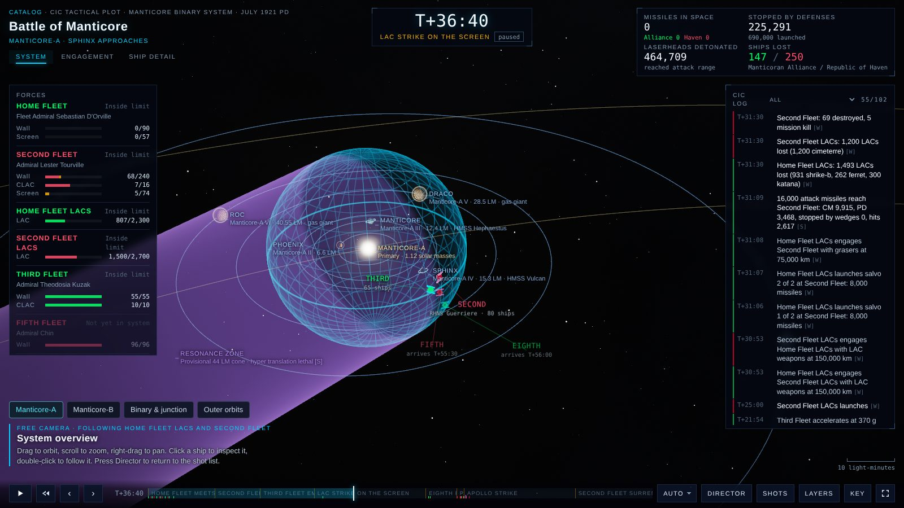
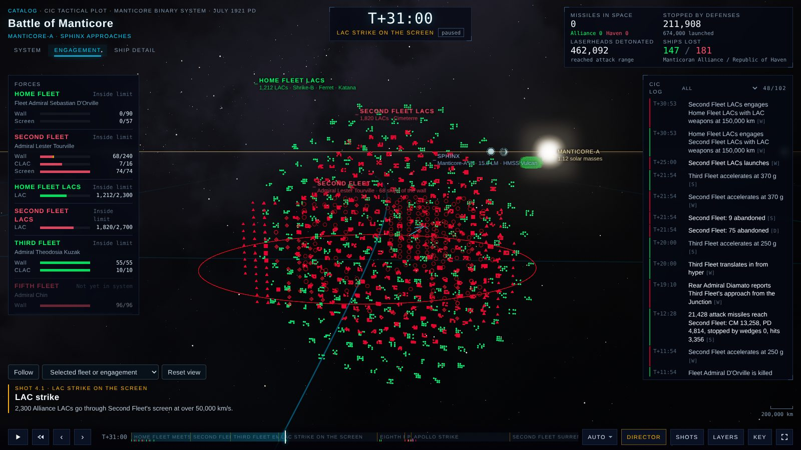
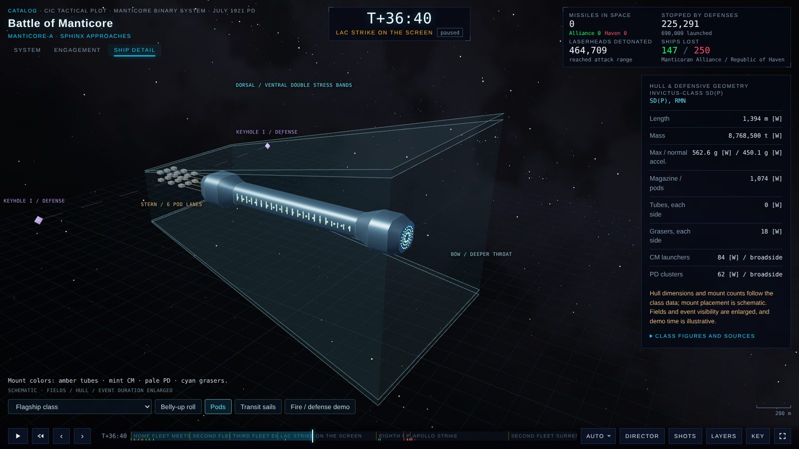
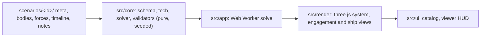

<h1 align="center">honor-cic</h1>

<p align="center"><b>Replay the Honorverse's great fleet actions from the combat information centre.</b><br>
Hundreds of thousands of missiles, thousands of LACs and every wall of battle, on a 3D tactical plot where each number carries its evidence label.</p>

<p align="center">
  <a href="https://honor-cic.pages.dev"><b>▶ Launch the viewer</b></a> ·
  <a href="https://honor-cic.pages.dev/#/battle/manticore">Battle of Manticore</a> ·
  <a href="https://honor-cic.pages.dev/#/battle/basilisk">First Battle of Basilisk</a> ·
  <a href="https://ra100.github.io/honor-cic/">GitHub Pages mirror</a>
</p>

<p align="center">
  <a href="https://honor-cic.pages.dev/#/battle/manticore"></a>
</p>

<table>
  <tr>
    <td width="33%"></td>
    <td width="33%"></td>
    <td width="33%"></td>
  </tr>
  <tr>
    <td align="center"><sub><b>System</b>: the binary, the hyper limit and the Junction</sub></td>
    <td align="center"><sub><b>Engagement</b>: 2,300 LACs go through the screen</sub></td>
    <td align="center"><sub><b>Ship detail</b>: an <i>Invictus</i> inside its wedge</sub></td>
  </tr>
</table>

Honorverse fleet-action reconstructions, plus a non-canon Training example. Every number in the app carries its evidence label.

The look and controls follow two earlier visualizers of the Battle of Manticore: the cinematic plot of [Site A](https://battle-of-manticore.muddy-glade-edee.workers.dev) and the System / Engagement / Ship detail structure of [Site B](https://battle-of-manticore.ra100x.chatgpt.site). `DESIGN.md` records how.

- **System.** The star system as Site A draws it: the filmic star, the hyper-limit globe, orbits, the binary, the Junction and its resonance zone, with Site B's lit planets, fleet callouts and camera presets (Manticore-A, Manticore-B, Binary & junction, Outer orbits).
- **Engagement.** Range rings centred on your side's fleet, or on your force that the camera follows, the hyper-limit arc, fleets and LAC wings in their 3D formations at one scale (every LAC a dot in its squadron of twelve) with rings and velocity arrows, and every missile packet as streaks fired from the launching ships and landing on the target fleet, with laserheads, beams, defensive kills, ship losses and Apollo telemetry from the replay. Missile density runs from 1:1 to 1:16, and the readout says what is drawn.
- **Ship detail.** Each class hull at true scale inside Site B's wedge: double stress bands, sidewalls, Keyhole platforms, pods on tethers, transit sails and the fire / defense demo, with the class figures and their sources beside it.
- **Director or free camera.** Each battle pack scripts its own shots, and the director adds captioned shots for every launch, flight, impact and close-range pass. Drag the plot to take the camera and press `D` to give it back. **Follow** (`G`) keeps your angle and distance while the view moves with a force: pick a fleet or LAC group in the Follow list, step through them with `N`, click a name in Forces, or double-click a ship.
- **Actual or perceived.** Ground truth, or one commander's delayed sensor picture with contact ages and uncertainty rings.
- **CIC console.** The battle clock and phase, tallies of missiles in space, stopped, detonated and ships lost, Forces with per-role strength bars, the CIC log, a ship inspector, a scale bar and an after-action debrief when the replay ends.
- **Idle when paused.** A paused plot redraws only after input, a resize or a camera move; replay, demos and camera easing animate.

## Quick start

```bash
npm install
npm run dev        # http://localhost:5173
```

| Script | What it does |
|---|---|
| `npm run dev` | Development server |
| `npm test` | Unit tests (Vitest) |
| `npm run typecheck` | TypeScript, no emit |
| `npm run validate` | Static and replay checks for every scenario pack |
| `npm run calibrate -- <id>` | Tunes a pack's S-labelled defense inputs toward its canon interception share |
| `npm run e2e` | Playwright on desktop and phone, WebGL through SwiftShader |
| `npm run build` | Production build into `dist/` |
| `npm run deploy` | Build and deploy to Cloudflare Pages |

## How it is built



- `src/core` never touches the DOM or three.js and never calls `Math.random`; `tests/architecture.test.ts` enforces this. Given a pack, the solver produces the same replay every time. Scrubbing samples that replay at the exact requested time. Engagement keeps every fleet's formation in 3D, so orbiting turns it rather than reshaping it, and draws every formation and LAC wing four times life size about its true centre at every zoom (less only where that would run into another fleet), so sizes compare and zooming brings a force closer; the readout captions this [S]. Each sampled missile leaves a ship or LAC of its group, flies its packet's solved path and comes down on a ship of the target fleet. None of this changes positions, counts, ranges, timing or picking identities.
- Ship and missile figures come from the project's technical reference, `docs/honorverse-master-technical-specification.md` (cited in code as `MTS §n`).
- The catalog loads without the plot renderer. Entering a battle loads the viewer, then computes the replay in a worker. Leaving the route cancels solving and disposes its controls, observers and rendering schedule; stale load or solve results cannot mount.
- Director + Auto uses event-focused cinematic pacing. Manual speeds and Free + Auto keep their existing behavior.

## Controls

| Input | Action |
|---|---|
| Drag, scroll, right-drag | Orbit, zoom, pan (takes the free camera) |
| Click / double-click a ship | Inspect it / follow its force |
| `Space` | Play or pause |
| `←` `→` (with `Shift`) | Step 1 s (60 s) |
| `[` `]` | Previous or next phase |
| `+` `−` | Faster or slower |
| `1` `2` `3` | System, Engagement, Ship detail |
| `D` / `F` / `G` | Director / free camera / Follow on or off |
| `N` (with `Shift`) | Follow the next (previous) fleet or LAC group |
| `P` | Actual or perceived picture |
| `?` / `Esc` | Key / close menus and the debrief |

Shots, Layers and Key open from the transport bar. Below 860 px wide, Forces, the log and the ship's class data open as sheets from the toggles under the top bar, and below 520 px the scrubber gets its own row.

## Evidence policy

| Label | Meaning |
|---|---|
| P | Primary: novel or author statement |
| W | Wiki or reference work |
| D | Derived by calculation from sourced inputs |
| S | Speculative: reconstruction or provisional value |

- An unknown value is `null` and shows as "unknown". It is never zero.
- Every S value needs an `uncertainty` note explaining the assumption.
- The solver never forces a canon outcome it cannot reach. A canon arrival that needs more than the missile profile allows fails validation instead of breaking physics.

## Adding a scenario

1. Copy `scenarios/training/` to `scenarios/<id>/` and set `meta.json` `id` to `<id>`.
2. Fill in the files:

   | File | Holds |
   |---|---|
   | `meta.json` | Title, date, sides and colours, frame, phases, theaters, director shots, sources |
   | `bodies.json` | Stars, planets, termini, with hyper limits, exclusions and resonance zones |
   | `forces.json` | Fleets and LAC groups: classes, counts, formation, state anchor, presence |
   | `timeline.json` | Fire plans, beam attacks, ranges, rolls, escapes, canon outcomes |
   | `notes.md` | Reconstruction choices and caveats, shown in the viewer's Notes dialog |

3. Run `npm run validate`. Fix the data until there are no errors. Warnings explain S choices.
4. If the battle states an interception share, run `npm run calibrate -- <id>` and record every changed value in `notes.md`.
5. Run `npm run dev` and open `http://localhost:5173/#/battle/<id>`. The catalog lists the pack automatically.

Pick side colours that stay readable as text on the near-black plot (`#020208`); the Manticore pack uses `#00ff66` and `#ff0033`.

## Deploy

Every push to `main` publishes the site twice:

| Where | Workflow |
|---|---|
| [honor-cic.pages.dev](https://honor-cic.pages.dev) | `.github/workflows/deploy.yml` (Cloudflare Pages) |
| [ra100.github.io/honor-cic](https://ra100.github.io/honor-cic/) | `.github/workflows/pages.yml` (GitHub Pages) |

The build uses relative asset paths and hash routes, so the same `dist/` works at a domain root and under `/honor-cic/`. GitHub Pages needs **Settings → Pages → Source: GitHub Actions** once. It ignores `public/_headers`, so the content security policy and immutable asset caching apply on Cloudflare only.

Cloudflare Pages by hand, project `honor-cic`:

```bash
npx wrangler login   # once per machine
npm run deploy
```

From GitHub Actions instead (no local Cloudflare login): add the repository secrets `CLOUDFLARE_API_TOKEN` (permission Account, Cloudflare Pages, Edit) and `CLOUDFLARE_ACCOUNT_ID`. Every push to `main` then deploys through `.github/workflows/deploy.yml`, or run it by hand from the Actions tab.

Locally behind a TLS-intercepting proxy, point Node at the proxy's root certificate with `NODE_EXTRA_CA_CERTS` and use the same two variables instead of `wrangler login`.

`public/_headers` sets the content security policy and asset caching.

## Fan project

The Honorverse belongs to David Weber. This is a non-commercial fan tool. It reproduces no text from the novels beyond short factual citations, and it links to its sources.
