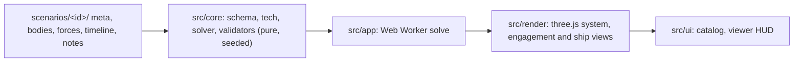

# honor-cic Battle Viewer Implementation Plan

> **For agentic workers:** REQUIRED SUB-SKILL: Use superpowers:subagent-driven-development (recommended) or superpowers:executing-plans to implement this plan task-by-task. Steps use checkbox (`- [ ]`) syntax for tracking.

**Goal:** Build a static, scenario-driven web app that catalogs Honorverse battles and replays each one deterministically. The first release ships the Battle of Manticore, corrected against the MTS, plus a stub training scenario.

**Architecture:** A layered single Vite app:
- `src/core` is pure TypeScript with no DOM and no three.js. It covers units, evidence, schema, tech presets, the solver, the replay, sensors and validators.
- `src/render` holds the three.js scale views, layers, effects and director camera.
- `src/ui` holds the vanilla-TS catalog, viewer, panels, menus and timeline.

Scenarios are data packs in `scenarios/<id>/`. Each pack is parsed and statically validated. It is then solved once into a `Replay` (in a Web Worker), validated again, and sampled by the renderer with `sampleFrame(replay, t)`.

**Tech Stack:** TypeScript 5.6 (strict), Vite 5, three.js 0.169 (EffectComposer + UnrealBloomPass), zod 3, Vitest 2, Playwright 1.48, Cloudflare Pages (`wrangler pages deploy`).

**Spec:** `docs/superpowers/specs/2026-10-07-honviz-battle-viewer-design.md` (the design). It cites the Master Technical Specification, `honorverse-master-technical-specification.md`, as "MTS". Section numbers below (e.g. MTS §5.3) refer to the MTS. Executors read the design spec first. Task 6 copies the MTS into `docs/honorverse-master-technical-specification.md`.

## Global Constraints

- Node ≥ 20 and npm. Runtime dependencies are only `three` and `zod`. Dev dependencies are only `typescript`, `vite`, `vitest`, `vite-node`, `@playwright/test`, `@types/three` and `@types/node`. Do not add a UI framework, a CSS framework, a state library or a physics engine.
- UI and render work follows `DESIGN.md` (direction transcribed from Site A) and antislop in **during** mode. `AGENTS.md` points to the skills.
  - Use only the palette tokens, fonts, reflow states, UI states and copy rules in `DESIGN.md`.
  - UI text contains no em dash character.
  - Text meets WCAG AA: 4.5:1 for normal text and 3:1 for large text.
  - Touch targets are at least 44×44px under `(pointer: coarse)`.
  - Every control works by keyboard and has a visible `:focus-visible` ring in `--wedge`.
  - No idle animation loops.
  - Task 20 ends with the antislop Delivery Gate report.
- Internal units are km, s, t (tonnes) and km/s². Use `C_KM_S = 299_792.458`, `G0_KM_S2 = 0.00980665` and `LM_KM = 17_987_547.48`. Convert to LM, Mkm or g only for display, or when parsing authored values through `baseValue()`.
- Every sourced number is a `SourceValue` with fields `{ value, unit, evidence: 'P'|'W'|'D'|'S', source_id, locator?, era?, uncertainty?, status? }`. An unknown value is `null`, never `0`. The UI renders `null` as `unknown`. An S value is always shown as speculative and never as canon.
- `src/core/**` must not import from `src/render`, `src/ui`, `three` or any DOM API. This is enforced by `tests/architecture.test.ts`.
- A scenario is data only, under `scenarios/<id>/`. Code that a scenario needs goes in `src/core/tech` or `src/core/solver`.
- Replays are deterministic: the same pack gives the same `replay.hash`. All randomness comes from `rngFor(...)` seeded by event `seed` fields. `Math.random` is banned in `src/core`, and an architecture test greps for it.
- Never force a missile arrival. If an intercept cannot be solved within the profile limits, the packet is marked `infeasible`, and validation fails when a canon arrival window exists. Every vehicle's speed must stay below c (validator `flight`).
- Apollo counting (MTS §4.3, §10.2) works as follows:
  - Each Apollo pod holds 8 attack/EW vehicles plus 1 controller.
  - 7,776 pods give 62,208 attack/EW vehicles and 7,776 controllers.
  - Headline missile counts exclude controllers. "Damaging warheads" counts only attack vehicles.
- Ship broadsides are per side (MTS §5):
  - Nike BC: 25 M and 12 G per broadside at 674.3 g.
  - Saganami-C: 20 M per broadside.
  - Invictus: no broadside missile tubes, 1,074 pods.
  - Keyhole II is fitted per ship, never per class.
- The title is "Battle of Manticore", never "Eighth Battle of Manticore" (MTS §10.1).
- Performance: the Manticore solve stays under 2 s on a mid-range laptop (spec §10; `npm run validate` prints the time). The renderer draws at most 250,000 missile dots.
- Commit after each task, with conventional-commit messages and no `Co-authored-by` trailer. Author: `ra100 <git@ra100.net>` (already in the local git config). The remote is `https://github.com/ra100/honor-cic.git`.
- The shell is fish. Commands in this plan are POSIX-compatible single commands; run multi-step snippets with `bash -c '…'` if fish complains.

## Review Focus

These are the most likely real-world failures that the spec implies but does not test. Each line has a pinning test in the task named.

1. **Arbitrary scrubbing.** Expected: jumping backwards, past the end, or to a negative `t` gives exactly the same frame as sampling that `t` fresh, and nothing throws or carries stale state. Test in Task 13: `sampleFrame` is idempotent and order-independent, and `t` is clamped.
2. **Broken or incomplete scenario pack.** Expected: the catalog still renders. The card is marked "Pack failed validation" with its first three errors, and opening the viewer shows "This replay could not be computed" with the error list instead of a blank canvas. Tests: Task 3 (`parsePack` reports path-qualified errors) and Task 18 (catalog error card).
3. **High playback speed (240×) skipping many events per frame.** Expected: every CIC log entry between two frames still appears, in order, and no entry is lost. Test in Task 13: `logBetween(prevT, t)` is half-open and exhaustive.
4. **Density 1:1 on about 740k real missiles.** Expected: the renderer stays responsive by capping the dots it draws. The UI shows the effective ratio (e.g. "Sampling 1:2 (capped from 1:1), 740,000 missiles in flight"), and totals stay true counts. Tests: Task 15 (`planDensity` caps the dot count and reports the effective ratio) and Task 16 (the engagement view reports the sampling text).
5. **Perceived view before light arrives, or for a side with no sensors on an object.** Expected: no contact is drawn, and no ground-truth position leaks into the perceived picture. Tests: Task 12 (`perceivedContacts` returns no contact before the signal arrives, and contacts carry stale positions) and Task 16 (the engagement view draws no ground truth in perceived mode and disables picking).

---

## File Structure

```
package.json, tsconfig.json, vite.config.ts, playwright.config.ts, index.html, README.md
public/_headers                      # Cloudflare Pages caching headers
.github/workflows/ci.yml             # typecheck, unit, validate, build, e2e
docs/honorverse-master-technical-specification.md   # the MTS, copied in Task 6
scripts/validate.ts                  # `npm run validate`: static and replay checks for every pack, with solve time
scripts/calibrate.ts                 # `npm run calibrate -- <id>`: tune S defense inputs toward canon shares
scenarios/
  manticore/ meta.json bodies.json forces.json timeline.json notes.md
  training/  meta.json bodies.json forces.json timeline.json notes.md
src/
  main.ts                            # boot: router → catalog | viewer
  registry.ts                        # import.meta.glob over scenarios/* → parsed packs + catalog entries
  core/
    vec.ts units.ts evidence.ts rng.ts
    schema.ts                        # zod schemas + inferred types + parsePack()
    tech/ types.ts sv-helpers.ts missiles.ts classes.ts index.ts   # TECH registry, capOf(), podArithmetic()
    sensors.ts                       # light/grav delay, perceived contacts, latency
    perceived.ts                     # replay → trackables → commander picture
    solver/
      types.ts runtime.ts            # shared enums and runtime records
      orbits.ts                      # bodyPosition, orbitPolyline, hyper-limit queries
      kinematics.ts                  # KinSegment, segmentState, buildUnitTracks
      formation.ts                   # formation offsets with wedge clearance
      timeref.ts                     # TimeRef resolution (event-relative times)
      intercept.ts                   # burn schedule + intercept solve
      packets.ts                     # fire_plan → salvos → PacketTrack[]
      geometry.ts                    # wedge/sidewall/throat/kilt aspect classification
      defense.ts                     # channel-based CM/PD resolution per arrival window
      damage.ts                      # subsystem damage + canon outcome reconciliation
      beams.ts                       # beam_attack events → BeamEvent + hits
      log.ts                         # CIC log generation
      solve.ts                       # orchestration → Replay
    replay.ts                        # Replay types, samplers, sampleFrame, logBetween, hashing
    validate/ types.ts forces.ts index.ts checks-static.ts checks-replay.ts
    worker/ protocol.ts             # pure solve protocol, testable in Node
  app/
    solve.worker.ts solve-client.ts   # worker entry and client; depend on the registry
  render/
    engine.ts                        # WebGLRenderer + EffectComposer + bloom, resize, dispose
    origin.ts                        # floating-origin conversion km → render units
    density.ts                       # planDensity, packetSpreadKm, DotCache (pure)
    palette.ts                       # DESIGN.md colours, status and drive-phase brightness
    points.ts lines.ts labels.ts     # sprite clouds, line batches, projected HTML labels
    director.ts                      # shots, director poses and the easing camera rig
    scales/ types.ts system-view.ts engagement-view.ts ship-view.ts
  ui/
    dom.ts store.ts router.ts format.ts catalog.ts styles.css
    viewer/ model.ts panels.ts hud.ts viewer.ts
tests/
  architecture.test.ts
  core/*.test.ts  solver/*.test.ts  validate/*.test.ts  render/*.test.ts  ui/*.test.ts
  scenarios.test.ts                  # every pack: zero errors
  fixtures/mini-pack.ts              # tiny valid pack builder used by many tests
e2e/helpers.ts catalog.spec.ts viewer.spec.ts
```

## Shared Interface Sheet

Every task's **Interfaces** block repeats the names it uses from this sheet. If a task needs to change a name here, it changes it everywhere.

```ts
// core/vec.ts
type Vec3 = [number, number, number];
add, sub, scale, addScaled(a,b,s), dot, cross, len, dist, norm, rotateAbout(v, axis, rad)

// core/units.ts
C_KM_S, G0_KM_S2, LS_KM, LM_KM, LH_KM, AU_KM, MKM_KM, T_YEAR_S
type Unit = 'km'|'Mkm'|'LM'|'m'|'km/s'|'km/s2'|'g'|'s'|'min'|'t'|'deg'|'count'|'c'|'Msun'|'PD-date'|'text'|'ratio'
gToKmS2, kmS2ToG, lmToKm, kmToLm, mkmToKm, kmToMkm, toFractionC, fmtDistance(km), fmtDuration(s), fmtCount(n)

// core/evidence.ts
type EvidenceLabel = 'P'|'W'|'D'|'S'
interface SourceValue<T> { value: T|null; unit: Unit; evidence: EvidenceLabel; source_id: string; locator?; era?; uncertainty?; status?: 'verified'|'unverified'|'conflict' }
sv(value, unit, evidence, source_id, extra?) ; known(v) ; need(v, ctx) ; baseValue(v) ; formatSourceValue(v) ; formatLabelled(v) ; EVIDENCE_TEXT ; evidenceScore(labels[])

// core/rng.ts
type Rng = () => number ; mulberry32(seed) ; hashSeed(...parts) ; rngFor(...parts) ; binomial(rng,n,p) ; shuffleInPlace(rng, arr)

// core/schema.ts  (zod-inferred)
ScenarioMeta, CelestialBody, ShipEntry, UnitDef (fleet | lac group), TimelineEvent (union), ScenarioPack { meta, bodies, units, events, notes }
type TimeRef = number | { ref: string; anchor: 'launch'|'arrival'|'last_arrival'|'t'; offset_s: number }
parsePack(raw: RawPack): { ok: true; pack: ScenarioPack } | { ok: false; errors: string[] }

// core/tech
ShipClass, Mounts, MissileProfile, PodLoad, Equipment, TechRegistry, TECH
capOf(cls, entry, path) ; wholeShipTotal(cls, mount) ; podArithmetic(pods, load) ; shipEquipment(cls, entry) ; allSourceValues(obj)

// core/replay.ts (re-exports solver/types.ts)
enum ShipStatus { Operational=0, Degraded=1, MissionKill=2, Destroyed=3, Escaped=4, Captured=5, Absent=6 } ; STATUS_TEXT
enum DrivePhase { Boost=0, Coast=1, Terminal=2, Gone=3 }
type Subsystem = 'drive_fore'|'drive_aft'|'wall_port'|'wall_stbd'|'launchers'|'energy'|'defense'|'sensors'|'hull' ; SUBSYSTEMS ; SUBSYSTEM_TEXT
interface KinSegment { t0; t1; p0: Vec3; v0: Vec3; a: Vec3 }
interface UnitTrack { id; idx; name; kind: 'fleet'|'lac'; side; theater; segments; facing: Vec3; up: Vec3; rolls: Roll[]; tAppear; tDepart; appearVia; departVia; shipIdx: number[]; lacClasses: Record<string,number>; lacCount: {t;count}[] }
interface ShipTrack { idx; unit; classId; name; nameEvidence; side; role; slot: Vec3; flagship; equipment: string[]; readiness; status: {t;status;cause}[]; subsystems: {t;sub;value}[]; damageTaken; hitCount }
interface PacketTrack { idx; id; side; engagement; salvoId; planId; profileId; fromUnit; toUnit; targetShip; guidance; tLaunch; tArrive; segments; phases: {t0;phase}[]; launched: Counts; survivors: {t;attack;ew;controller}[]; maxSpeed; infeasible; seed }
interface Counts { attack: number; ew: number; controller: number }
interface BeamEvent { t; dur; kind: 'laserhead'|'graser'|'laser'|'cm-kill'|'pd-kill'|'transit'; from: Vec3; to: Vec3; side; aspect: Aspect|null; ship: number }
interface LogEntry { t; side: string|null; kind; text; evidence: EvidenceLabel; source_id; ref?: string }
interface Replay { scenarioId; duration_s; sides; units; ships; packets; beams; log; stats; diagnostics: Issue[]; resolvedTimes: Record<string,number>; hash }
clampT(r,t) ; unitPosition(u,t,out?) ; unitVelocity(u,t) ; unitPresent(u,t) ; shipStatusAt(r,s,t) ; subsystemsAt(s,t) ; shipPositionAt(r,s,t,out?)
packetPositionAt(p,t,out?) ; packetAliveAt(p,t): Counts ; packetPhaseAt(p,t) ; lacCountAt(u,t)
interface Frame { t; shipPos: Float64Array; shipStatus: Uint8Array; unitPos: Float64Array; unitCount: Uint32Array; packetPos: Float64Array; packetAlive: Uint32Array; packetPhase: Uint8Array }
createFrame(r) ; sampleFrame(r, t, reuse?) ; logBetween(r, t0, t1) ; logUntil(r, t) ; computeHash(r)

// core/solver
type Aspect = 'wedge'|'sidewall'|'throat'|'kilt'
indexBodies(bodies) ; bodyPosition(index, id, t) ; orbitPolyline(index, id, t, n?) ; exclusionsAt(index, t) ; insideExclusion(index, p, t)
segmentState(segs, t, outP?, outV?) ; buildUnitTracks(pack, bodies, times, span) ; basis(facing, up) ; formationOffsets(kind, n, spacingKm, rng) ; toSystem(basis, local)
burnPlanOf(profile) ; burnDisplacement(plan, T) ; planIntercept(input): InterceptPlan ; expandFirePlans(plans, tech, times, ctx) ; arrivalAnchors(packets)
orientationAt(facing, up, rolls, t): Basis ; classifyAspect(o, incoming, dims, standoffKm?) ; ASPECT_FACTOR ; endwallFactor(wall) ; launchBlocked(o, dir, dims)
resolveArrivals(ctx) ; resolveBeamAttacks(events, ctx) ; applyHit(ship, t, dmg, aspect, rng) ; applyEscapes(outcomes, ctx) ; reconcileOutcomes(outcomes, ctx)
solve(pack, tech = TECH, onProgress?): Replay

// core/sensors.ts and core/perceived.ts
propagationDelay(km, sensor, ftlC) ; observationTime(...) ; perceivedContacts(observerPos, objects: Trackable[], t, ftlC): Contact[]
replayTrackables(replay, theater) ; observerUnit(replay, side, theater, t) ; commanderPicture(replay, tracks, side, theater, t, ftlC)

// core/validate
type CheckId = 'units'|'frames'|'projection'|'epoch'|'weapons'|'inventory'|'guidance'|'latency'|'flight'|'geometry'|'escape'|'era'|'canon'
interface Issue { check: CheckId; severity: 'error'|'warn'|'info'; message: string; path?: string }
validateStatic(pack, tech) ; validateReplay(pack, tech, replay) ; hasErrors(issues) ; formatIssues(issues)

// render
planDensity(alive: Uint32Array, ratio, cap?) → { ratio, effectiveRatio, dots, total, perPacket }
type ScaleId = 'system'|'engagement'|'ship' ; type LayerId = 'celestial'|'truth'|'commander'|'engagement'|'protection'|'comms'|'damage'
interface ViewContext { replay; pack; tech; frame; layers; perceived: { enabled; side }; density; theater; selectedShip; selectedClass; reducedMotion }
interface ScaleView { id; scene; camera; controls; update(ctx); setPose(eyeKm, targetKm); labels(); pick(ndcX, ndcY): number|null; status(): { samplingText; scaleNote; notice }; dispose() }
new SystemView | EngagementView | ShipView(pack, replay, dom: HTMLElement | null)
shotsFor(pack, replay): DirectorShot[] ; shotAt(shots, t) ; directorPose(shot, replay, frame, reducedMotion): DirectorPose ; class CameraRig { eye; target; follow(pose, dt, snap) }

// ui
interface ViewerState { t; playing; speed: number|'auto'; scale; camera: 'director'|'free'; theater; layers; perceived; density; selectedShip; selectedClass; logSide; demo; demoProgress; reducedMotion; drawer; menu }
createStore(initial): Store<T> { get(); set(patch | fn); subscribe(fn) } ; parseRoute(hash) ; mountViewer(root, id): () => void
```


---

### Task 1: Scaffold the Vite + TypeScript + Vitest + Playwright app

**Files:**
- Create: `package.json`, `tsconfig.json`, `vite.config.ts`, `playwright.config.ts`, `index.html`, `src/main.ts`, `tests/architecture.test.ts`
- Modify: `.gitignore` (already contains `node_modules/`, `dist/`, `test-results/`, `playwright-report/`, `coverage/`, `.wrangler/`)

**Interfaces:**
- Consumes: nothing.
- Produces:
  - The npm scripts used by every later task: `dev`, `build`, `preview`, `typecheck`, `test`, `validate`, `calibrate`, `e2e` and `deploy`.
  - The architecture guard test that later tasks must keep green.

- [ ] **Step 1: Install dependencies**

```bash
npm init -y
npm install three@^0.169.0 zod@^3.23.8
npm install -D typescript@^5.6.0 vite@^5.4.0 vitest@^2.1.0 vite-node@^2.1.0 @playwright/test@^1.48.0 @types/three@^0.169.0 @types/node@^22.7.0
npx playwright install chromium
```

- [ ] **Step 2: Replace `package.json` with**

```json
{
  "name": "honor-cic",
  "private": true,
  "version": "0.1.0",
  "type": "module",
  "description": "Honorverse battle viewer: replay and explore canon battles",
  "license": "MIT",
  "engines": { "node": ">=20" },
  "scripts": {
    "dev": "vite",
    "build": "tsc --noEmit && vite build",
    "preview": "vite preview --port 4173 --strictPort",
    "typecheck": "tsc --noEmit",
    "test": "vitest run",
    "test:watch": "vitest",
    "validate": "vite-node scripts/validate.ts",
    "calibrate": "vite-node scripts/calibrate.ts --",
    "e2e": "playwright test",
    "deploy": "npm run build && npx wrangler pages deploy dist --project-name honor-cic"
  },
  "dependencies": { "three": "^0.169.0", "zod": "^3.23.8" },
  "devDependencies": {
    "@playwright/test": "^1.48.0",
    "@types/node": "^22.7.0",
    "@types/three": "^0.169.0",
    "typescript": "^5.6.0",
    "vite": "^5.4.0",
    "vite-node": "^2.1.0",
    "vitest": "^2.1.0"
  }
}
```

After editing, run `npm install` once so the lockfile matches.

- [ ] **Step 3: Create `tsconfig.json`**

```json
{
  "compilerOptions": {
    "target": "ES2022",
    "module": "ESNext",
    "moduleResolution": "Bundler",
    "lib": ["ES2022", "DOM", "DOM.Iterable"],
    "strict": true,
    "noFallthroughCasesInSwitch": true,
    "noImplicitOverride": true,
    "resolveJsonModule": true,
    "isolatedModules": true,
    "skipLibCheck": true,
    "noEmit": true,
    "types": ["vite/client", "node"]
  },
  "include": ["src", "tests", "scripts", "e2e", "vite.config.ts", "playwright.config.ts"]
}
```

The `WebWorker` lib is deliberately absent because it conflicts with `DOM`. The worker in Task 14 casts `self` instead.

- [ ] **Step 4: Create `vite.config.ts`**

```ts
import { defineConfig } from 'vitest/config';

export default defineConfig({
  base: './',
  build: { target: 'es2022', sourcemap: true, chunkSizeWarningLimit: 1500 },
  worker: { format: 'es' },
  test: { include: ['tests/**/*.test.ts'], environment: 'node', testTimeout: 30_000 },
});
```

- [ ] **Step 5: Create `playwright.config.ts`**

```ts
import { defineConfig, devices } from '@playwright/test';

export default defineConfig({
  testDir: 'e2e',
  timeout: 120_000,
  retries: process.env.CI ? 1 : 0,
  use: { baseURL: 'http://localhost:4173', trace: 'retain-on-failure' },
  webServer: {
    command: 'npm run build && npm run preview',
    url: 'http://localhost:4173',
    reuseExistingServer: !process.env.CI,
    timeout: 240_000,
  },
  projects: [
    {
      name: 'desktop',
      use: {
        ...devices['Desktop Chrome'],
        launchOptions: { args: ['--use-gl=angle', '--use-angle=swiftshader', '--enable-unsafe-swiftshader', '--ignore-gpu-blocklist'] },
      },
    },
    {
      name: 'phone',
      use: {
        ...devices['Pixel 7'],
        launchOptions: { args: ['--use-gl=angle', '--use-angle=swiftshader', '--enable-unsafe-swiftshader', '--ignore-gpu-blocklist'] },
      },
    },
  ],
});
```

- [ ] **Step 6: Create `index.html`**

The page title uses a colon, not an em dash (R-02).

```html
<!doctype html>
<html lang="en">
  <head>
    <meta charset="utf-8" />
    <meta name="viewport" content="width=device-width, initial-scale=1, viewport-fit=cover" />
    <meta name="description" content="Replay and explore Honorverse fleet battles, with every number tagged by its source." />
    <title>honor-cic: Honorverse battle replays</title>
    <link rel="preconnect" href="https://fonts.googleapis.com" />
    <link rel="preconnect" href="https://fonts.gstatic.com" crossorigin />
    <link
      rel="stylesheet"
      href="https://fonts.googleapis.com/css2?family=Chakra+Petch:wght@500;600&family=IBM+Plex+Mono:wght@400;500&family=IBM+Plex+Sans+Condensed:wght@400;500;600&display=swap"
    />
  </head>
  <body>
    <div id="app"></div>
    <script type="module" src="/src/main.ts"></script>
  </body>
</html>
```

- [ ] **Step 7: Create a placeholder `src/main.ts`**

Task 18 replaces this file.

```ts
const root = document.querySelector<HTMLDivElement>('#app');
if (root) root.textContent = 'honor-cic';
```

- [ ] **Step 8: Write the architecture guard `tests/architecture.test.ts`**

```ts
import { describe, expect, it } from 'vitest';
import { existsSync, readdirSync, readFileSync, statSync } from 'node:fs';
import { join } from 'node:path';

function walk(dir: string): string[] {
  if (!existsSync(dir)) return [];
  return readdirSync(dir).flatMap((name) => {
    const p = join(dir, name);
    return statSync(p).isDirectory() ? walk(p) : p.endsWith('.ts') ? [p] : [];
  });
}

const core = walk('src/core');

describe('architecture', () => {
  it('keeps src/core free of render, ui, three and DOM access', () => {
    const banned = /from ['"](\.\.\/)+(render|ui)\/|from ['"]three|\bdocument\.|\bwindow\./;
    expect(core.filter((f) => banned.test(readFileSync(f, 'utf8')))).toEqual([]);
  });

  it('keeps src/core deterministic (no Math.random)', () => {
    expect(core.filter((f) => /Math\.random/.test(readFileSync(f, 'utf8')))).toEqual([]);
  });
});
```

- [ ] **Step 9: Run the guard**

Run: `npx vitest run tests/architecture.test.ts`
Expected: PASS with 2 tests. It passes vacuously because `src/core` is empty. Task 2 Step 1 adds a "core exists" assertion that makes the guard meaningful.

- [ ] **Step 10: Confirm the toolchain builds**

Run: `npm run typecheck && npx vite build`
Expected: both succeed and `dist/index.html` exists.

- [ ] **Step 11: Commit**

```bash
git add package.json package-lock.json tsconfig.json vite.config.ts playwright.config.ts index.html src/main.ts tests/architecture.test.ts .gitignore
git commit -m "chore: scaffold vite, typescript, vitest and playwright"
```


---

### Task 2: Core primitives (vectors, units, evidence, seeded RNG)

**Files:**
- Create: `src/core/vec.ts`, `src/core/units.ts`, `src/core/evidence.ts`, `src/core/rng.ts`
- Test: `tests/core/primitives.test.ts`
- Modify: `tests/architecture.test.ts` (add the non-empty assertion)

**Interfaces:**
- Consumes: nothing.
- Produces (exact names; later tasks import these):
  - `vec.ts`: `type Vec3 = [number, number, number]`, `add`, `sub`, `scale`, `addScaled(a, b, s)`, `dot`, `cross`, `len`, `dist`, `norm`, `rotateAbout(v, axis, rad)`.
  - `units.ts`: `C_KM_S`, `G0_KM_S2`, `LS_KM`, `LM_KM`, `LH_KM`, `AU_KM`, `MKM_KM`, `T_YEAR_S`, `type Unit`, `baseFactor(unit)`, `gToKmS2`, `kmS2ToG`, `lmToKm`, `kmToLm`, `mkmToKm`, `kmToMkm`, `toFractionC`, `fmtDistance(km)`, `fmtDuration(s)`, `fmtCount(n)`.
  - `evidence.ts`: `type EvidenceLabel`, `type VerificationStatus`, `interface SourceValue<T>`, `sv`, `known`, `need`, `needBase`, `baseValue`, `MissingValueError`, `EVIDENCE_TEXT`, `formatSourceValue`, `formatLabelled`, `evidenceScore`.
  - `rng.ts`: `type Rng`, `mulberry32`, `hashSeed`, `rngFor`, `binomial`, `shuffleInPlace`.

- [ ] **Step 1: Make the architecture guard non-vacuous**

In `tests/architecture.test.ts`, add this as the first test inside the `describe`:

```ts
  it('has the core layer', () => {
    expect(core.length).toBeGreaterThan(0);
  });
```

- [ ] **Step 2: Write the failing tests `tests/core/primitives.test.ts`**

```ts
import { describe, expect, it } from 'vitest';
import { add, cross, dist, dot, len, norm, rotateAbout, scale, sub } from '../../src/core/vec';
import {
  C_KM_S, G0_KM_S2, LM_KM, MKM_KM, baseFactor, fmtCount, fmtDistance, fmtDuration,
  gToKmS2, kmS2ToG, kmToLm, lmToKm, toFractionC,
} from '../../src/core/units';
import { EVIDENCE_TEXT, MissingValueError, baseValue, evidenceScore, formatLabelled, formatSourceValue, known, need, sv } from '../../src/core/evidence';
import { binomial, hashSeed, mulberry32, rngFor, shuffleInPlace } from '../../src/core/rng';

describe('vec', () => {
  it('does basic algebra', () => {
    expect(add([1, 2, 3], [1, 1, 1])).toEqual([2, 3, 4]);
    expect(sub([1, 2, 3], [1, 1, 1])).toEqual([0, 1, 2]);
    expect(scale([1, 2, 3], 2)).toEqual([2, 4, 6]);
    expect(dot([1, 0, 0], [0, 1, 0])).toBe(0);
    expect(cross([1, 0, 0], [0, 1, 0])).toEqual([0, 0, 1]);
    expect(len([3, 4, 0])).toBe(5);
    expect(dist([0, 0, 0], [0, 0, 2])).toBe(2);
    expect(norm([0, 0, 0])).toEqual([0, 0, 0]);
  });
  it('rotates about an axis', () => {
    const r = rotateAbout([1, 0, 0], [0, 0, 1], Math.PI / 2);
    expect(r[0]).toBeCloseTo(0, 12);
    expect(r[1]).toBeCloseTo(1, 12);
  });
});

describe('units (MTS §1.2)', () => {
  it('uses the MTS constants', () => {
    expect(C_KM_S).toBe(299_792.458);
    expect(G0_KM_S2).toBe(0.00980665);
    expect(LM_KM).toBe(17_987_547.48);
  });
  it('round-trips LM, km and Mkm', () => {
    expect(kmToLm(lmToKm(22))).toBeCloseTo(22, 12);
    expect(lmToKm(739) / MKM_KM).toBeCloseTo(13_292.8, 1); // the MTS's corrected 739 LM figure
    expect(lmToKm(22)).toBeCloseTo(395_726_044.56, 2);
  });
  it('round-trips g and km/s²', () => {
    expect(gToKmS2(46_000)).toBeCloseTo(451.1059, 4); // MTS §8.2
    expect(gToKmS2(580.9)).toBeCloseTo(5.697, 3); // MTS §5.4 corrected conversion
    expect(kmS2ToG(gToKmS2(674.3))).toBeCloseTo(674.3, 10);
  });
  it('maps authored units to base factors', () => {
    expect(baseFactor('LM')).toBe(LM_KM);
    expect(baseFactor('Mkm')).toBe(1e6);
    expect(baseFactor('g')).toBe(G0_KM_S2);
    expect(baseFactor('m')).toBe(0.001);
    expect(baseFactor('yr')).toBe(31_557_600);
    expect(baseFactor('text')).toBeNull();
    expect(toFractionC(C_KM_S / 2)).toBe(0.5);
  });
  it('formats for display', () => {
    expect(fmtDuration(714)).toBe('11:54');
    expect(fmtDuration(5400)).toBe('1:30:00');
    expect(fmtDuration(-65)).toBe('-1:05');
    expect(fmtDistance(78e6)).toBe('78.00 Mkm');
    expect(fmtDistance(lmToKm(22))).toBe('22.00 LM');
    expect(fmtDistance(75_000)).toBe('75,000 km');
    expect(fmtCount(62208)).toBe('62,208');
  });
});

describe('evidence (MTS §1.1, §12.1)', () => {
  it('treats null as unknown, never zero', () => {
    const v = sv<number>(null, 'count', 'S', 'mts');
    expect(known(v)).toBe(false);
    expect(formatSourceValue(v)).toBe('unknown');
    expect(known(sv(0, 'count', 'W', 'wiki'))).toBe(true);
  });
  it('marks S values as speculative', () => {
    expect(formatSourceValue(sv(64, 'ratio', 'S', 'mts'))).toBe('64 (speculative)');
    expect(formatSourceValue(sv(25, 'count', 'W', 'wiki'))).toBe('25');
    expect(formatLabelled(sv(25, 'count', 'W', 'wiki'))).toBe('25 [W]');
    expect(formatLabelled(sv(64, 'ratio', 'S', 'mts'))).toBe('64 (speculative) [S]');
    expect(formatLabelled(sv<number>(null, 'km', 'S', 'mts'))).toBe('unknown');
    expect(formatSourceValue(sv(674.3, 'g', 'W', 'wiki'))).toBe('674.3 g');
  });
  it('need() throws a contextual error for unknown values', () => {
    expect(() => need(sv(null, 'km', 'S', 'x'), 'nike.wedge.band_offset')).toThrow(MissingValueError);
    expect(need(sv(5, 'km', 'S', 'x'), 'ctx')).toBe(5);
  });
  it('converts authored units to base units', () => {
    expect(baseValue(sv(22, 'LM', 'P', 'obs'))).toBeCloseTo(395_726_044.56, 2);
    expect(baseValue(sv(48_000, 'g', 'W', 'wiki'))).toBeCloseTo(470.7192, 4);
    expect(baseValue(sv(null, 'km', 'S', 'x'))).toBeNull();
  });
  it('explains every label and scores canon share', () => {
    expect(Object.keys(EVIDENCE_TEXT).sort()).toEqual(['D', 'P', 'S', 'W']);
    expect(evidenceScore(['P', 'W', 'D', 'S'])).toBe(0.5);
    expect(evidenceScore([])).toBe(0);
  });
});

describe('rng', () => {
  it('is deterministic per seed', () => {
    const a = mulberry32(42), b = mulberry32(42);
    const xs = Array.from({ length: 5 }, () => a());
    expect(xs).toEqual(Array.from({ length: 5 }, () => b()));
    expect(xs.every((x) => x >= 0 && x < 1)).toBe(true);
  });
  it('hashes with FNV-1a', () => {
    expect(hashSeed('a')).toBe(0xe40c292c);
    expect(rngFor('manticore', 7)()).toBe(rngFor('manticore', 7)());
    expect(rngFor('manticore', 7)()).not.toBe(rngFor('manticore', 8)());
  });
  it('draws binomials with the right mean and bounds', () => {
    const r = mulberry32(1);
    let sum = 0;
    for (let i = 0; i < 2000; i++) sum += binomial(r, 1000, 0.3);
    expect(sum / 2000).toBeGreaterThan(295);
    expect(sum / 2000).toBeLessThan(305);
    expect(binomial(r, 10, 0)).toBe(0);
    expect(binomial(r, 10, 1)).toBe(10);
    expect(binomial(r, 0, 0.5)).toBe(0);
  });
  it('shuffles deterministically without losing items', () => {
    const s = shuffleInPlace(mulberry32(3), [1, 2, 3, 4, 5]);
    expect([...s].sort()).toEqual([1, 2, 3, 4, 5]);
    expect(s).toEqual(shuffleInPlace(mulberry32(3), [1, 2, 3, 4, 5]));
  });
});
```

- [ ] **Step 3: Run and confirm failure**

Run: `npx vitest run tests/core/primitives.test.ts`
Expected: FAIL with "Failed to resolve import ../../src/core/vec".

- [ ] **Step 4: Implement `src/core/vec.ts`**

```ts
export type Vec3 = [number, number, number];

export const add = (a: Vec3, b: Vec3): Vec3 => [a[0] + b[0], a[1] + b[1], a[2] + b[2]];
export const sub = (a: Vec3, b: Vec3): Vec3 => [a[0] - b[0], a[1] - b[1], a[2] - b[2]];
export const scale = (a: Vec3, s: number): Vec3 => [a[0] * s, a[1] * s, a[2] * s];
export const addScaled = (a: Vec3, b: Vec3, s: number): Vec3 => [a[0] + b[0] * s, a[1] + b[1] * s, a[2] + b[2] * s];
export const dot = (a: Vec3, b: Vec3): number => a[0] * b[0] + a[1] * b[1] + a[2] * b[2];
export const cross = (a: Vec3, b: Vec3): Vec3 => [a[1] * b[2] - a[2] * b[1], a[2] * b[0] - a[0] * b[2], a[0] * b[1] - a[1] * b[0]];
export const len = (a: Vec3): number => Math.hypot(a[0], a[1], a[2]);
export const dist = (a: Vec3, b: Vec3): number => Math.hypot(a[0] - b[0], a[1] - b[1], a[2] - b[2]);

export function norm(a: Vec3): Vec3 {
  const l = len(a);
  return l > 0 ? [a[0] / l, a[1] / l, a[2] / l] : [0, 0, 0];
}

/** Rodrigues rotation of v about axis by rad. */
export function rotateAbout(v: Vec3, axis: Vec3, rad: number): Vec3 {
  const k = norm(axis);
  const c = Math.cos(rad), s = Math.sin(rad);
  const kv = cross(k, v);
  const kd = dot(k, v) * (1 - c);
  return [v[0] * c + kv[0] * s + k[0] * kd, v[1] * c + kv[1] * s + k[1] * kd, v[2] * c + kv[2] * s + k[2] * kd];
}
```

- [ ] **Step 5: Implement `src/core/units.ts`**

```ts
export const C_KM_S = 299_792.458;
export const G0_KM_S2 = 0.00980665;
export const LS_KM = C_KM_S;
export const LM_KM = 17_987_547.48;
export const LH_KM = 1_079_252_848.8;
export const AU_KM = 149_597_870.7;
export const MKM_KM = 1_000_000;
/** Julian year, used for T-year periods (a D convention, see notes.md). */
export const T_YEAR_S = 31_557_600;

export type Unit =
  | 'km' | 'Mkm' | 'LM' | 'm' | 'km/s' | 'km/s2' | 'g' | 's' | 'min' | 'yr'
  | 't' | 'deg' | 'count' | 'c' | 'Msun' | 'PD-date' | 'text' | 'ratio';

/** Factor from an authored unit to the base unit of its dimension; null for non-numeric units. */
export function baseFactor(unit: Unit): number | null {
  switch (unit) {
    case 'km': case 'km/s': case 'km/s2': case 's': case 't': case 'deg':
    case 'count': case 'c': case 'Msun': case 'ratio':
      return 1;
    case 'Mkm': return MKM_KM;
    case 'LM': return LM_KM;
    case 'm': return 0.001;
    case 'g': return G0_KM_S2;
    case 'min': return 60;
    case 'yr': return T_YEAR_S;
    case 'PD-date': case 'text': return null;
  }
}

export const gToKmS2 = (g: number): number => g * G0_KM_S2;
export const kmS2ToG = (a: number): number => a / G0_KM_S2;
export const lmToKm = (lm: number): number => lm * LM_KM;
export const kmToLm = (km: number): number => km / LM_KM;
export const mkmToKm = (mkm: number): number => mkm * MKM_KM;
export const kmToMkm = (km: number): number => km / MKM_KM;
export const toFractionC = (kmS: number): number => kmS / C_KM_S;

export function fmtDistance(km: number): string {
  const a = Math.abs(km);
  if (a >= 10 * LM_KM) return `${(km / LM_KM).toFixed(2)} LM`;
  if (a >= MKM_KM) return `${(km / MKM_KM).toFixed(2)} Mkm`;
  if (a >= 1) return `${Math.round(km).toLocaleString('en-US')} km`;
  return `${Math.round(km * 1000)} m`;
}

export function fmtDuration(s: number): string {
  const sign = s < 0 ? '-' : '';
  let x = Math.abs(Math.round(s));
  const h = Math.floor(x / 3600);
  x -= h * 3600;
  const m = Math.floor(x / 60);
  const sec = x - m * 60;
  const ss = String(sec).padStart(2, '0');
  return h ? `${sign}${h}:${String(m).padStart(2, '0')}:${ss}` : `${sign}${m}:${ss}`;
}

export const fmtCount = (n: number): string => Math.round(n).toLocaleString('en-US');
```

- [ ] **Step 6: Implement `src/core/evidence.ts`**

```ts
import { baseFactor, type Unit } from './units';

/** P primary (novel/author), W wiki/reference, D derived calculation, S speculative reconstruction (MTS §1.1). */
export type EvidenceLabel = 'P' | 'W' | 'D' | 'S';
export type VerificationStatus = 'verified' | 'unverified' | 'conflict';

export interface SourceValue<T> {
  value: T | null;
  unit: Unit;
  evidence: EvidenceLabel;
  source_id: string;
  locator?: string;
  era?: string;
  uncertainty?: string;
  status?: VerificationStatus;
}

type Extra<T> = Partial<Pick<SourceValue<T>, 'locator' | 'era' | 'uncertainty' | 'status'>>;

export function sv<T>(value: T | null, unit: Unit, evidence: EvidenceLabel, source_id: string, extra: Extra<T> = {}): SourceValue<T> {
  return { value, unit, evidence, source_id, ...extra };
}

export function known<T>(v: SourceValue<T> | null | undefined): v is SourceValue<T> & { value: T } {
  return v !== null && v !== undefined && v.value !== null && v.value !== undefined;
}

export class MissingValueError extends Error {
  constructor(readonly ctx: string) {
    super(`Missing required value: ${ctx}`);
  }
}

export function need<T>(v: SourceValue<T> | null | undefined, ctx: string): T {
  if (!known(v)) throw new MissingValueError(ctx);
  return v.value;
}

export function baseValue(v: SourceValue<number> | null | undefined): number | null {
  if (!known(v)) return null;
  const f = baseFactor(v.unit);
  if (f === null) throw new Error(`Unit ${v.unit} has no numeric base conversion`);
  return v.value * f;
}

export function needBase(v: SourceValue<number> | null | undefined, ctx: string): number {
  const x = baseValue(v);
  if (x === null) throw new MissingValueError(ctx);
  return x;
}

export const EVIDENCE_TEXT: Record<EvidenceLabel, string> = {
  P: 'Primary: novel or author statement',
  W: 'Wiki or reference work',
  D: 'Derived by calculation from sourced inputs',
  S: 'Speculative: reconstruction or provisional value',
};

const NO_UNIT_SUFFIX: Unit[] = ['count', 'text', 'ratio', 'PD-date'];

export function formatSourceValue(
  v: SourceValue<number | string> | null | undefined,
  fmt: (n: number) => string = (n) => n.toLocaleString('en-US'),
): string {
  if (!known(v)) return 'unknown';
  const body =
    typeof v.value === 'number'
      ? `${fmt(v.value)}${NO_UNIT_SUFFIX.includes(v.unit) ? '' : ` ${v.unit}`}`
      : String(v.value);
  return v.evidence === 'S' ? `${body} (speculative)` : body;
}

/** The form every number takes in the UI (DESIGN.md Copy): "25 [W]", "64 (speculative) [S]" or "unknown". */
export function formatLabelled(
  v: SourceValue<number | string> | null | undefined,
  fmt?: (n: number) => string,
): string {
  return known(v) ? `${formatSourceValue(v, fmt)} [${v.evidence}]` : 'unknown';
}

/** Share of canon-grade labels (P or W), 0..1. Drives the catalog evidence meter. */
export function evidenceScore(labels: EvidenceLabel[]): number {
  if (labels.length === 0) return 0;
  return labels.filter((l) => l === 'P' || l === 'W').length / labels.length;
}
```

- [ ] **Step 7: Implement `src/core/rng.ts`**

```ts
export type Rng = () => number;

export function mulberry32(seed: number): Rng {
  let a = seed >>> 0;
  return () => {
    a = (a + 0x6d2b79f5) >>> 0;
    let t = a;
    t = Math.imul(t ^ (t >>> 15), t | 1);
    t ^= t + Math.imul(t ^ (t >>> 7), t | 61);
    return ((t ^ (t >>> 14)) >>> 0) / 4294967296;
  };
}

/** FNV-1a over the parts joined with U+241F, so ('ab','c') and ('a','bc') differ. */
export function hashSeed(...parts: Array<string | number>): number {
  const s = parts.join('\u241f');
  let h = 0x811c9dc5;
  for (let i = 0; i < s.length; i++) {
    h ^= s.charCodeAt(i);
    h = Math.imul(h, 0x01000193);
  }
  return h >>> 0;
}

export const rngFor = (...parts: Array<string | number>): Rng => mulberry32(hashSeed(...parts));

/** Exact Bernoulli sum for n ≤ 64, clamped normal approximation above. */
export function binomial(rng: Rng, n: number, p: number): number {
  if (n <= 0 || p <= 0) return 0;
  if (p >= 1) return n;
  if (n <= 64) {
    let k = 0;
    for (let i = 0; i < n; i++) if (rng() < p) k++;
    return k;
  }
  const mean = n * p;
  const sd = Math.sqrt(n * p * (1 - p));
  const u1 = Math.max(rng(), 1e-12);
  const u2 = rng();
  const z = Math.sqrt(-2 * Math.log(u1)) * Math.cos(2 * Math.PI * u2);
  return Math.min(n, Math.max(0, Math.round(mean + sd * z)));
}

export function shuffleInPlace<T>(rng: Rng, arr: T[]): T[] {
  for (let i = arr.length - 1; i > 0; i--) {
    const j = Math.floor(rng() * (i + 1));
    const tmp = arr[i];
    arr[i] = arr[j];
    arr[j] = tmp;
  }
  return arr;
}
```

The `hashSeed('a')` expectation in Step 2 holds only for a single part. FNV-1a of `"a"` is `0xe40c292c`, and the U+241F separator never appears with one part.

- [ ] **Step 8: Run the tests**

Run: `npx vitest run tests/core/primitives.test.ts tests/architecture.test.ts`
Expected: PASS (all).

- [ ] **Step 9: Commit**

```bash
git add src/core tests/core tests/architecture.test.ts
git commit -m "feat(core): add vectors, units, evidence values and seeded rng"
```


---

### Task 3: Scenario schema, `parsePack` and the shared mini-pack fixture

**Files:**
- Create: `src/core/schema.ts`, `tests/fixtures/mini-pack.ts`
- Test: `tests/core/schema.test.ts`

**Interfaces:**
- Consumes:
  - `Unit`, `baseFactor` from `units.ts`.
  - `Vec3` from `vec.ts`.
- Produces:
  - Zod schemas: `EvidenceZ`, `UnitZ`, `SVNumZ`, `SVStrZ`, `Vec3Z`, `PosZ`, `TimeRefZ`, `CountsZ`, `MetaZ`, `BodyZ`, `FleetZ`, `LacGroupZ`, `UnitDefZ`, `EventZ`.
  - Types: `ScenarioMeta`, `CelestialBody`, `ShipEntry`, `FleetDef`, `LacGroupDef`, `UnitDef`, `TimelineEvent`, `FirePlanEvent`, `BeamAttackEvent`, `OutcomeEvent`, `RangeEvent`, `ManeuverEvent`, `RollEvent`, `SignalEvent`, `SurrenderEvent`, `NoteEvent`, `TimeRef`, `Pos`, `ScenarioPack`, `RawPack`, `ParseResult`.
  - Functions: `parsePack(raw)`, `integrityErrors(pack)`, `posToKm(pos)`, `eventUnitRefs(ev)`, `eventTimeRefs(ev)`.
  - Fixtures: `miniPackRaw(): RawPack` and `miniPack(mutate?): ScenarioPack`. Together they describe a valid two-fleet pack used by Tasks 5, 7–14 and 18.

Data-file contract, which is the MTS §12.1 schema adapted to the app:
- `meta.json` holds scenario metadata, sides, the frame, phases, theaters, director shots and sources.
- `bodies.json` holds `{ bodies: CelestialBody[] }`.
- `forces.json` holds `{ units: (FleetDef | LacGroupDef)[] }`.
- `timeline.json` holds `{ events: TimelineEvent[] }`.
- `notes.md` holds free text: sources and caveats.
- A `TimeRef` is either seconds from T0, or `{ ref: eventId, anchor, offset_s }`. Anchors resolve against solver output in Task 9, so scripts never hard-code solved arrival times.

- [ ] **Step 1: Write the fixture `tests/fixtures/mini-pack.ts`**

```ts
import type { RawPack } from '../../src/core/schema';
import { parsePack, type ScenarioPack } from '../../src/core/schema';

const S = (value: number | null, unit: string, evidence = 'S') => ({ value, unit, evidence, source_id: 'test' });
const STR = (value: string | null) => ({ value, unit: 'text', evidence: 'S', source_id: 'test' });

function fleet(id: string, side: string, classId: string, posMkm: [number, number, number], facing: [number, number, number]) {
  return {
    kind: 'fleet', id, name: id, side, theater: 'main',
    commander: STR(null), flagship_name: STR(null),
    ships: [{ class_id: classId, count: 2 }],
    formation: { kind: 'wall', facing, up: [0, 0, 1], spacing: S(2000, 'km') },
    state: {
      t: 0,
      place: { frame: 'planet', position: { value: posMkm, unit: 'Mkm' } },
      velocity: { frame: 'system', velocity_km_s: [0, 0, 0] },
      evidence: 'S',
    },
    present: { from: null, from_via: null, until: null, until_via: null },
    stores: null, evidence: 'S', source_id: 'test',
  };
}

/** A valid, tiny two-fleet engagement. Tests mutate copies of it. */
export function miniPackRaw(): RawPack {
  return {
    meta: {
      id: 'mini', title: 'Mini engagement',
      date: { value: '1921-01-01', unit: 'PD-date', evidence: 'S', source_id: 'test' },
      year_pd: 1921, era: 'early-apollo-1921', location: 'Test system',
      summary: 'Two cruiser pairs trade one salvo.',
      sides: [{ id: 'blue', name: 'Blue', color: '#00ff66' }, { id: 'red', name: 'Red', color: '#ff0033' }],
      frame: { origin_body: 'star', axes: '+X toward the red start position', evidence: 'S' },
      duration_s: 900, motion_model: 'narrative-calibrated', ftl_speed_c: S(64, 'ratio'),
      phases: [{ id: 'open', label: 'Opening salvo', t0: 0 }],
      theaters: [{ id: 'main', label: 'Main', anchor_body: 'planet' }],
      sources: [{ id: 'test', title: 'Test fixture', kind: 'S' }],
    },
    bodies: {
      bodies: [
        { id: 'star', name: 'Star', kind: 'star', parent_id: null, radius: S(696000, 'km'), mass: S(1, 'Msun'),
          orbit: null, offset: null, hyper_limit: S(22, 'LM'), exclusion: null },
        { id: 'planet', name: 'Planet', kind: 'planet', ordinal: 1, parent_id: 'star', radius: S(6000, 'km'),
          orbit: { radius: S(12, 'LM'), phase: S(0, 'deg'), period: S(1.7, 'yr'), inclination: S(0, 'deg') },
          offset: null, hyper_limit: null, exclusion: null },
      ],
    },
    forces: {
      units: [
        fleet('blue-ca', 'blue', 'saganami-c', [-5, 0, 0], [1, 0, 0]),
        fleet('red-ca', 'red', 'rhn-ca', [5, 0, 0], [-1, 0, 0]),
      ],
    },
    timeline: {
      events: [
        { id: 'fp-blue', type: 'fire_plan', t: 0, engagement: 'e1', from: 'blue-ca', to: 'red-ca', profile: 'mk16-ddm',
          salvos: 1, interval_s: 0, launch: 'tube', pod_load: null, pods: null,
          totals: { attack: 40, ew: 0, controller: 0 }, guidance: 'shipboard', packets_per_salvo: 2,
          arrival_window: null, evidence: 'S', source_id: 'test', seed: 1 },
      ],
    },
    notes: '# Mini\nTest fixture.',
  };
}

/** Parsed mini pack. `mutate` edits a fresh raw copy first; invalid edits throw with the parse errors. */
export function miniPack(mutate?: (raw: any) => void): ScenarioPack {
  const raw = miniPackRaw();
  mutate?.(raw);
  const r = parsePack(raw);
  if (!r.ok) throw new Error(r.errors.join('\n'));
  return r.pack;
}
```

- [ ] **Step 2: Write the failing tests `tests/core/schema.test.ts`**

```ts
import { describe, expect, it } from 'vitest';
import { parsePack, posToKm } from '../../src/core/schema';
import { miniPackRaw } from '../fixtures/mini-pack';

// Tests mutate untyped JSON copies of the fixture on purpose.
type Any = any;

describe('parsePack', () => {
  it('accepts the mini pack', () => {
    const r = parsePack(miniPackRaw());
    expect(r.ok ? [] : r.errors).toEqual([]);
  });

  it('reports a missing field with file and path', () => {
    const raw = miniPackRaw();
    delete (raw.meta as Any).title;
    const r = parsePack(raw);
    expect(r.ok).toBe(false);
    if (!r.ok) expect(r.errors).toContain('meta.json: title: Required');
  });

  it('accepts null for unknown values and rejects "unknown" strings', () => {
    const raw = miniPackRaw();
    (raw.bodies as Any).bodies[0].radius.value = 'unknown';
    expect(parsePack(raw).ok).toBe(false);
    (raw.bodies as Any).bodies[0].radius.value = null;
    expect(parsePack(raw).ok).toBe(true);
  });

  it('rejects undeclared sides, duplicate ids and dangling time references', () => {
    const raw = miniPackRaw();
    const units = (raw.forces as Any).units;
    units[1].side = 'green';
    units[1].id = units[0].id;
    (raw.timeline as Any).events[0].t = { ref: 'nope', anchor: 't', offset_s: 0 };
    const r = parsePack(raw);
    expect(r.ok).toBe(false);
    if (r.ok) return;
    expect(r.errors.some((e) => e.includes('units.1.side "green"'))).toBe(true);
    expect(r.errors.some((e) => e.includes('duplicate unit id "blue-ca"'))).toBe(true);
    expect(r.errors.some((e) => e.includes('time reference "nope"'))).toBe(true);
  });

  it('rejects zero ship counts with a precise path', () => {
    const raw = miniPackRaw();
    (raw.forces as Any).units[0].ships[0].count = 0;
    const r = parsePack(raw);
    expect(r.ok).toBe(false);
    if (!r.ok) expect(r.errors.some((e) => e.startsWith('forces.json: units.0.ships.0.count'))).toBe(true);
  });

  it('requires range constraints to say distance or min', () => {
    const raw = miniPackRaw();
    (raw.timeline as Any).events.push({
      id: 'r1', type: 'range', t: 0, a: 'blue-ca', b: 'red-ca', distance: null, min: null, tolerance: 0.05,
      evidence: 'S', source_id: 'test', seed: 0,
    });
    const r = parsePack(raw);
    expect(r.ok).toBe(false);
    if (!r.ok) expect(r.errors.some((e) => e.includes('range needs distance or min'))).toBe(true);
  });

  it('converts authored positions to km', () => {
    expect(posToKm({ value: [1, 0, 0], unit: 'LM' })[0]).toBeCloseTo(17_987_547.48, 2);
    expect(posToKm({ value: [0, 2, 0], unit: 'Mkm' })[1]).toBe(2_000_000);
  });
});
```

- [ ] **Step 3: Run and confirm failure**

Run: `npx vitest run tests/core/schema.test.ts`
Expected: FAIL with "Failed to resolve import ../../src/core/schema".

- [ ] **Step 4: Implement `src/core/schema.ts`**

```ts
import { z } from 'zod';
import { baseFactor } from './units';
import type { Vec3 } from './vec';

const Id = z.string().regex(/^[a-z0-9][a-z0-9-]*$/, 'use lowercase letters, digits and dashes');
const n0 = z.number().int().nonnegative().default(0);

export const EvidenceZ = z.enum(['P', 'W', 'D', 'S']);
export const UnitZ = z.enum([
  'km', 'Mkm', 'LM', 'm', 'km/s', 'km/s2', 'g', 's', 'min', 'yr',
  't', 'deg', 'count', 'c', 'Msun', 'PD-date', 'text', 'ratio',
]);

const svFields = {
  unit: UnitZ,
  evidence: EvidenceZ,
  source_id: z.string().min(1),
  locator: z.string().optional(),
  era: z.string().optional(),
  uncertainty: z.string().optional(),
  status: z.enum(['verified', 'unverified', 'conflict']).optional(),
};
export const SVNumZ = z.object({ value: z.number().finite().nullable(), ...svFields }).strict();
export const SVStrZ = z.object({ value: z.string().nullable(), ...svFields }).strict();
export const Vec3Z = z.tuple([z.number().finite(), z.number().finite(), z.number().finite()]);
export const PosZ = z.object({ value: Vec3Z, unit: z.enum(['km', 'Mkm', 'LM']) }).strict();
export const TimeRefZ = z.union([
  z.number().finite(),
  z.object({
    ref: z.string(),
    anchor: z.enum(['launch', 'arrival', 'last_arrival', 't']),
    offset_s: z.number().finite(),
  }).strict(),
]);
export const CountsZ = z.object({
  attack: z.number().int().nonnegative(),
  ew: z.number().int().nonnegative(),
  controller: z.number().int().nonnegative(),
}).strict();

export const ShotZ = z.object({
  id: Id, label: z.string(), desc: z.string(), t0: TimeRefZ, theater: z.string(),
  scale: z.enum(['system', 'engagement']),
  subject: z.array(z.string()).min(1),
  distance_km: z.number().positive(),
  elev_deg: z.number(), azim_deg: z.number(),
  orbit_deg_per_min: z.number().default(0),
}).strict();

export const MetaZ = z.object({
  id: Id,
  title: z.string().min(1),
  alt_titles: z.array(z.string()).default([]),
  date: SVStrZ,
  year_pd: z.number().int(),
  era: z.string().min(1),
  location: z.string().min(1),
  summary: z.string().min(1),
  stub: z.boolean().default(false),
  sides: z.array(z.object({ id: Id, name: z.string(), color: z.string().regex(/^#[0-9a-fA-F]{6}$/) }).strict()).min(2),
  frame: z.object({ origin_body: z.string(), axes: z.string(), evidence: EvidenceZ }).strict(),
  duration_s: z.number().positive(),
  motion_model: z.literal('narrative-calibrated'),
  ftl_speed_c: SVNumZ,
  phases: z.array(z.object({ id: Id, label: z.string(), t0: TimeRefZ }).strict()).min(1),
  theaters: z.array(z.object({ id: Id, label: z.string(), anchor_body: z.string() }).strict()).min(1),
  shots: z.array(ShotZ).default([]),
  sources: z.array(z.object({ id: z.string(), title: z.string(), url: z.string().url().optional(), kind: EvidenceZ }).strict()).min(1),
}).strict();

export const BodyZ = z.object({
  id: Id,
  name: z.string(),
  kind: z.enum(['star', 'planet', 'belt', 'station', 'terminus']),
  designation: z.string().optional(),
  ordinal: z.number().int().positive().optional(),
  parent_id: z.string().nullable(),
  radius: SVNumZ,
  mass: SVNumZ.optional(),
  orbit: z.object({ radius: SVNumZ, phase: SVNumZ, period: SVNumZ, inclination: SVNumZ }).strict().nullable(),
  offset: PosZ.nullable(),
  offset_evidence: EvidenceZ.optional(),
  hyper_limit: SVNumZ.nullable(),
  exclusion: SVNumZ.nullable(),
  note: z.string().optional(),
}).strict();
const BodiesFileZ = z.object({ bodies: z.array(BodyZ).min(1) }).strict();

export const ShipEntryZ = z.object({
  class_id: z.string(),
  count: z.number().int().positive(),
  names: z.array(z.string()).default([]),
  name_evidence: EvidenceZ.default('S'),
  flagship: z.boolean().default(false),
  equipment: z.array(z.enum(['keyhole', 'keyhole-ii'])).default([]),
  equipment_evidence: EvidenceZ.default('S'),
  hyper_readiness: z.enum(['powered-down', 'routine', 'standby', 'ready']).default('routine'),
  overrides: z.record(SVNumZ).default({}),
  note: z.string().optional(),
}).strict();

const PlaceZ = z.union([
  z.object({ frame: z.string(), position: PosZ }).strict(),
  z.object({ relative_to: z.string(), position: PosZ }).strict(),
]);
const VelZ = z.union([
  z.object({ frame: z.literal('system'), velocity_km_s: Vec3Z }).strict(),
  z.object({ relative_to: z.string(), velocity_km_s: Vec3Z }).strict(),
]);
export const StateZ = z.object({
  t: TimeRefZ, place: PlaceZ, velocity: VelZ, evidence: EvidenceZ, note: z.string().optional(),
}).strict();
const FormationZ = z.object({
  kind: z.enum(['wall', 'globe', 'column', 'swarm']),
  facing: Vec3Z, up: Vec3Z, spacing: SVNumZ,
}).strict();
const PresentZ = z.object({
  from: TimeRefZ.nullable(), from_via: z.enum(['hyper', 'junction', 'launch']).nullable(),
  until: TimeRefZ.nullable(), until_via: z.enum(['hyper', 'junction']).nullable(),
}).strict();
const unitCommon = {
  id: Id, name: z.string(), side: z.string(), theater: z.string(),
  commander: SVStrZ, formation: FormationZ, state: StateZ, present: PresentZ,
  evidence: EvidenceZ, source_id: z.string(), note: z.string().optional(),
};
export const FleetZ = z.object({
  kind: z.literal('fleet'), ...unitCommon,
  flagship_name: SVStrZ,
  ships: z.array(ShipEntryZ).min(1),
  stores: z.object({ pods: SVNumZ, pod_load: z.string() }).strict().nullable(),
}).strict();
export const LacGroupZ = z.object({
  kind: z.literal('lac'), ...unitCommon,
  classes: z.record(z.number().int().nonnegative()),
  class_evidence: EvidenceZ,
}).strict();
export const UnitDefZ = z.discriminatedUnion('kind', [FleetZ, LacGroupZ]);
const ForcesFileZ = z.object({ units: z.array(UnitDefZ).min(1) }).strict();

const evBase = {
  id: Id, t: TimeRefZ, evidence: EvidenceZ, source_id: z.string(),
  note: z.string().optional(), seed: z.number().int().nonnegative(),
};
const ReactsZ = z.object({
  ref: z.string(), anchor: z.enum(['launch', 'arrival', 't']),
  sensor: z.enum(['light', 'grav']), observer: z.string(),
}).strict();
const DirectionZ = z.union([
  z.object({ toward: z.string() }).strict(),
  z.object({ away: z.string() }).strict(),
  z.object({ vector: Vec3Z }).strict(),
]);

export const ManeuverZ = z.object({
  type: z.literal('maneuver'), ...evBase, unit: z.string(), until: TimeRefZ, accel: SVNumZ,
  direction: DirectionZ, reacts_to: ReactsZ.nullable().default(null),
}).strict();
export const RollZ = z.object({
  type: z.literal('roll'), ...evBase, unit: z.string(), angle_deg: z.number(), duration_s: z.number().positive(),
}).strict();
export const FirePlanZ = z.object({
  type: z.literal('fire_plan'), ...evBase,
  engagement: z.string(), from: z.string(), to: z.string(), profile: z.string(),
  salvos: z.number().int().positive(), interval_s: z.number().nonnegative(),
  launch: z.enum(['tube', 'pod', 'tow']),
  pod_load: z.string().nullable(), pods: z.number().int().nonnegative().nullable(),
  totals: CountsZ,
  guidance: z.enum(['shipboard', 'apollo', 'autonomous']),
  packets_per_salvo: z.number().int().positive(),
  arrival_window: z.tuple([z.number(), z.number()]).nullable(),
  canon_intercept_share: SVNumZ.nullable().default(null),
}).strict();
export const BeamAttackZ = z.object({
  type: z.literal('beam_attack'), ...evBase,
  engagement: z.string(), from: z.string(), to: z.string(), until: TimeRefZ,
  weapon: z.enum(['graser', 'laser', 'lac-mixed']), shots: z.number().int().positive(), range: SVNumZ,
}).strict();
export const OutcomeZ = z.object({
  type: z.literal('outcome'), ...evBase,
  engagement: z.string(), unit: z.string(), from: TimeRefZ,
  roles: z.array(z.enum(['wall', 'screen', 'carrier', 'lac'])).min(1),
  counts: z.object({
    destroyed: n0, mission_kill: n0, degraded: n0, undamaged: n0, abandoned: n0, captured: n0, escaped: n0,
  }).strict(),
  by_class: z.record(z.number().int().nonnegative()).nullable().default(null),
  partial: z.boolean().default(false),
  escape: z.object({ via: z.literal('hyper'), readiness_from: TimeRefZ }).strict().nullable().default(null),
}).strict();
export const RangeZ = z.object({
  type: z.literal('range'), ...evBase, a: z.string(), b: z.string(),
  distance: SVNumZ.nullable(), min: SVNumZ.nullable(), tolerance: z.number().positive(),
  closing_min_km_s: z.number().positive().nullable().default(null),
}).strict();
export const SignalZ = z.object({
  type: z.literal('signal'), ...evBase, actor: z.string(), text: z.string(),
  unit: z.string().nullable(), reacts_to: ReactsZ.nullable().default(null),
}).strict();
export const SurrenderZ = z.object({
  type: z.literal('surrender'), ...evBase, unit: z.string(), reacts_to: ReactsZ.nullable().default(null),
}).strict();
export const NoteZ = z.object({
  type: z.literal('note'), ...evBase, text: z.string(), side: z.string().nullable(),
}).strict();
export const EventZ = z.discriminatedUnion('type', [
  ManeuverZ, RollZ, FirePlanZ, BeamAttackZ, OutcomeZ, RangeZ, SignalZ, SurrenderZ, NoteZ,
]);
const TimelineFileZ = z.object({ events: z.array(EventZ) }).strict();

export type TimeRef = z.infer<typeof TimeRefZ>;
export type Pos = z.infer<typeof PosZ>;
export type ScenarioMeta = z.infer<typeof MetaZ>;
export type Shot = z.infer<typeof ShotZ>;
export type CelestialBody = z.infer<typeof BodyZ>;
export type ShipEntry = z.infer<typeof ShipEntryZ>;
export type FleetDef = z.infer<typeof FleetZ>;
export type LacGroupDef = z.infer<typeof LacGroupZ>;
export type UnitDef = z.infer<typeof UnitDefZ>;
export type TimelineEvent = z.infer<typeof EventZ>;
export type ManeuverEvent = z.infer<typeof ManeuverZ>;
export type RollEvent = z.infer<typeof RollZ>;
export type FirePlanEvent = z.infer<typeof FirePlanZ>;
export type BeamAttackEvent = z.infer<typeof BeamAttackZ>;
export type OutcomeEvent = z.infer<typeof OutcomeZ>;
export type RangeEvent = z.infer<typeof RangeZ>;
export type SignalEvent = z.infer<typeof SignalZ>;
export type SurrenderEvent = z.infer<typeof SurrenderZ>;
export type NoteEvent = z.infer<typeof NoteZ>;

export interface ScenarioPack {
  meta: ScenarioMeta;
  bodies: CelestialBody[];
  units: UnitDef[];
  events: TimelineEvent[];
  notes: string;
}
export interface RawPack { meta: unknown; bodies: unknown; forces: unknown; timeline: unknown; notes: string }
export type ParseResult = { ok: true; pack: ScenarioPack } | { ok: false; errors: string[] };

export function posToKm(p: Pos): Vec3 {
  const f = baseFactor(p.unit) as number;
  return [p.value[0] * f, p.value[1] * f, p.value[2] * f];
}

export function eventUnitRefs(ev: TimelineEvent): string[] {
  const observer = 'reacts_to' in ev && ev.reacts_to ? [ev.reacts_to.observer] : [];
  switch (ev.type) {
    case 'maneuver': case 'surrender': return [ev.unit, ...observer];
    case 'roll': return [ev.unit];
    case 'fire_plan': case 'beam_attack': return [ev.from, ev.to];
    case 'outcome': return [ev.unit];
    case 'range': return [ev.a, ev.b];
    case 'signal': return [...(ev.unit ? [ev.unit] : []), ...observer];
    case 'note': return [];
  }
}

export function eventTimeRefs(ev: TimelineEvent): TimeRef[] {
  const refs: TimeRef[] = [ev.t];
  if (ev.type === 'maneuver' || ev.type === 'beam_attack') refs.push(ev.until);
  if (ev.type === 'outcome') {
    refs.push(ev.from);
    if (ev.escape) refs.push(ev.escape.readiness_from);
  }
  return refs;
}

function duplicates(ids: string[]): string[] {
  const seen = new Set<string>();
  const dup = new Set<string>();
  for (const id of ids) (seen.has(id) ? dup : seen).add(id);
  return [...dup];
}

export function integrityErrors(p: ScenarioPack): string[] {
  const e: string[] = [];
  const bodyIds = new Set(p.bodies.map((b) => b.id));
  const unitIds = new Set(p.units.map((u) => u.id));
  const eventIds = new Set(p.events.map((x) => x.id));
  const sideIds = new Set(p.meta.sides.map((s) => s.id));
  const theaterIds = new Set(p.meta.theaters.map((t) => t.id));

  for (const d of duplicates(p.bodies.map((b) => b.id))) e.push(`bodies.json: duplicate body id "${d}"`);
  for (const d of duplicates(p.units.map((u) => u.id))) e.push(`forces.json: duplicate unit id "${d}"`);
  for (const d of duplicates(p.events.map((x) => x.id))) e.push(`timeline.json: duplicate event id "${d}"`);

  const ref = (where: string, r: TimeRef | null) => {
    if (r !== null && typeof r !== 'number' && !eventIds.has(r.ref)) e.push(`${where}: time reference "${r.ref}" is not an event id`);
  };

  if (!bodyIds.has(p.meta.frame.origin_body)) e.push(`meta.json: frame.origin_body "${p.meta.frame.origin_body}" is not a body`);
  p.meta.theaters.forEach((t, i) => {
    if (!bodyIds.has(t.anchor_body)) e.push(`meta.json: theaters.${i}.anchor_body "${t.anchor_body}" is not a body`);
  });
  p.meta.phases.forEach((ph, i) => ref(`meta.json: phases.${i}.t0`, ph.t0));
  p.meta.shots.forEach((s, i) => {
    ref(`meta.json: shots.${i}.t0`, s.t0);
    if (!theaterIds.has(s.theater)) e.push(`meta.json: shots.${i}.theater "${s.theater}" is not a theater`);
    for (const id of s.subject) {
      if (!unitIds.has(id) && !bodyIds.has(id)) e.push(`meta.json: shots.${i}.subject "${id}" is not a unit or body`);
    }
  });

  p.bodies.forEach((b, i) => {
    if (b.parent_id !== null && !bodyIds.has(b.parent_id)) e.push(`bodies.json: bodies.${i}.parent_id "${b.parent_id}" is not a body`);
  });

  p.units.forEach((u, i) => {
    const at = `forces.json: units.${i}`;
    if (!sideIds.has(u.side)) e.push(`${at}.side "${u.side}" is not a declared side`);
    if (!theaterIds.has(u.theater)) e.push(`${at}.theater "${u.theater}" is not a declared theater`);
    const pl = u.state.place;
    if ('frame' in pl && !bodyIds.has(pl.frame)) e.push(`${at}.state.place.frame "${pl.frame}" is not a body`);
    if ('relative_to' in pl && !unitIds.has(pl.relative_to)) e.push(`${at}.state.place.relative_to "${pl.relative_to}" is not a unit`);
    const v = u.state.velocity;
    if ('relative_to' in v && !unitIds.has(v.relative_to)) e.push(`${at}.state.velocity.relative_to "${v.relative_to}" is not a unit`);
    ref(`${at}.state.t`, u.state.t);
    ref(`${at}.present.from`, u.present.from);
    ref(`${at}.present.until`, u.present.until);
  });

  p.events.forEach((ev, i) => {
    const at = `timeline.json: events.${i} (${ev.id})`;
    for (const id of eventUnitRefs(ev)) if (!unitIds.has(id)) e.push(`${at}: unit "${id}" does not exist`);
    for (const r of eventTimeRefs(ev)) ref(at, r);
    if ('reacts_to' in ev && ev.reacts_to && !eventIds.has(ev.reacts_to.ref)) e.push(`${at}: reacts_to "${ev.reacts_to.ref}" is not an event id`);
    if (ev.type === 'range' && ev.distance === null && ev.min === null) e.push(`${at}: range needs distance or min`);
    if (ev.type === 'maneuver') {
      const target = 'toward' in ev.direction ? ev.direction.toward : 'away' in ev.direction ? ev.direction.away : null;
      if (target !== null && !unitIds.has(target) && !bodyIds.has(target)) e.push(`${at}: direction target "${target}" is not a unit or body`);
    }
    if (ev.type === 'note' && ev.side !== null && !sideIds.has(ev.side)) e.push(`${at}: side "${ev.side}" is not declared`);
  });
  return e;
}

export function parsePack(raw: RawPack): ParseResult {
  const errors: string[] = [];
  const take = <T>(file: string, schema: z.ZodType<T, z.ZodTypeDef, unknown>, data: unknown): T | null => {
    const r = schema.safeParse(data);
    if (r.success) return r.data;
    for (const issue of r.error.issues) errors.push(`${file}: ${issue.path.join('.') || '(root)'}: ${issue.message}`);
    return null;
  };
  const meta = take('meta.json', MetaZ, raw.meta);
  const bodies = take('bodies.json', BodiesFileZ, raw.bodies);
  const forces = take('forces.json', ForcesFileZ, raw.forces);
  const timeline = take('timeline.json', TimelineFileZ, raw.timeline);
  if (!meta || !bodies || !forces || !timeline) return { ok: false, errors };
  const pack: ScenarioPack = { meta, bodies: bodies.bodies, units: forces.units, events: timeline.events, notes: raw.notes };
  errors.push(...integrityErrors(pack));
  return errors.length ? { ok: false, errors } : { ok: true, pack };
}
```

- [ ] **Step 5: Run the tests**

Run: `npx vitest run tests/core/schema.test.ts`
Expected: PASS (7 tests).

If "reports a missing field" fails because zod words the message differently, print `r.errors` and match the actual zod 3 wording. That wording is `Required` for a missing key.

- [ ] **Step 6: Typecheck and commit**

```bash
npm run typecheck
git add src/core/schema.ts tests/core/schema.test.ts tests/fixtures/mini-pack.ts
git commit -m "feat(core): add scenario pack schema and parsePack with integrity checks"
```


---

### Task 4: Era-dated tech presets (classes, missiles, pod loads, equipment)

**Files:**
- Create: `src/core/tech/types.ts`, `src/core/tech/sv-helpers.ts`, `src/core/tech/missiles.ts`, `src/core/tech/classes.ts`, `src/core/tech/index.ts`
- Test: `tests/core/tech.test.ts`

**Interfaces:**
- Consumes:
  - `sv`, `SourceValue`, `EvidenceLabel` from `evidence.ts`.
  - `Unit`, `gToKmS2`, `C_KM_S` from `units.ts`.
  - `ShipEntry` from `schema.ts`.
- Produces:
  - Types: `SV`, `Mounts`, `ShipClass`, `MissileProfile`, `PodLoad`, `Equipment`, `TechRegistry`.
  - `TECH: TechRegistry`.
  - `capOf(cls, entry | null, path): SV`, `wholeShipTotal(cls, mount): number | null`, `podArithmetic(pods, load)`, `shipEquipment(cls, entry): string[]`.
  - `allSourceValues(obj): Array<{ path: string; v: SV }>`, used by the policy tests and by validator `units`.

Policy, from MTS §1.1, §1.3 and §5.1:
- Every number is a `SourceValue`. W values copied from the MTS tables carry `source_id: 'mts'` and the section in `locator`.
- Every S value carries an `uncertainty` note that explains the assumption.
- Mount counts are per side. Equipment such as Keyhole II is never inherited from the class; it comes only from a `ShipEntry`.

- [ ] **Step 1: Write the failing tests `tests/core/tech.test.ts`**

```ts
import { describe, expect, it } from 'vitest';
import { TECH, allSourceValues, capOf, podArithmetic, shipEquipment, wholeShipTotal } from '../../src/core/tech';
import { C_KM_S, gToKmS2 } from '../../src/core/units';

const cls = (id: string) => {
  const c = TECH.classes[id];
  if (!c) throw new Error(`missing class ${id}`);
  return c;
};

describe('ship classes (MTS §5)', () => {
  it('Nike BC: 25 M and 12 G per broadside at 674.3 g, 50 tubes in total', () => {
    const n = cls('nike');
    expect(n.broadside.missile.value).toBe(25);
    expect(n.broadside.graser.value).toBe(12);
    expect(n.accel_max.value).toBe(674.3);
    expect(n.hull).toBe('BC');
    expect(wholeShipTotal(n, 'missile')).toBe(50);
  });
  it('Saganami-C: 20 M per broadside, 40 combined', () => {
    expect(cls('saganami-c').broadside.missile.value).toBe(20);
    expect(wholeShipTotal(cls('saganami-c'), 'missile')).toBe(40);
  });
  it('Invictus: no broadside missile tubes, 1,074 pods, six per twelve seconds', () => {
    const i = cls('invictus');
    expect(i.broadside.missile.value).toBe(0);
    expect(i.pod_capacity.value).toBe(1074);
    expect(i.pod_eject_count.value).toBe(6);
    expect(i.pod_eject_cycle.value).toBe(12);
  });
  it('never inherits Keyhole II from the class', () => {
    const i = cls('invictus');
    expect(i.keyhole_allowed).toBe('keyhole-ii');
    expect(shipEquipment(i, { equipment: [] })).toEqual([]);
    expect(shipEquipment(i, { equipment: ['keyhole-ii'] })).toEqual(['keyhole-ii']);
  });
  it('gives the solver every input it needs, so solving never throws', () => {
    const paths = [
      'accel_max', 'accel_normal', 'durability', 'broadside.cm', 'broadside.pd', 'fore.cm', 'fore.pd',
      'defense.cm_waves', 'defense.pk_cm', 'defense.pd_shots', 'defense.pk_pd',
      'wedge.band_offset', 'wedge.band_length', 'wedge.band_width', 'wedge.sidewall_offset', 'hyper_cycle',
    ];
    for (const c of Object.values(TECH.classes)) {
      for (const p of paths) expect(capOf(c, null, p).value, `${c.id}.${p}`).not.toBeNull();
    }
  });
  it('lets a ship entry override a class value and keeps the override provenance', () => {
    const o = { 'accel_normal': { value: 400, unit: 'g' as const, evidence: 'S' as const, source_id: 'x', uncertainty: 'damaged' } };
    expect(capOf(cls('nike'), { overrides: o }, 'accel_normal').value).toBe(400);
    expect(capOf(cls('nike'), null, 'accel_normal').value).toBe(539.4);
  });
});

describe('pods and Apollo arithmetic (MTS §4.3, §10.2)', () => {
  it('counts an all-Apollo Invictus magazine correctly', () => {
    expect(podArithmetic(1074, TECH.podLoads['apollo']!)).toEqual({ attackEw: 8592, controllers: 1074, totalVehicles: 9666 });
    expect(podArithmetic(1074, TECH.podLoads['mk17-mk23']!).attackEw).toBe(10740);
  });
  it('reproduces the Eighth Fleet strike counts', () => {
    expect(podArithmetic(7776, TECH.podLoads['apollo']!)).toEqual({ attackEw: 62208, controllers: 7776, totalVehicles: 69984 });
  });
});

describe('missile profiles (MTS §4.1, §8.2)', () => {
  it('keeps Mk16 DDM and Mk23 MDM distinct', () => {
    expect(TECH.missiles['mk16-ddm']!.stages).toHaveLength(2);
    expect(TECH.missiles['mk23']!.stages).toHaveLength(3);
    expect(TECH.missiles['mk23']!.mass.value).toBe(94);
  });
  it('has no profile that reaches c with all stages burning (classical, from rest)', () => {
    for (const m of Object.values(TECH.missiles)) {
      const v = m.stages.reduce((s, st) => s + gToKmS2(st.accel.value as number) * (st.duration.value as number), 0);
      expect(v / C_KM_S, m.id).toBeLessThan(0.9);
    }
  });
});

describe('evidence policy', () => {
  it('gives every value a source and every S value a reason', () => {
    for (const { path, v } of allSourceValues(TECH)) {
      expect(v.source_id, path).not.toBe('');
      if (v.evidence === 'S') expect(v.uncertainty, path).toBeTruthy();
    }
  });
});
```

- [ ] **Step 2: Run and confirm failure**

Run: `npx vitest run tests/core/tech.test.ts`
Expected: FAIL with "Failed to resolve import ../../src/core/tech".

- [ ] **Step 3: Implement `src/core/tech/types.ts`**

```ts
import type { EvidenceLabel, SourceValue } from '../evidence';

export type SV = SourceValue<number>;
export type MountKey = 'missile' | 'graser' | 'laser' | 'energy_torpedo' | 'cm' | 'pd' | 'pod_lanes';
export type Mounts = Record<MountKey, SV>;
export type Hull = 'SD' | 'SD(P)' | 'BC' | 'BC(P)' | 'CA' | 'CL' | 'CLAC' | 'LAC';
export type Role = 'wall' | 'screen' | 'carrier' | 'lac';
export type Navy = 'RMN' | 'GSN' | 'IAN' | 'RHN';

export interface ShipClass {
  id: string;
  name: string;
  navy: Navy;
  hull: Hull;
  role: Role;
  era_from: SV;
  mass: SV;
  length: SV;
  beam: SV;
  height: SV;
  accel_max: SV;
  accel_normal: SV;
  /** Per side (MTS §5.1). */
  broadside: Mounts;
  fore: Mounts;
  aft: Mounts;
  magazine: SV;
  magazine_model: string | null;
  pod_capacity: SV;
  pod_eject_count: SV;
  pod_eject_cycle: SV;
  /** Final readiness cycle C; from powered down a translation takes 8C (MTS §3.5). */
  hyper_cycle: SV;
  wedge: { band_offset: SV; band_length: SV; band_width: SV; sidewall_offset: SV };
  bow_wall: 'none' | 'buckler' | 'full';
  stern_wall: 'none' | 'buckler' | 'full';
  defense: { cm_waves: SV; pk_cm: SV; pd_shots: SV; pk_pd: SV; control_links: SV };
  /** Abstract damage points to destruction; ranking only, never shown as canon. */
  durability: SV;
  keyhole_allowed: 'none' | 'keyhole' | 'keyhole-ii';
  crew: SV;
  lac_bays: SV;
  note: string;
}

export interface MissileStage { accel: SV; duration: SV }

export interface MissileProfile {
  id: string;
  name: string;
  navy: Navy;
  era_from: SV;
  mass: SV;
  stages: MissileStage[];
  max_coast: SV;
  standoff: SV;
  beams: SV;
  hit_fraction: SV;
  damage_per_beam: SV;
  reported_burnout_c: SV | null;
  guidance_allowed: Array<'shipboard' | 'apollo' | 'autonomous'>;
  note: string;
}

export interface PodLoad {
  id: string;
  name: string;
  profile: string;
  attack_ew: number;
  controller: number;
  evidence: EvidenceLabel;
  source_id: string;
  locator: string;
  era_from: number;
}

export interface Equipment { id: 'keyhole' | 'keyhole-ii'; name: string; era_from: SV; note: string }

export interface TechRegistry {
  classes: Record<string, ShipClass>;
  missiles: Record<string, MissileProfile>;
  podLoads: Record<string, PodLoad>;
  equipment: Record<string, Equipment>;
  eras: Record<string, { label: string; year_from: number; year_to: number }>;
}
```

- [ ] **Step 4: Implement `src/core/tech/sv-helpers.ts`**

```ts
import { sv } from '../evidence';
import type { Unit } from '../units';
import type { Mounts, MountKey, SV } from './types';

/** W value quoted by the MTS (which cites the wiki), with the MTS section as locator. */
export const MTS = (value: number | null, unit: Unit, locator: string, uncertainty?: string): SV =>
  sv(value, unit, 'W', 'mts', uncertainty ? { locator, uncertainty } : { locator });

/** P value quoted by the MTS from a novel or the author. */
export const AUTHOR = (value: number, unit: Unit, locator: string): SV => sv(value, unit, 'P', 'mts', { locator });

/** D value computed from sourced inputs; `how` states the calculation. */
export const DER = (value: number, unit: Unit, how: string): SV => sv(value, unit, 'D', 'mts', { uncertainty: how });

/** S value: project reconstruction. `why` is mandatory and shown in the inspector. */
export const REC = (value: number | null, unit: Unit, why: string): SV =>
  sv(value, unit, 'S', 'honor-cic', { uncertainty: why, status: 'unverified' });

const KEYS: MountKey[] = ['missile', 'graser', 'laser', 'energy_torpedo', 'cm', 'pd', 'pod_lanes'];

/** Mounts quoted from one MTS table; keys absent from the table are 0 because the table lists the full fit. */
export function mtsMounts(locator: string, m: Partial<Record<MountKey, number>>): Mounts {
  return Object.fromEntries(
    KEYS.map((k) => [k, k in m ? MTS(m[k] as number, 'count', locator) : MTS(0, 'count', locator, 'not listed in the table')]),
  ) as Mounts;
}

/** Mounts with no published table; every value is a labelled reconstruction. */
export function recMounts(why: string, m: Partial<Record<MountKey, number>>): Mounts {
  return Object.fromEntries(KEYS.map((k) => [k, REC(m[k] ?? 0, 'count', why)])) as Mounts;
}
```


- [ ] **Step 5: Implement `src/core/tech/missiles.ts`**

```ts
import { MTS, REC } from './sv-helpers';
import type { Equipment, MissileProfile, PodLoad } from './types';

const STAGE_180 =
  '180 s per stage, from the MTS §4.2 conventional example; with three stages it reproduces the nine-minute Mk23 run (MTS §4.4)';

export const MISSILES: Record<string, MissileProfile> = {
  mk23: {
    id: 'mk23',
    name: 'Mark 23 MDM, half setting, long profile',
    navy: 'RMN',
    era_from: REC(1919, 'count', 'first fleet use year not in the MTS; set before the 1921 battles'),
    mass: MTS(94, 't', '§4.1 Mark 23'),
    stages: [0, 1, 2].map(() => ({ accel: MTS(48_000, 'g', '§4.1 Mark 23 half setting'), duration: REC(180, 's', STAGE_180) })),
    max_coast: REC(1_200, 's', 'ballistic interval before the last stage; long enough for the Apollo shot beyond 150 Mkm (wiki, Battle of Manticore)'),
    standoff: REC(30_000, 'km', 'MTS Appendix A gives 30,000 to 40,000 km as provisional; the low end is used'),
    beams: MTS(25, 'count', '§4.4 older laserhead descriptions'),
    hit_fraction: REC(0.3, 'ratio', 'share of beams that strike the aimed aspect; calibration constant'),
    damage_per_beam: REC(1, 'ratio', 'abstract damage unit; only relative values matter'),
    reported_burnout_c: MTS(0.83, 'c', '§4.1 wiki long profile', 'the Weber FAQ gives 0.81c for a nine-minute run (P, MTS §4.4)'),
    guidance_allowed: ['shipboard', 'apollo'],
    note: 'Three-stage capital MDM. The 96,000 g maximum setting is not used: three stages at maximum would pass c classically.',
  },
  'mk16-ddm': {
    id: 'mk16-ddm',
    name: 'Mark 16 DDM',
    navy: 'RMN',
    era_from: REC(1917, 'count', 'introduction year not in the MTS'),
    mass: REC(null, 't', 'not in the MTS'),
    stages: [0, 1].map(() => ({
      accel: REC(46_000, 'g', 'MTS §4.2 conventional example applied to the Mk16 DDM'),
      duration: REC(180, 's', STAGE_180),
    })),
    max_coast: REC(600, 's', 'ballistic interval assumed'),
    standoff: REC(30_000, 'km', 'MTS Appendix A provisional standoff'),
    beams: REC(25, 'count', 'older laserhead beam count (MTS §4.4) assumed for the Mod G warhead'),
    hit_fraction: REC(0.3, 'ratio', 'calibration constant'),
    damage_per_beam: REC(0.6, 'ratio', 'smaller warhead than the Mk23; relative value only'),
    reported_burnout_c: null,
    guidance_allowed: ['shipboard'],
    note: 'Two-stage DDM for cruisers, battlecruisers and LACs (MTS §4.1). Not the older single-drive Mk16.',
  },
  'rhn-mdm': {
    id: 'rhn-mdm',
    name: 'Havenite MDM (reconstruction)',
    navy: 'RHN',
    era_from: REC(1919, 'count', 'introduction year not in the MTS'),
    mass: REC(null, 't', 'not in the MTS'),
    stages: [0, 1, 2].map(() => ({
      accel: REC(46_000, 'g', 'Havenite MDM drive figures are not in the MTS; the §4.2 conventional example is assumed'),
      duration: REC(180, 's', STAGE_180),
    })),
    max_coast: REC(600, 's', 'ballistic interval assumed'),
    standoff: REC(30_000, 'km', 'MTS Appendix A provisional standoff'),
    beams: REC(20, 'count', 'fewer beams than the Mk23 assumed'),
    hit_fraction: REC(0.25, 'ratio', 'lower terminal accuracy than RMN missiles assumed'),
    damage_per_beam: REC(1, 'ratio', 'abstract damage unit'),
    reported_burnout_c: null,
    guidance_allowed: ['shipboard'],
    note: 'Reconstruction. The MTS warns against giving every navy one missile envelope (§4.1, §10.3).',
  },
};

export const POD_LOADS: Record<string, PodLoad> = {
  'mk17-mk23': { id: 'mk17-mk23', name: 'Mk17 flatpack, ten Mk23', profile: 'mk23', attack_ew: 10, controller: 0, evidence: 'W', source_id: 'mts', locator: '§4.2', era_from: 1919 },
  apollo: { id: 'apollo', name: 'Apollo pod: eight attack or EW Mk23 plus one Mk23-E controller', profile: 'mk23', attack_ew: 8, controller: 1, evidence: 'W', source_id: 'mts', locator: '§4.3', era_from: 1921 },
  'agamemnon-mk16': { id: 'agamemnon-mk16', name: 'Agamemnon pod, fourteen Mk16', profile: 'mk16-ddm', attack_ew: 14, controller: 0, evidence: 'W', source_id: 'mts', locator: '§5.7', era_from: 1919 },
  'rhn-mdm-10': { id: 'rhn-mdm-10', name: 'Havenite pod, ten MDM (reconstruction)', profile: 'rhn-mdm', attack_ew: 10, controller: 0, evidence: 'S', source_id: 'honor-cic', locator: 'pod size not in the MTS; ten assumed from the RMN Mk17', era_from: 1919 },
};

export const EQUIPMENT: Record<string, Equipment> = {
  keyhole: { id: 'keyhole', name: 'Keyhole', era_from: REC(1919, 'count', 'service year not in the MTS'), note: 'Tethered platform that coordinates CM waves around wedge interference (MTS §4.7, §7.3).' },
  'keyhole-ii': { id: 'keyhole-ii', name: 'Keyhole II', era_from: REC(1920, 'count', 'service year not in the MTS; in service by the 1921 battle'), note: 'Adds Apollo FTL control (MTS §4.3, §7.3). Fitted per ship, never per class.' },
};
```

- [ ] **Step 6: Implement `src/core/tech/classes.ts`**

```ts
import type { Unit } from '../units';
import { DER, MTS, REC, mtsMounts, recMounts } from './sv-helpers';
import type { Hull, Mounts, Navy, Role, ShipClass, SV } from './types';

const WEDGE_WHY = 'stress-band geometry is not published; sized for formation clearance (MTS §3.1, §6.1)';
function wedge(offset: number, length: number, width: number, sidewall: number): ShipClass['wedge'] {
  return {
    band_offset: REC(offset, 'km', WEDGE_WHY),
    band_length: REC(length, 'km', WEDGE_WHY),
    band_width: REC(width, 'km', WEDGE_WHY),
    sidewall_offset: REC(sidewall, 'km', 'Weber FAQ 10 km example scaled by hull size (MTS §4.6)'),
  };
}
const WEDGE: Record<'SD' | 'BC' | 'CA' | 'CL' | 'CLAC' | 'LAC', () => ShipClass['wedge']> = {
  SD: () => wedge(12, 40, 30, 10), BC: () => wedge(8, 26, 20, 7), CA: () => wedge(6, 18, 14, 5),
  CL: () => wedge(5, 14, 10, 4), CLAC: () => wedge(12, 36, 28, 9), LAC: () => wedge(2, 6, 4, 1),
};

const DEF_WHY = 'defense constants are not published; calibrated so Fifth Fleet stops about 30% of the Apollo strike (wiki, Battle of Manticore)';
function defense(cmWaves: number, pkCm: number, pdShots: number, pkPd: number): ShipClass['defense'] {
  return {
    cm_waves: REC(cmWaves, 'count', DEF_WHY),
    pk_cm: REC(pkCm, 'ratio', DEF_WHY),
    pd_shots: REC(pdShots, 'count', DEF_WHY),
    pk_pd: REC(pkPd, 'ratio', DEF_WHY),
    control_links: REC(null, 'count', 'telemetry link count not established (MTS Appendix B removes the 128-link claim)'),
  };
}
const RMN_DEF = () => defense(4, 0.6, 6, 0.6);
const RHN_DEF = () => defense(4, 0.5, 6, 0.45);
const LAC_DEF = () => defense(2, 0.4, 4, 0.4);

const DUR = (n: number) => REC(n, 'ratio', 'abstract durability used only to rank damage; scaled from Site A hit points');
const ERA = (y: number, why = 'introduction year not in the MTS; set no later than the scenario year') => REC(y, 'count', why);
const UNK = (unit: Unit, why = 'not established in the MTS') => REC(null, unit, why);
const CYCLE = {
  SD: () => REC(240, 's', 'MTS §3.5 representative 8-Mt SD cycle from standby, applied to this class'),
  MID: () => REC(90, 's', 'assumed between the MTS §3.5 SD and Saganami-C examples'),
  CRUISER: () => REC(60, 's', 'assumed near the MTS §3.5 Saganami-C example'),
  LAC: () => REC(30, 's', 'MTS §3.5 small military vessel minimum, applied'),
};
const NO_PODS = (): [SV, SV, SV] => [DER(0, 'count', 'not a pod-layer hull'), DER(0, 'count', 'not a pod-layer hull'), DER(0, 's', 'not a pod-layer hull')];

interface Spec {
  id: string; name: string; navy: Navy; hull: Hull; role: Role;
  era: SV; mass: SV; dims: [SV, SV, SV]; accel: [SV, SV];
  broadside: Mounts; fore: Mounts; aft: Mounts;
  magazine?: [SV, string | null]; pods?: [SV, SV, SV];
  hyper: SV; wedge: ShipClass['wedge']; walls?: [ShipClass['bow_wall'], ShipClass['stern_wall']];
  defense: ShipClass['defense']; durability: SV;
  keyhole?: ShipClass['keyhole_allowed']; crew?: SV; lacBays?: SV; note: string;
}

function ship(s: Spec): ShipClass {
  const pods = s.pods ?? NO_PODS();
  return {
    id: s.id, name: s.name, navy: s.navy, hull: s.hull, role: s.role,
    era_from: s.era, mass: s.mass, length: s.dims[0], beam: s.dims[1], height: s.dims[2],
    accel_max: s.accel[0], accel_normal: s.accel[1],
    broadside: s.broadside, fore: s.fore, aft: s.aft,
    magazine: s.magazine?.[0] ?? UNK('count'), magazine_model: s.magazine?.[1] ?? null,
    pod_capacity: pods[0], pod_eject_count: pods[1], pod_eject_cycle: pods[2],
    hyper_cycle: s.hyper, wedge: s.wedge,
    bow_wall: s.walls?.[0] ?? 'none', stern_wall: s.walls?.[1] ?? 'none',
    defense: s.defense, durability: s.durability,
    keyhole_allowed: s.keyhole ?? 'none',
    crew: s.crew ?? UNK('count'),
    lac_bays: s.lacBays ?? DER(0, 'count', 'no LAC bays'),
    note: s.note,
  };
}

const INVICTUS_SIDE = 'mount counts not in the MTS; Invictus per-side figures assumed';

const LIST: ShipClass[] = [
  ship({
    id: 'invictus', name: 'Invictus-class SD(P)', navy: 'RMN', hull: 'SD(P)', role: 'wall',
    era: MTS(1919, 'count', '§5.2 introduction'), mass: MTS(8_768_500, 't', '§5.2'),
    dims: [MTS(1394, 'm', '§5.2'), MTS(202, 'm', '§5.2'), MTS(188, 'm', '§5.2')],
    accel: [MTS(562.6, 'g', '§5.2 maximum'), MTS(450.1, 'g', '§5.2 normal')],
    broadside: mtsMounts('§5.2 each broadside', { graser: 18, cm: 84, pd: 62 }),
    fore: mtsMounts('§5.2 fore', { graser: 10, cm: 24, pd: 22 }),
    aft: mtsMounts('§5.2 aft', { pod_lanes: 6, graser: 10, cm: 14, pd: 24 }),
    pods: [MTS(1074, 'count', '§5.2 pod stowage'), MTS(6, 'count', '§5.2 ejection cycle'), MTS(12, 's', '§5.2 ejection cycle')],
    hyper: CYCLE.SD(), wedge: WEDGE.SD(), defense: RMN_DEF(), durability: DUR(100), keyhole: 'keyhole-ii',
    note: 'Pod superdreadnought with no broadside missile tubes. Keyhole II fit varies by ship (MTS §5.2): set it on the ship entry. Endwall fit not in the MTS.',
  }),
  ship({
    id: 'medusa', name: 'Medusa-class SD(P)', navy: 'RMN', hull: 'SD(P)', role: 'wall',
    era: ERA(1914, 'Medusa class is not in the MTS; early RMN pod superdreadnought'),
    mass: REC(8_550_000, 't', 'Site A figure, not in the MTS'),
    dims: [UNK('m'), UNK('m'), UNK('m')],
    accel: [REC(502.8, 'g', 'Site A figure, not in the MTS'), DER(402.2, 'g', '80% of the maximum (MTS §3.2 convention)')],
    broadside: recMounts(INVICTUS_SIDE, { graser: 18, cm: 84, pd: 62 }),
    fore: recMounts(INVICTUS_SIDE, { graser: 10, cm: 24, pd: 22 }),
    aft: recMounts(INVICTUS_SIDE, { pod_lanes: 6, graser: 10, cm: 14, pd: 24 }),
    pods: [REC(492, 'count', 'Site A figure, not in the MTS'), REC(6, 'count', 'Invictus rate assumed'), REC(12, 's', 'Invictus rate assumed')],
    hyper: CYCLE.SD(), wedge: WEDGE.SD(), defense: RMN_DEF(), durability: DUR(100), keyhole: 'keyhole',
    note: 'Earlier RMN pod superdreadnought; every figure is a labelled assumption.',
  }),
  ship({
    id: 'sd-conventional', name: 'Conventional SD (Gryphon figures)', navy: 'RMN', hull: 'SD', role: 'wall',
    era: ERA(1905), mass: MTS(8_339_000, 't', '§5.7 Gryphon'),
    dims: [MTS(1371, 'm', '§5.7 Gryphon'), MTS(199, 'm', '§5.7 Gryphon'), MTS(185, 'm', '§5.7 Gryphon')],
    accel: [MTS(402.1, 'g', '§5.7 Gryphon listed', 'setting not established; treated as maximum'), DER(321.7, 'g', '80% of the listed acceleration (MTS §3.2)')],
    broadside: mtsMounts('§5.7 Gryphon per broadside', { missile: 37, laser: 19, graser: 22, energy_torpedo: 8, cm: 28, pd: 30 }),
    fore: recMounts('chase armament not in the MTS', { missile: 4, graser: 4, cm: 8, pd: 10 }),
    aft: recMounts('chase armament not in the MTS', { missile: 2, graser: 4, cm: 8, pd: 10 }),
    hyper: CYCLE.SD(), wedge: WEDGE.SD(), defense: RMN_DEF(), durability: DUR(96),
    note: 'Stands in for Home Fleet\'s 48 conventional SDs; their individual classes are not established.',
  }),
  ship({
    id: 'agamemnon', name: 'Agamemnon-class BC(P)', navy: 'RMN', hull: 'BC(P)', role: 'screen',
    era: ERA(1918), mass: MTS(1_750_750, 't', '§5.7'),
    dims: [MTS(815, 'm', '§5.7'), MTS(118, 'm', '§5.7'), MTS(110, 'm', '§5.7')],
    accel: [DER(692.6, 'g', 'normal 554.1 g taken as 80% of maximum (MTS §3.2)'), MTS(554.1, 'g', '§5.7 normal')],
    broadside: mtsMounts('§5.7 Agamemnon per broadside', { graser: 10, cm: 30, pd: 30 }),
    fore: recMounts('chase armament not in the MTS', { graser: 2, cm: 6, pd: 8 }),
    aft: { ...recMounts('chase armament not in the MTS', { graser: 2, cm: 6, pd: 8 }), pod_lanes: MTS(4, 'count', '§5.7 four ejection lanes') },
    pods: [MTS(360, 'count', '§5.7'), REC(4, 'count', 'one pod per lane per cycle assumed'), REC(12, 's', 'Invictus cycle assumed')],
    hyper: CYCLE.MID(), wedge: WEDGE.BC(), defense: RMN_DEF(), durability: DUR(40), keyhole: 'keyhole',
    note: 'Pod battlecruiser with a typical fourteen-Mk16 pod load (MTS §5.7).',
  }),
  ship({
    id: 'nike', name: 'Nike-class BC', navy: 'RMN', hull: 'BC', role: 'screen',
    era: ERA(1920), mass: MTS(2_519_750, 't', '§5.3'),
    dims: [MTS(1012, 'm', '§5.3'), MTS(129, 'm', '§5.3'), MTS(114, 'm', '§5.3')],
    accel: [MTS(674.3, 'g', '§5.3 maximum'), MTS(539.4, 'g', '§5.3 normal')],
    broadside: mtsMounts('§5.3 each broadside', { missile: 25, graser: 12, cm: 32, pd: 30 }),
    fore: mtsMounts('§5.3 chase entry', { graser: 4, pd: 12 }),
    aft: recMounts('§5.3 chase entry assumed to apply to each end; the MTS asks to confirm', { graser: 4, pd: 12 }),
    magazine: [MTS(6000, 'count', '§5.3'), 'mk16-ddm'],
    hyper: CYCLE.MID(), wedge: WEDGE.BC(), defense: RMN_DEF(), durability: DUR(46), keyhole: 'keyhole',
    crew: MTS(750, 'count', '§5.3'),
    note: 'Conventional large battlecruiser, not a BC(P): 25 tubes and 12 grasers per side (MTS §5.3, Appendix B).',
  }),
  ship({
    id: 'saganami-c', name: 'Edward Saganami-C-class CA', navy: 'RMN', hull: 'CA', role: 'screen',
    era: MTS(1920, 'count', '§5.4 introduction'), mass: MTS(483_000, 't', '§5.4'),
    dims: [MTS(610, 'm', '§5.4'), MTS(74, 'm', '§5.4'), MTS(62, 'm', '§5.4')],
    accel: [MTS(726.2, 'g', '§5.4 maximum'), MTS(580.9, 'g', '§5.4 normal')],
    broadside: mtsMounts('§5.4 each broadside', { missile: 20, graser: 8, cm: 20, pd: 24 }),
    fore: mtsMounts('§5.4 chase entry', { laser: 3, graser: 2, pd: 8 }),
    aft: recMounts('§5.4 chase entry assumed to apply to each end', { laser: 3, graser: 2, pd: 8 }),
    magazine: [MTS(1200, 'count', '§5.4 internal magazine'), 'mk16-ddm'],
    pods: [MTS(40, 'count', '§5.4 external Mk23 flatpack provision'), REC(40, 'count', 'external pods released together'), REC(18, 's', 'one off-bore salvo cycle (MTS §5.4)')],
    hyper: MTS(44.6, 's', '§3.5 Saganami-C'), wedge: WEDGE.CA(), defense: RMN_DEF(), durability: DUR(22),
    crew: MTS(355, 'count', '§5.4 including 140 Marines'),
    note: 'Forty tubes combined, twenty per side. The "128 Apollo links" claim is removed as unverified (MTS Appendix B).',
  }),
  ship({
    id: 'rmn-clac', name: 'RMN CLAC (Covington figures)', navy: 'RMN', hull: 'CLAC', role: 'carrier',
    era: ERA(1915), mass: MTS(6_244_250, 't', '§5.7 Covington'),
    dims: [MTS(1135, 'm', '§5.7 Covington'), MTS(189, 'm', '§5.7 Covington'), MTS(175, 'm', '§5.7 Covington')],
    accel: [MTS(476.7, 'g', '§5.7 Covington maximum'), MTS(381.4, 'g', '§5.7 Covington normal')],
    broadside: recMounts('carrier armament not in the MTS', { cm: 20, pd: 24 }),
    fore: recMounts('carrier armament not in the MTS', { cm: 6, pd: 8 }),
    aft: recMounts('carrier armament not in the MTS', { cm: 6, pd: 8 }),
    hyper: REC(200, 's', 'assumed from the MTS §3.5 SD example scaled by mass'), wedge: WEDGE.CLAC(), defense: RMN_DEF(), durability: DUR(60),
    lacBays: MTS(124, 'count', '§5.7 Covington'),
    note: 'Representative Alliance CLAC; Covington figures stand in for the classes present.',
  }),
  ship({
    id: 'cl-rmn', name: 'RMN light cruiser (representative)', navy: 'RMN', hull: 'CL', role: 'screen',
    era: ERA(1910), mass: UNK('t'), dims: [UNK('m'), UNK('m'), UNK('m')],
    accel: [REC(600, 'g', 'assumed'), DER(480, 'g', '80% of the assumed maximum')],
    broadside: recMounts('light cruiser fit not in the MTS', { missile: 8, laser: 4, cm: 8, pd: 8 }),
    fore: recMounts('light cruiser fit not in the MTS', { cm: 2, pd: 4 }),
    aft: recMounts('light cruiser fit not in the MTS', { cm: 2, pd: 4 }),
    magazine: [REC(300, 'count', 'assumed'), 'mk16-ddm'],
    hyper: CYCLE.CRUISER(), wedge: WEDGE.CL(), defense: RMN_DEF(), durability: DUR(13),
    note: 'Stands in for Home Fleet\'s 26 light cruisers.',
  }),
  ship({
    id: 'harrington-ii', name: 'Honor Harrington II-class SD(P) (GSN)', navy: 'GSN', hull: 'SD(P)', role: 'wall',
    era: ERA(1920), mass: UNK('t'), dims: [UNK('m'), UNK('m'), UNK('m')],
    accel: [REC(560, 'g', 'assumed close to Invictus'), DER(448, 'g', '80% of the assumed maximum')],
    broadside: recMounts('Grayson keeps broadside tubes at the cost of pod volume (MTS §5.7); counts assumed', { missile: 10, graser: 16, cm: 60, pd: 50 }),
    fore: recMounts('counts assumed', { graser: 8, cm: 20, pd: 20 }),
    aft: recMounts('counts assumed', { pod_lanes: 6, graser: 8, cm: 12, pd: 20 }),
    pods: [REC(800, 'count', 'less pod volume than Invictus (MTS §5.7); size assumed'), REC(6, 'count', 'Invictus rate assumed'), REC(12, 's', 'Invictus rate assumed')],
    magazine: [REC(1000, 'count', 'assumed internal magazine for broadside tubes'), 'mk23'],
    hyper: CYCLE.SD(), wedge: WEDGE.SD(), defense: RMN_DEF(), durability: DUR(100), keyhole: 'keyhole-ii',
    note: 'Detailed dimensions are not established (MTS §5.7). Do not copy the Invictus layout beyond the stated assumptions.',
  }),
  ship({
    id: 'ian-sdp', name: 'IAN SD(P) (representative)', navy: 'IAN', hull: 'SD(P)', role: 'wall',
    era: ERA(1920), mass: UNK('t'), dims: [UNK('m'), UNK('m'), UNK('m')],
    accel: [REC(540, 'g', 'assumed'), DER(432, 'g', '80% of the assumed maximum')],
    broadside: recMounts(INVICTUS_SIDE, { graser: 18, cm: 84, pd: 62 }),
    fore: recMounts(INVICTUS_SIDE, { graser: 10, cm: 24, pd: 22 }),
    aft: recMounts(INVICTUS_SIDE, { pod_lanes: 6, graser: 10, cm: 14, pd: 24 }),
    pods: [REC(900, 'count', 'assumed'), REC(6, 'count', 'Invictus rate assumed'), REC(12, 's', 'Invictus rate assumed')],
    hyper: CYCLE.SD(), wedge: WEDGE.SD(), defense: RMN_DEF(), durability: DUR(100), keyhole: 'keyhole',
    note: 'Andermani task force 16 ships; class not established.',
  }),
  ship({
    id: 'shrike-b', name: 'Shrike-B LAC', navy: 'RMN', hull: 'LAC', role: 'lac',
    era: MTS(1915, 'count', '§5.5 new construction from 1915'), mass: MTS(21_250, 't', '§5.5'),
    dims: [MTS(72, 'm', '§5.5'), MTS(20, 'm', '§5.5'), MTS(20, 'm', '§5.5')],
    accel: [MTS(635, 'g', '§5.5 maximum'), MTS(508.4, 'g', '§5.5 normal')],
    broadside: mtsMounts('§5.5 (no broadside weapons)', {}),
    fore: mtsMounts('§5.5 forward', { missile: 4, graser: 1, cm: 4, pd: 6 }),
    aft: mtsMounts('§5.5 aft', { cm: 4, pd: 6 }),
    magazine: [MTS(20, 'count', '§5.5 attack missiles'), 'mk16-ddm'],
    hyper: CYCLE.LAC(), wedge: WEDGE.LAC(), walls: ['none', 'full'], defense: LAC_DEF(), durability: DUR(3),
    note: 'Stern wall fitted from 1915; power does not allow bow and stern walls together (MTS §5.5). 1.5 m graser aperture.',
  }),
  ship({
    id: 'ferret', name: 'Ferret missile LAC (reconstruction)', navy: 'RMN', hull: 'LAC', role: 'lac',
    era: ERA(1918, 'Ferret is not in the MTS'), mass: UNK('t'), dims: [UNK('m'), UNK('m'), UNK('m')],
    accel: [REC(635, 'g', 'Shrike-B hull assumed'), REC(508.4, 'g', 'Shrike-B hull assumed')],
    broadside: recMounts('Ferret fit not in the MTS', {}),
    fore: recMounts('Ferret fit not in the MTS', { missile: 4, cm: 4, pd: 6 }),
    aft: recMounts('Ferret fit not in the MTS', { cm: 4, pd: 6 }),
    magazine: [DER(54, 'count', '16,000 missiles flushed by 300 Ferrets (wiki, Battle of Manticore), rounded up'), 'mk16-ddm'],
    hyper: CYCLE.LAC(), wedge: WEDGE.LAC(), defense: LAC_DEF(), durability: DUR(3),
    note: 'Missile-armed LAC. Only the magazine is derived from canon counts.',
  }),
  ship({
    id: 'katana', name: 'Katana space-superiority LAC', navy: 'GSN', hull: 'LAC', role: 'lac',
    era: ERA(1920), mass: REC(19_500, 't', 'MTS Appendix A provisional'),
    dims: [REC(71, 'm', 'MTS Appendix A provisional'), REC(20, 'm', 'MTS Appendix A provisional'), REC(20, 'm', 'MTS Appendix A provisional')],
    accel: [REC(640.4, 'g', 'MTS Appendix A provisional'), DER(512.3, 'g', '80% of the provisional maximum')],
    broadside: mtsMounts('§5.6 (no broadside weapons)', {}),
    fore: mtsMounts('§5.6 five off-bore Mk31/Mk9 launchers, three heavy PD clusters', { cm: 5, pd: 3 }),
    aft: recMounts('light aft PD; six clusters from MTS Appendix A provisional', { pd: 6 }),
    hyper: CYCLE.LAC(), wedge: WEDGE.LAC(), walls: ['buckler', 'none'], defense: defense(3, 0.5, 6, 0.5), durability: DUR(3),
    note: 'Anti-LAC and fleet missile defense; no anti-ship missiles (MTS §5.6). Two-phase bow buckler.',
  }),
  ship({
    id: 'sovereign-of-space', name: 'Sovereign of Space-class SD(P)', navy: 'RHN', hull: 'SD(P)', role: 'wall',
    era: ERA(1918), mass: MTS(8_750_000, 't', '§5.7'), dims: [UNK('m'), UNK('m'), UNK('m')],
    accel: [MTS(529, 'g', '§5.7 listed', 'setting not established; treated as maximum'), DER(423.2, 'g', '80% of the listed acceleration')],
    broadside: recMounts('defensive mounts not in the MTS; sized for the 30% interception calibration', { graser: 18, cm: 60, pd: 40 }),
    fore: recMounts('mounts not in the MTS', { graser: 10, cm: 12, pd: 12 }),
    aft: { ...recMounts('mounts not in the MTS', { graser: 10, cm: 10, pd: 12 }), pod_lanes: REC(6, 'count', 'lane count assumed from the six-pod cycle') },
    pods: [UNK('count', 'pod stowage not in the MTS'), MTS(6, 'count', '§5.7 six pods per twelve seconds'), MTS(12, 's', '§5.7')],
    hyper: CYCLE.SD(), wedge: WEDGE.SD(), defense: RHN_DEF(), durability: DUR(100),
    note: 'Havenite pod-layer with no broadside attack tubes (MTS §5.7). Second Fleet also towed Donkey pod arrays (wiki).',
  }),
  ship({
    id: 'rhn-bc', name: 'RHN battlecruiser (representative)', navy: 'RHN', hull: 'BC', role: 'screen',
    era: ERA(1915), mass: UNK('t'), dims: [UNK('m'), UNK('m'), UNK('m')],
    accel: [REC(620, 'g', 'assumed'), DER(496, 'g', '80% of the assumed maximum')],
    broadside: recMounts('Havenite BC fit not in the MTS', { missile: 12, graser: 8, cm: 20, pd: 18 }),
    fore: recMounts('Havenite BC fit not in the MTS', { graser: 2, cm: 4, pd: 6 }),
    aft: recMounts('Havenite BC fit not in the MTS', { graser: 2, cm: 4, pd: 6 }),
    magazine: [REC(1500, 'count', 'assumed'), 'mk16-ddm'],
    hyper: CYCLE.MID(), wedge: WEDGE.BC(), defense: RHN_DEF(), durability: DUR(40),
    note: 'Stands in for Second Fleet and Diamato\'s battlecruisers.',
  }),
  ship({
    id: 'rhn-ca', name: 'RHN heavy cruiser (representative)', navy: 'RHN', hull: 'CA', role: 'screen',
    era: ERA(1915), mass: UNK('t'), dims: [UNK('m'), UNK('m'), UNK('m')],
    accel: [REC(650, 'g', 'assumed'), DER(520, 'g', '80% of the assumed maximum')],
    broadside: recMounts('Havenite CA fit not in the MTS', { missile: 10, graser: 4, cm: 12, pd: 12 }),
    fore: recMounts('Havenite CA fit not in the MTS', { cm: 2, pd: 4 }),
    aft: recMounts('Havenite CA fit not in the MTS', { cm: 2, pd: 4 }),
    magazine: [REC(400, 'count', 'assumed'), 'mk16-ddm'],
    hyper: CYCLE.CRUISER(), wedge: WEDGE.CA(), defense: RHN_DEF(), durability: DUR(20),
    note: 'Stands in for Second Fleet\'s heavy cruisers.',
  }),
  ship({
    id: 'rhn-clac', name: 'RHN CLAC (representative)', navy: 'RHN', hull: 'CLAC', role: 'carrier',
    era: ERA(1915), mass: UNK('t'), dims: [UNK('m'), UNK('m'), UNK('m')],
    accel: [REC(450, 'g', 'assumed'), DER(360, 'g', '80% of the assumed maximum')],
    broadside: recMounts('carrier armament not in the MTS', { cm: 16, pd: 20 }),
    fore: recMounts('carrier armament not in the MTS', { cm: 4, pd: 6 }),
    aft: recMounts('carrier armament not in the MTS', { cm: 4, pd: 6 }),
    hyper: REC(200, 's', 'assumed from the MTS §3.5 SD example scaled by mass'), wedge: WEDGE.CLAC(), defense: RHN_DEF(), durability: DUR(55),
    lacBays: DER(200, 'count', 'about 3,200 LACs across 16 CLACs (wiki, Battle of Manticore)'),
    note: 'Stands in for Havenite CLACs.',
  }),
  ship({
    id: 'cimeterre', name: 'Cimeterre LAC', navy: 'RHN', hull: 'LAC', role: 'lac',
    era: ERA(1918), mass: UNK('t'), dims: [UNK('m'), UNK('m'), UNK('m')],
    accel: [REC(600, 'g', 'assumed'), DER(480, 'g', '80% of the assumed maximum')],
    broadside: recMounts('Cimeterre fit not in the MTS', {}),
    fore: recMounts('Cimeterre fit not in the MTS', { missile: 2, graser: 1, cm: 2, pd: 4 }),
    aft: recMounts('Cimeterre fit not in the MTS', { cm: 2, pd: 4 }),
    hyper: CYCLE.LAC(), wedge: WEDGE.LAC(), defense: LAC_DEF(), durability: DUR(2),
    crew: MTS(15, 'count', '§5.7 crew 13 to 15', 'upper bound of the published range'),
    note: 'Fleet-defense LAC; Alpha and Beta variants differ in power, walls and weapons (MTS §5.7).',
  }),
];

export const CLASSES: Record<string, ShipClass> = Object.fromEntries(LIST.map((c) => [c.id, c]));
```

- [ ] **Step 7: Implement `src/core/tech/index.ts`**

```ts
import type { ShipEntry } from '../schema';
import { CLASSES } from './classes';
import { EQUIPMENT, MISSILES, POD_LOADS } from './missiles';
import type { MountKey, PodLoad, ShipClass, SV, TechRegistry } from './types';

export * from './types';

export const TECH: TechRegistry = {
  classes: CLASSES,
  missiles: MISSILES,
  podLoads: POD_LOADS,
  equipment: EQUIPMENT,
  eras: { 'early-apollo-1921': { label: 'Early Apollo, 1921 PD', year_from: 1921, year_to: 1921 } },
};

const isSV = (x: unknown): x is SV =>
  typeof x === 'object' && x !== null && 'evidence' in x && 'source_id' in x && 'unit' in x;

/** Class value at a dotted path, replaced by the ship entry's override when present (provenance kept). */
export function capOf(cls: ShipClass, entry: Pick<ShipEntry, 'overrides'> | null, path: string): SV {
  const override = entry?.overrides[path];
  if (override) return override;
  const v = path.split('.').reduce<unknown>((acc, k) => (acc as Record<string, unknown> | undefined)?.[k], cls);
  if (!isSV(v)) throw new Error(`Unknown capability path "${path}" on class ${cls.id}`);
  return v;
}

/** Two broadsides plus both ends (MTS §5.1); null when any part is unknown. */
export function wholeShipTotal(cls: ShipClass, mount: MountKey): number | null {
  const parts = [cls.broadside[mount], cls.broadside[mount], cls.fore[mount], cls.aft[mount]];
  if (parts.some((p) => p.value === null)) return null;
  return parts.reduce((s, p) => s + (p.value as number), 0);
}

export function podArithmetic(pods: number, load: PodLoad): { attackEw: number; controllers: number; totalVehicles: number } {
  const attackEw = pods * load.attack_ew;
  const controllers = pods * load.controller;
  return { attackEw, controllers, totalVehicles: attackEw + controllers };
}

/** Equipment comes only from the ship entry, never from the class (MTS §5.2, Appendix B). */
export function shipEquipment(_cls: ShipClass, entry: Pick<ShipEntry, 'equipment'>): string[] {
  return [...entry.equipment];
}

export function allSourceValues(obj: unknown, path = ''): Array<{ path: string; v: SV }> {
  if (isSV(obj)) return [{ path, v: obj }];
  if (typeof obj !== 'object' || obj === null) return [];
  return Object.entries(obj as Record<string, unknown>).flatMap(([k, v]) => allSourceValues(v, path ? `${path}.${k}` : k));
}
```

- [ ] **Step 8: Run the tests**

Run: `npx vitest run tests/core/tech.test.ts`
Expected: PASS (11 tests).

If "gives every S value a reason" fails, the failing path names the value that is missing its `uncertainty` note. Fix the data, not the test.

- [ ] **Step 9: Typecheck and commit**

```bash
npm run typecheck
git add src/core/tech tests/core/tech.test.ts
git commit -m "feat(tech): add era-dated ship classes, missile profiles and pod loads with provenance"
```


---

### Task 5: Validator framework and static checks

**Files:**
- Create: `src/core/validate/types.ts`, `src/core/validate/forces.ts`, `src/core/validate/checks-static.ts`, `src/core/validate/index.ts`
- Test: `tests/validate/static.test.ts`

**Interfaces:**
- Consumes:
  - `ScenarioPack`, `UnitDef`, `ShipEntry`, `FirePlanEvent`, `parsePack` from `schema.ts`.
  - `TECH`, `TechRegistry`, `ShipClass`, `capOf`, `podArithmetic`, `allSourceValues` from `tech`.
  - `baseValue` from `evidence.ts`, and conversions from `units.ts`.
- Produces:
  - `types.ts`: `type CheckId`, `type Severity`, `interface Issue`, `interface StaticCtx`, `type StaticCheck`, `issue(check, severity, message, path?)`.
  - `forces.ts`: `shipsOf(u, tech)`, `launcherTubes(u, tech)`, `ejectRate(u, tech)`, `podCapacity(u, tech)`, `magazineTotal(u, tech)`, `firePlans(pack)`.
  - `checks-static.ts`: `STATIC_CHECKS: StaticCheck[]` (array literal; Tasks 7 and 8 append entries).
  - `index.ts`: `validateStatic(pack, tech)`, `hasErrors(issues)`, `formatIssues(issues)`. Task 13 adds `validateReplay`.

Check ids map to MTS §12.2:

| # | MTS check | CheckId | Task |
|---|---|---|---|
| 1 | unit round trips | `units` | 5 |
| 2 | parent frames | `frames` | 5 (structure) and 7 (positions) |
| 3 | shared projection | `projection` | 7 |
| 4 | epoch | `epoch` | 5 |
| 5 | weapons | `weapons` | 5 |
| 6 | inventory | `inventory` | 5 |
| 7 | guidance | `guidance` | 5 |
| 8 | latency | `latency` | 12 |
| 9 | flight | `flight` | 8 (fleets) and 9 (missiles) |
| 10 | geometry | `geometry` | 8 (formations) and 11 (launch and attack aspects) |
| 11 | escape | `escape` | 13 |
| 12 | era | `era` | 5 |
| ext | canon calibration (ranges, outcomes, interception share) | `canon` | 13 |

- [ ] **Step 1: Write the failing tests `tests/validate/static.test.ts`**

```ts
import { describe, expect, it } from 'vitest';
import type { ScenarioPack } from '../../src/core/schema';
import { TECH } from '../../src/core/tech';
import { hasErrors, validateStatic, type CheckId } from '../../src/core/validate';
import { miniPack as pack } from '../fixtures/mini-pack';

const SVS = (value: number, unit: string) => ({ value, unit, evidence: 'S', source_id: 't', uncertainty: 'test' });
const errorsOf = (p: ScenarioPack, check: CheckId) =>
  validateStatic(p, TECH).filter((i) => i.severity === 'error' && i.check === check);

describe('static validators (MTS §12.2)', () => {
  it('passes the mini pack with no errors', () => {
    const issues = validateStatic(pack(), TECH);
    expect(issues.filter((i) => i.severity === 'error')).toEqual([]);
    expect(hasErrors(issues)).toBe(false);
  });

  it('units: rejects a planet radius in degrees', () => {
    expect(errorsOf(pack((r) => { r.bodies.bodies[1].radius.unit = 'deg'; }), 'units')).toHaveLength(1);
  });

  it('frames: orbital order must follow the designation (Draco A-V inside Roc A-VI)', () => {
    const p = pack((r) =>
      r.bodies.bodies.push({
        id: 'inner', name: 'Inner', kind: 'planet', ordinal: 2, parent_id: 'star', radius: SVS(1000, 'km'),
        orbit: { radius: SVS(5, 'LM'), phase: SVS(0, 'deg'), period: SVS(1, 'yr'), inclination: SVS(0, 'deg') },
        offset: null, hyper_limit: null, exclusion: null,
      }),
    );
    expect(errorsOf(p, 'frames')[0]?.message).toMatch(/orbits inside/);
  });

  it('epoch: an orbit radius without a phase gives no position', () => {
    expect(errorsOf(pack((r) => { r.bodies.bodies[1].orbit.phase.value = null; }), 'epoch')).toHaveLength(1);
  });

  it('weapons: a salvo cannot exceed the tubes bearing', () => {
    expect(errorsOf(pack((r) => { r.timeline.events[0].totals.attack = 41; }), 'weapons')).toHaveLength(1);
  });

  it('inventory: Apollo arithmetic must hold', () => {
    const p = pack((r) => Object.assign(r.timeline.events[0], {
      launch: 'tow', pod_load: 'apollo', pods: 10, profile: 'mk23', guidance: 'apollo',
      totals: { attack: 80, ew: 0, controller: 9 },
    }));
    expect(errorsOf(p, 'inventory').some((i) => /gives 80 attack\/EW and 10 controllers/.test(i.message))).toBe(true);
  });

  it('inventory: launches cannot exceed magazines', () => {
    const p = pack((r) => Object.assign(r.timeline.events[0], { salvos: 100, interval_s: 18, totals: { attack: 3000, ew: 0, controller: 0 } }));
    expect(errorsOf(p, 'inventory').some((i) => /exceeds magazines of 2400/.test(i.message))).toBe(true);
  });

  it('guidance: Apollo without a Keyhole II ship is rejected', () => {
    const p = pack((r) => {
      Object.assign(r.timeline.events[0], {
        launch: 'tow', pod_load: 'apollo', pods: 5, profile: 'mk23', guidance: 'apollo',
        totals: { attack: 40, ew: 0, controller: 5 },
      });
    });
    expect(errorsOf(p, 'guidance').some((i) => /Keyhole II/.test(i.message))).toBe(true);
  });

  it('guidance: a class that cannot carry Keyhole II cannot be given one', () => {
    expect(errorsOf(pack((r) => { r.forces.units[0].ships[0].equipment = ['keyhole-ii']; }), 'guidance')).toHaveLength(1);
  });

  it('era: later classes cannot appear in earlier scenarios', () => {
    const errs = errorsOf(pack((r) => { r.meta.year_pd = 1919; }), 'era');
    expect(errs.some((i) => /Edward Saganami-C/.test(i.message))).toBe(true);
    expect(errs.some((i) => /outside era/.test(i.message))).toBe(true);
  });
});
```

- [ ] **Step 2: Run and confirm failure**

Run: `npx vitest run tests/validate/static.test.ts`
Expected: FAIL with "Failed to resolve import ../../src/core/validate".

- [ ] **Step 3: Implement `src/core/validate/types.ts`**

```ts
import type { ScenarioPack } from '../schema';
import type { TechRegistry } from '../tech';

export type CheckId =
  | 'units' | 'frames' | 'projection' | 'epoch' | 'weapons' | 'inventory' | 'guidance'
  | 'latency' | 'flight' | 'geometry' | 'escape' | 'era' | 'canon';
export type Severity = 'error' | 'warn' | 'info';

export interface Issue { check: CheckId; severity: Severity; message: string; path?: string }
export interface StaticCtx { pack: ScenarioPack; tech: TechRegistry }
export type StaticCheck = (ctx: StaticCtx) => Issue[];

export const issue = (check: CheckId, severity: Severity, message: string, path?: string): Issue =>
  path ? { check, severity, message, path } : { check, severity, message };
```

- [ ] **Step 4: Implement `src/core/validate/forces.ts`**

```ts
import type { FirePlanEvent, ScenarioPack, ShipEntry, UnitDef } from '../schema';
import { capOf, type ShipClass, type TechRegistry } from '../tech';

export interface ShipGroup { cls: ShipClass; count: number; entry: ShipEntry | null }

export function shipsOf(u: UnitDef, tech: TechRegistry): ShipGroup[] {
  if (u.kind === 'fleet') {
    return u.ships.flatMap((s) => {
      const cls = tech.classes[s.class_id];
      return cls ? [{ cls, count: s.count, entry: s }] : [];
    });
  }
  return Object.entries(u.classes).flatMap(([id, count]) => {
    const cls = tech.classes[id];
    return cls ? [{ cls, count, entry: null }] : [];
  });
}

function sumKnown(parts: Array<number | null>): number | null {
  return parts.some((p) => p === null) ? null : parts.reduce<number>((a, b) => a + (b as number), 0);
}

/** Attack tubes that bear on one target: one broadside plus the bow (MTS §5.1). */
export const launcherTubes = (u: UnitDef, tech: TechRegistry): number | null =>
  sumKnown(shipsOf(u, tech).map(({ cls, count, entry }) => {
    const b = capOf(cls, entry, 'broadside.missile').value;
    const f = capOf(cls, entry, 'fore.missile').value;
    return b === null || f === null ? null : count * (b + f);
  }));

/** Pods per second the unit can eject from internal rails. */
export const ejectRate = (u: UnitDef, tech: TechRegistry): number | null =>
  sumKnown(shipsOf(u, tech)
    .filter(({ cls }) => (cls.pod_capacity.value ?? 1) > 0)
    .map(({ cls, count, entry }) => {
      const n = capOf(cls, entry, 'pod_eject_count').value;
      const c = capOf(cls, entry, 'pod_eject_cycle').value;
      return n === null || c === null || c === 0 ? null : (count * n) / c;
    }));

export const podCapacity = (u: UnitDef, tech: TechRegistry): number | null =>
  sumKnown(shipsOf(u, tech).map(({ cls, count, entry }) => {
    const p = capOf(cls, entry, 'pod_capacity').value;
    return p === null ? null : count * p;
  }));

export const magazineTotal = (u: UnitDef, tech: TechRegistry): number | null =>
  sumKnown(shipsOf(u, tech).map(({ cls, count, entry }) => {
    const m = capOf(cls, entry, 'magazine').value;
    return m === null ? null : count * m;
  }));

export const firePlans = (pack: ScenarioPack): FirePlanEvent[] =>
  pack.events.filter((e): e is FirePlanEvent => e.type === 'fire_plan');
```

- [ ] **Step 5: Implement `src/core/validate/checks-static.ts`**

```ts
import { baseValue } from '../evidence';
import { podArithmetic, allSourceValues } from '../tech';
import { gToKmS2, kmS2ToG, kmToLm, kmToMkm, lmToKm, mkmToKm, type Unit } from '../units';
import { ejectRate, firePlans, launcherTubes, magazineTotal, podCapacity } from './forces';
import { issue, type Issue, type StaticCheck } from './types';

const FIELD_UNITS: Record<string, readonly Unit[]> = {
  radius: ['km', 'Mkm', 'LM', 'm'], hyper_limit: ['km', 'Mkm', 'LM'], exclusion: ['km', 'Mkm', 'LM'],
  phase: ['deg'], inclination: ['deg'], period: ['s', 'min', 'yr'], mass: ['Msun', 't'],
  spacing: ['km', 'Mkm'], accel: ['g', 'km/s2'], accel_max: ['g', 'km/s2'], accel_normal: ['g', 'km/s2'],
  distance: ['km', 'Mkm', 'LM'], min: ['km', 'Mkm', 'LM'], range: ['km', 'Mkm', 'LM'],
  pods: ['count'], ftl_speed_c: ['ratio'], date: ['PD-date'], commander: ['text'], flagship_name: ['text'],
};

/** MTS §12.2 check 1. */
const unitsCheck: StaticCheck = ({ pack }) => {
  const out: Issue[] = [];
  const trips: Array<[string, number, number]> = [
    ['LM to km and back', kmToLm(lmToKm(22)), 22],
    ['Mkm to km and back', kmToMkm(mkmToKm(78)), 78],
    ['g to km/s² and back', kmS2ToG(gToKmS2(674.3)), 674.3],
  ];
  for (const [name, got, want] of trips) {
    if (Math.abs(got - want) > 1e-9 * want) out.push(issue('units', 'error', `${name} drifted: ${got} vs ${want}`));
  }
  const scanned = { meta: pack.meta, bodies: pack.bodies, units: pack.units, events: pack.events };
  for (const { path, v } of allSourceValues(scanned)) {
    const field = path.split('.').filter((s) => !/^\d+$/.test(s)).pop() ?? '';
    const allowed = FIELD_UNITS[field];
    if (allowed && !allowed.includes(v.unit)) {
      out.push(issue('units', 'error', `${field} uses unit "${v.unit}"; expected ${allowed.join(', ')}`, path));
    }
  }
  return out;
};

/** MTS §12.2 check 2, structural part (positions are checked in Task 7). */
const framesStructureCheck: StaticCheck = ({ pack }) => {
  const out: Issue[] = [];
  const byId = new Map(pack.bodies.map((b) => [b.id, b]));
  for (const b of pack.bodies) {
    const seen = new Set<string>();
    let cur = b;
    while (cur.parent_id !== null) {
      if (seen.has(cur.id)) {
        out.push(issue('frames', 'error', `parent cycle through ${b.name}`, `bodies.${b.id}`));
        break;
      }
      seen.add(cur.id);
      const next = byId.get(cur.parent_id);
      if (!next) break;
      cur = next;
    }
  }
  for (const r of pack.bodies.filter((b) => b.parent_id === null)) {
    if (r.id !== pack.meta.frame.origin_body) {
      out.push(issue('frames', 'error', `root body ${r.name} is not the frame origin "${pack.meta.frame.origin_body}"`, `bodies.${r.id}`));
    }
  }
  const groups = new Map<string, typeof pack.bodies>();
  for (const b of pack.bodies) {
    if (b.parent_id !== null && b.ordinal !== undefined && b.orbit && b.orbit.radius.value !== null) {
      groups.set(b.parent_id, [...(groups.get(b.parent_id) ?? []), b]);
    }
  }
  for (const [parent, list] of groups) {
    const sorted = [...list].sort((a, c) => (a.ordinal as number) - (c.ordinal as number));
    for (let i = 1; i < sorted.length; i++) {
      const prev = sorted[i - 1];
      const cur = sorted[i];
      if ((baseValue(cur.orbit!.radius) as number) <= (baseValue(prev.orbit!.radius) as number)) {
        out.push(issue('frames', 'error',
          `${cur.name} (${cur.designation ?? cur.ordinal}) orbits inside ${prev.name} (${prev.designation ?? prev.ordinal}) around ${parent}; orbital order must follow the designation (MTS §2.2)`,
          `bodies.${cur.id}`));
      }
    }
  }
  return out;
};

/** MTS §12.2 check 4. */
const epochCheck: StaticCheck = ({ pack }) => {
  const out: Issue[] = [];
  for (const b of pack.bodies) {
    const at = `bodies.${b.id}`;
    if (b.parent_id === null || b.kind === 'belt') continue;
    if (!b.orbit && !b.offset) {
      out.push(issue('epoch', 'error', `${b.name} has a parent but neither an orbit nor an offset, so it has no position`, at));
      continue;
    }
    if (!b.orbit) continue;
    if (b.orbit.radius.value === null) out.push(issue('epoch', 'error', `${b.name}: orbit radius unknown`, at));
    if (b.orbit.phase.value === null) {
      out.push(issue('epoch', 'error', `${b.name}: an orbit radius alone does not give a position; set a phase at the epoch (MTS §1.2)`, at));
    } else if (b.orbit.phase.evidence === 'S') {
      out.push(issue('epoch', 'info', `${b.name}: orbital phase at the epoch is a scenario assumption`, at));
    }
    if (b.orbit.period.value === null) out.push(issue('epoch', 'warn', `${b.name}: period unknown, the body is held fixed`, at));
  }
  return out;
};

/** MTS §12.2 check 5. */
const weaponsCheck: StaticCheck = ({ pack, tech }) => {
  const out: Issue[] = [];
  const units = new Map(pack.units.map((u) => [u.id, u]));
  for (const ev of firePlans(pack)) {
    const from = units.get(ev.from);
    if (!from) continue;
    const at = `events.${ev.id}`;
    const perSalvo = (ev.totals.attack + ev.totals.ew + ev.totals.controller) / ev.salvos;
    if (ev.launch === 'tube') {
      const tubes = launcherTubes(from, tech);
      if (tubes === null) out.push(issue('weapons', 'warn', `${from.name}: tube count unknown; salvo size not checked`, at));
      else if (perSalvo > tubes) {
        out.push(issue('weapons', 'error', `${ev.id}: ${perSalvo} missiles per salvo exceeds the ${tubes} tubes bearing (one broadside plus bow, MTS §5.1)`, at));
      }
    }
    if (ev.launch === 'pod') {
      const rate = ejectRate(from, tech);
      const pods = (ev.pods ?? 0) / ev.salvos;
      const window = ev.salvos > 1 ? ev.interval_s : 120;
      if (rate === null) out.push(issue('weapons', 'warn', `${from.name}: pod ejection rate unknown`, at));
      else if (pods > rate * window + 1e-9) {
        out.push(issue('weapons', 'error', `${ev.id}: ${pods} pods per salvo need ${Math.ceil(pods / rate)} s of ejection; ${window} s available`, at));
      }
    }
  }
  return out;
};

/** MTS §12.2 check 6. */
const inventoryCheck: StaticCheck = ({ pack, tech }) => {
  const out: Issue[] = [];
  const units = new Map(pack.units.map((u) => [u.id, u]));
  const podsUsed = new Map<string, number>();
  const tubesUsed = new Map<string, number>();
  for (const ev of firePlans(pack)) {
    const at = `events.${ev.id}`;
    if (ev.launch === 'tube') {
      if (ev.totals.controller > 0) out.push(issue('inventory', 'error', `${ev.id}: tube launches carry no Apollo controllers`, at));
      tubesUsed.set(ev.from, (tubesUsed.get(ev.from) ?? 0) + ev.totals.attack + ev.totals.ew);
      continue;
    }
    const load = ev.pod_load ? tech.podLoads[ev.pod_load] : undefined;
    if (!load || ev.pods === null) {
      out.push(issue('inventory', 'error', `${ev.id}: pod launches need a known pod_load and a pod count`, at));
      continue;
    }
    const a = podArithmetic(ev.pods, load);
    if (ev.totals.attack + ev.totals.ew !== a.attackEw || ev.totals.controller !== a.controllers) {
      out.push(issue('inventory', 'error',
        `${ev.id}: ${ev.pods} pods of "${load.name}" gives ${a.attackEw} attack/EW and ${a.controllers} controllers; the plan says ${ev.totals.attack + ev.totals.ew} and ${ev.totals.controller}`, at));
    }
    if (load.profile !== ev.profile) out.push(issue('inventory', 'error', `${ev.id}: the pod load carries ${load.profile}, the plan says ${ev.profile}`, at));
    podsUsed.set(ev.from, (podsUsed.get(ev.from) ?? 0) + ev.pods);
  }
  for (const [id, used] of podsUsed) {
    const u = units.get(id);
    if (!u) continue;
    const stock = u.kind === 'fleet' && u.stores ? u.stores.pods.value : podCapacity(u, tech);
    if (stock === null) out.push(issue('inventory', 'warn', `${u.name}: pod stock unknown; ${used} pods launched not checked`, `units.${id}`));
    else if (used > stock) out.push(issue('inventory', 'error', `${u.name}: ${used} pods launched exceeds the ${stock} available`, `units.${id}`));
  }
  for (const [id, used] of tubesUsed) {
    const u = units.get(id);
    if (!u) continue;
    const mag = magazineTotal(u, tech);
    if (mag === null) out.push(issue('inventory', 'warn', `${u.name}: magazine size unknown; ${used} tube launches not checked`, `units.${id}`));
    else if (used > mag) out.push(issue('inventory', 'error', `${u.name}: ${used} missiles launched from tubes exceeds magazines of ${mag}`, `units.${id}`));
  }
  return out;
};

/** MTS §12.2 check 7. */
const guidanceCheck: StaticCheck = ({ pack, tech }) => {
  const out: Issue[] = [];
  const units = new Map(pack.units.map((u) => [u.id, u]));
  for (const u of pack.units) {
    if (u.kind !== 'fleet') continue;
    u.ships.forEach((s, i) => {
      const cls = tech.classes[s.class_id];
      if (!cls) return;
      for (const eq of s.equipment) {
        const allowed = eq === 'keyhole-ii' ? cls.keyhole_allowed === 'keyhole-ii' : cls.keyhole_allowed !== 'none';
        if (!allowed) out.push(issue('guidance', 'error', `${u.name}: ${cls.name} cannot carry ${eq}`, `units.${u.id}.ships.${i}`));
      }
    });
  }
  for (const ev of firePlans(pack)) {
    const at = `events.${ev.id}`;
    const prof = tech.missiles[ev.profile];
    if (!prof) {
      out.push(issue('guidance', 'error', `${ev.id}: unknown missile profile "${ev.profile}"`, at));
      continue;
    }
    if (!prof.guidance_allowed.includes(ev.guidance)) {
      out.push(issue('guidance', 'error', `${ev.id}: ${prof.name} does not support ${ev.guidance} guidance`, at));
    }
    if (ev.guidance === 'apollo') {
      const from = units.get(ev.from);
      const hasKeyholeII = from?.kind === 'fleet' && from.ships.some((s) => s.equipment.includes('keyhole-ii'));
      if (!hasKeyholeII) {
        out.push(issue('guidance', 'error', `${ev.id}: Apollo control needs at least one Keyhole II ship in ${from?.name ?? ev.from}; ordinary telemetry must not inherit Apollo`, at));
      }
      if (ev.pod_load !== 'apollo') out.push(issue('guidance', 'error', `${ev.id}: Apollo guidance needs Apollo pods`, at));
      if (ev.pods !== null && ev.totals.controller !== ev.pods) out.push(issue('guidance', 'error', `${ev.id}: one Mk23-E controller per Apollo pod expected`, at));
    } else if (ev.totals.controller > 0) {
      out.push(issue('guidance', 'error', `${ev.id}: controllers present without Apollo guidance`, at));
    }
  }
  return out;
};

/** MTS §12.2 check 12. */
const eraCheck: StaticCheck = ({ pack, tech }) => {
  const out: Issue[] = [];
  const year = pack.meta.year_pd;
  const era = tech.eras[pack.meta.era];
  if (!era) out.push(issue('era', 'error', `unknown tech era "${pack.meta.era}"`, 'meta.era'));
  else if (year < era.year_from || year > era.year_to) out.push(issue('era', 'error', `scenario year ${year} is outside era ${era.label}`, 'meta.era'));
  const dated = (what: string, y: number | null, path: string) => {
    if (y === null) out.push(issue('era', 'warn', `${what}: introduction year unknown`, path));
    else if (y > year) out.push(issue('era', 'error', `${what} (from ${y}) appears in a ${year} scenario (MTS §1.3)`, path));
  };
  for (const u of pack.units) {
    const ids = u.kind === 'fleet' ? u.ships.map((s) => s.class_id) : Object.keys(u.classes);
    for (const id of new Set(ids)) {
      const c = tech.classes[id];
      if (!c) out.push(issue('era', 'error', `${u.name}: unknown ship class "${id}"`, `units.${u.id}`));
      else dated(c.name, c.era_from.value, `units.${u.id}`);
    }
    if (u.kind === 'fleet') {
      for (const s of u.ships) for (const eq of s.equipment) dated(tech.equipment[eq]?.name ?? eq, tech.equipment[eq]?.era_from.value ?? null, `units.${u.id}`);
    }
  }
  for (const ev of firePlans(pack)) {
    const m = tech.missiles[ev.profile];
    if (m) dated(m.name, m.era_from.value, `events.${ev.id}`);
    if (ev.pod_load) {
      const l = tech.podLoads[ev.pod_load];
      if (!l) out.push(issue('era', 'error', `unknown pod load "${ev.pod_load}"`, `events.${ev.id}`));
      else dated(l.name, l.era_from, `events.${ev.id}`);
    }
  }
  return out;
};

export const STATIC_CHECKS: StaticCheck[] = [
  unitsCheck,
  framesStructureCheck,
  epochCheck,
  weaponsCheck,
  inventoryCheck,
  guidanceCheck,
  eraCheck,
];
```

- [ ] **Step 6: Implement `src/core/validate/index.ts`**

```ts
import type { ScenarioPack } from '../schema';
import type { TechRegistry } from '../tech';
import { STATIC_CHECKS } from './checks-static';
import type { Issue } from './types';

export * from './types';

function dedupe(issues: Issue[]): Issue[] {
  const seen = new Set<string>();
  return issues.filter((i) => {
    const key = `${i.check}|${i.severity}|${i.message}|${i.path ?? ''}`;
    if (seen.has(key)) return false;
    seen.add(key);
    return true;
  });
}

export function validateStatic(pack: ScenarioPack, tech: TechRegistry): Issue[] {
  return dedupe(STATIC_CHECKS.flatMap((check) => check({ pack, tech })));
}

export const hasErrors = (issues: Issue[]): boolean => issues.some((i) => i.severity === 'error');

export function formatIssues(issues: Issue[]): string {
  return issues.map((i) => `${i.severity.padEnd(5)} [${i.check}] ${i.message}${i.path ? `  (${i.path})` : ''}`).join('\n');
}
```

- [ ] **Step 7: Run the tests**

Run: `npx vitest run tests/validate/static.test.ts`
Expected: PASS (10 tests).

- [ ] **Step 8: Typecheck and commit**

```bash
npm run typecheck
git add src/core/validate tests/validate
git commit -m "feat(validate): add static checks for units, frames, epoch, weapons, inventory, guidance and era"
```


---

### Task 6: Scenario packs (Manticore and training stub), registry and pack CI

**Files:**
- Create: `scenarios/manticore/{meta,bodies,forces,timeline}.json`, `scenarios/manticore/notes.md`
- Create: `scenarios/training/{meta,bodies,forces,timeline}.json`, `scenarios/training/notes.md`
- Create: `src/registry.ts`, `docs/honorverse-master-technical-specification.md` (copy)
- Test: `tests/scenarios.test.ts`

**Interfaces:**
- Consumes:
  - `parsePack`, `RawPack`, `ScenarioPack` from `schema.ts`.
  - `validateStatic`, `hasErrors`, `formatIssues` from `validate`.
  - `TECH` and `evidenceScore`.
- Produces:
  - `src/registry.ts`:
    - `interface CatalogEntry { id; title; date; year_pd; location; summary; stub; sides; evidence: number; ok: boolean; errors: string[] }`
    - `listScenarios(): CatalogEntry[]`, sorted by `year_pd`, then title.
    - `getPack(id): ScenarioPack | null`.
    - `rawPacks(): Record<string, RawPack>`.
  - Two packs that pass every static check with zero errors. Task 14 extends `tests/scenarios.test.ts` to replay checks.

**Reconstruction rules.** Read these before editing the data. They apply MTS §1.1, §1.2 and §10.
- Canon facts are W, and the source is `wiki-bom`, the Battle of Manticore wiki article. Facts quoted by the MTS are W with source `mts`.
- Every position, velocity, split of a total, and timing that the sources do not give is S, with a reason in `uncertainty` or `note`.
- Canon facts that the replay must honour are encoded as `range` and `outcome` events, so validators enforce them. Never encode them only in prose.
- The Sphinx theater uses `u_r = (cos 25°, sin 25°, 0) = (0.906308, 0.422618, 0)`: the radial direction from Manticore-A through Sphinx at the epoch. Offsets below are multiples of `u_r`.
  - Sphinx's phase of 25° is S. It is chosen so the battle lies in the provisional resonance-zone direction, toward the Junction on +X, as the narrative needs (3F emerges near the RZ, and 8F jumps from inside it).

- [ ] **Step 1: Create `scenarios/manticore/meta.json`**

```json
{
  "id": "manticore",
  "title": "Battle of Manticore",
  "alt_titles": ["Operation Beatrice (the Havenite plan)"],
  "date": { "value": "1921-07-24", "unit": "PD-date", "evidence": "W", "source_id": "wiki-bom", "locator": "infobox" },
  "year_pd": 1921,
  "era": "early-apollo-1921",
  "location": "Manticore binary system",
  "summary": "Second and Fifth Fleets strike at the heart of the Star Kingdom. Home Fleet and Third Fleet are destroyed holding them off Sphinx. Eighth Fleet's first Apollo salvo destroys Fifth Fleet, and Second Fleet surrenders.",
  "stub": false,
  "sides": [
    { "id": "alliance", "name": "Manticoran Alliance", "color": "#00ff66" },
    { "id": "haven", "name": "Republic of Haven", "color": "#ff0033" }
  ],
  "frame": {
    "origin_body": "manticore-a",
    "axes": "Origin at Manticore-A. +X toward the projected Junction direction, +Y in the reference plane, +Z normal to it. A map convention, not an astronomical orientation (MTS §1.2).",
    "evidence": "S"
  },
  "duration_s": 5400,
  "motion_model": "narrative-calibrated",
  "ftl_speed_c": { "value": 64, "unit": "ratio", "evidence": "S", "source_id": "mts", "locator": "§7.2", "uncertainty": "declared provisional grav-pulse preset (MTS Appendix A)" },
  "phases": [
    { "id": "home-fleet", "label": "Home Fleet meets Second Fleet", "t0": 0 },
    { "id": "aftermath-1", "label": "Second Fleet turns away", "t0": 714 },
    { "id": "third-fleet", "label": "Third Fleet emerges", "t0": 1200 },
    { "id": "lac-strike", "label": "LAC strike on the screen", "t0": { "ref": "lac-ferret-flush", "anchor": "t", "offset_s": -90 } },
    { "id": "junction", "label": "Eighth Fleet's screen at the Junction", "t0": { "ref": "fp-8fs-diamato", "anchor": "t", "offset_s": -30 } },
    { "id": "paul-revere", "label": "Paul Revere: Fifth Fleet arrives", "t0": { "ref": "sig-paul-revere", "anchor": "t", "offset_s": 0 } },
    { "id": "apollo", "label": "Apollo strike", "t0": { "ref": "fp-apollo-5f", "anchor": "launch", "offset_s": -20 } },
    { "id": "surrender", "label": "Second Fleet surrenders", "t0": { "ref": "sur-2f", "anchor": "t", "offset_s": 0 } }
  ],
  "theaters": [
    { "id": "sphinx", "label": "Sphinx approaches", "anchor_body": "sphinx" },
    { "id": "junction", "label": "Junction terminus", "anchor_body": "junction" }
  ],
  "shots": [
    { "id": "system", "label": "The system", "desc": "Manticore-A, the 22 LM hyper limit and Sphinx. Second Fleet is already inside the limit.", "t0": 0, "theater": "sphinx", "scale": "system", "subject": ["manticore-a"], "distance_km": 1.2e9, "elev_deg": 35, "azim_deg": -30, "orbit_deg_per_min": 2 },
    { "id": "walls", "label": "Walls of battle", "desc": "Home Fleet and Second Fleet, 65 Mkm apart, open fire.", "t0": 40, "theater": "sphinx", "scale": "engagement", "subject": ["home-fleet", "second-fleet"], "distance_km": 9e7, "elev_deg": 20, "azim_deg": 70, "orbit_deg_per_min": 3 },
    { "id": "hf-impact", "label": "Home Fleet under fire", "desc": "Havenite laserheads reach Home Fleet.", "t0": { "ref": "fp-2f-hf", "anchor": "arrival", "offset_s": -40 }, "theater": "sphinx", "scale": "engagement", "subject": ["home-fleet"], "distance_km": 3e6, "elev_deg": 15, "azim_deg": 120, "orbit_deg_per_min": 6 },
    { "id": "sf-impact", "label": "Second Fleet hit", "desc": "Home Fleet's salvos arrive on Second Fleet's wall.", "t0": { "ref": "fp-hf-2f", "anchor": "arrival", "offset_s": -20 }, "theater": "sphinx", "scale": "engagement", "subject": ["second-fleet"], "distance_km": 5e6, "elev_deg": 25, "azim_deg": -100, "orbit_deg_per_min": 4 },
    { "id": "lacs", "label": "LAC strike", "desc": "2,300 Alliance LACs go through Second Fleet's screen at over 50,000 km/s.", "t0": { "ref": "lac-ferret-flush", "anchor": "t", "offset_s": -60 }, "theater": "sphinx", "scale": "engagement", "subject": ["hf-lacs", "second-fleet"], "distance_km": 2.5e6, "elev_deg": 10, "azim_deg": 40, "orbit_deg_per_min": 5 },
    { "id": "third-fleet", "label": "Third Fleet", "desc": "Third Fleet emerges from hyper and closes on Second Fleet.", "t0": 1200, "theater": "sphinx", "scale": "engagement", "subject": ["third-fleet", "second-fleet"], "distance_km": 2.2e8, "elev_deg": 30, "azim_deg": 10, "orbit_deg_per_min": 2 },
    { "id": "junction", "label": "The Junction", "desc": "Eighth Fleet's screen pushes Diamato's battlecruisers off the terminus.", "t0": { "ref": "fp-8fs-diamato", "anchor": "t", "offset_s": -30 }, "theater": "junction", "scale": "engagement", "subject": ["eighth-screen", "diamato"], "distance_km": 8e6, "elev_deg": 25, "azim_deg": -20, "orbit_deg_per_min": 4 },
    { "id": "paul-revere", "label": "Paul Revere", "desc": "Fifth Fleet translates in beyond the limit and opens fire on Third Fleet.", "t0": { "ref": "sig-paul-revere", "anchor": "t", "offset_s": 0 }, "theater": "sphinx", "scale": "engagement", "subject": ["fifth-fleet", "third-fleet"], "distance_km": 1.6e8, "elev_deg": 25, "azim_deg": 60, "orbit_deg_per_min": 2 },
    { "id": "apollo-launch", "label": "Apollo launch", "desc": "Eighth Fleet launches 7,776 Apollo pods at 78 Mkm.", "t0": { "ref": "fp-apollo-5f", "anchor": "launch", "offset_s": -20 }, "theater": "sphinx", "scale": "engagement", "subject": ["eighth-fleet"], "distance_km": 4e6, "elev_deg": 20, "azim_deg": -60, "orbit_deg_per_min": 5 },
    { "id": "apollo-arrival", "label": "Apollo arrival", "desc": "54,208 attack missiles reach Fifth Fleet.", "t0": { "ref": "fp-apollo-5f", "anchor": "arrival", "offset_s": -45 }, "theater": "sphinx", "scale": "engagement", "subject": ["fifth-fleet"], "distance_km": 4e6, "elev_deg": 15, "azim_deg": 150, "orbit_deg_per_min": 6 },
    { "id": "surrender", "label": "Surrender", "desc": "Second Fleet surrenders.", "t0": { "ref": "sur-2f", "anchor": "t", "offset_s": -30 }, "theater": "sphinx", "scale": "engagement", "subject": ["second-fleet"], "distance_km": 8e6, "elev_deg": 30, "azim_deg": 0, "orbit_deg_per_min": 1 }
  ],
  "sources": [
    { "id": "mts", "title": "Honorverse Master Technical Specification (project reference document)", "kind": "W" },
    { "id": "wiki-bom", "title": "Battle of Manticore, Honorverse wiki", "url": "https://honorverse.fandom.com/wiki/Battle_of_Manticore", "kind": "W" },
    { "id": "obs", "title": "David Weber, On Basilisk Station (quoted by the MTS)", "kind": "P" },
    { "id": "honor-cic", "title": "honor-cic reconstruction (this project)", "kind": "S" }
  ]
}
```

- [ ] **Step 2: Create `scenarios/manticore/bodies.json`**

Kepler periods are D values: years, AU and solar masses, with 1 LM = 0.120239 AU (MTS §2.2 method). Radii from Appendix A are S, as the MTS requires.

```json
{
  "bodies": [
    { "id": "manticore-a", "name": "Manticore-A", "kind": "star", "parent_id": null,
      "radius": { "value": null, "unit": "km", "evidence": "S", "source_id": "mts", "uncertainty": "stellar radius not in the MTS" },
      "mass": { "value": 1.12, "unit": "Msun", "evidence": "W", "source_id": "mts", "locator": "§2.1" },
      "orbit": null, "offset": null,
      "hyper_limit": { "value": 22, "unit": "LM", "evidence": "P", "source_id": "obs", "locator": "On Basilisk Station ch. 5, via MTS §2.1" },
      "exclusion": null },
    { "id": "manticore-b", "name": "Manticore-B", "kind": "star", "parent_id": "manticore-a",
      "radius": { "value": null, "unit": "km", "evidence": "S", "source_id": "mts", "uncertainty": "stellar radius not in the MTS" },
      "mass": { "value": 0.92, "unit": "Msun", "evidence": "W", "source_id": "mts", "locator": "§2.1" },
      "orbit": null,
      "offset": { "value": [340.12, 656.08, 0], "unit": "LM" }, "offset_evidence": "S",
      "hyper_limit": { "value": 22.12, "unit": "LM", "evidence": "S", "source_id": "mts", "locator": "Appendix A", "uncertainty": "draft value, not independently established" },
      "exclusion": null,
      "note": "739 LM from A (W separation, MTS §2.1) in the direction that also puts B about 660 LM from the Junction (S inherited map parameter). Barycentric motion is ignored over 90 minutes." },
    { "id": "salamander", "name": "Salamander", "designation": "A-I", "kind": "planet", "ordinal": 1, "parent_id": "manticore-a",
      "radius": { "value": 2612, "unit": "km", "evidence": "S", "source_id": "mts", "locator": "Appendix A", "uncertainty": "0.41 Earth radii draft value" },
      "orbit": {
        "radius": { "value": 1.75, "unit": "LM", "evidence": "W", "source_id": "mts", "locator": "§2.2" },
        "phase": { "value": 40, "unit": "deg", "evidence": "S", "source_id": "honor-cic", "uncertainty": "orbital phase at the epoch is not published" },
        "period": { "value": 0.0912, "unit": "yr", "evidence": "D", "source_id": "mts", "uncertainty": "Kepler with 1.12 Msun" },
        "inclination": { "value": 0, "unit": "deg", "evidence": "S", "source_id": "honor-cic", "uncertainty": "coplanar assumed" } },
      "offset": null, "hyper_limit": null, "exclusion": null },
    { "id": "phoenix", "name": "Phoenix", "designation": "A-II", "kind": "planet", "ordinal": 2, "parent_id": "manticore-a",
      "radius": { "value": 4778, "unit": "km", "evidence": "S", "source_id": "mts", "locator": "Appendix A", "uncertainty": "0.75 Earth radii draft value" },
      "orbit": {
        "radius": { "value": 6.6, "unit": "LM", "evidence": "S", "source_id": "mts", "locator": "Appendix A", "uncertainty": "draft orbit, not certified" },
        "phase": { "value": 300, "unit": "deg", "evidence": "S", "source_id": "honor-cic", "uncertainty": "orbital phase at the epoch is not published" },
        "period": { "value": 0.668, "unit": "yr", "evidence": "D", "source_id": "mts", "uncertainty": "Kepler with 1.12 Msun" },
        "inclination": { "value": 0, "unit": "deg", "evidence": "S", "source_id": "honor-cic", "uncertainty": "coplanar assumed" } },
      "offset": null, "hyper_limit": null, "exclusion": null },
    { "id": "manticore", "name": "Manticore", "designation": "A-III", "kind": "planet", "ordinal": 3, "parent_id": "manticore-a",
      "radius": { "value": 6496, "unit": "km", "evidence": "W", "source_id": "mts", "locator": "§2.2 diameter 12,992 km" },
      "orbit": {
        "radius": { "value": 12.4, "unit": "LM", "evidence": "S", "source_id": "mts", "locator": "Appendix A", "uncertainty": "draft orbit; Kepler from the 1.73-year period gives 12.45 LM (D, MTS §2.2)" },
        "phase": { "value": 250, "unit": "deg", "evidence": "S", "source_id": "honor-cic", "uncertainty": "orbital phase at the epoch is not published" },
        "period": { "value": 1.73, "unit": "yr", "evidence": "W", "source_id": "mts", "locator": "§2.2" },
        "inclination": { "value": 0, "unit": "deg", "evidence": "S", "source_id": "honor-cic", "uncertainty": "coplanar assumed" } },
      "offset": null, "hyper_limit": null, "exclusion": null },
    { "id": "sphinx", "name": "Sphinx", "designation": "A-IV", "kind": "planet", "ordinal": 4, "parent_id": "manticore-a",
      "radius": { "value": 6953, "unit": "km", "evidence": "W", "source_id": "mts", "locator": "§2.2 diameter 13,906 km" },
      "orbit": {
        "radius": { "value": 15.3, "unit": "LM", "evidence": "S", "source_id": "mts", "locator": "§2.2", "status": "conflict", "uncertainty": "provisional scenario value; Kepler with the W 5.22-year period gives about 26.0 LM (MTS §2.2)" },
        "phase": { "value": 25, "unit": "deg", "evidence": "S", "source_id": "honor-cic", "uncertainty": "chosen so the Sphinx approaches lie toward the Junction, inside the provisional resonance-zone direction the narrative needs" },
        "period": { "value": 5.22, "unit": "yr", "evidence": "W", "source_id": "mts", "locator": "§2.2" },
        "inclination": { "value": 0, "unit": "deg", "evidence": "S", "source_id": "honor-cic", "uncertainty": "coplanar assumed" } },
      "offset": null, "hyper_limit": null, "exclusion": null },
    { "id": "draco", "name": "Draco", "designation": "A-V", "kind": "planet", "ordinal": 5, "parent_id": "manticore-a",
      "radius": { "value": null, "unit": "km", "evidence": "S", "source_id": "mts", "uncertainty": "gas giant radius not in the MTS" },
      "orbit": {
        "radius": { "value": 28.5, "unit": "LM", "evidence": "S", "source_id": "mts", "locator": "Appendix A", "uncertainty": "the draft's fifth-slot radius; the draft named that slot Roc, the MTS corrects the order to Draco A-V" },
        "phase": { "value": 200, "unit": "deg", "evidence": "S", "source_id": "honor-cic", "uncertainty": "orbital phase at the epoch is not published" },
        "period": { "value": 5.994, "unit": "yr", "evidence": "D", "source_id": "mts", "uncertainty": "Kepler with 1.12 Msun" },
        "inclination": { "value": 0, "unit": "deg", "evidence": "S", "source_id": "honor-cic", "uncertainty": "coplanar assumed" } },
      "offset": null, "hyper_limit": null, "exclusion": null },
    { "id": "roc", "name": "Roc", "designation": "A-VI", "kind": "planet", "ordinal": 6, "parent_id": "manticore-a",
      "radius": { "value": null, "unit": "km", "evidence": "S", "source_id": "mts", "uncertainty": "gas giant radius not in the MTS" },
      "orbit": {
        "radius": { "value": 40.55, "unit": "LM", "evidence": "S", "source_id": "mts", "locator": "Appendix A", "uncertainty": "the draft's sixth-slot radius, reassigned with the corrected order" },
        "phase": { "value": 290, "unit": "deg", "evidence": "S", "source_id": "honor-cic", "uncertainty": "orbital phase at the epoch is not published" },
        "period": { "value": 10.17, "unit": "yr", "evidence": "D", "source_id": "mts", "uncertainty": "Kepler with 1.12 Msun" },
        "inclination": { "value": 0, "unit": "deg", "evidence": "S", "source_id": "honor-cic", "uncertainty": "coplanar assumed" } },
      "offset": null, "hyper_limit": null, "exclusion": null },
    { "id": "wyvern", "name": "Wyvern", "designation": "A-VII", "kind": "planet", "ordinal": 7, "parent_id": "manticore-a",
      "radius": { "value": null, "unit": "km", "evidence": "S", "source_id": "mts", "uncertainty": "gas giant radius not in the MTS" },
      "orbit": {
        "radius": { "value": 85.2, "unit": "LM", "evidence": "S", "source_id": "mts", "locator": "Appendix A", "uncertainty": "draft orbit, not certified" },
        "phase": { "value": 110, "unit": "deg", "evidence": "S", "source_id": "honor-cic", "uncertainty": "orbital phase at the epoch is not published" },
        "period": { "value": 30.98, "unit": "yr", "evidence": "D", "source_id": "mts", "uncertainty": "Kepler with 1.12 Msun" },
        "inclination": { "value": 0, "unit": "deg", "evidence": "S", "source_id": "honor-cic", "uncertainty": "coplanar assumed" } },
      "offset": null, "hyper_limit": null, "exclusion": null },
    { "id": "gryphon", "name": "Gryphon", "designation": "B-V", "kind": "planet", "ordinal": 5, "parent_id": "manticore-b",
      "radius": { "value": 5939, "unit": "km", "evidence": "S", "source_id": "mts", "locator": "Appendix A", "uncertainty": "draft value" },
      "orbit": {
        "radius": { "value": 18.2, "unit": "LM", "evidence": "S", "source_id": "mts", "locator": "Appendix A", "uncertainty": "draft orbit, not certified" },
        "phase": { "value": 90, "unit": "deg", "evidence": "S", "source_id": "honor-cic", "uncertainty": "orbital phase at the epoch is not published" },
        "period": { "value": 3.375, "unit": "yr", "evidence": "D", "source_id": "mts", "uncertainty": "Kepler with 0.92 Msun" },
        "inclination": { "value": 0, "unit": "deg", "evidence": "S", "source_id": "honor-cic", "uncertainty": "coplanar assumed" } },
      "offset": null, "hyper_limit": null, "exclusion": null },
    { "id": "unicorn-belt", "name": "Unicorn Belt", "kind": "belt", "parent_id": "manticore-b",
      "radius": { "value": null, "unit": "km", "evidence": "S", "source_id": "mts", "uncertainty": "belt width not established" },
      "orbit": {
        "radius": { "value": 8.5, "unit": "LM", "evidence": "S", "source_id": "mts", "locator": "Appendix A", "uncertainty": "radial boundary not certified" },
        "phase": { "value": 0, "unit": "deg", "evidence": "S", "source_id": "honor-cic", "uncertainty": "a belt has no phase; drawn as a ring" },
        "period": { "value": null, "unit": "yr", "evidence": "S", "source_id": "honor-cic", "uncertainty": "not applicable to a ring" },
        "inclination": { "value": 0, "unit": "deg", "evidence": "S", "source_id": "honor-cic", "uncertainty": "coplanar assumed" } },
      "offset": null, "hyper_limit": null, "exclusion": null },
    { "id": "hephaestus", "name": "HMSS Hephaestus", "kind": "station", "parent_id": "manticore",
      "radius": { "value": null, "unit": "km", "evidence": "S", "source_id": "mts", "uncertainty": "size not in the MTS" },
      "orbit": null, "offset": { "value": [60000, 0, 0], "unit": "km" }, "offset_evidence": "S",
      "hyper_limit": null, "exclusion": null, "note": "Orbital station above Manticore (W, MTS §2.3). Offset is illustrative." },
    { "id": "vulcan", "name": "HMSS Vulcan", "kind": "station", "parent_id": "sphinx",
      "radius": { "value": null, "unit": "km", "evidence": "S", "source_id": "mts", "uncertainty": "size not in the MTS" },
      "orbit": null, "offset": { "value": [60000, 0, 0], "unit": "km" }, "offset_evidence": "S",
      "hyper_limit": null, "exclusion": null, "note": "Association with Sphinx is provisional (MTS §2.3)." },
    { "id": "junction", "name": "Manticore Junction (central terminus)", "kind": "terminus", "parent_id": "manticore-a",
      "radius": { "value": 149896, "unit": "km", "evidence": "W", "source_id": "mts", "locator": "§2.4 sphere about one LS in diameter" },
      "orbit": null, "offset": { "value": [412, 0, 0], "unit": "LM" }, "offset_evidence": "S",
      "hyper_limit": null,
      "exclusion": { "value": 1000000, "unit": "km", "evidence": "P", "source_id": "obs", "locator": "MTS §2.6", "uncertainty": "described as less than one million km; used as an upper bound" },
      "note": "412 LM is an inherited map parameter (S, MTS §2.4); the wiki describes about seven LH." }
  ]
}
```


- [ ] **Step 3: Create `scenarios/manticore/forces.json`**

Strength totals are W (wiki order of battle). Class splits inside a total, sizes of named squadrons, positions and velocities are S.

Positions are anchored where canon gives geometry:
- Third Fleet: 60 Mkm from Second Fleet, 26 minutes after its emergence.
- The LAC strike: closing faster than 50,000 km/s.
- Eighth Fleet: 78 Mkm from Fifth Fleet.

The solver back-integrates each unit's earlier track from its anchor (Task 8).

```json
{
  "units": [
    {
      "kind": "fleet", "id": "home-fleet", "name": "Home Fleet", "side": "alliance", "theater": "sphinx",
      "commander": { "value": "Fleet Admiral Sebastian D'Orville", "unit": "text", "evidence": "W", "source_id": "wiki-bom", "locator": "order of battle" },
      "flagship_name": { "value": "HMS Invictus", "unit": "text", "evidence": "S", "source_id": "honor-cic", "status": "unverified", "uncertainty": "used by earlier reconstructions; not in the wiki battle article" },
      "ships": [
        { "class_id": "invictus", "count": 1, "names": ["HMS Invictus"], "flagship": true, "equipment": ["keyhole"], "note": "MTS §5.2 distinguishes the lead ship's Keyhole fit" },
        { "class_id": "invictus", "count": 11, "note": "split of the 42 SD(P) (W) between classes is S" },
        { "class_id": "medusa", "count": 30 },
        { "class_id": "sd-conventional", "count": 48 },
        { "class_id": "agamemnon", "count": 12 },
        { "class_id": "nike", "count": 7, "note": "19 BC and CA (W) split as 7 Nike and 12 Saganami-C (S)" },
        { "class_id": "saganami-c", "count": 12 },
        { "class_id": "cl-rmn", "count": 26 }
      ],
      "formation": { "kind": "wall", "facing": [0.906308, 0.422618, 0], "up": [0, 0, 1],
        "spacing": { "value": 25000, "unit": "km", "evidence": "S", "source_id": "honor-cic", "uncertainty": "display-friendly dispersion, well above wedge clearance (MTS §6.1)" } },
      "state": { "t": 0, "place": { "frame": "sphinx", "position": { "value": [21.7514, 10.1428, 0], "unit": "Mkm" } },
        "velocity": { "frame": "system", "velocity_km_s": [7250.46, 3380.94, 0] }, "evidence": "S",
        "note": "24 Mkm beyond Sphinx along u_r, outbound at 8,000 km/s; the walls open 65.35 Mkm apart" },
      "present": { "from": null, "from_via": null, "until": null, "until_via": null },
      "stores": null, "evidence": "W", "source_id": "wiki-bom",
      "note": "42 SD(P), 48 SD, 12 BC(P), 19 BC and CA, 26 CL (W)."
    },
    {
      "kind": "fleet", "id": "second-fleet", "name": "Second Fleet", "side": "haven", "theater": "sphinx",
      "commander": { "value": "Admiral Lester Tourville", "unit": "text", "evidence": "W", "source_id": "wiki-bom", "locator": "infobox" },
      "flagship_name": { "value": "RHNS Guerriere", "unit": "text", "evidence": "S", "source_id": "honor-cic", "status": "unverified", "uncertainty": "used by earlier reconstructions; not in the wiki battle article" },
      "ships": [
        { "class_id": "sovereign-of-space", "count": 240, "flagship": true, "note": "every SD(P) represented by the one class with published figures (S)" },
        { "class_id": "rhn-clac", "count": 16 },
        { "class_id": "rhn-bc", "count": 33 },
        { "class_id": "rhn-ca", "count": 41 }
      ],
      "formation": { "kind": "wall", "facing": [-0.906308, -0.422618, 0], "up": [0, 0, 1],
        "spacing": { "value": 25000, "unit": "km", "evidence": "S", "source_id": "honor-cic", "uncertainty": "display-friendly dispersion" } },
      "state": { "t": 0, "place": { "frame": "sphinx", "position": { "value": [80.9786, 37.7609, 0], "unit": "Mkm" } },
        "velocity": { "frame": "system", "velocity_km_s": [-5437.85, -2535.71, 0] }, "evidence": "S",
        "note": "89.35 Mkm beyond Sphinx along u_r (20.3 LM from A, inside the limit), inbound at 6,000 km/s" },
      "present": { "from": null, "from_via": null, "until": null, "until_via": null },
      "stores": { "pods": { "value": 60000, "unit": "count", "evidence": "S", "source_id": "honor-cic", "uncertainty": "internal and Donkey-towed pods; enough for the 524,000 missiles fired (W)" }, "pod_load": "rhn-mdm-10" },
      "evidence": "W", "source_id": "wiki-bom",
      "note": "240 SD(P), 16 CLAC with about 3,200 LACs, 106 BC and CA (W). 32 battlecruisers are with Diamato at the Junction (D: 106 less the 74 the LAC strike engaged)."
    },
    {
      "kind": "lac", "id": "hf-lacs", "name": "Home Fleet LACs", "side": "alliance", "theater": "sphinx",
      "commander": { "value": null, "unit": "text", "evidence": "S", "source_id": "honor-cic", "uncertainty": "not established" },
      "classes": { "shrike-b": 1550, "ferret": 450, "katana": 300 }, "class_evidence": "S",
      "formation": { "kind": "swarm", "facing": [0.906308, 0.422618, 0], "up": [0, 0, 1],
        "spacing": { "value": 2000, "unit": "km", "evidence": "S", "source_id": "honor-cic", "uncertainty": "display spacing for a LAC wing" } },
      "state": { "t": 1850, "place": { "relative_to": "second-fleet", "position": { "value": [-0.906308, -0.422618, 0], "unit": "Mkm" } },
        "velocity": { "relative_to": "second-fleet", "velocity_km_s": [47128.0, 21976.1, 0] }, "evidence": "W",
        "note": "closing at 52,000 km/s, over the 50,000 km/s the wiki gives; 1 Mkm out at t=1850 is S" },
      "present": { "from": 600, "from_via": "launch", "until": null, "until_via": null },
      "evidence": "W", "source_id": "wiki-bom",
      "note": "2,300 LACs attacked Second Fleet's screen (W). The class split is S."
    },
    {
      "kind": "lac", "id": "sf-lacs", "name": "Second Fleet LACs", "side": "haven", "theater": "sphinx",
      "commander": { "value": null, "unit": "text", "evidence": "S", "source_id": "honor-cic", "uncertainty": "not established" },
      "classes": { "cimeterre": 2700 }, "class_evidence": "W",
      "formation": { "kind": "swarm", "facing": [-0.906308, -0.422618, 0], "up": [0, 0, 1],
        "spacing": { "value": 1500, "unit": "km", "evidence": "S", "source_id": "honor-cic", "uncertainty": "display spacing for a LAC wing" } },
      "state": { "t": 1500, "place": { "relative_to": "second-fleet", "position": { "value": [-0.453154, -0.211309, 0], "unit": "Mkm" } },
        "velocity": { "relative_to": "second-fleet", "velocity_km_s": [0, 0, 0] }, "evidence": "S",
        "note": "screening 0.5 Mkm ahead of Second Fleet" },
      "present": { "from": 1500, "from_via": "launch", "until": null, "until_via": null },
      "evidence": "W", "source_id": "wiki-bom",
      "note": "2,700 Cimeterre Alphas and Betas engaged the Alliance LACs (W)."
    },
    {
      "kind": "fleet", "id": "third-fleet", "name": "Third Fleet", "side": "alliance", "theater": "sphinx",
      "commander": { "value": "Admiral Theodosia Kuzak", "unit": "text", "evidence": "W", "source_id": "wiki-bom", "locator": "order of battle" },
      "flagship_name": { "value": null, "unit": "text", "evidence": "S", "source_id": "honor-cic", "uncertainty": "not established" },
      "ships": [
        { "class_id": "invictus", "count": 8, "note": "Battle Squadron 61, detached from Eighth Fleet (W); class and size S" },
        { "class_id": "medusa", "count": 47 },
        { "class_id": "rmn-clac", "count": 10 }
      ],
      "formation": { "kind": "wall", "facing": [-0.906308, -0.422618, 0], "up": [0, 0, 1],
        "spacing": { "value": 25000, "unit": "km", "evidence": "S", "source_id": "honor-cic", "uncertainty": "display-friendly dispersion" } },
      "state": { "t": 2760, "place": { "relative_to": "second-fleet", "position": { "value": [54.3785, 25.3571, 0], "unit": "Mkm" } },
        "velocity": { "relative_to": "second-fleet", "velocity_km_s": [-40279.9, -18782.8, 0] }, "evidence": "W",
        "note": "60 Mkm from Second Fleet 26 minutes after emerging (W); closing at 44,444 km/s so the range is 36 Mkm when Paul Revere is signalled (W)" },
      "present": { "from": 1200, "from_via": "hyper", "until": null, "until_via": null },
      "stores": null, "evidence": "W", "source_id": "wiki-bom",
      "note": "55 SD(P) and 10 CLAC (W). Placed outward of Second Fleet because a hyper emergence must lie outside the 22 LM limit; see notes.md."
    },
    {
      "kind": "fleet", "id": "fifth-fleet", "name": "Fifth Fleet", "side": "haven", "theater": "sphinx",
      "commander": { "value": "Admiral Chin", "unit": "text", "evidence": "W", "source_id": "wiki-bom", "locator": "infobox" },
      "flagship_name": { "value": "RHNS Canonnade", "unit": "text", "evidence": "W", "source_id": "wiki-bom", "locator": "losses" },
      "ships": [
        { "class_id": "sovereign-of-space", "count": 17, "names": ["RHNS Canonnade"], "name_evidence": "W", "flagship": true, "hyper_readiness": "ready",
          "note": "the seventeen that escaped into hyper (W); generators assumed already spun up (S)" },
        { "class_id": "sovereign-of-space", "count": 79, "hyper_readiness": "standby" }
      ],
      "formation": { "kind": "wall", "facing": [-0.838671, -0.544639, 0], "up": [0, 0, 1],
        "spacing": { "value": 25000, "unit": "km", "evidence": "S", "source_id": "honor-cic", "uncertainty": "display-friendly dispersion" } },
      "state": { "t": 3330, "place": { "frame": "manticore-a", "position": { "value": [352.242, 228.748, 0], "unit": "Mkm" } },
        "velocity": { "frame": "system", "velocity_km_s": [-4193.36, -2723.2, 0] }, "evidence": "S",
        "note": "420 Mkm from A at bearing 33°, outside the 22 LM limit as a hyper emergence requires" },
      "present": { "from": 3330, "from_via": "hyper", "until": null, "until_via": null },
      "stores": { "pods": { "value": 6000, "unit": "count", "evidence": "S", "source_id": "honor-cic", "uncertainty": "pod stock not established" }, "pod_load": "rhn-mdm-10" },
      "evidence": "W", "source_id": "wiki-bom",
      "note": "96 SD(P) (W). Its 30 CLACs and about 5,000 LACs are not placed: the sources do not show them engaged (notes.md)."
    },
    {
      "kind": "fleet", "id": "eighth-fleet", "name": "Eighth Fleet", "side": "alliance", "theater": "sphinx",
      "commander": { "value": "Admiral Honor Harrington", "unit": "text", "evidence": "W", "source_id": "wiki-bom", "locator": "infobox" },
      "flagship_name": { "value": "HMS Imperator", "unit": "text", "evidence": "S", "source_id": "honor-cic", "status": "unverified", "uncertainty": "not in the wiki battle article" },
      "ships": [
        { "class_id": "invictus", "count": 19, "flagship": true, "equipment": ["keyhole-ii"], "equipment_evidence": "S",
          "note": "Eighth Fleet fired the first Apollo salvo (W); per-ship Keyhole II fit is S" },
        { "class_id": "harrington-ii", "count": 8, "note": "Battle Squadron 15, GSN (W); size S" },
        { "class_id": "ian-sdp", "count": 8, "note": "Task Force 16, IAN (W); size S" },
        { "class_id": "rmn-clac", "count": 8 }
      ],
      "formation": { "kind": "wall", "facing": [-0.838671, -0.544639, 0], "up": [0, 0, 1],
        "spacing": { "value": 25000, "unit": "km", "evidence": "S", "source_id": "honor-cic", "uncertainty": "display-friendly dispersion" } },
      "state": { "t": 3360, "place": { "relative_to": "fifth-fleet", "position": { "value": [65.4163, 42.4818, 0], "unit": "Mkm" } },
        "velocity": { "relative_to": "fifth-fleet", "velocity_km_s": [0, 0, 0] }, "evidence": "W",
        "note": "78 Mkm from Fifth Fleet on emergence (W), further out along the same bearing (S)" },
      "present": { "from": 3360, "from_via": "hyper", "until": null, "until_via": null },
      "stores": { "pods": { "value": 15552, "unit": "count", "evidence": "D", "source_id": "wiki-bom", "uncertainty": "the 7,776 pods fired were almost half the allotment" }, "pod_load": "apollo" },
      "evidence": "W", "source_id": "wiki-bom",
      "note": "35 SD(P) and 8 CLAC (W)."
    },
    {
      "kind": "fleet", "id": "eighth-screen", "name": "Eighth Fleet screen", "side": "alliance", "theater": "junction",
      "commander": { "value": "Rear Admiral Michael Oversteegen", "unit": "text", "evidence": "W", "source_id": "wiki-bom", "locator": "order of battle" },
      "flagship_name": { "value": null, "unit": "text", "evidence": "S", "source_id": "honor-cic", "uncertainty": "not established" },
      "ships": [
        { "class_id": "agamemnon", "count": 5 },
        { "class_id": "nike", "count": 1 },
        { "class_id": "saganami-c", "count": 12 }
      ],
      "formation": { "kind": "wall", "facing": [0, 1, 0], "up": [0, 0, 1],
        "spacing": { "value": 5000, "unit": "km", "evidence": "S", "source_id": "honor-cic", "uncertainty": "display spacing" } },
      "state": { "t": 2950, "place": { "frame": "junction", "position": { "value": [0, -0.3, 0], "unit": "Mkm" } },
        "velocity": { "frame": "system", "velocity_km_s": [0, 1500, 0] }, "evidence": "S" },
      "present": { "from": 2950, "from_via": "junction", "until": null, "until_via": null },
      "stores": null, "evidence": "W", "source_id": "wiki-bom",
      "note": "5 BC(P), 1 BC and 12 CA (W) in Battlecruiser Squadron 81 and Cruiser Squadrons 7 and 12."
    },
    {
      "kind": "fleet", "id": "diamato", "name": "Diamato's task group", "side": "haven", "theater": "junction",
      "commander": { "value": "Rear Admiral Diamato", "unit": "text", "evidence": "W", "source_id": "wiki-bom", "locator": "course of battle" },
      "flagship_name": { "value": null, "unit": "text", "evidence": "S", "source_id": "honor-cic", "uncertainty": "not established" },
      "ships": [ { "class_id": "rhn-bc", "count": 32, "hyper_readiness": "standby", "note": "count D: Second Fleet's 106 BC and CA less the 74 the LAC strike engaged" } ],
      "formation": { "kind": "wall", "facing": [0, -1, 0], "up": [0, 0, 1],
        "spacing": { "value": 5000, "unit": "km", "evidence": "S", "source_id": "honor-cic", "uncertainty": "display spacing" } },
      "state": { "t": 0, "place": { "frame": "junction", "position": { "value": [0.5, 2.0, 0], "unit": "Mkm" } },
        "velocity": { "frame": "system", "velocity_km_s": [0, 0, 0] }, "evidence": "S",
        "note": "watching the terminus from outside its one-million-km exclusion" },
      "present": { "from": null, "from_via": null, "until": null, "until_via": null },
      "stores": null, "evidence": "W", "source_id": "wiki-bom",
      "note": "All of Diamato's ships escaped; two battlecruisers were damaged (W)."
    }
  ]
}
```


- [ ] **Step 4: Create `scenarios/manticore/timeline.json`**

T0 is the first missile launch by Second Fleet (S anchor). Times given as `{ ref, anchor, offset_s }` resolve against the solved replay (Task 9), so arrival-relative events stay correct when the solver changes.

```json
{
  "events": [
    { "id": "note-donkey", "type": "note", "t": 0, "text": "Second Fleet makes the first combat use of Donkey pod tows.", "side": "haven", "evidence": "W", "source_id": "wiki-bom", "seed": 1 },
    { "id": "m-hf", "type": "maneuver", "t": 0, "unit": "home-fleet", "until": 714,
      "accel": { "value": 300, "unit": "g", "evidence": "S", "source_id": "honor-cic", "uncertainty": "below the slowest member's normal acceleration (321.7 g)" },
      "direction": { "toward": "second-fleet" }, "evidence": "S", "source_id": "honor-cic", "seed": 2 },
    { "id": "m-2f-1", "type": "maneuver", "t": 0, "unit": "second-fleet", "until": 714,
      "accel": { "value": 250, "unit": "g", "evidence": "S", "source_id": "honor-cic", "uncertainty": "in-system acceleration toward Sphinx (W qualitative)" },
      "direction": { "toward": "sphinx" }, "evidence": "S", "source_id": "honor-cic", "seed": 3 },
    { "id": "fp-2f-hf", "type": "fire_plan", "t": 0, "engagement": "e1", "from": "second-fleet", "to": "home-fleet", "profile": "rhn-mdm",
      "salvos": 8, "interval_s": 30, "launch": "tow", "pod_load": "rhn-mdm-10", "pods": 52400,
      "totals": { "attack": 524000, "ew": 0, "controller": 0 }, "guidance": "shipboard", "packets_per_salvo": 60, "arrival_window": null,
      "evidence": "W", "source_id": "wiki-bom", "note": "over 524,000 missiles (W); salvo count and spacing S", "seed": 4 },
    { "id": "fp-hf-2f", "type": "fire_plan", "t": 0, "engagement": "e1", "from": "home-fleet", "to": "second-fleet", "profile": "mk23",
      "salvos": 7, "interval_s": 45, "launch": "tow", "pod_load": "mk17-mk23", "pods": 15000,
      "totals": { "attack": 150000, "ew": 0, "controller": 0 }, "guidance": "shipboard", "packets_per_salvo": 42, "arrival_window": null,
      "evidence": "W", "source_id": "wiki-bom", "note": "over 150,000 missiles (W); salvo count and spacing S", "seed": 5 },
    { "id": "c-e1-open", "type": "range", "t": 0, "a": "home-fleet", "b": "second-fleet",
      "distance": { "value": 65350000, "unit": "km", "evidence": "S", "source_id": "honor-cic", "uncertainty": "inherited from earlier reconstructions" },
      "min": null, "tolerance": 0.02, "evidence": "S", "source_id": "honor-cic", "seed": 6 },
    { "id": "roll-hf", "type": "roll", "t": 400, "unit": "home-fleet", "angle_deg": 90, "duration_s": 20, "evidence": "S", "source_id": "honor-cic", "note": "rolls to interpose the wedge as the first salvos arrive", "seed": 7 },
    { "id": "out-hf-e1", "type": "outcome", "t": 714, "engagement": "e1", "unit": "home-fleet", "from": 0, "roles": ["wall", "screen"],
      "counts": { "destroyed": 147 }, "evidence": "W", "source_id": "wiki-bom", "note": "Home Fleet was completely destroyed; the exchange lasted 11.9 minutes from the first launch", "seed": 8 },
    { "id": "out-2f-e1", "type": "outcome", "t": 714, "engagement": "e1", "unit": "second-fleet", "from": 0, "roles": ["wall"],
      "counts": { "destroyed": 97, "mission_kill": 19, "degraded": 113, "undamaged": 11 }, "evidence": "W", "source_id": "wiki-bom",
      "note": "97 ships of the wall lost, 19 lost at least one impeller ring, 11 of the remaining 124 undamaged", "seed": 9 },
    { "id": "note-dorville", "type": "note", "t": 714, "text": "Fleet Admiral D'Orville is killed with Home Fleet.", "side": "alliance", "evidence": "W", "source_id": "wiki-bom", "seed": 10 },
    { "id": "m-2f-2", "type": "maneuver", "t": 714, "unit": "second-fleet", "until": 1314,
      "accel": { "value": 250, "unit": "g", "evidence": "S", "source_id": "honor-cic", "uncertainty": "acceleration while damaged ships are assessed" },
      "direction": { "away": "sphinx" }, "evidence": "W", "source_id": "wiki-bom", "note": "changed course to angle away from Sphinx", "seed": 11 },
    { "id": "sig-diamato-report", "type": "signal", "t": 1150, "actor": "Rear Admiral Diamato", "text": "reports Third Fleet's approach from the Junction", "unit": "second-fleet", "reacts_to": null,
      "evidence": "W", "source_id": "wiki-bom", "seed": 12 },
    { "id": "m-3f-1", "type": "maneuver", "t": 1200, "unit": "third-fleet", "until": 1314,
      "accel": { "value": 250, "unit": "g", "evidence": "S", "source_id": "honor-cic", "uncertainty": "matches Second Fleet so the closing rate stays constant" },
      "direction": { "away": "sphinx" }, "evidence": "S", "source_id": "honor-cic", "seed": 13 },
    { "id": "out-2f-abandon-wall", "type": "outcome", "t": 1314, "engagement": "e1", "unit": "second-fleet", "from": 0, "roles": ["wall"],
      "counts": { "abandoned": 75 }, "partial": true, "evidence": "D", "source_id": "wiki-bom",
      "note": "ships unable to make 370 g abandoned ten minutes after the engagement (W); 75 = 251 Havenite SD(P) destroyed (W) less 97 and less Fifth Fleet's 79 (D)", "seed": 14 },
    { "id": "out-2f-abandon-carrier", "type": "outcome", "t": 1314, "engagement": "e1", "unit": "second-fleet", "from": 0, "roles": ["carrier"],
      "counts": { "abandoned": 9 }, "partial": true, "evidence": "S", "source_id": "honor-cic",
      "note": "casualty box gives 9 CLAC destroyed and 7 captured (W); abandonment as the cause is S", "seed": 15 },
    { "id": "m-2f-3", "type": "maneuver", "t": 1314, "unit": "second-fleet", "until": 4600,
      "accel": { "value": 370, "unit": "g", "evidence": "W", "source_id": "wiki-bom", "locator": "course of battle" },
      "direction": { "away": "manticore-a" }, "evidence": "W", "source_id": "wiki-bom", "note": "fastest course toward the hyper limit", "seed": 16 },
    { "id": "m-3f-2", "type": "maneuver", "t": 1314, "unit": "third-fleet", "until": 3700,
      "accel": { "value": 370, "unit": "g", "evidence": "S", "source_id": "honor-cic", "uncertainty": "matches Second Fleet so the closing rate stays constant" },
      "direction": { "away": "manticore-a" }, "evidence": "S", "source_id": "honor-cic", "seed": 17 },
    { "id": "lac-dogfight-a", "type": "beam_attack", "t": 1780, "engagement": "e2", "from": "hf-lacs", "to": "sf-lacs", "until": 1860, "weapon": "lac-mixed", "shots": 2400,
      "range": { "value": 150000, "unit": "km", "evidence": "S", "source_id": "honor-cic", "uncertainty": "LAC melee range assumed" },
      "evidence": "W", "source_id": "wiki-bom", "seed": 18 },
    { "id": "lac-dogfight-b", "type": "beam_attack", "t": 1780, "engagement": "e2", "from": "sf-lacs", "to": "hf-lacs", "until": 1860, "weapon": "lac-mixed", "shots": 1800,
      "range": { "value": 150000, "unit": "km", "evidence": "S", "source_id": "honor-cic", "uncertainty": "LAC melee range assumed" },
      "evidence": "W", "source_id": "wiki-bom", "seed": 19 },
    { "id": "c-lac-closing", "type": "range", "t": 1850, "a": "hf-lacs", "b": "second-fleet",
      "distance": { "value": 1000000, "unit": "km", "evidence": "S", "source_id": "honor-cic", "uncertainty": "strike geometry anchor" },
      "min": null, "tolerance": 0.05, "closing_min_km_s": 50000, "evidence": "W", "source_id": "wiki-bom", "note": "closing velocity over 50,000 km/s", "seed": 20 },
    { "id": "lac-ferret-flush", "type": "fire_plan", "t": 1866, "engagement": "e2", "from": "hf-lacs", "to": "second-fleet", "profile": "mk16-ddm",
      "salvos": 14, "interval_s": 2, "launch": "tube", "pod_load": null, "pods": null,
      "totals": { "attack": 16000, "ew": 0, "controller": 0 }, "guidance": "shipboard", "packets_per_salvo": 2, "arrival_window": null,
      "evidence": "W", "source_id": "wiki-bom", "note": "300 Ferrets flushed all 16,000 missiles at 180,000 km (W); salvo split S", "seed": 21 },
    { "id": "c-ferret-range", "type": "range", "t": { "ref": "lac-ferret-flush", "anchor": "t", "offset_s": 0 }, "a": "hf-lacs", "b": "second-fleet",
      "distance": { "value": 180000, "unit": "km", "evidence": "W", "source_id": "wiki-bom" }, "min": null, "tolerance": 0.15,
      "evidence": "W", "source_id": "wiki-bom", "seed": 22 },
    { "id": "lac-shrike-grasers", "type": "beam_attack", "t": 1868, "engagement": "e2", "from": "hf-lacs", "to": "second-fleet", "until": 1872, "weapon": "graser", "shots": 1500,
      "range": { "value": 75000, "unit": "km", "evidence": "W", "source_id": "wiki-bom" },
      "evidence": "W", "source_id": "wiki-bom", "note": "Shrikes fired their grasers at 75,000 km; shot count S", "seed": 23 },
    { "id": "c-shrike-range", "type": "range", "t": { "ref": "lac-shrike-grasers", "anchor": "t", "offset_s": 0 }, "a": "hf-lacs", "b": "second-fleet",
      "distance": { "value": 75000, "unit": "km", "evidence": "W", "source_id": "wiki-bom" }, "min": null, "tolerance": 0.15,
      "evidence": "W", "source_id": "wiki-bom", "seed": 24 },
    { "id": "out-2f-screen-e2", "type": "outcome", "t": 1890, "engagement": "e2", "unit": "second-fleet", "from": 1780, "roles": ["screen"],
      "counts": { "destroyed": 69, "mission_kill": 5 }, "evidence": "W", "source_id": "wiki-bom", "note": "all 41 CA and 28 BC destroyed, 5 BC reduced to wrecks", "seed": 25 },
    { "id": "out-hflacs-e2", "type": "outcome", "t": 1890, "engagement": "e2", "unit": "hf-lacs", "from": 1780, "roles": ["lac"],
      "counts": { "destroyed": 1493 }, "by_class": { "shrike-b": 931, "ferret": 262, "katana": 300 }, "partial": true,
      "evidence": "W", "source_id": "wiki-bom", "note": "600 + 300 + 112 + 481 (W) = 1,493 (D); split by class S beyond the 481 Shrikes and 112 Ferrets", "seed": 26 },
    { "id": "out-sflacs-e2", "type": "outcome", "t": 1890, "engagement": "e2", "unit": "sf-lacs", "from": 1780, "roles": ["lac"],
      "counts": { "destroyed": 1200 }, "by_class": { "cimeterre": 1200 }, "partial": true, "evidence": "W", "source_id": "wiki-bom", "seed": 27 },
    { "id": "c-3f-26min", "type": "range", "t": 2760, "a": "third-fleet", "b": "second-fleet",
      "distance": { "value": 60000000, "unit": "km", "evidence": "W", "source_id": "wiki-bom" }, "min": null, "tolerance": 0.05,
      "evidence": "W", "source_id": "wiki-bom", "note": "26 minutes after translating back, almost sixty million km", "seed": 28 },
    { "id": "sig-kuzak", "type": "signal", "t": 2800, "actor": "Admiral Kuzak", "text": "asks Sphinx defenses to hold fire on Second Fleet", "unit": "third-fleet", "reacts_to": null,
      "evidence": "W", "source_id": "wiki-bom", "seed": 29 },
    { "id": "fp-8fs-diamato", "type": "fire_plan", "t": 3000, "engagement": "e4", "from": "eighth-screen", "to": "diamato", "profile": "mk16-ddm",
      "salvos": 2, "interval_s": 18, "launch": "tube", "pod_load": null, "pods": null,
      "totals": { "attack": 500, "ew": 0, "controller": 0 }, "guidance": "shipboard", "packets_per_salvo": 10, "arrival_window": null,
      "evidence": "S", "source_id": "honor-cic", "note": "surprise missile attack from Oversteegen's group (W); size S", "seed": 30 },
    { "id": "out-diamato-e4", "type": "outcome", "t": { "ref": "fp-8fs-diamato", "anchor": "last_arrival", "offset_s": 10 }, "engagement": "e4", "unit": "diamato", "from": 2950, "roles": ["screen"],
      "counts": { "degraded": 2, "undamaged": 30 }, "evidence": "W", "source_id": "wiki-bom", "note": "two battlecruisers damaged", "seed": 31 },
    { "id": "out-diamato-escape", "type": "outcome", "t": { "ref": "fp-8fs-diamato", "anchor": "last_arrival", "offset_s": 30 }, "engagement": "e4", "unit": "diamato", "from": 2950, "roles": ["screen"],
      "counts": { "escaped": 32 }, "escape": { "via": "hyper", "readiness_from": { "ref": "fp-8fs-diamato", "anchor": "t", "offset_s": 0 } },
      "evidence": "W", "source_id": "wiki-bom", "note": "all of Diamato's task group escaped", "seed": 32 },
    { "id": "note-8f-transit", "type": "note", "t": 3200, "text": "Eighth Fleet transits the Junction from Trevor's Star with 5,000 pods already rolled.", "side": "alliance", "evidence": "W", "source_id": "wiki-bom", "seed": 33 },
    { "id": "sig-paul-revere", "type": "signal", "t": 3300, "actor": "Admiral Tourville", "text": "signals Paul Revere", "unit": "second-fleet", "reacts_to": null,
      "evidence": "W", "source_id": "wiki-bom", "seed": 34 },
    { "id": "c-paul-revere", "type": "range", "t": { "ref": "sig-paul-revere", "anchor": "t", "offset_s": 0 }, "a": "third-fleet", "b": "second-fleet",
      "distance": { "value": 36000000, "unit": "km", "evidence": "W", "source_id": "wiki-bom" }, "min": null, "tolerance": 0.05,
      "evidence": "W", "source_id": "wiki-bom", "note": "almost 36 million km when Tourville stopped waiting", "seed": 35 },
    { "id": "fp-2f-3f", "type": "fire_plan", "t": 3310, "engagement": "e3", "from": "second-fleet", "to": "third-fleet", "profile": "rhn-mdm",
      "salvos": 3, "interval_s": 30, "launch": "pod", "pod_load": "rhn-mdm-10", "pods": 3000,
      "totals": { "attack": 30000, "ew": 0, "controller": 0 }, "guidance": "shipboard", "packets_per_salvo": 24, "arrival_window": null,
      "evidence": "S", "source_id": "honor-cic", "note": "Second Fleet opened fire as well (W); size S", "seed": 36 },
    { "id": "fp-5f-3f", "type": "fire_plan", "t": 3345, "engagement": "e3", "from": "fifth-fleet", "to": "third-fleet", "profile": "rhn-mdm",
      "salvos": 4, "interval_s": 30, "launch": "pod", "pod_load": "rhn-mdm-10", "pods": 5760,
      "totals": { "attack": 57600, "ew": 0, "controller": 0 }, "guidance": "shipboard", "packets_per_salvo": 48, "arrival_window": null,
      "evidence": "S", "source_id": "honor-cic", "note": "Chin ordered pods rolled and opened fire (W); size S", "seed": 37 },
    { "id": "fp-3f-5f", "type": "fire_plan", "t": 3350, "engagement": "e3", "from": "third-fleet", "to": "fifth-fleet", "profile": "mk23",
      "salvos": 2, "interval_s": 30, "launch": "pod", "pod_load": "mk17-mk23", "pods": 1600,
      "totals": { "attack": 16000, "ew": 0, "controller": 0 }, "guidance": "shipboard", "packets_per_salvo": 32, "arrival_window": null,
      "evidence": "S", "source_id": "honor-cic", "note": "McKeon began firing on Fifth Fleet (W); size S", "seed": 38 },
    { "id": "c-8f-78", "type": "range", "t": 3360, "a": "eighth-fleet", "b": "fifth-fleet",
      "distance": { "value": 78000000, "unit": "km", "evidence": "W", "source_id": "wiki-bom" }, "min": null, "tolerance": 0.02,
      "evidence": "W", "source_id": "wiki-bom", "seed": 39 },
    { "id": "fp-apollo-5f", "type": "fire_plan", "t": 3400, "engagement": "e5", "from": "eighth-fleet", "to": "fifth-fleet", "profile": "mk23",
      "salvos": 1, "interval_s": 0, "launch": "tow", "pod_load": "apollo", "pods": 7776,
      "totals": { "attack": 54208, "ew": 8000, "controller": 7776 }, "guidance": "apollo", "packets_per_salvo": 162, "arrival_window": null,
      "canon_intercept_share": { "value": 0.3, "unit": "ratio", "evidence": "W", "source_id": "wiki-bom", "locator": "course of battle, engagement 5" },
      "evidence": "W", "source_id": "wiki-bom",
      "note": "62,208 attack and EW missiles plus 7,776 Apollo controllers (W); 54,208 attack missiles homed on Fifth Fleet (W), so 8,000 EW (D)", "seed": 40 },
    { "id": "fp-apollo-2f", "type": "fire_plan", "t": 3400, "engagement": "e5", "from": "eighth-fleet", "to": "second-fleet", "profile": "mk23",
      "salvos": 1, "interval_s": 0, "launch": "tow", "pod_load": "apollo", "pods": 8,
      "totals": { "attack": 60, "ew": 4, "controller": 8 }, "guidance": "apollo", "packets_per_salvo": 2, "arrival_window": null,
      "evidence": "S", "source_id": "wiki-bom", "note": "a second pattern with 'only 60 (?)' missiles (W, uncertain); eight Apollo pods hold 64 attack and EW, split 60 and 4 (S)", "seed": 41 },
    { "id": "c-apollo-150", "type": "range", "t": { "ref": "fp-apollo-2f", "anchor": "launch", "offset_s": 0 }, "a": "eighth-fleet", "b": "second-fleet",
      "distance": null, "min": { "value": 150000000, "unit": "km", "evidence": "W", "source_id": "wiki-bom" }, "tolerance": 0.01,
      "evidence": "W", "source_id": "wiki-bom", "note": "Apollo accuracy demonstrated at ranges over 150 million km", "seed": 42 },
    { "id": "out-3f-wall", "type": "outcome", "t": { "ref": "fp-5f-3f", "anchor": "last_arrival", "offset_s": 90 }, "engagement": "e3", "unit": "third-fleet", "from": 3300, "roles": ["wall"],
      "counts": { "destroyed": 55 }, "evidence": "D", "source_id": "wiki-bom",
      "note": "Third Fleet rendered combat ineffective (W); Alliance losses of 139 SD plus 7 unrepairable (W) less Home Fleet's 90 leave about 55 (D)", "seed": 43 },
    { "id": "out-3f-carrier", "type": "outcome", "t": { "ref": "fp-5f-3f", "anchor": "last_arrival", "offset_s": 90 }, "engagement": "e3", "unit": "third-fleet", "from": 3300, "roles": ["carrier"],
      "counts": { "destroyed": 7, "mission_kill": 2, "degraded": 1 }, "evidence": "W", "source_id": "wiki-bom", "note": "7 CLAC destroyed and 2 unrepairable (W); the tenth damaged (D)", "seed": 44 },
    { "id": "note-3f-kia", "type": "note", "t": { "ref": "fp-5f-3f", "anchor": "last_arrival", "offset_s": 90 }, "text": "Admirals Kuzak and McKeon are killed with Third Fleet.", "side": "alliance", "evidence": "W", "source_id": "wiki-bom", "seed": 45 },
    { "id": "sig-chin-hyper", "type": "signal", "t": { "ref": "fp-apollo-5f", "anchor": "arrival", "offset_s": -120 }, "actor": "Admiral Chin", "text": "orders Fifth Fleet into hyper, two minutes too late", "unit": "fifth-fleet",
      "reacts_to": { "ref": "fp-apollo-5f", "anchor": "launch", "sensor": "grav", "observer": "fifth-fleet" }, "evidence": "W", "source_id": "wiki-bom", "seed": 46 },
    { "id": "roll-5f", "type": "roll", "t": { "ref": "fp-apollo-5f", "anchor": "arrival", "offset_s": -40 }, "unit": "fifth-fleet", "angle_deg": 90, "duration_s": 25,
      "evidence": "S", "source_id": "honor-cic", "note": "rolls to interpose wedges against the Apollo salvo", "seed": 47 },
    { "id": "out-5f-escape", "type": "outcome", "t": { "ref": "fp-apollo-5f", "anchor": "arrival", "offset_s": -5 }, "engagement": "e5", "unit": "fifth-fleet", "from": 3330, "roles": ["wall"],
      "counts": { "escaped": 17 }, "partial": true, "escape": { "via": "hyper", "readiness_from": { "ref": "sig-chin-hyper", "anchor": "t", "offset_s": 0 } },
      "evidence": "W", "source_id": "wiki-bom", "note": "seventeen superdreadnoughts, Canonnade among them, translated into hyper", "seed": 48 },
    { "id": "out-5f-apollo", "type": "outcome", "t": { "ref": "fp-apollo-5f", "anchor": "arrival", "offset_s": 60 }, "engagement": "e5", "unit": "fifth-fleet", "from": 3330, "roles": ["wall"],
      "counts": { "destroyed": 79 }, "evidence": "D", "source_id": "wiki-bom", "note": "Fifth Fleet wiped out (W) apart from the seventeen that escaped: 96 less 17 (D)", "seed": 49 },
    { "id": "sur-2f", "type": "surrender", "t": { "ref": "fp-apollo-2f", "anchor": "arrival", "offset_s": 60 }, "unit": "second-fleet",
      "reacts_to": { "ref": "fp-apollo-5f", "anchor": "arrival", "sensor": "grav", "observer": "second-fleet" }, "evidence": "W", "source_id": "wiki-bom", "seed": 50 },
    { "id": "out-2f-surrender-wall", "type": "outcome", "t": { "ref": "sur-2f", "anchor": "t", "offset_s": 0 }, "engagement": "e5", "unit": "second-fleet", "from": 0, "roles": ["wall"],
      "counts": { "captured": 68 }, "evidence": "W", "source_id": "wiki-bom", "seed": 51 },
    { "id": "out-2f-surrender-screen", "type": "outcome", "t": { "ref": "sur-2f", "anchor": "t", "offset_s": 0 }, "engagement": "e5", "unit": "second-fleet", "from": 0, "roles": ["screen"],
      "counts": { "abandoned": 5 }, "evidence": "S", "source_id": "honor-cic", "note": "the five wrecked battlecruisers are not among the captured ships (W casualty box); scuttling assumed", "seed": 52 },
    { "id": "out-2f-surrender-carrier", "type": "outcome", "t": { "ref": "sur-2f", "anchor": "t", "offset_s": 0 }, "engagement": "e5", "unit": "second-fleet", "from": 0, "roles": ["carrier"],
      "counts": { "captured": 7 }, "evidence": "W", "source_id": "wiki-bom", "seed": 53 },
    { "id": "out-sflacs-surrender", "type": "outcome", "t": { "ref": "sur-2f", "anchor": "t", "offset_s": 0 }, "engagement": "e5", "unit": "sf-lacs", "from": 0, "roles": ["lac"],
      "counts": { "captured": 1500 }, "evidence": "S", "source_id": "honor-cic", "note": "the remaining Cimeterres; the casualty box gives 3,000 or more captured LACs (W), more than the modeled groups hold", "seed": 54 }
  ]
}
```


- [ ] **Step 5: Create `scenarios/manticore/notes.md`**

```markdown
# Battle of Manticore: sources and caveats

The viewer replays a reconstruction. Every number carries an evidence label:

- **P**: a novel or the author, as quoted by the MTS.
- **W**: the Honorverse wiki or the project's MTS reference tables.
- **D**: derived by calculation from sourced inputs.
- **S**: speculative. These are reconstructions and provisional values, never canon.

## Sources
- Battle of Manticore, Honorverse wiki: https://honorverse.fandom.com/wiki/Battle_of_Manticore
- Honorverse Master Technical Specification (MTS), the project's reference document, in `docs/`.
- David Weber, *On Basilisk Station*, as quoted by the MTS for the 22 LM hyper limit.

## Naming
This is the Battle of Manticore (Operation Beatrice was the Havenite plan). "Eighth" refers to Harrington's Eighth Fleet. "Eighth Battle of Manticore" is not the canonical name of the engagement (MTS §10.1).

## Motion model
Missiles fly a narrative-calibrated classical profile:
- The Mk23 runs three 180 s stages at the 48,000 g half setting, with a ballistic coast before the last stage.
- Burnout from rest is about 0.85c. The wiki reports 0.83c and Weber's FAQ 0.81c (MTS §4.4), and both are kept as reference values.
- Nothing is forced to arrive on time, and nothing exceeds c.

## Known conflicts and choices
- **Sphinx orbit**: the scenario keeps 15.30 LM (S). Kepler with Sphinx's 5.22-year period gives about 26 LM (MTS §2.2). The conflict is shown, not hidden.
- **Draco and Roc**: the order is Draco A-V, then Roc A-VI. The draft's radii follow their orbital slots.
- **Sphinx phase (25°)**: chosen so the fighting happens toward the Junction. That direction holds the provisional resonance zone the narrative refers to.
- **Third Fleet placement**: the wiki says Third Fleet emerged closer to Sphinx than Second Fleet. A hyper emergence must lie outside the 22 LM limit, and with this Second Fleet track that is impossible. Third Fleet is therefore placed outward of Second Fleet, and the two W range facts (60 Mkm after 26 minutes, 36 Mkm at Paul Revere) are kept exactly.
- **LAC counts**: the wiki says almost 3,000 LACs died with Home Fleet. The LAC strike accounts for 1,493, and the casualty box gives 2,806 Alliance LACs in total. Only the strike's 1,493 are modeled, so 1,313 Alliance LAC losses are unattributed.
- **Havenite screen losses**: the casualty box lists 64 BC and 54 CA destroyed. The modeled screen accounts for 33 BC and 41 CA. Diamato's 32 battlecruisers escaped. The remainder is unattributed.
- **Fifth Fleet's carriers**: the 30 CLACs and about 5,000 LACs are not placed. The sources do not show them engaged.
- **Flagship names**: HMS Invictus (Home Fleet), RHNS Guerriere (Second Fleet) and HMS Imperator (Eighth Fleet) are unverified (S). RHNS Canonnade is W.
- **Fifth Fleet's escapees**: seventeen ships escaped (W). The assumption that their generators were already spun up is S. It makes the "two minutes too late" order consistent with readiness times (MTS §3.5).
- **Defense calibration**: CM and PD constants are S, tuned so that Fifth Fleet stops about 30% of the Apollo strike (W). The `canon` validator reports the solved share.
- **Damage**: canon loss counts are enforced exactly. Which individual ship received which result is a reconstruction ranked by modeled damage (S).
```

- [ ] **Step 6: Create the training stub pack in `scenarios/training/`**

`meta.json`:

```json
{
  "id": "training",
  "title": "Training engagement: cruiser squadrons",
  "date": { "value": "1921-01-15", "unit": "PD-date", "evidence": "S", "source_id": "honor-cic", "uncertainty": "non-canon training scenario" },
  "year_pd": 1921,
  "era": "early-apollo-1921",
  "location": "Training range (non-canon)",
  "summary": "Non-canon. Four Saganami-C cruisers trade missile salvos with four Havenite heavy cruisers. It shows how a scenario pack is built.",
  "stub": true,
  "sides": [
    { "id": "alliance", "name": "Manticoran Alliance", "color": "#00ff66" },
    { "id": "haven", "name": "Republic of Haven", "color": "#ff0033" }
  ],
  "frame": { "origin_body": "range-star", "axes": "+X toward the Havenite start position", "evidence": "S" },
  "duration_s": 1200,
  "motion_model": "narrative-calibrated",
  "ftl_speed_c": { "value": 64, "unit": "ratio", "evidence": "S", "source_id": "mts", "locator": "§7.2", "uncertainty": "declared provisional preset" },
  "phases": [ { "id": "open", "label": "Opening salvos", "t0": 0 } ],
  "theaters": [ { "id": "range", "label": "Range", "anchor_body": "range-planet" } ],
  "shots": [
    { "id": "overview", "label": "Both squadrons", "desc": "The squadrons open fire at 12 Mkm.", "t0": 0, "theater": "range", "scale": "engagement", "subject": ["tf-blue", "tf-red"], "distance_km": 2.5e7, "elev_deg": 25, "azim_deg": 30, "orbit_deg_per_min": 4 }
  ],
  "sources": [ { "id": "honor-cic", "title": "honor-cic training scenario (non-canon)", "kind": "S" }, { "id": "mts", "title": "Honorverse Master Technical Specification", "kind": "W" } ]
}
```

`bodies.json`:

```json
{
  "bodies": [
    { "id": "range-star", "name": "Range star", "kind": "star", "parent_id": null,
      "radius": { "value": 700000, "unit": "km", "evidence": "S", "source_id": "honor-cic", "uncertainty": "non-canon" },
      "mass": { "value": 1, "unit": "Msun", "evidence": "S", "source_id": "honor-cic", "uncertainty": "non-canon" },
      "orbit": null, "offset": null,
      "hyper_limit": { "value": 20, "unit": "LM", "evidence": "S", "source_id": "honor-cic", "uncertainty": "non-canon" }, "exclusion": null },
    { "id": "range-planet", "name": "Range planet", "kind": "planet", "ordinal": 1, "parent_id": "range-star",
      "radius": { "value": 6000, "unit": "km", "evidence": "S", "source_id": "honor-cic", "uncertainty": "non-canon" },
      "orbit": {
        "radius": { "value": 10, "unit": "LM", "evidence": "S", "source_id": "honor-cic", "uncertainty": "non-canon" },
        "phase": { "value": 0, "unit": "deg", "evidence": "S", "source_id": "honor-cic", "uncertainty": "non-canon" },
        "period": { "value": 1.2, "unit": "yr", "evidence": "S", "source_id": "honor-cic", "uncertainty": "non-canon" },
        "inclination": { "value": 0, "unit": "deg", "evidence": "S", "source_id": "honor-cic", "uncertainty": "non-canon" } },
      "offset": null, "hyper_limit": null, "exclusion": null }
  ]
}
```

`forces.json`:

```json
{
  "units": [
    { "kind": "fleet", "id": "tf-blue", "name": "Training squadron Blue", "side": "alliance", "theater": "range",
      "commander": { "value": null, "unit": "text", "evidence": "S", "source_id": "honor-cic", "uncertainty": "non-canon" },
      "flagship_name": { "value": null, "unit": "text", "evidence": "S", "source_id": "honor-cic", "uncertainty": "non-canon" },
      "ships": [ { "class_id": "saganami-c", "count": 4 } ],
      "formation": { "kind": "wall", "facing": [1, 0, 0], "up": [0, 0, 1], "spacing": { "value": 3000, "unit": "km", "evidence": "S", "source_id": "honor-cic", "uncertainty": "non-canon" } },
      "state": { "t": 0, "place": { "frame": "range-planet", "position": { "value": [-6, 0, 0], "unit": "Mkm" } }, "velocity": { "frame": "system", "velocity_km_s": [1000, 0, 0] }, "evidence": "S" },
      "present": { "from": null, "from_via": null, "until": null, "until_via": null },
      "stores": null, "evidence": "S", "source_id": "honor-cic" },
    { "kind": "fleet", "id": "tf-red", "name": "Training squadron Red", "side": "haven", "theater": "range",
      "commander": { "value": null, "unit": "text", "evidence": "S", "source_id": "honor-cic", "uncertainty": "non-canon" },
      "flagship_name": { "value": null, "unit": "text", "evidence": "S", "source_id": "honor-cic", "uncertainty": "non-canon" },
      "ships": [ { "class_id": "rhn-ca", "count": 4 } ],
      "formation": { "kind": "wall", "facing": [-1, 0, 0], "up": [0, 0, 1], "spacing": { "value": 3000, "unit": "km", "evidence": "S", "source_id": "honor-cic", "uncertainty": "non-canon" } },
      "state": { "t": 0, "place": { "frame": "range-planet", "position": { "value": [6, 0, 0], "unit": "Mkm" } }, "velocity": { "frame": "system", "velocity_km_s": [-1000, 0, 0] }, "evidence": "S" },
      "present": { "from": null, "from_via": null, "until": null, "until_via": null },
      "stores": null, "evidence": "S", "source_id": "honor-cic" }
  ]
}
```

`timeline.json`:

```json
{
  "events": [
    { "id": "fp-blue", "type": "fire_plan", "t": 0, "engagement": "e1", "from": "tf-blue", "to": "tf-red", "profile": "mk16-ddm",
      "salvos": 3, "interval_s": 18, "launch": "tube", "pod_load": null, "pods": null,
      "totals": { "attack": 240, "ew": 0, "controller": 0 }, "guidance": "shipboard", "packets_per_salvo": 4, "arrival_window": null,
      "evidence": "S", "source_id": "honor-cic", "seed": 1 },
    { "id": "fp-red", "type": "fire_plan", "t": 5, "engagement": "e1", "from": "tf-red", "to": "tf-blue", "profile": "mk16-ddm",
      "salvos": 3, "interval_s": 20, "launch": "tube", "pod_load": null, "pods": null,
      "totals": { "attack": 120, "ew": 0, "controller": 0 }, "guidance": "shipboard", "packets_per_salvo": 4, "arrival_window": null,
      "evidence": "S", "source_id": "honor-cic", "seed": 2 },
    { "id": "c-open", "type": "range", "t": 0, "a": "tf-blue", "b": "tf-red",
      "distance": { "value": 12000000, "unit": "km", "evidence": "S", "source_id": "honor-cic", "uncertainty": "non-canon" }, "min": null, "tolerance": 0.02,
      "evidence": "S", "source_id": "honor-cic", "seed": 3 }
  ]
}
```

`notes.md`:

```markdown
# Training engagement (non-canon)

This pack is not a canon battle. It shows the scenario format with a small, fast replay: two cruiser squadrons with published MTS figures (Saganami-C) against a labelled Havenite reconstruction. Every value here is S. To add a battle, copy this folder, rename the `id`, and follow the README section "Adding a scenario".
```

- [ ] **Step 7: Copy the MTS into the repo**

Copy the user-supplied reference document so code citations resolve:

```bash
cp "/Users/svarba/.copilot/workspaces/703273af-41e0-4018-b5ff-1397e3c90443/attachments/e469c207-6407-4399-9742-a47dcb8e00f4-honorverse-master-technical-specification.md" docs/honorverse-master-technical-specification.md
```

If that path does not exist on the executing machine, ask the user for the file. Do not reconstruct it. Code cites sections as `MTS §n`.

- [ ] **Step 8: Write the failing pack tests `tests/scenarios.test.ts`**

```ts
import { describe, expect, it } from 'vitest';
import { parsePack } from '../src/core/schema';
import { TECH } from '../src/core/tech';
import { formatIssues, validateStatic } from '../src/core/validate';
import { getPack, listScenarios, rawPacks } from '../src/registry';

describe('scenario packs', () => {
  const packs = rawPacks();

  it('finds the Manticore and training packs', () => {
    expect(Object.keys(packs).sort()).toEqual(['manticore', 'training']);
  });

  for (const [id, raw] of Object.entries(packs)) {
    it(`${id}: parses`, () => {
      const r = parsePack(raw);
      expect(r.ok ? [] : r.errors).toEqual([]);
    });
    it(`${id}: passes static validation with zero errors`, () => {
      const pack = getPack(id);
      expect(pack).not.toBeNull();
      const errors = validateStatic(pack!, TECH).filter((i) => i.severity === 'error');
      expect(formatIssues(errors)).toBe('');
    });
  }

  it('lists the catalog with titles and an evidence score', () => {
    const m = listScenarios().find((e) => e.id === 'manticore');
    expect(m?.title).toBe('Battle of Manticore');
    expect(m?.ok).toBe(true);
    expect(m?.evidence).toBeGreaterThan(0);
    expect(m?.evidence).toBeLessThan(1);
  });

  it('never calls it the Eighth Battle of Manticore (MTS §10.1)', () => {
    expect(JSON.stringify(packs['manticore'])).not.toMatch(/Eighth Battle of Manticore/i);
  });

  it('keeps the Apollo strike counts exact (MTS §10.2)', () => {
    const ev = getPack('manticore')!.events.find((e) => e.id === 'fp-apollo-5f');
    if (ev?.type !== 'fire_plan') throw new Error('fp-apollo-5f missing');
    expect(ev.pods).toBe(7776);
    expect(ev.totals.attack + ev.totals.ew).toBe(62208);
    expect(ev.totals.controller).toBe(7776);
  });
});
```

Run: `npx vitest run tests/scenarios.test.ts`
Expected: FAIL with "Failed to resolve import ../src/registry".

- [ ] **Step 9: Implement `src/registry.ts`**

```ts
import { evidenceScore, type EvidenceLabel } from './core/evidence';
import { parsePack, type RawPack, type ScenarioPack } from './core/schema';
import { TECH, allSourceValues } from './core/tech';
import { formatIssues, validateStatic } from './core/validate';

const jsonFiles = import.meta.glob('/scenarios/*/*.json', { eager: true, import: 'default' }) as Record<string, unknown>;
const noteFiles = import.meta.glob('/scenarios/*/notes.md', { eager: true, query: '?raw', import: 'default' }) as Record<string, string>;

type FileKey = 'meta' | 'bodies' | 'forces' | 'timeline';

export function rawPacks(): Record<string, RawPack> {
  const found: Record<string, Partial<Record<FileKey, unknown>> & { notes?: string }> = {};
  for (const [path, data] of Object.entries(jsonFiles)) {
    const m = /\/scenarios\/([^/]+)\/(meta|bodies|forces|timeline)\.json$/.exec(path);
    if (m) (found[m[1]] ??= {})[m[2] as FileKey] = data;
  }
  for (const [path, text] of Object.entries(noteFiles)) {
    const m = /\/scenarios\/([^/]+)\/notes\.md$/.exec(path);
    if (m) (found[m[1]] ??= {}).notes = text;
  }
  return Object.fromEntries(
    Object.entries(found).map(([id, f]) => [id, { meta: f.meta, bodies: f.bodies, forces: f.forces, timeline: f.timeline, notes: f.notes ?? '' }]),
  );
}

export interface CatalogEntry {
  id: string;
  title: string;
  date: string | null;
  dateEvidence: EvidenceLabel | null;
  year_pd: number | null;
  location: string;
  summary: string;
  stub: boolean;
  sides: Array<{ id: string; name: string; color: string }>;
  /** Share of P and W labels across the pack's values and events, 0..1. */
  evidence: number;
  ok: boolean;
  errors: string[];
}

function brokenEntry(id: string, raw: RawPack, errors: string[]): CatalogEntry {
  const meta = (raw.meta ?? {}) as Record<string, unknown>;
  return {
    id,
    title: typeof meta.title === 'string' ? meta.title : id,
    date: null, dateEvidence: null,
    year_pd: typeof meta.year_pd === 'number' ? meta.year_pd : null,
    location: typeof meta.location === 'string' ? meta.location : '',
    summary: '', stub: false, sides: [], evidence: 0, ok: false, errors,
  };
}

export function listScenarios(): CatalogEntry[] {
  return Object.entries(rawPacks())
    .map(([id, raw]): CatalogEntry => {
      const r = parsePack(raw);
      if (!r.ok) return brokenEntry(id, raw, r.errors);
      const p = r.pack;
      const errors = validateStatic(p, TECH).filter((i) => i.severity === 'error');
      if (errors.length) return brokenEntry(id, raw, formatIssues(errors).split('\n'));
      const labels: EvidenceLabel[] = [
        ...allSourceValues({ bodies: p.bodies, units: p.units, events: p.events }).map((x) => x.v.evidence),
        ...p.events.map((e) => e.evidence),
      ];
      return {
        id, title: p.meta.title, date: p.meta.date.value, dateEvidence: p.meta.date.evidence, year_pd: p.meta.year_pd,
        location: p.meta.location, summary: p.meta.summary, stub: p.meta.stub, sides: p.meta.sides,
        evidence: evidenceScore(labels), ok: true, errors: [],
      };
    })
    .sort((a, b) => (a.year_pd ?? 9999) - (b.year_pd ?? 9999) || a.title.localeCompare(b.title));
}

export function getPack(id: string): ScenarioPack | null {
  const raw = rawPacks()[id];
  if (!raw) return null;
  const r = parsePack(raw);
  return r.ok ? r.pack : null;
}
```

- [ ] **Step 10: Run the tests and fix data, not tests**

Run: `npx vitest run tests/scenarios.test.ts`
Expected: PASS.

If a static check fails, the message names the event or unit. Fix the JSON, and keep any changed value labelled S with its reason. Warnings such as "magazine size unknown" are expected; errors are not.

- [ ] **Step 11: Commit**

```bash
git add scenarios src/registry.ts tests/scenarios.test.ts docs/honorverse-master-technical-specification.md
git commit -m "feat(scenarios): add Battle of Manticore and training packs with registry"
```


---

### Task 7: Orbits, exclusion volumes, and the frames and projection checks

**Files:**
- Create: `src/core/solver/orbits.ts`
- Modify: `src/core/validate/checks-static.ts`. Add `framesPositionCheck` and `projectionCheck` to `STATIC_CHECKS`.
- Test: `tests/solver/orbits.test.ts`

**Interfaces:**
- Consumes:
  - `CelestialBody`, `ScenarioPack`, `posToKm` from `schema.ts`.
  - `baseValue` from `evidence.ts`.
  - `Vec3`, `add`, `dist`, `sub`, `dot`, `len` from `vec.ts`.
- Produces:
  - `DEG`.
  - `indexBodies(bodies): Map<string, CelestialBody>`.
  - `localOffset(body, t): Vec3`.
  - `bodyPosition(index, id, t): Vec3`, in km in the system frame.
  - `orbitPolyline(index, id, t, n = 256): Vec3[]`.
  - `interface Exclusion { body: string; name: string; center: Vec3; radius: number; kind: 'hyper-limit' | 'terminus' }`.
  - `exclusionsAt(index, t): Exclusion[]`.
  - `insideExclusion(index, p, t): Exclusion | null`.
- The renderer (Task 15) draws planets with `bodyPosition` and orbits with `orbitPolyline`. Sharing these two functions is what MTS §12.2 check 3 ("a planet and its orbit overlay coincide at every camera angle") relies on, and `projectionCheck` guards it.

Orbits are circular, with a phase at the epoch (t = 0) and a period. A null period holds the body fixed. Inclination tilts the orbit about the parent's +X axis. Belts are rings: they have a radius but no position.

- [ ] **Step 1: Write the failing tests `tests/solver/orbits.test.ts`**

```ts
import { describe, expect, it } from 'vitest';
import { bodyPosition, exclusionsAt, indexBodies, insideExclusion, orbitPolyline } from '../../src/core/solver/orbits';
import { TECH } from '../../src/core/tech';
import { LM_KM } from '../../src/core/units';
import { validateStatic } from '../../src/core/validate';
import { dist, len, sub } from '../../src/core/vec';
import { getPack } from '../../src/registry';

const pack = getPack('manticore')!;
const idx = indexBodies(pack.bodies);
const lm = (km: number) => km / LM_KM;

describe('orbits (MTS §1.2, §2)', () => {
  it('puts Manticore-B 739 LM from A', () => {
    expect(lm(len(bodyPosition(idx, 'manticore-b', 0)))).toBeCloseTo(739, 1);
  });
  it('keeps B-system orbits centered on B at every time (check 2)', () => {
    for (const t of [0, 2700, 5400]) {
      const r = dist(bodyPosition(idx, 'gryphon', t), bodyPosition(idx, 'manticore-b', t));
      expect(lm(r)).toBeCloseTo(18.2, 6);
    }
  });
  it('places Sphinx at its epoch phase', () => {
    const p = bodyPosition(idx, 'sphinx', 0);
    expect(lm(p[0])).toBeCloseTo(15.3 * Math.cos((25 * Math.PI) / 180), 6);
    expect(lm(p[1])).toBeCloseTo(15.3 * Math.sin((25 * Math.PI) / 180), 6);
  });
  it('moves Sphinx a little over 90 minutes', () => {
    const moved = dist(bodyPosition(idx, 'sphinx', 0), bodyPosition(idx, 'sphinx', 5400));
    expect(moved).toBeGreaterThan(10_000);
    expect(moved).toBeLessThan(200_000);
  });
  it('draws each orbit through its body (check 3)', () => {
    const p = bodyPosition(idx, 'sphinx', 1234);
    const poly = orbitPolyline(idx, 'sphinx', 1234, 4096);
    const nearest = Math.min(...poly.map((q) => dist(p, q)));
    expect(nearest / (15.3 * LM_KM)).toBeLessThan(1e-3);
  });
  it('knows the hyper limit and the terminus exclusion', () => {
    const ex = exclusionsAt(idx, 0);
    expect(ex.find((e) => e.body === 'manticore-a')?.radius).toBeCloseTo(22 * LM_KM, 0);
    expect(insideExclusion(idx, [10 * LM_KM, 0, 0], 0)?.body).toBe('manticore-a');
    expect(insideExclusion(idx, [30 * LM_KM, 0, 0], 0)).toBeNull();
    const j = bodyPosition(idx, 'junction', 0);
    expect(insideExclusion(idx, [j[0] + 500_000, j[1], j[2]], 0)?.kind).toBe('terminus');
    expect(len(sub(j, [412 * LM_KM, 0, 0]))).toBeLessThan(1);
  });
  it('passes the positional frames and projection checks on every pack', () => {
    const bad = validateStatic(pack, TECH).filter((i) => (i.check === 'frames' || i.check === 'projection') && i.severity === 'error');
    expect(bad).toEqual([]);
  });
});
```

- [ ] **Step 2: Run and confirm failure**

Run: `npx vitest run tests/solver/orbits.test.ts`
Expected: FAIL with "Failed to resolve import ../../src/core/solver/orbits".

- [ ] **Step 3: Implement `src/core/solver/orbits.ts`**

```ts
import { baseValue } from '../evidence';
import { posToKm, type CelestialBody } from '../schema';
import { add, dist, type Vec3 } from '../vec';

export const DEG = Math.PI / 180;

export function indexBodies(bodies: CelestialBody[]): Map<string, CelestialBody> {
  return new Map(bodies.map((b) => [b.id, b]));
}

function ringPoint(radius: number, angle: number, inclination: number): Vec3 {
  const y0 = radius * Math.sin(angle);
  return [radius * Math.cos(angle), y0 * Math.cos(inclination), y0 * Math.sin(inclination)];
}

/** Body position relative to its parent at t seconds after the epoch. */
export function localOffset(b: CelestialBody, t: number): Vec3 {
  if (b.orbit) {
    const r = baseValue(b.orbit.radius) ?? 0;
    const phase = (b.orbit.phase.value ?? 0) * DEG;
    const period = baseValue(b.orbit.period);
    const omega = period ? (2 * Math.PI) / period : 0;
    return ringPoint(r, phase + omega * t, (b.orbit.inclination.value ?? 0) * DEG);
  }
  if (b.offset) return posToKm(b.offset);
  return [0, 0, 0];
}

export function bodyPosition(index: Map<string, CelestialBody>, id: string, t: number): Vec3 {
  const b = index.get(id);
  if (!b) throw new Error(`Unknown body "${id}"`);
  const local = localOffset(b, t);
  return b.parent_id === null ? local : add(bodyPosition(index, b.parent_id, t), local);
}

/** The orbit drawn in the same frame as bodyPosition at time t (MTS §12.2 check 3). */
export function orbitPolyline(index: Map<string, CelestialBody>, id: string, t: number, n = 256): Vec3[] {
  const b = index.get(id);
  if (!b?.orbit || b.parent_id === null) return [];
  const parent = bodyPosition(index, b.parent_id, t);
  const r = baseValue(b.orbit.radius) ?? 0;
  const inc = (b.orbit.inclination.value ?? 0) * DEG;
  return Array.from({ length: n }, (_, i) => add(parent, ringPoint(r, (2 * Math.PI * i) / n, inc)));
}

export interface Exclusion { body: string; name: string; center: Vec3; radius: number; kind: 'hyper-limit' | 'terminus' }

export function exclusionsAt(index: Map<string, CelestialBody>, t: number): Exclusion[] {
  const out: Exclusion[] = [];
  for (const b of index.values()) {
    const hyper = baseValue(b.hyper_limit);
    if (hyper !== null) out.push({ body: b.id, name: b.name, center: bodyPosition(index, b.id, t), radius: hyper, kind: 'hyper-limit' });
    const ex = baseValue(b.exclusion);
    if (ex !== null) out.push({ body: b.id, name: b.name, center: bodyPosition(index, b.id, t), radius: ex, kind: 'terminus' });
  }
  return out;
}

export function insideExclusion(index: Map<string, CelestialBody>, p: Vec3, t: number): Exclusion | null {
  return exclusionsAt(index, t).find((e) => dist(p, e.center) < e.radius) ?? null;
}
```

- [ ] **Step 4: Add the two checks to `src/core/validate/checks-static.ts`**

Add these imports at the top:

```ts
import { bodyPosition, indexBodies, orbitPolyline } from '../solver/orbits';
import { dist } from '../vec';
```

Add these functions above `STATIC_CHECKS`:

```ts
/** MTS §12.2 check 2, positional part: children stay at their orbit radius around their own parent. */
const framesPositionCheck: StaticCheck = ({ pack }) => {
  const out: Issue[] = [];
  const idx = indexBodies(pack.bodies);
  for (const b of pack.bodies) {
    if (!b.orbit || b.parent_id === null || b.kind === 'belt') continue;
    const r = baseValue(b.orbit.radius);
    if (r === null) continue;
    for (const t of [0, pack.meta.duration_s / 2, pack.meta.duration_s]) {
      const d = dist(bodyPosition(idx, b.id, t), bodyPosition(idx, b.parent_id, t));
      if (Math.abs(d - r) > 1e-9 * r + 1e-6) {
        out.push(issue('frames', 'error', `${b.name} drifts from its parent frame: ${d} km vs orbit ${r} km at t=${t}`, `bodies.${b.id}`));
        break;
      }
    }
  }
  return out;
};

/** MTS §12.2 check 3: body and orbit overlay come from the same transform. */
const projectionCheck: StaticCheck = ({ pack }) => {
  const out: Issue[] = [];
  const idx = indexBodies(pack.bodies);
  const n = 1024;
  for (const b of pack.bodies) {
    if (!b.orbit || b.parent_id === null || b.kind === 'belt') continue;
    const r = baseValue(b.orbit.radius);
    if (!r) continue;
    const sagitta = r * (1 - Math.cos(Math.PI / n));
    for (const t of [0, pack.meta.duration_s]) {
      const p = bodyPosition(idx, b.id, t);
      const nearest = Math.min(...orbitPolyline(idx, b.id, t, n).map((q) => dist(p, q)));
      if (nearest > 2 * Math.PI * r / n + sagitta) {
        out.push(issue('projection', 'error', `${b.name} sits ${nearest.toFixed(0)} km off its drawn orbit at t=${t}`, `bodies.${b.id}`));
        break;
      }
    }
  }
  return out;
};
```

Then extend the array:

```ts
export const STATIC_CHECKS: StaticCheck[] = [
  unitsCheck,
  framesStructureCheck,
  framesPositionCheck,
  projectionCheck,
  epochCheck,
  weaponsCheck,
  inventoryCheck,
  guidanceCheck,
  eraCheck,
];
```

The nearest-vertex test allows one chord length plus the sagitta, because a body between two polyline vertices is up to half a chord from the nearest vertex.

- [ ] **Step 5: Run the tests**

Run: `npx vitest run tests/solver/orbits.test.ts tests/validate tests/scenarios.test.ts`
Expected: PASS.

- [ ] **Step 6: Commit**

```bash
git add src/core/solver/orbits.ts src/core/validate/checks-static.ts tests/solver/orbits.test.ts
git commit -m "feat(solver): add circular orbits, exclusion volumes and frame/projection checks"
```


---

### Task 8: Kinematics, time references and formations

**Files:**
- Create: `src/core/solver/types.ts`, `src/core/solver/timeref.ts`, `src/core/solver/kinematics.ts`, `src/core/solver/formation.ts`
- Modify: `src/core/validate/checks-static.ts`. Add `fleetFlightCheck` and `formationGeometryCheck`.
- Test: `tests/solver/kinematics.test.ts`

**Interfaces:**
- Consumes:
  - `bodyPosition` and `indexBodies` from `orbits.ts`.
  - `posToKm` and the event types from `schema.ts`.
  - `baseValue` from `evidence.ts`.
  - `Rng`, `rngFor` from `rng.ts`.
  - `shipsOf` from `validate/forces.ts`.
  - `capOf` from `tech`.
- Produces:
  - `types.ts`: `KinSegment`, `enum DrivePhase { Boost, Coast, Terminal, Gone }`, `enum ShipStatus { Operational, Degraded, MissionKill, Destroyed, Escaped, Captured, Absent }`, `STATUS_TEXT`, `type Subsystem`, `SUBSYSTEMS`, `SUBSYSTEM_TEXT`, `Counts`, `type Aspect`.
  - `timeref.ts`: `class TimeResolver { resolve(ref); tryResolve(ref); withAnchors(a) }`, `interface Anchors { arrival; lastArrival }`, `class UnresolvedArrivalError`.
  - `kinematics.ts`: `STEP_S`, `segmentState(segs, t, outP?, outV?)`, `buildUnitTracks(pack, bodies, times, span): Map<string, KinSegment[]>`.
  - `formation.ts`: `interface Basis { f; s; u }`, `basis(facing, up)`, `formationOffsets(kind, n, spacingKm, rng): Vec3[]`, `toSystem(basis, localOffset): Vec3`.

Rules:
- Unit motion is piecewise constant acceleration (MTS §8.1).
- A unit's `state` is an anchor. The track integrates forward and backward from it, so canon geometry that is stated mid-battle holds exactly. Examples are "60 Mkm after 26 minutes" and "78 Mkm on emergence".
- `toward` and `away` directions refresh every `STEP_S` seconds.
- Unit motion may only use times that resolve without missile arrivals. `TimeResolver.resolve` throws `UnresolvedArrivalError` otherwise.
- Formation offsets are in the local frame `[forward, starboard, up]`. In a wall the ships' starboard axis points at the threat (`formation.facing`), so the wall spreads along forward and up. A defensive roll (Task 10) turns the wedge toward the threat (MTS §6.1, §6.2).

- [ ] **Step 1: Write the failing tests `tests/solver/kinematics.test.ts`**

```ts
import { describe, expect, it } from 'vitest';
import { mulberry32 } from '../../src/core/rng';
import { buildUnitTracks, segmentState } from '../../src/core/solver/kinematics';
import { formationOffsets } from '../../src/core/solver/formation';
import { bodyPosition, indexBodies } from '../../src/core/solver/orbits';
import { TimeResolver, UnresolvedArrivalError } from '../../src/core/solver/timeref';
import type { KinSegment } from '../../src/core/solver/types';
import { TECH } from '../../src/core/tech';
import { G0_KM_S2 } from '../../src/core/units';
import { validateStatic } from '../../src/core/validate';
import { dist, len } from '../../src/core/vec';
import { miniPack } from '../fixtures/mini-pack';

const S = (value: number, unit: string) => ({ value, unit, evidence: 'S', source_id: 't', uncertainty: 'test' });
const tracksOf = (p: ReturnType<typeof miniPack>) =>
  buildUnitTracks(p, indexBodies(p.bodies), new TimeResolver(p.events), [-600, p.meta.duration_s + 600]);

describe('segmentState', () => {
  const segs: KinSegment[] = [{ t0: 0, t1: 100, p0: [0, 0, 0], v0: [0, 0, 0], a: [2, 0, 0] }];
  it('integrates constant acceleration exactly', () => {
    expect(segmentState(segs, 10).p[0]).toBe(100);
    expect(segmentState(segs, 10).v[0]).toBe(20);
  });
  it('extrapolates before the first and after the last segment', () => {
    expect(segmentState(segs, -10).p[0]).toBe(100);
    expect(segmentState(segs, 200).v[0]).toBe(400);
  });
});

describe('TimeResolver', () => {
  const p = miniPack((r) => r.timeline.events.push(
    { id: 'n1', type: 'note', t: { ref: 'fp-blue', anchor: 'launch', offset_s: 30 }, text: 'x', side: null, evidence: 'S', source_id: 't', seed: 0 },
    { id: 'n2', type: 'note', t: { ref: 'fp-blue', anchor: 'arrival', offset_s: -5 }, text: 'y', side: null, evidence: 'S', source_id: 't', seed: 0 },
  ));
  it('resolves numbers, t and launch anchors', () => {
    const tr = new TimeResolver(p.events);
    expect(tr.resolve(12)).toBe(12);
    expect(tr.resolve({ ref: 'n1', anchor: 't', offset_s: 1 })).toBe(31);
  });
  it('refuses arrival anchors until arrivals are solved', () => {
    const tr = new TimeResolver(p.events);
    expect(() => tr.resolve({ ref: 'n2', anchor: 't', offset_s: 0 })).toThrow(UnresolvedArrivalError);
    expect(tr.tryResolve({ ref: 'n2', anchor: 't', offset_s: 0 })).toBeNull();
    const solved = tr.withAnchors({ arrival: new Map([['fp-blue', 400]]), lastArrival: new Map([['fp-blue', 410]]) });
    expect(solved.resolve({ ref: 'n2', anchor: 't', offset_s: 0 })).toBe(395);
  });
});

describe('buildUnitTracks', () => {
  it('places a unit relative to a body at its anchor time', () => {
    const p = miniPack();
    const blue = segmentState(tracksOf(p).get('blue-ca')!, 0).p;
    const planet = bodyPosition(indexBodies(p.bodies), 'planet', 0);
    expect(dist(blue, [planet[0] - 5e6, planet[1], planet[2]])).toBeLessThan(1e-6);
  });

  it('places a unit relative to another unit at a later anchor time', () => {
    const p = miniPack((r) => {
      r.forces.units[1].state = {
        t: 100, place: { relative_to: 'blue-ca', position: { value: [1, 0, 0], unit: 'Mkm' } },
        velocity: { relative_to: 'blue-ca', velocity_km_s: [0, 0, 0] }, evidence: 'S',
      };
    });
    const tr = tracksOf(p);
    const d = dist(segmentState(tr.get('red-ca')!, 100).p, segmentState(tr.get('blue-ca')!, 100).p);
    expect(d).toBeCloseTo(1e6, 3);
  });

  it('applies a maneuver toward a target', () => {
    const p = miniPack((r) => r.timeline.events.push({
      id: 'm1', type: 'maneuver', t: 0, unit: 'blue-ca', until: 300, accel: S(100, 'g'),
      direction: { toward: 'red-ca' }, evidence: 'S', source_id: 't', seed: 0,
    }));
    const v = segmentState(tracksOf(p).get('blue-ca')!, 300).v;
    expect(len(v)).toBeCloseTo(100 * G0_KM_S2 * 300, 0);
  });

  it('back-integrates from a mid-battle anchor', () => {
    const p = miniPack((r) => {
      r.forces.units[0].state.t = 1000;
      r.timeline.events.push({
        id: 'm2', type: 'maneuver', t: 0, unit: 'blue-ca', until: 1000, accel: S(100, 'g'),
        direction: { vector: [1, 0, 0] }, evidence: 'S', source_id: 't', seed: 0,
      });
    });
    const segs = tracksOf(p).get('blue-ca')!;
    expect(segmentState(segs, 1000).v[0]).toBeCloseTo(0, 6);
    expect(segmentState(segs, 0).v[0]).toBeCloseTo(-100 * G0_KM_S2 * 1000, 6);
  });
});

describe('formations (MTS §6.1)', () => {
  it('builds a wall with the centre slot first and no overlap', () => {
    const o = formationOffsets('wall', 9, 1000, mulberry32(1));
    expect(len(o[0])).toBeLessThan(700);
    let min = Infinity;
    for (let i = 0; i < o.length; i++) for (let j = i + 1; j < o.length; j++) min = Math.min(min, dist(o[i], o[j]));
    expect(min).toBeGreaterThanOrEqual(590);
  });
  it('rejects spacing that lets wedges overlap', () => {
    const p = miniPack((r) => { r.forces.units[0].formation.spacing.value = 10; });
    expect(validateStatic(p, TECH).some((i) => i.check === 'geometry' && i.severity === 'error')).toBe(true);
  });
  it('rejects maneuvers beyond the slowest ship', () => {
    const p = miniPack((r) => r.timeline.events.push({
      id: 'm3', type: 'maneuver', t: 0, unit: 'blue-ca', until: 10, accel: S(2000, 'g'),
      direction: { vector: [1, 0, 0] }, evidence: 'S', source_id: 't', seed: 0,
    }));
    expect(validateStatic(p, TECH).some((i) => i.check === 'flight' && i.severity === 'error')).toBe(true);
  });
});
```

- [ ] **Step 2: Run and confirm failure**

Run: `npx vitest run tests/solver/kinematics.test.ts`
Expected: FAIL with "Failed to resolve import ../../src/core/solver/kinematics".

- [ ] **Step 3: Implement `src/core/solver/types.ts`**

```ts
import type { Vec3 } from '../vec';

export interface KinSegment { t0: number; t1: number; p0: Vec3; v0: Vec3; a: Vec3 }

export enum DrivePhase { Boost = 0, Coast = 1, Terminal = 2, Gone = 3 }

export enum ShipStatus { Operational = 0, Degraded = 1, MissionKill = 2, Destroyed = 3, Escaped = 4, Captured = 5, Absent = 6 }

export const STATUS_TEXT: Record<ShipStatus, string> = {
  [ShipStatus.Operational]: 'operational', [ShipStatus.Degraded]: 'degraded', [ShipStatus.MissionKill]: 'mission kill',
  [ShipStatus.Destroyed]: 'destroyed', [ShipStatus.Escaped]: 'escaped', [ShipStatus.Captured]: 'captured', [ShipStatus.Absent]: 'not present',
};

/** Subsystem damage states (MTS §5.8, §9.1). */
export type Subsystem =
  | 'drive_fore' | 'drive_aft' | 'wall_port' | 'wall_stbd' | 'launchers' | 'energy' | 'defense' | 'sensors' | 'hull';
export const SUBSYSTEMS: Subsystem[] = [
  'drive_fore', 'drive_aft', 'wall_port', 'wall_stbd', 'launchers', 'energy', 'defense', 'sensors', 'hull',
];
export const SUBSYSTEM_TEXT: Record<Subsystem, string> = {
  drive_fore: 'Forward impeller ring', drive_aft: 'Aft impeller ring', wall_port: 'Port sidewall', wall_stbd: 'Starboard sidewall',
  launchers: 'Launchers', energy: 'Energy mounts', defense: 'Point defense', sensors: 'Sensors', hull: 'Hull',
};

export interface Counts { attack: number; ew: number; controller: number }

export type Aspect = 'wedge' | 'sidewall' | 'throat' | 'kilt';
```

- [ ] **Step 4: Implement `src/core/solver/timeref.ts`**

```ts
import type { TimeRef, TimelineEvent } from '../schema';

export interface Anchors { arrival: Map<string, number>; lastArrival: Map<string, number> }

export class UnresolvedArrivalError extends Error {
  constructor(readonly ref: string) {
    super(`Time depends on the solved arrival of "${ref}"`);
  }
}

export class TimeResolver {
  private readonly byId: Map<string, TimelineEvent>;

  constructor(private readonly events: TimelineEvent[], private readonly anchors: Anchors | null = null) {
    this.byId = new Map(events.map((e) => [e.id, e]));
  }

  withAnchors(anchors: Anchors): TimeResolver {
    return new TimeResolver(this.events, anchors);
  }

  resolve(ref: TimeRef, seen: ReadonlySet<string> = new Set()): number {
    if (typeof ref === 'number') return ref;
    const ev = this.byId.get(ref.ref);
    if (!ev) throw new Error(`Unknown time reference "${ref.ref}"`);
    if (seen.has(ref.ref)) throw new Error(`Circular time reference through "${ref.ref}"`);
    const next = new Set(seen).add(ref.ref);
    if (ref.anchor !== 't' && ev.type !== 'fire_plan') throw new Error(`"${ref.ref}" is not a fire plan; anchor "${ref.anchor}" needs one`);
    if (ref.anchor === 't' || ref.anchor === 'launch') return this.resolve(ev.t, next) + ref.offset_s;
    const solved = (ref.anchor === 'arrival' ? this.anchors?.arrival : this.anchors?.lastArrival)?.get(ref.ref);
    if (solved === undefined) throw new UnresolvedArrivalError(ref.ref);
    return solved + ref.offset_s;
  }

  tryResolve(ref: TimeRef): number | null {
    try {
      return this.resolve(ref);
    } catch (e) {
      if (e instanceof UnresolvedArrivalError) return null;
      throw e;
    }
  }
}
```

- [ ] **Step 5: Implement `src/core/solver/kinematics.ts`**

```ts
import { baseValue } from '../evidence';
import { posToKm, type CelestialBody, type ManeuverEvent, type ScenarioPack, type UnitDef } from '../schema';
import { add, addScaled, norm, scale, sub, type Vec3 } from '../vec';
import { bodyPosition } from './orbits';
import type { TimeResolver } from './timeref';
import type { KinSegment } from './types';

/** Seconds between direction refreshes for toward/away maneuvers. */
export const STEP_S = 60;

export function segmentState(segs: KinSegment[], t: number, outP: Vec3 = [0, 0, 0], outV: Vec3 = [0, 0, 0]): { p: Vec3; v: Vec3 } {
  let lo = 0;
  let hi = segs.length - 1;
  if (t >= segs[hi].t0) lo = hi;
  else {
    while (lo < hi) {
      const mid = (lo + hi + 1) >> 1;
      if (segs[mid].t0 <= t) lo = mid;
      else hi = mid - 1;
    }
  }
  const s = segs[lo];
  const dt = t - s.t0;
  for (let i = 0; i < 3; i++) {
    outV[i] = s.v0[i] + s.a[i] * dt;
    outP[i] = s.p0[i] + s.v0[i] * dt + 0.5 * s.a[i] * dt * dt;
  }
  return { p: outP, v: outV };
}

type Direction = ManeuverEvent['direction'];
interface Thrust { t0: number; t1: number; accel: number; dir: Direction }

function targetOf(dir: Direction): string | null {
  return 'toward' in dir ? dir.toward : 'away' in dir ? dir.away : null;
}

export function buildUnitTracks(
  pack: ScenarioPack,
  bodies: Map<string, CelestialBody>,
  times: TimeResolver,
  span: [number, number],
): Map<string, KinSegment[]> {
  const units = new Map(pack.units.map((u) => [u.id, u]));
  const thrusts = new Map<string, Thrust[]>();
  for (const ev of pack.events) {
    if (ev.type !== 'maneuver') continue;
    const accel = baseValue(ev.accel);
    if (accel === null) throw new Error(`${ev.id}: acceleration unknown`);
    thrusts.set(ev.unit, [...(thrusts.get(ev.unit) ?? []), { t0: times.resolve(ev.t), t1: times.resolve(ev.until), accel, dir: ev.direction }]);
  }

  const deps = (u: UnitDef): string[] => {
    const d: string[] = [];
    if ('relative_to' in u.state.place) d.push(u.state.place.relative_to);
    if ('relative_to' in u.state.velocity) d.push(u.state.velocity.relative_to);
    for (const th of thrusts.get(u.id) ?? []) {
      const target = targetOf(th.dir);
      if (target && units.has(target)) d.push(target);
    }
    return d.filter((x) => x !== u.id);
  };

  const order: UnitDef[] = [];
  const mark = new Map<string, 'visiting' | 'done'>();
  const visit = (u: UnitDef, path: string[]): void => {
    if (mark.get(u.id) === 'done') return;
    if (mark.get(u.id) === 'visiting') throw new Error(`Circular unit dependency: ${[...path, u.id].join(' -> ')}`);
    mark.set(u.id, 'visiting');
    for (const d of deps(u)) visit(units.get(d) as UnitDef, [...path, u.id]);
    mark.set(u.id, 'done');
    order.push(u);
  };
  for (const u of pack.units) visit(u, []);

  const tracks = new Map<string, KinSegment[]>();
  const stateOf = (id: string, t: number) => segmentState(tracks.get(id) as KinSegment[], t);
  const positionOf = (id: string, t: number): Vec3 => (units.has(id) ? stateOf(id, t).p : bodyPosition(bodies, id, t));
  const directionOf = (dir: Direction, p: Vec3, t: number): Vec3 => {
    if ('vector' in dir) return norm(dir.vector);
    if ('toward' in dir) return norm(sub(positionOf(dir.toward, t), p));
    return norm(sub(p, positionOf(dir.away, t)));
  };

  for (const u of order) {
    const tA = times.resolve(u.state.t);
    const pl = u.state.place;
    const p0 = add('frame' in pl ? bodyPosition(bodies, pl.frame, tA) : stateOf(pl.relative_to, tA).p, posToKm(pl.position));
    const vel = u.state.velocity;
    const v0: Vec3 = 'frame' in vel ? [...vel.velocity_km_s] : add(stateOf(vel.relative_to, tA).v, vel.velocity_km_s);
    const own = [...(thrusts.get(u.id) ?? [])].sort((a, b) => a.t0 - b.t0);
    tracks.set(u.id, integrate(p0, v0, tA, span, own, directionOf));
  }
  return tracks;
}

function integrate(
  p0: Vec3, v0: Vec3, tA: number, [tMin, tMax]: [number, number], thrusts: Thrust[],
  directionOf: (dir: Direction, p: Vec3, t: number) => Vec3,
): KinSegment[] {
  const lo = Math.min(tMin, tA);
  const hi = Math.max(tMax, tA);
  const cuts = new Set<number>([lo, hi, tA]);
  for (const th of thrusts) {
    for (let t = th.t0; t < th.t1; t += STEP_S) if (t > lo && t < hi) cuts.add(t);
    if (th.t1 > lo && th.t1 < hi) cuts.add(th.t1);
  }
  const ts = [...cuts].sort((a, b) => a - b);
  const active = (t: number): Thrust | null => thrusts.find((th) => t >= th.t0 && t < th.t1) ?? null;
  const iA = ts.indexOf(tA);

  const forward: KinSegment[] = [];
  let p = p0;
  let v = v0;
  for (let i = iA; i < ts.length - 1; i++) {
    const t0 = ts[i];
    const dt = ts[i + 1] - t0;
    const th = active(t0);
    const a: Vec3 = th ? scale(directionOf(th.dir, p, t0), th.accel) : [0, 0, 0];
    forward.push({ t0, t1: ts[i + 1], p0: p, v0: v, a });
    p = add(addScaled(p, v, dt), scale(a, 0.5 * dt * dt));
    v = addScaled(v, a, dt);
  }

  const backward: KinSegment[] = [];
  p = p0;
  v = v0;
  for (let i = iA; i > 0; i--) {
    const t0 = ts[i - 1];
    const t1 = ts[i];
    const dt = t1 - t0;
    const th = active(t0);
    // The start state is unknown, so the direction is taken at the segment's known end.
    const a: Vec3 = th ? scale(directionOf(th.dir, p, t1), th.accel) : [0, 0, 0];
    const vStart = addScaled(v, a, -dt);
    const pStart = sub(sub(p, scale(vStart, dt)), scale(a, 0.5 * dt * dt));
    backward.push({ t0, t1, p0: pStart, v0: vStart, a });
    p = pStart;
    v = vStart;
  }
  return [...backward.reverse(), ...forward];
}
```

- [ ] **Step 6: Implement `src/core/solver/formation.ts`**

```ts
import type { Rng } from '../rng';
import { add, cross, dot, norm, scale, sub, type Vec3 } from '../vec';

export interface Basis { f: Vec3; s: Vec3; u: Vec3 }

/**
 * Ship axes for a formation facing a threat. A wall presents its broadsides, so starboard points at the
 * threat, up is made orthogonal to it, and forward completes the right-handed frame (s = f × u).
 */
export function basis(facing: Vec3, up: Vec3): Basis {
  const s = norm(facing);
  const u = norm(sub(up, scale(s, dot(up, s))));
  return { f: cross(u, s), s, u };
}

export const toSystem = (b: Basis, o: Vec3): Vec3 => add(add(scale(b.f, o[0]), scale(b.s, o[1])), scale(b.u, o[2]));

/** Local offsets [forward, starboard, up] in km. Slots are sorted by distance, so the first is central (flagship). */
export function formationOffsets(kind: 'wall' | 'globe' | 'column' | 'swarm', n: number, spacing: number, rng: Rng): Vec3[] {
  if (n <= 0) return [];
  let pts: Vec3[];
  if (kind === 'column') {
    pts = Array.from({ length: n }, (_, i): Vec3 => [-i * spacing, 0, 0]);
  } else if (kind === 'wall') {
    const cols = Math.ceil(Math.sqrt(n * 1.6));
    const rows = Math.ceil(n / cols);
    pts = [];
    for (let r = 0; r < rows; r++) {
      for (let c = 0; c < cols; c++) {
        pts.push([(c - (cols - 1) / 2) * spacing, (rng() - 0.5) * 0.04 * spacing, (r - (rows - 1) / 2) * spacing * 0.6]);
      }
    }
  } else {
    const radius = spacing * Math.cbrt(n) * 0.62;
    const golden = Math.PI * (3 - Math.sqrt(5));
    pts = Array.from({ length: n }, (_, i): Vec3 => {
      const y = 1 - (2 * (i + 0.5)) / n;
      const r = Math.sqrt(1 - y * y);
      const k = radius * Math.cbrt((i + 1) / n);
      return [y * k, Math.cos(i * golden) * r * k, Math.sin(i * golden) * r * k];
    });
  }
  pts.sort((a, b) => a[0] ** 2 + a[1] ** 2 + a[2] ** 2 - (b[0] ** 2 + b[1] ** 2 + b[2] ** 2));
  return pts.slice(0, n);
}
```

- [ ] **Step 7: Add the fleet checks to `src/core/validate/checks-static.ts`**

Add the imports:

```ts
import { capOf } from '../tech';
import { G0_KM_S2 } from '../units';
import { shipsOf } from './forces';
```

Merge them into the existing import lines from the same modules. Then add these functions above `STATIC_CHECKS`:

```ts
/** MTS §12.2 check 9, fleet part: maneuvers stay within the slowest member's limits (MTS §3.2). */
const fleetFlightCheck: StaticCheck = ({ pack, tech }) => {
  const out: Issue[] = [];
  const units = new Map(pack.units.map((u) => [u.id, u]));
  for (const ev of pack.events) {
    if (ev.type !== 'maneuver') continue;
    const u = units.get(ev.unit);
    const a = baseValue(ev.accel);
    if (!u || a === null) continue;
    const g = a / G0_KM_S2;
    const groups = shipsOf(u, tech);
    const maxes = groups.map((x) => capOf(x.cls, x.entry, 'accel_max').value).filter((v): v is number => v !== null);
    const normals = groups.map((x) => capOf(x.cls, x.entry, 'accel_normal').value).filter((v): v is number => v !== null);
    if (maxes.length && g > Math.min(...maxes) + 1e-9) {
      out.push(issue('flight', 'error', `${ev.id}: ${g.toFixed(1)} g exceeds the slowest member's maximum of ${Math.min(...maxes)} g`, `events.${ev.id}`));
    } else if (normals.length && g > Math.min(...normals) + 1e-9) {
      out.push(issue('flight', 'warn', `${ev.id}: ${g.toFixed(1)} g is above the slowest member's normal ${Math.min(...normals)} g`, `events.${ev.id}`));
    }
  }
  return out;
};

/** MTS §12.2 check 10, formation part: neighbouring wedges never overlap (MTS §6.1). */
const formationGeometryCheck: StaticCheck = ({ pack, tech }) => {
  const out: Issue[] = [];
  for (const u of pack.units) {
    if (u.kind !== 'fleet' || u.formation.kind === 'swarm') continue;
    const spacing = baseValue(u.formation.spacing);
    if (spacing === null) {
      out.push(issue('geometry', 'error', `${u.name}: formation spacing unknown`, `units.${u.id}`));
      continue;
    }
    let along = 0;
    let between = 0;
    for (const { cls, entry } of shipsOf(u, tech)) {
      along = Math.max(along, baseValue(capOf(cls, entry, 'wedge.band_length')) ?? 0);
      between = Math.max(between, 2 * (baseValue(capOf(cls, entry, 'wedge.band_offset')) ?? 0));
    }
    const rowGap = u.formation.kind === 'wall' ? 0.6 * spacing : spacing;
    if (spacing < along || rowGap < between) {
      out.push(issue('geometry', 'error',
        `${u.name}: ${spacing} km spacing lets neighbouring wedges overlap (needs ${along} km bow to stern and ${between} km between rows)`, `units.${u.id}`));
    }
  }
  return out;
};
```

Append both to the array:

```ts
export const STATIC_CHECKS: StaticCheck[] = [
  unitsCheck, framesStructureCheck, framesPositionCheck, projectionCheck, epochCheck,
  weaponsCheck, inventoryCheck, guidanceCheck, eraCheck, fleetFlightCheck, formationGeometryCheck,
];
```

- [ ] **Step 8: Run the tests**

Run: `npx vitest run tests/solver tests/validate tests/scenarios.test.ts`
Expected: PASS.

The Manticore pack produces a `flight` warning for `m-2f-3`: the Havenite CLACs' 360 g normal acceleration is below 370 g. That is the canon reason they were abandoned, so it stays a warning.

- [ ] **Step 9: Commit**

```bash
git add src/core/solver src/core/validate/checks-static.ts tests/solver/kinematics.test.ts
git commit -m "feat(solver): add anchored unit kinematics, time references and formations"
```


---

### Task 9: Missile intercepts and packets

**Files:**
- Create: `src/core/solver/intercept.ts`, `src/core/solver/packets.ts`
- Test: `tests/solver/intercept.test.ts`

**Interfaces:**
- Consumes:
  - `KinSegment`, `DrivePhase`, `Counts` from `types.ts`.
  - `segmentState` from `kinematics.ts`.
  - `MissileProfile`, `TechRegistry` from `tech`.
  - `needBase` from `evidence.ts`.
  - `FirePlanEvent` from `schema.ts`.
  - `hashSeed` from `rng.ts`.
  - `TimeResolver`, `Anchors`.
- Produces:
  - `intercept.ts`:
    - `interface BurnPlan { stages: Array<{ accel: number; dur: number }>; maxCoast: number }`
    - `burnPlanOf(profile)`
    - `burnSchedule(plan, T): Array<{ dur: number; accel: number; phase: DrivePhase }>`
    - `burnDisplacement(plan, T): { s: number; v: number }`
    - `interface InterceptInput { plan; tLaunch; launchP; launchV; target(t): Vec3 }`
    - `interface InterceptPlan { feasible; T; dir; segments; phases; maxSpeed; arrival: Vec3 }`
    - `planIntercept(input): InterceptPlan`
  - `packets.ts`:
    - `interface LaunchContext { unitIndex: Map<string, number>; unitPosition(id, t): Vec3; unitVelocity(id, t): Vec3; shipSlots(id): Array<{ ship: number; offset(t): Vec3 }>; side(id): string }`
    - `interface PacketTrack` (fields as in the Interface Sheet)
    - `expandFirePlans(plans, tech, times, ctx): PacketTrack[]`
    - `arrivalAnchors(packets): Anchors`

Model (narrative-calibrated classical motion, MTS §8.1–8.3):
- A missile burns its stages back to back. When the target needs more time than the powered flight, it coasts before the last stage, so the last stage is the terminal burn.
- The thrust direction is constant and is solved so that the missile is at the target point at arrival. This is the intercept condition (MTS §4.2), not a range circle.
- The flight time `T` is the earliest root of `s(T) = |target(tL + T) − (p0 + v0·T)|`, found by scanning in 5 s steps and then bisecting.
- If there is no root within all stages plus the maximum coast, the packet is `infeasible`. The arrival time is never forced; forcing it is what produced Site A's 1.11c missiles.
- `maxSpeed` is recorded, and validator `flight` (Task 13) fails any packet at or above c.

- [ ] **Step 1: Write the failing tests `tests/solver/intercept.test.ts`**

```ts
import { describe, expect, it } from 'vitest';
import { burnDisplacement, burnPlanOf, planIntercept } from '../../src/core/solver/intercept';
import { segmentState } from '../../src/core/solver/kinematics';
import { DrivePhase } from '../../src/core/solver/types';
import { TECH } from '../../src/core/tech';
import { C_KM_S, gToKmS2 } from '../../src/core/units';
import { dist, type Vec3 } from '../../src/core/vec';

const mk16 = burnPlanOf(TECH.missiles['mk16-ddm']!);
const mk23 = burnPlanOf(TECH.missiles['mk23']!);
const still = (p: Vec3) => () => p;

describe('burn schedule (MTS §8.2)', () => {
  it('matches the from-rest classical figures for one 46,000 g 180 s stage', () => {
    const { s, v } = burnDisplacement(mk16, 180);
    expect(v).toBeCloseTo(gToKmS2(46_000) * 180, 6);
    expect(s / 1e6).toBeCloseTo(7.308, 3);
  });
  it('coasts before the last stage when the target is beyond powered range', () => {
    const powered = burnDisplacement(mk16, 360).s;
    expect(burnDisplacement(mk16, 400).s).toBeCloseTo(powered + 40 * gToKmS2(46_000) * 180, 3);
  });
});

describe('planIntercept', () => {
  it('reaches a stationary target 30 Mkm away in about 369.5 s', () => {
    const plan = planIntercept({ plan: mk16, tLaunch: 0, launchP: [0, 0, 0], launchV: [0, 0, 0], target: still([30e6, 0, 0]) });
    expect(plan.feasible).toBe(true);
    expect(plan.T).toBeCloseTo(369.46, 1);
    expect(dist(segmentState(plan.segments, plan.T).p, [30e6, 0, 0])).toBeLessThan(1);
    expect(plan.phases.map((p) => p.phase)).toEqual([DrivePhase.Boost, DrivePhase.Coast, DrivePhase.Terminal]);
  });

  it('meets a moving target where it will be, not where it was', () => {
    const target = (t: number): Vec3 => [20e6 + 5000 * t, 3e6, 0];
    const plan = planIntercept({ plan: mk16, tLaunch: 100, launchP: [0, 0, 0], launchV: [1000, 0, 0], target });
    expect(plan.feasible).toBe(true);
    expect(dist(segmentState(plan.segments, 100 + plan.T).p, target(100 + plan.T))).toBeLessThan(1);
  });

  it('flies the Apollo shot at 78 Mkm below c', () => {
    const plan = planIntercept({ plan: mk23, tLaunch: 0, launchP: [0, 0, 0], launchV: [0, 0, 0], target: still([78e6, 0, 0]) });
    expect(plan.feasible).toBe(true);
    expect(plan.T).toBeGreaterThan(590);
    expect(plan.T).toBeLessThan(600);
    expect(plan.maxSpeed / C_KM_S).toBeLessThan(0.9);
  });

  it('reports an unreachable target as infeasible instead of forcing it', () => {
    const plan = planIntercept({ plan: mk16, tLaunch: 0, launchP: [0, 0, 0], launchV: [0, 0, 0], target: still([500e6, 0, 0]) });
    expect(plan.feasible).toBe(false);
    expect(plan.maxSpeed).toBeLessThan(C_KM_S);
  });
});
```

The 369.46 s figure is the closed form. Two Mk16 stages of 451.1059 km/s² for 180 s cover 29.232 Mkm. The remaining 0.768 Mkm is coasted at 81,199 km/s, which takes 9.46 s, so T = 360 + 9.46.

- [ ] **Step 2: Run and confirm failure**

Run: `npx vitest run tests/solver/intercept.test.ts`
Expected: FAIL with "Failed to resolve import ../../src/core/solver/intercept".

- [ ] **Step 3: Implement `src/core/solver/intercept.ts`**

```ts
import { needBase } from '../evidence';
import type { MissileProfile } from '../tech';
import { add, addScaled, len, norm, scale, sub, type Vec3 } from '../vec';
import { DrivePhase, type KinSegment } from './types';

export interface BurnPlan { stages: Array<{ accel: number; dur: number }>; maxCoast: number }

export function burnPlanOf(profile: MissileProfile): BurnPlan {
  return {
    stages: profile.stages.map((s, i) => ({
      accel: needBase(s.accel, `${profile.id}.stages.${i}.accel`),
      dur: needBase(s.duration, `${profile.id}.stages.${i}.duration`),
    })),
    maxCoast: needBase(profile.max_coast, `${profile.id}.max_coast`),
  };
}

/** Burn pieces for a flight of T seconds: stages back to back, a coast inserted before the last stage when needed. */
export function burnSchedule(plan: BurnPlan, T: number): Array<{ dur: number; accel: number; phase: DrivePhase }> {
  const n = plan.stages.length;
  const powered = plan.stages.reduce((a, s) => a + s.dur, 0);
  const out: Array<{ dur: number; accel: number; phase: DrivePhase }> = [];
  const phaseOf = (i: number) => (i === n - 1 ? DrivePhase.Terminal : DrivePhase.Boost);
  if (T <= powered) {
    let left = T;
    plan.stages.forEach((s, i) => {
      const d = Math.min(s.dur, left);
      if (d > 0) out.push({ dur: d, accel: s.accel, phase: phaseOf(i) });
      left -= d;
    });
    return out;
  }
  plan.stages.slice(0, n - 1).forEach((s, i) => out.push({ dur: s.dur, accel: s.accel, phase: phaseOf(i) }));
  out.push({ dur: T - powered, accel: 0, phase: DrivePhase.Coast });
  out.push({ dur: plan.stages[n - 1].dur, accel: plan.stages[n - 1].accel, phase: DrivePhase.Terminal });
  return out;
}

/** Distance and speed gained along the thrust axis from rest after T seconds. */
export function burnDisplacement(plan: BurnPlan, T: number): { s: number; v: number } {
  let s = 0;
  let v = 0;
  for (const p of burnSchedule(plan, T)) {
    s += v * p.dur + 0.5 * p.accel * p.dur * p.dur;
    v += p.accel * p.dur;
  }
  return { s, v };
}

export interface InterceptInput { plan: BurnPlan; tLaunch: number; launchP: Vec3; launchV: Vec3; target: (t: number) => Vec3 }
export interface InterceptPlan {
  feasible: boolean;
  T: number;
  dir: Vec3;
  segments: KinSegment[];
  phases: Array<{ t0: number; phase: DrivePhase }>;
  maxSpeed: number;
  arrival: Vec3;
}

export function planIntercept({ plan, tLaunch, launchP, launchV, target }: InterceptInput): InterceptPlan {
  const powered = plan.stages.reduce((a, s) => a + s.dur, 0);
  const tMax = powered + plan.maxCoast;
  const required = (T: number) => sub(target(tLaunch + T), addScaled(launchP, launchV, T));
  const gap = (T: number) => burnDisplacement(plan, T).s - len(required(T));

  let hiT = -1;
  for (let T = 5; T <= tMax + 1e-9; T += 5) {
    if (gap(T) >= 0) {
      hiT = T;
      break;
    }
  }
  let feasible = hiT > 0;
  let T = tMax;
  if (feasible) {
    let lo = Math.max(0, hiT - 5);
    let hi = hiT;
    for (let i = 0; i < 60; i++) {
      const mid = (lo + hi) / 2;
      if (gap(mid) >= 0) hi = mid;
      else lo = mid;
    }
    T = hi;
  }
  const dir = norm(required(T));

  const segments: KinSegment[] = [];
  const phases: Array<{ t0: number; phase: DrivePhase }> = [];
  let t = tLaunch;
  let p = launchP;
  let v = launchV;
  let maxSpeed = len(v);
  for (const piece of burnSchedule(plan, T)) {
    const a = scale(dir, piece.accel);
    segments.push({ t0: t, t1: t + piece.dur, p0: p, v0: v, a });
    phases.push({ t0: t, phase: piece.phase });
    p = add(addScaled(p, v, piece.dur), scale(a, 0.5 * piece.dur * piece.dur));
    v = addScaled(v, a, piece.dur);
    t += piece.dur;
    maxSpeed = Math.max(maxSpeed, len(v));
  }
  if (feasible && len(sub(p, target(tLaunch + T))) > 1_000) feasible = false;
  return { feasible, T, dir, segments, phases, maxSpeed, arrival: p };
}
```

The final check marks the intercept infeasible if the arrival misses by more than 1,000 km. That can happen when a fast-moving target defeats the constant-direction solution, and it is reported rather than hidden.

- [ ] **Step 4: Implement `src/core/solver/packets.ts`**

```ts
import { hashSeed } from '../rng';
import type { FirePlanEvent } from '../schema';
import type { TechRegistry } from '../tech';
import type { Vec3 } from '../vec';
import { burnPlanOf, planIntercept } from './intercept';
import type { Anchors, TimeResolver } from './timeref';
import type { Counts, DrivePhase, KinSegment } from './types';

export interface PacketTrack {
  idx: number;
  id: string;
  side: string;
  engagement: string;
  salvoId: string;
  planId: string;
  profileId: string;
  fromUnit: number;
  toUnit: number;
  targetShip: number;
  guidance: 'shipboard' | 'apollo' | 'autonomous';
  tLaunch: number;
  tArrive: number;
  segments: KinSegment[];
  phases: Array<{ t0: number; phase: DrivePhase }>;
  launched: Counts;
  survivors: Array<{ t: number } & Counts>;
  maxSpeed: number;
  infeasible: boolean;
  seed: number;
}

export interface LaunchContext {
  unitIndex: Map<string, number>;
  unitPosition(id: string, t: number): Vec3;
  unitVelocity(id: string, t: number): Vec3;
  /** Ships of a unit in targeting priority (wall, carrier, screen); empty for LAC groups. */
  shipSlots(id: string): Array<{ ship: number; offset: (t: number) => Vec3 }>;
  side(id: string): string;
}

/** Splits total into n integer parts that differ by at most one and sum exactly to total. */
export function splitEven(total: number, n: number): number[] {
  const base = Math.floor(total / n);
  const extra = total - base * n;
  return Array.from({ length: n }, (_, i) => base + (i < extra ? 1 : 0));
}

export function expandFirePlans(plans: FirePlanEvent[], tech: TechRegistry, times: TimeResolver, ctx: LaunchContext): PacketTrack[] {
  const out: PacketTrack[] = [];
  for (const ev of plans) {
    const profile = tech.missiles[ev.profile];
    if (!profile) throw new Error(`${ev.id}: unknown missile profile ${ev.profile}`);
    const plan = burnPlanOf(profile);
    const t0 = times.resolve(ev.t);
    const launchers = ctx.shipSlots(ev.from);
    const targets = ctx.shipSlots(ev.to);
    const salvoAttack = splitEven(ev.totals.attack, ev.salvos);
    const salvoEw = splitEven(ev.totals.ew, ev.salvos);
    const salvoCtl = splitEven(ev.totals.controller, ev.salvos);
    for (let k = 0; k < ev.salvos; k++) {
      const tL = t0 + k * ev.interval_s;
      const attack = splitEven(salvoAttack[k], ev.packets_per_salvo);
      const ew = splitEven(salvoEw[k], ev.packets_per_salvo);
      const ctl = splitEven(salvoCtl[k], ev.packets_per_salvo);
      for (let j = 0; j < ev.packets_per_salvo; j++) {
        if (attack[j] + ew[j] + ctl[j] === 0) continue;
        const launcher = launchers.length ? launchers[j % launchers.length] : null;
        const aim = targets.length ? targets[(j * 7 + k) % targets.length] : null;
        const launchP = launcher ? addV(ctx.unitPosition(ev.from, tL), launcher.offset(tL)) : ctx.unitPosition(ev.from, tL);
        const target = (t: number): Vec3 => (aim ? addV(ctx.unitPosition(ev.to, t), aim.offset(t)) : ctx.unitPosition(ev.to, t));
        const ip = planIntercept({ plan, tLaunch: tL, launchP, launchV: ctx.unitVelocity(ev.from, tL), target });
        const launched = { attack: attack[j], ew: ew[j], controller: ctl[j] };
        out.push({
          idx: out.length,
          id: `${ev.id}#${k}.${j}`,
          side: ctx.side(ev.from),
          engagement: ev.engagement,
          salvoId: `${ev.id}#${k}`,
          planId: ev.id,
          profileId: ev.profile,
          fromUnit: ctx.unitIndex.get(ev.from) as number,
          toUnit: ctx.unitIndex.get(ev.to) as number,
          targetShip: aim ? aim.ship : -1,
          guidance: ev.guidance,
          tLaunch: tL,
          tArrive: tL + ip.T,
          segments: ip.segments,
          phases: ip.phases,
          launched,
          survivors: [{ t: tL, ...launched }],
          maxSpeed: ip.maxSpeed,
          infeasible: !ip.feasible,
          seed: hashSeed(ev.seed, k, j),
        });
      }
    }
  }
  return out;
}

const addV = (a: Vec3, b: Vec3): Vec3 => [a[0] + b[0], a[1] + b[1], a[2] + b[2]];

/** First and last solved arrival per fire plan, for `arrival` / `last_arrival` time references. */
export function arrivalAnchors(packets: PacketTrack[]): Anchors {
  const arrival = new Map<string, number>();
  const lastArrival = new Map<string, number>();
  for (const p of packets) {
    arrival.set(p.planId, Math.min(arrival.get(p.planId) ?? Infinity, p.tArrive));
    lastArrival.set(p.planId, Math.max(lastArrival.get(p.planId) ?? -Infinity, p.tArrive));
  }
  return { arrival, lastArrival };
}
```

The `(j * 7 + k) % n` pattern spreads aim points across a wall: consecutive packets aim at different ships, and successive salvos shift the pattern. Overkill is redistributed later by the damage model (Task 11).

- [ ] **Step 5: Append a packet expansion test to `tests/solver/intercept.test.ts`**

Merge these imports into the file's existing import block, then append the `describe`:

```ts
import { expandFirePlans, splitEven, arrivalAnchors } from '../../src/core/solver/packets';
import { TimeResolver } from '../../src/core/solver/timeref';
import { miniPack } from '../fixtures/mini-pack';

describe('expandFirePlans', () => {
  it('splits counts exactly', () => {
    expect(splitEven(10, 3)).toEqual([4, 3, 3]);
    expect(splitEven(10, 3).reduce((a, b) => a + b)).toBe(10);
  });

  it('turns the mini fire plan into conserved, feasible packets', () => {
    const pack = miniPack();
    const plans = pack.events.filter((e) => e.type === 'fire_plan') as Extract<typeof pack.events[number], { type: 'fire_plan' }>[];
    const pos = (id: string): Vec3 => (id === 'blue-ca' ? [-5e6, 0, 0] : [5e6, 0, 0]);
    const packets = expandFirePlans(plans, TECH, new TimeResolver(pack.events), {
      unitIndex: new Map([['blue-ca', 0], ['red-ca', 1]]),
      unitPosition: (id) => pos(id),
      unitVelocity: () => [0, 0, 0],
      shipSlots: (id) => [0, 1].map((k) => ({ ship: (id === 'blue-ca' ? 0 : 2) + k, offset: () => [0, k * 2000, 0] as Vec3 })),
      side: (id) => (id === 'blue-ca' ? 'blue' : 'red'),
    });
    expect(packets).toHaveLength(2);
    expect(packets.reduce((a, p) => a + p.launched.attack, 0)).toBe(40);
    expect(packets.every((p) => !p.infeasible && p.tArrive > p.tLaunch)).toBe(true);
    expect(arrivalAnchors(packets).arrival.get('fp-blue')).toBeGreaterThan(0);
  });
});
```

- [ ] **Step 6: Run the tests**

Run: `npx vitest run tests/solver/intercept.test.ts`
Expected: PASS (7 tests).

- [ ] **Step 7: Commit**

```bash
git add src/core/solver/intercept.ts src/core/solver/packets.ts tests/solver/intercept.test.ts
git commit -m "feat(solver): solve staged missile intercepts without forcing arrival times"
```


---

### Task 10: Wedge geometry and attack aspects

**Files:**
- Create: `src/core/solver/geometry.ts`
- Test: `tests/solver/geometry.test.ts`

**Interfaces:**
- Consumes:
  - `basis`, `Basis` from `formation.ts`.
  - `Aspect` from `types.ts`.
  - `cross`, `dot`, `norm`, `rotateAbout` from `vec.ts`.
- Produces:
  - `interface WedgeDims { bandOffset: number; bandLength: number; bandWidth: number }`
  - `interface Roll { t0: number; t1: number; angleRad: number }`
  - `orientationAt(facing, up, rolls, t): Basis`
  - `classifyAspect(orientation, incoming, dims, standoffKm = 30_000): Aspect`
  - `ASPECT_FACTOR`
  - `endwallFactor(wall: 'none' | 'buckler' | 'full'): number`
  - `launchBlocked(orientation, dirToTarget, dims): boolean`

The model follows MTS §3.1, §4.6 and §6.2.
- The two stress bands are finite planes at `±bandOffset` along the ship's up axis, `bandLength` long and `bandWidth` wide.
- An attack ray that meets the band facing the attacker is blocked (`wedge`).
- Otherwise the ray enters through the side (`sidewall`) or through the open ends: `throat` ahead, `kilt` astern.
- Sidewalls attenuate attacks but are not immunity. End walls (bow and stern walls, bucklers) attenuate the throat and kilt.
- A roll about the bow axis turns the wedge toward a threat that was on the broadside.

- [ ] **Step 1: Write the failing tests `tests/solver/geometry.test.ts`**

```ts
import { describe, expect, it } from 'vitest';
import { basis } from '../../src/core/solver/formation';
import { classifyAspect, endwallFactor, launchBlocked, orientationAt, type WedgeDims } from '../../src/core/solver/geometry';
import { scale } from '../../src/core/vec';

const SD: WedgeDims = { bandOffset: 12, bandLength: 40, bandWidth: 30 };
const o = basis([1, 0, 0], [0, 0, 1]);
const from = (v: [number, number, number]) => scale(v, -1) as [number, number, number];

describe('classifyAspect (MTS §3.1, §4.6)', () => {
  it('blocks attacks from above and below with the wedge', () => {
    expect(classifyAspect(o, from(o.u), SD)).toBe('wedge');
    expect(classifyAspect(o, o.u, SD)).toBe('wedge');
  });
  it('sends broadside attacks into the sidewall', () => {
    expect(classifyAspect(o, from(o.s), SD)).toBe('sidewall');
  });
  it('finds the throat ahead and the kilt astern', () => {
    expect(classifyAspect(o, from(o.f), SD)).toBe('throat');
    expect(classifyAspect(o, o.f, SD)).toBe('kilt');
  });
  it('uses the band size: steep attacks hit the wedge, shallow ones the sidewall', () => {
    const mix = (a: number, b: number) => [o.s[0] * a + o.u[0] * b, o.s[1] * a + o.u[1] * b, o.s[2] * a + o.u[2] * b] as [number, number, number];
    expect(classifyAspect(o, from(mix(Math.SQRT1_2, Math.SQRT1_2)), SD)).toBe('wedge');
    expect(classifyAspect(o, from(mix(Math.cos(Math.PI / 6), 0.5)), SD)).toBe('sidewall');
  });
  it('a 90° roll turns the wedge toward a broadside threat (MTS §6.2)', () => {
    const rolled = orientationAt([1, 0, 0], [0, 0, 1], [{ t0: 0, t1: 10, angleRad: Math.PI / 2 }], 20);
    expect(classifyAspect(rolled, from(o.s), SD)).toBe('wedge');
    const half = orientationAt([1, 0, 0], [0, 0, 1], [{ t0: 0, t1: 10, angleRad: Math.PI / 2 }], 5);
    expect(half.u[2]).toBeCloseTo(Math.SQRT1_2, 6);
  });
  it('weakens attacks through end walls without making them immune', () => {
    expect(endwallFactor('none')).toBe(1);
    expect(endwallFactor('full')).toBeGreaterThan(0);
    expect(endwallFactor('full')).toBeLessThan(endwallFactor('buckler'));
  });
  it('blocks launches through the ship\'s own wedge', () => {
    expect(launchBlocked(o, o.s, SD)).toBe(false);
    expect(launchBlocked(o, o.u, SD)).toBe(true);
  });
});
```

The `mix` vectors point 45° and 30° above the broadside, built from the ship's own axes.

- [ ] **Step 2: Run and confirm failure**

Run: `npx vitest run tests/solver/geometry.test.ts`
Expected: FAIL with "Failed to resolve import ../../src/core/solver/geometry".

- [ ] **Step 3: Implement `src/core/solver/geometry.ts`**

```ts
import { cross, dot, norm, rotateAbout, type Vec3 } from '../vec';
import { basis, type Basis } from './formation';
import type { Aspect } from './types';

export interface WedgeDims { bandOffset: number; bandLength: number; bandWidth: number }
export interface Roll { t0: number; t1: number; angleRad: number }

/** Unit axes at t, with completed rolls applied and the current roll interpolated. Rolls turn about the bow axis. */
export function orientationAt(facing: Vec3, up: Vec3, rolls: Roll[], t: number): Basis {
  const b = basis(facing, up);
  let angle = 0;
  for (const r of rolls) {
    if (t >= r.t1) angle += r.angleRad;
    else if (t > r.t0) angle += (r.angleRad * (t - r.t0)) / (r.t1 - r.t0);
  }
  const u = rotateAbout(b.u, b.f, angle);
  return { f: b.f, u, s: cross(b.f, u) };
}

/** Where an attack travelling along `incoming` meets the ship (MTS §3.1, §4.6). */
export function classifyAspect(o: Basis, incoming: Vec3, w: WedgeDims, standoffKm = 30_000): Aspect {
  const d = norm(incoming);
  const df = dot(d, o.f);
  const ds = dot(d, o.s);
  const du = dot(d, o.u);
  const of = -df * standoffKm;
  const os = -ds * standoffKm;
  const ou = -du * standoffKm;
  if (Math.abs(du) > 1e-12) {
    const plane = ou > 0 ? w.bandOffset : -w.bandOffset;
    const k = (plane - ou) / du;
    if (k > 0) {
      const hf = of + df * k;
      const hs = os + ds * k;
      if (Math.abs(hf) <= w.bandLength / 2 && Math.abs(hs) <= w.bandWidth / 2) return 'wedge';
    }
  }
  if (Math.abs(ds) >= Math.abs(df)) return 'sidewall';
  return of > 0 ? 'throat' : 'kilt';
}

/** Damage multiplier by aspect before end walls. The sidewall value is S: walls attenuate, they do not grant immunity. */
export const ASPECT_FACTOR: Record<Aspect, number> = { wedge: 0, sidewall: 0.35, throat: 1, kilt: 1 };

/** Multiplier for attacks through the throat or kilt (MTS §4.6: a bow wall is sidewall-grade, not complete immunity). */
export function endwallFactor(wall: 'none' | 'buckler' | 'full'): number {
  return wall === 'none' ? 1 : wall === 'buckler' ? 0.6 : ASPECT_FACTOR.sidewall;
}

/** True when a launch toward the target would cross the ship's own stress band (MTS §12.2 check 10). */
export function launchBlocked(o: Basis, dirToTarget: Vec3, w: WedgeDims): boolean {
  return classifyAspect(o, [-dirToTarget[0], -dirToTarget[1], -dirToTarget[2]], w) === 'wedge';
}
```

- [ ] **Step 4: Run the tests**

Run: `npx vitest run tests/solver/geometry.test.ts`
Expected: PASS (7 tests).

- [ ] **Step 5: Commit**

```bash
git add src/core/solver/geometry.ts tests/solver/geometry.test.ts
git commit -m "feat(solver): classify attack aspects against wedge, sidewalls and end walls"
```


---

### Task 11: Active defense, damage and canon outcome reconciliation

**Files:**
- Create: `src/core/solver/runtime.ts`, `src/core/solver/defense.ts`, `src/core/solver/beams.ts`, `src/core/solver/damage.ts`
- Test: `tests/solver/combat.test.ts`

**Interfaces:**
- Consumes:
  - `PacketTrack`, `splitEven` from `packets.ts`.
  - `classifyAspect`, `orientationAt`, `ASPECT_FACTOR`, `endwallFactor`, `Roll` from `geometry.ts`.
  - `segmentState` from `kinematics.ts`.
  - `formationOffsets`, `toSystem` from `formation.ts`.
  - `capOf`, `ShipClass`, `TechRegistry` from `tech`.
  - `rngFor`, `binomial`, `shuffleInPlace` from `rng.ts`.
  - `needBase`, `baseValue` from `evidence.ts`.
  - `OutcomeEvent`, `BeamAttackEvent` from `schema.ts`.
  - `issue`, `Issue` from `validate/types.ts`.
- Produces:
  - `runtime.ts`:
    - `interface UnitRuntime { id; idx; name; kind; side; theater; segments; facing; up; rolls: Roll[]; tAppear; tDepart; ships: number[]; lacClasses; lacCount: Array<{ t: number; count: number }> }`
    - `interface ShipRuntime { idx; unit; side; classId; cls; entry; role; slot; name; nameEvidence; flagship; equipment; readiness; damage; hits; subs; escapedAt; goneAt }`
    - `interface BeamEvent`, `interface LogEntry`
    - `unitPos(u, t)`, `unitVel(u, t)`, `unitBasis(u, t)`, `shipPos(units, s, t)`
  - `defense.ts`:
    - `WINDOW_S`, `JAM_PER_EW`, `DECOY_TRACKS`
    - `interface PlanStat { arriving: number; intercepted: number }`
    - `resolveArrivals(ctx): { planStats: Map<string, PlanStat> }`
  - `beams.ts`: `resolveBeamAttacks(events, ctx)`.
  - `damage.ts`:
    - `applyHit(ship, t, dmg, aspect, rng)`
    - `applyEscapes(outcomes, ctx)`
    - `reconcileOutcomes(outcomes, ctx): Issue[]`
    - `finalStatus(ship): Array<{ t; status; cause }>`
    - `subsystemSteps(ship): Array<{ t; sub; value }>`

How a salvo is resolved, following MTS §4.7, §6.3, §7.4 and §9.1:

1. Arrivals at the same target unit within a 15 s window share that unit's defensive channels. This is how saturation happens.
2. CM channels are counted per defender: one broadside plus the bow (cm tubes), times CM waves, with a Keyhole bonus. PD channels are (pd clusters on one broadside plus the bow) × shots.
3. EW vehicles jam: they cut effective channels. Each EW vehicle also shows as `DECOY_TRACKS` apparent tracks that draw fire. Decoys never become kinetic hits (MTS §7.4).
4. CM kills, then PD kills, are drawn with seeded binomials. Apollo guidance lowers defensive Pk.
5. Each surviving attack missile is a laserhead attack on a ship. Its aspect comes from the packet's approach direction and the target's orientation, including rolls.
   - `wedge` is blocked.
   - `sidewall` is attenuated.
   - `throat` and `kilt` are attenuated only by end walls.
6. A hit damages a subsystem chosen by aspect. A ship is provisionally destroyed when its damage passes its durability.

Canon outcome events then fix the final statuses (step 4 of Task 13).

- [ ] **Step 1: Implement `src/core/solver/runtime.ts`**

```ts
import type { EvidenceLabel } from '../evidence';
import type { ShipEntry } from '../schema';
import type { Role, ShipClass } from '../tech';
import { add, type Vec3 } from '../vec';
import { toSystem, type Basis } from './formation';
import { orientationAt, type Roll } from './geometry';
import { segmentState } from './kinematics';
import type { Aspect, KinSegment, Subsystem } from './types';

export interface UnitRuntime {
  id: string;
  idx: number;
  name: string;
  kind: 'fleet' | 'lac';
  side: string;
  theater: string;
  segments: KinSegment[];
  facing: Vec3;
  up: Vec3;
  rolls: Roll[];
  tAppear: number;
  tDepart: number;
  ships: number[];
  lacClasses: Record<string, number>;
  lacCount: Array<{ t: number; count: number }>;
}

export interface Hit { t: number; dmg: number; aspect: Aspect; sub: Subsystem }

export interface ShipRuntime {
  idx: number;
  unit: number;
  side: string;
  classId: string;
  cls: ShipClass;
  entry: ShipEntry | null;
  role: Role;
  /** Formation slot in the unit frame [forward, starboard, up], km. */
  slot: Vec3;
  name: string;
  nameEvidence: EvidenceLabel;
  flagship: boolean;
  equipment: string[];
  readiness: 'powered-down' | 'routine' | 'standby' | 'ready';
  damage: number;
  hits: Hit[];
  subs: Record<Subsystem, number>;
  escapedAt: number;
  /** Provisional mechanistic destruction time; Infinity while the ship survives. */
  goneAt: number;
  /** Status steps written by reconciliation; empty means "use the mechanistic result". */
  steps: Array<{ t: number; status: number; cause: string }>;
}

export interface BeamEvent {
  t: number;
  dur: number;
  kind: 'laserhead' | 'graser' | 'laser' | 'cm-kill' | 'pd-kill' | 'transit';
  from: Vec3;
  to: Vec3;
  side: string;
  aspect: Aspect | null;
  ship: number;
}

export interface LogEntry {
  t: number;
  side: string | null;
  kind: string;
  text: string;
  evidence: EvidenceLabel;
  source_id: string;
  ref?: string;
}

export const unitPos = (u: UnitRuntime, t: number): Vec3 => segmentState(u.segments, t).p;
export const unitVel = (u: UnitRuntime, t: number): Vec3 => segmentState(u.segments, t).v;
export const unitBasis = (u: UnitRuntime, t: number): Basis => orientationAt(u.facing, u.up, u.rolls, t);

export function shipPos(units: UnitRuntime[], s: ShipRuntime, t: number): Vec3 {
  const u = units[s.unit];
  return add(unitPos(u, t), toSystem(unitBasis(u, t), s.slot));
}

export const present = (u: UnitRuntime, t: number): boolean => t >= u.tAppear && t < u.tDepart;
export const alive = (s: ShipRuntime, t: number): boolean => s.escapedAt > t && s.goneAt > t;
```

- [ ] **Step 2: Implement `src/core/solver/defense.ts`**

```ts
import { needBase } from '../evidence';
import { binomial, rngFor } from '../rng';
import { capOf, type TechRegistry } from '../tech';
import { add, norm, rotateAbout, scale } from '../vec';
import { applyHit } from './damage';
import { ASPECT_FACTOR, classifyAspect, endwallFactor } from './geometry';
import { segmentState } from './kinematics';
import type { PacketTrack } from './packets';
import { alive, present, shipPos, unitBasis, type BeamEvent, type LogEntry, type ShipRuntime, type UnitRuntime } from './runtime';

/** Arrivals at one target within this many seconds share its defensive channels. S constant. */
export const WINDOW_S = 15;
/** Fraction of defensive channels lost per EW vehicle per attack missile, capped at 50%. S constant (MTS §7.4). */
export const JAM_PER_EW = 2;
/** Apparent tracks each EW vehicle presents to defensive fire control. S constant. */
export const DECOY_TRACKS = 3;
const KEYHOLE_BONUS = 1.25;
const APOLLO_PK_FACTOR = 0.85;
const OVERKILL = 1.5;
const VISUAL_BEAMS_PER_PACKET = 6;
const VISUAL_KILLS_PER_PACKET = 4;

export interface PlanStat { arriving: number; intercepted: number }

export interface CombatContext {
  tech: TechRegistry;
  units: UnitRuntime[];
  ships: ShipRuntime[];
  packets: PacketTrack[];
  beams: BeamEvent[];
  log: LogEntry[];
}

function defenders(ctx: CombatContext, unitIdx: number, t: number): ShipRuntime[] {
  const u = ctx.units[unitIdx];
  if (!present(u, t)) return [];
  return u.ships.map((i) => ctx.ships[i]).filter((s) => alive(s, t));
}

function channelSums(ds: ShipRuntime[]): { cm: number; cmPk: number; pd: number; pdPk: number } {
  const keyhole = ds.some((s) => s.equipment.length > 0) ? KEYHOLE_BONUS : 1;
  let cm = 0, cmPk = 0, pd = 0, pdPk = 0;
  for (const s of ds) {
    const v = (path: string) => needBase(capOf(s.cls, s.entry, path), `${s.classId}.${path}`);
    const c = (v('broadside.cm') + v('fore.cm')) * v('defense.cm_waves') * keyhole;
    const p = (v('broadside.pd') + v('fore.pd')) * v('defense.pd_shots');
    cm += c; cmPk += c * v('defense.pk_cm');
    pd += p; pdPk += p * v('defense.pk_pd');
  }
  return { cm, cmPk: cm ? cmPk / cm : 0, pd, pdPk: pd ? pdPk / pd : 0 };
}

/** Largest-remainder split of `total` across weights. */
export function apportion(total: number, weights: number[]): number[] {
  const sum = weights.reduce((a, b) => a + b, 0);
  if (sum === 0 || total === 0) return weights.map(() => 0);
  const raw = weights.map((w) => (total * w) / sum);
  const out = raw.map(Math.floor);
  let left = total - out.reduce((a, b) => a + b, 0);
  const order = raw.map((r, i) => [r - Math.floor(r), i] as const).sort((a, b) => b[0] - a[0]);
  for (const [, i] of order) {
    if (left-- <= 0) break;
    out[i] += 1;
  }
  return out;
}

export function resolveArrivals(ctx: CombatContext): { planStats: Map<string, PlanStat> } {
  const planStats = new Map<string, PlanStat>();
  const groups = new Map<string, PacketTrack[]>();
  for (const p of ctx.packets) {
    if (p.infeasible) continue;
    const key = `${p.toUnit}|${Math.floor(p.tArrive / WINDOW_S)}`;
    groups.set(key, [...(groups.get(key) ?? []), p]);
  }
  const ordered = [...groups.values()].sort((a, b) => Math.min(...a.map((p) => p.tArrive)) - Math.min(...b.map((p) => p.tArrive)));

  for (const group of ordered) {
    const tw = Math.min(...group.map((p) => p.tArrive));
    const target = ctx.units[group[0].toUnit];
    const rng = rngFor('defense', target.id, group.map((p) => p.seed).join(','));
    const ds = defenders(ctx, target.idx, tw);
    const attack = group.reduce((a, p) => a + p.launched.attack, 0);
    const ew = group.reduce((a, p) => a + p.launched.ew, 0);
    for (const p of group) {
      const st = planStats.get(p.planId) ?? { arriving: 0, intercepted: 0 };
      st.arriving += p.launched.attack;
      planStats.set(p.planId, st);
    }
    if (ds.length === 0) {
      for (const p of group) p.survivors.push({ t: p.tArrive, attack: 0, ew: 0, controller: 0 });
      ctx.log.push({ t: tw, side: group[0].side, kind: 'arrival', text: `${attack.toLocaleString('en-US')} missiles reach ${target.name}'s position and find no target`, evidence: 'D', source_id: 'honor-cic' });
      continue;
    }

    const ch = channelSums(ds);
    const apolloShare = group.reduce((a, p) => a + (p.guidance === 'apollo' ? p.launched.attack : 0), 0) / Math.max(1, attack);
    const pkScale = 1 - apolloShare * (1 - APOLLO_PK_FACTOR);
    const jam = Math.min(0.5, (JAM_PER_EW * ew) / Math.max(1, attack));
    const apparent = attack + ew * DECOY_TRACKS;
    const cmOnReal = Math.min(attack, Math.round((ch.cm * (1 - jam) * attack) / Math.max(1, apparent)));
    const killedCm = binomial(rng, cmOnReal, ch.cmPk * pkScale);
    const afterCm = attack - killedCm;
    const pdOnReal = Math.min(afterCm, Math.round((ch.pd * (1 - jam) * afterCm) / Math.max(1, afterCm + ew)));
    const killedPd = binomial(rng, pdOnReal, ch.pdPk * pkScale);

    const weights = group.map((p) => p.launched.attack);
    const cmSplit = apportion(killedCm, weights);
    const pdSplit = apportion(killedPd, weights.map((w, i) => w - cmSplit[i]));
    let hits = 0;
    let blocked = 0;
    group.forEach((p, i) => {
      const st = planStats.get(p.planId) as PlanStat;
      st.intercepted += cmSplit[i] + pdSplit[i];
      const left = p.launched.attack - cmSplit[i] - pdSplit[i];
      p.survivors.push({ t: p.tArrive - 4, attack: p.launched.attack - cmSplit[i], ew: p.launched.ew, controller: p.launched.controller });
      p.survivors.push({ t: p.tArrive - 1, attack: left, ew: p.launched.ew, controller: p.launched.controller });
      p.survivors.push({ t: p.tArrive, attack: 0, ew: 0, controller: 0 });

      const approach = norm(segmentState(p.segments, p.tArrive).v);
      for (let k = 0; k < Math.min(VISUAL_KILLS_PER_PACKET, cmSplit[i]); k++) {
        const at = segmentState(p.segments, p.tArrive - 4).p;
        ctx.beams.push({ t: p.tArrive - 4, dur: 0.6, kind: 'cm-kill', from: at, to: at, side: target.side, aspect: null, ship: -1 });
      }
      for (let k = 0; k < Math.min(VISUAL_KILLS_PER_PACKET, pdSplit[i]); k++) {
        const at = segmentState(p.segments, p.tArrive - 1).p;
        ctx.beams.push({ t: p.tArrive - 1, dur: 0.2, kind: 'pd-kill', from: at, to: at, side: target.side, aspect: null, ship: -1 });
      }

      let cursor = Math.max(0, ds.findIndex((s) => s.idx === p.targetShip));
      for (let m = 0; m < left; m++) {
        let ship = ds[cursor % ds.length];
        for (let tries = 0; ship.damage >= OVERKILL * needBase(ship.cls.durability, 'durability') && tries < ds.length; tries++) {
          cursor++;
          ship = ds[cursor % ds.length];
        }
        const jitterAxis = norm([rng() - 0.5, rng() - 0.5, rng() - 0.5]);
        const incoming = rotateAbout(approach, jitterAxis, (rng() - 0.5) * 0.5);
        const o = unitBasis(target, p.tArrive);
        const dims = {
          bandOffset: needBase(ship.cls.wedge.band_offset, 'wedge.band_offset'),
          bandLength: needBase(ship.cls.wedge.band_length, 'wedge.band_length'),
          bandWidth: needBase(ship.cls.wedge.band_width, 'wedge.band_width'),
        };
        const aspect = classifyAspect(o, incoming, dims);
        if (aspect === 'wedge') {
          blocked++;
          continue;
        }
        const prof = ctx.tech.missiles[p.profileId];
        const endwall = aspect === 'throat' ? endwallFactor(ship.cls.bow_wall) : aspect === 'kilt' ? endwallFactor(ship.cls.stern_wall) : 1;
        const dmg = needBase(prof.beams, 'beams') * needBase(prof.hit_fraction, 'hit_fraction') * needBase(prof.damage_per_beam, 'damage_per_beam')
          * ASPECT_FACTOR[aspect] * endwall;
        applyHit(ship, p.tArrive, dmg, aspect, rng);
        hits++;
        if (m < VISUAL_BEAMS_PER_PACKET) {
          const to = shipPos(ctx.units, ship, p.tArrive);
          const standoff = needBase(prof.standoff, 'standoff');
          ctx.beams.push({ t: p.tArrive, dur: 0.35, kind: 'laserhead', from: add(to, scale(incoming, -standoff)), to, side: p.side, aspect, ship: ship.idx });
        }
        cursor++;
      }
    });

    ctx.log.push({
      t: tw, side: group[0].side, kind: 'arrival',
      text: `${attack.toLocaleString('en-US')} attack missiles reach ${target.name}: CM ${killedCm.toLocaleString('en-US')}, PD ${killedPd.toLocaleString('en-US')}, stopped by wedges ${blocked.toLocaleString('en-US')}, hits ${hits.toLocaleString('en-US')}`,
      evidence: 'S', source_id: 'honor-cic',
    });
  }
  return { planStats };
}
```


- [ ] **Step 3: Add the reconciliation marks to `ShipRuntime` in `runtime.ts`**

Add this field to `ShipRuntime`:

```ts
  /** Adjustments written by reconciliation so subsystem pips agree with canon statuses. */
  marks: { ringLost: { t: number; sub: 'drive_fore' | 'drive_aft' } | null; forcedDegradeAt: number | null; cleared: Array<[number, number]> };
```

- [ ] **Step 4: Implement `src/core/solver/damage.ts`**

```ts
import { needBase } from '../evidence';
import { rngFor, shuffleInPlace, type Rng } from '../rng';
import type { OutcomeEvent } from '../schema';
import { issue, type Issue } from '../validate/types';
import type { Hit, LogEntry, ShipRuntime, UnitRuntime } from './runtime';
import { splitEven } from './packets';
import { ShipStatus, SUBSYSTEMS, type Aspect, type Subsystem } from './types';

const SUBS_BY_ASPECT: Record<Exclude<Aspect, 'wedge'>, Array<Subsystem | 'wall'>> = {
  sidewall: ['wall', 'launchers', 'energy', 'defense', 'hull'],
  throat: ['drive_fore', 'sensors', 'energy', 'hull'],
  kilt: ['drive_aft', 'launchers', 'hull'],
};
/** Integrity lost per unit of damage relative to durability. S constant. */
const SUB_WEAR = 3;

export function applyHit(ship: ShipRuntime, t: number, dmg: number, aspect: Aspect, rng: Rng): void {
  if (aspect === 'wedge' || dmg <= 0) return;
  const choices = SUBS_BY_ASPECT[aspect];
  const pick = choices[Math.floor(rng() * choices.length)];
  const sub: Subsystem = pick === 'wall' ? (rng() < 0.5 ? 'wall_port' : 'wall_stbd') : pick;
  const durability = needBase(ship.cls.durability, `${ship.classId}.durability`);
  ship.damage += dmg;
  ship.subs[sub] = Math.max(0, ship.subs[sub] - (SUB_WEAR * dmg) / durability);
  ship.hits.push({ t, dmg, aspect, sub });
  if (ship.damage >= durability && ship.goneAt === Infinity) ship.goneAt = t;
}

const READY_RANK = { ready: 0, standby: 1, routine: 2, 'powered-down': 3 } as const;

export interface TimedOutcome { ev: OutcomeEvent; t: number; from: number }

export const isEscapeOnly = (ev: OutcomeEvent): boolean => {
  const c = ev.counts;
  return c.escaped > 0 && c.destroyed + c.mission_kill + c.degraded + c.undamaged + c.abandoned + c.captured === 0;
};

/** Escapes happen before damage is resolved: escaped ships are not defenders or targets afterwards. */
export function applyEscapes(list: TimedOutcome[], units: UnitRuntime[], ships: ShipRuntime[]): void {
  for (const { ev, t } of list.filter((x) => isEscapeOnly(x.ev)).sort((a, b) => a.t - b.t)) {
    const u = units.find((x) => x.id === ev.unit);
    if (!u) continue;
    const cands = u.ships.map((i) => ships[i]).filter((s) => ev.roles.includes(s.role) && s.escapedAt > t);
    cands.sort((a, b) => READY_RANK[a.readiness] - READY_RANK[b.readiness] || Number(b.flagship) - Number(a.flagship) || a.idx - b.idx);
    for (const s of cands.slice(0, ev.counts.escaped)) {
      s.escapedAt = t;
      s.steps.push({ t, status: ShipStatus.Escaped, cause: `${ev.id}: translated into hyper` });
    }
  }
}

function timeAtShare(hits: Hit[], share: number): number | null {
  const total = hits.reduce((a, h) => a + h.dmg, 0);
  if (total <= 0) return null;
  let acc = 0;
  for (const h of hits) {
    acc += h.dmg;
    if (acc >= share * total) return h.t;
  }
  return hits[hits.length - 1].t;
}

function applyLacOutcome(u: UnitRuntime, ev: OutcomeEvent, t: number, from: number, log: LogEntry[]): void {
  const lost = ev.counts.destroyed + ev.counts.captured + ev.counts.abandoned;
  let count = u.lacCount[u.lacCount.length - 1].count;
  const destroyedSteps = splitEven(ev.counts.destroyed, 5);
  destroyedSteps.forEach((n, k) => {
    count -= n;
    u.lacCount.push({ t: from + ((t - from) * (k + 1)) / 5, count });
  });
  if (ev.counts.captured + ev.counts.abandoned > 0) {
    count -= ev.counts.captured + ev.counts.abandoned;
    u.lacCount.push({ t, count });
  }
  u.lacCount.sort((a, b) => a.t - b.t);
  const byClass = ev.by_class ? ` (${Object.entries(ev.by_class).map(([k, n]) => `${n.toLocaleString('en-US')} ${k}`).join(', ')})` : '';
  const verb = ev.counts.captured ? 'captured' : 'lost';
  log.push({ t, side: u.side, kind: 'loss', text: `${u.name}: ${lost.toLocaleString('en-US')} LACs ${verb}${byClass}`, evidence: ev.evidence, source_id: ev.source_id, ref: ev.id });
}

/** Applies canon outcome counts (MTS §9.1): which ship gets which result follows modeled damage, ties broken by seed. */
export function reconcileOutcomes(list: TimedOutcome[], units: UnitRuntime[], ships: ShipRuntime[], log: LogEntry[]): Issue[] {
  const issues: Issue[] = [];
  const finalized = new Set<number>();
  for (const { ev, t, from } of list.filter((x) => !isEscapeOnly(x.ev)).sort((a, b) => a.t - b.t)) {
    const u = units.find((x) => x.id === ev.unit);
    if (!u) continue;
    if (u.kind === 'lac') {
      applyLacOutcome(u, ev, t, from, log);
      continue;
    }
    const c = ev.counts;
    const order: Array<[keyof typeof c, number]> = [
      ['destroyed', c.destroyed], ['mission_kill', c.mission_kill], ['abandoned', c.abandoned],
      ['degraded', c.degraded], ['captured', c.captured], ['escaped', c.escaped], ['undamaged', c.undamaged],
    ];
    const total = order.reduce((a, [, n]) => a + n, 0);
    const cands = u.ships.map((i) => ships[i]).filter((s) => ev.roles.includes(s.role) && s.escapedAt > t && !finalized.has(s.idx));
    if (total > cands.length || (!ev.partial && total !== cands.length)) {
      issues.push(issue('canon', 'error', `${ev.id}: lists ${total} ships but ${u.name} has ${cands.length} eligible ${ev.roles.join('/')} ships at t=${t.toFixed(0)}`, `events.${ev.id}`));
      if (total > cands.length) continue;
    }
    const inWindow = (s: ShipRuntime) => s.hits.filter((h) => h.t >= from && h.t <= t);
    const dmgOf = (s: ShipRuntime) => inWindow(s).reduce((a, h) => a + h.dmg, 0);
    const ranked = shuffleInPlace(rngFor('outcome', ev.id, ev.seed), [...cands]).sort((a, b) => dmgOf(b) - dmgOf(a));
    let k = 0;
    let noHitKills = 0;
    const cause = `${ev.id}`;
    for (const [kind, n] of order) {
      for (let i = 0; i < n; i++) {
        const s = ranked[k++];
        const hits = inWindow(s);
        if (kind === 'destroyed') {
          if (!hits.length) noHitKills++;
          s.steps.push({ t: Math.min(timeAtShare(hits, 0.6) ?? t, t), status: ShipStatus.Destroyed, cause });
          finalized.add(s.idx);
        } else if (kind === 'mission_kill') {
          const big = hits.reduce<Hit | null>((m, h) => (!m || h.dmg > m.dmg ? h : m), null);
          const tm = big?.t ?? t;
          s.marks.ringLost = { t: tm, sub: s.subs.drive_fore <= s.subs.drive_aft ? 'drive_fore' : 'drive_aft' };
          s.steps.push({ t: tm, status: ShipStatus.MissionKill, cause: `${cause}: impeller ring lost` });
        } else if (kind === 'abandoned') {
          s.steps.push({ t, status: ShipStatus.Destroyed, cause: `${cause}: abandoned and scuttled` });
          finalized.add(s.idx);
        } else if (kind === 'degraded') {
          if (!hits.length) s.marks.forcedDegradeAt = t;
          s.steps.push({ t: Math.min(hits[0]?.t ?? t, t), status: ShipStatus.Degraded, cause });
        } else if (kind === 'captured') {
          s.steps.push({ t, status: ShipStatus.Captured, cause });
          finalized.add(s.idx);
        } else if (kind === 'escaped') {
          s.escapedAt = t;
          s.steps.push({ t, status: ShipStatus.Escaped, cause });
        } else {
          s.marks.cleared.push([from, t]);
        }
      }
    }
    if (noHitKills) {
      issues.push(issue('canon', 'warn', `${ev.id}: ${noHitKills} of ${c.destroyed} canon losses had no modeled hits; defense or salvo parameters may be off`, `events.${ev.id}`));
    }
  }
  return issues;
}

const START = -1e12;

/** Status timeline: reconciled steps when present, otherwise the mechanistic result. */
export function finalStatus(s: ShipRuntime): Array<{ t: number; status: ShipStatus; cause: string }> {
  const steps = [...s.steps];
  const damageStatus = steps.some((x) => x.status !== ShipStatus.Escaped);
  if (!damageStatus) {
    if (s.goneAt < s.escapedAt) steps.push({ t: s.goneAt, status: ShipStatus.Destroyed, cause: 'modeled damage' });
    else if (s.hits.length && s.hits[0].t < s.escapedAt) steps.push({ t: s.hits[0].t, status: ShipStatus.Degraded, cause: 'modeled damage' });
  }
  return [{ t: START, status: ShipStatus.Operational, cause: 'start' }, ...steps.sort((a, b) => a.t - b.t)];
}

/** Subsystem integrity steps consistent with the final status. */
export function subsystemSteps(s: ShipRuntime): Array<{ t: number; sub: Subsystem; value: number }> {
  const status = finalStatus(s);
  const destroyedAt = status.find((x) => x.status === ShipStatus.Destroyed)?.t ?? Infinity;
  const cleared = (t: number) => s.marks.cleared.some(([a, b]) => t >= a && t <= b);
  const durability = needBase(s.cls.durability, `${s.classId}.durability`);
  const level = Object.fromEntries(SUBSYSTEMS.map((k) => [k, 1])) as Record<Subsystem, number>;
  const out: Array<{ t: number; sub: Subsystem; value: number }> = [];
  for (const h of [...s.hits].sort((a, b) => a.t - b.t)) {
    if (h.t >= destroyedAt || cleared(h.t)) continue;
    level[h.sub] = Math.max(0, level[h.sub] - (SUB_WEAR * h.dmg) / durability);
    out.push({ t: h.t, sub: h.sub, value: level[h.sub] });
  }
  if (s.marks.ringLost) out.push({ t: s.marks.ringLost.t, sub: s.marks.ringLost.sub, value: 0 });
  if (s.marks.forcedDegradeAt !== null) out.push({ t: s.marks.forcedDegradeAt, sub: 'hull', value: 0.85 });
  if (Number.isFinite(destroyedAt)) for (const sub of SUBSYSTEMS) out.push({ t: destroyedAt, sub, value: 0 });
  return out.sort((a, b) => a.t - b.t);
}
```

- [ ] **Step 5: Implement `src/core/solver/beams.ts`**

```ts
import { needBase } from '../evidence';
import { rngFor, type Rng } from '../rng';
import type { BeamAttackEvent } from '../schema';
import { fmtDistance } from '../units';
import { add, norm, sub, type Vec3 } from '../vec';
import { applyHit } from './damage';
import type { CombatContext } from './defense';
import { ASPECT_FACTOR, classifyAspect, endwallFactor } from './geometry';
import { alive, shipPos, unitBasis, unitPos, type ShipRuntime } from './runtime';

/** Abstract damage of one hitting LAC graser shot. S constant. */
const GRASER_DAMAGE = 6;
const VISUAL_SHOTS = 400;

const jitter = (rng: Rng, r: number): Vec3 => [(rng() - 0.5) * r, (rng() - 0.5) * r, (rng() - 0.5) * r];

function dims(s: ShipRuntime) {
  return {
    bandOffset: needBase(s.cls.wedge.band_offset, 'wedge.band_offset'),
    bandLength: needBase(s.cls.wedge.band_length, 'wedge.band_length'),
    bandWidth: needBase(s.cls.wedge.band_width, 'wedge.band_width'),
  };
}

/** Energy weapons resolve at light speed: each shot is an instantaneous ray (MTS §4.4). */
export function resolveBeamAttacks(list: Array<{ ev: BeamAttackEvent; t0: number; t1: number }>, ctx: CombatContext): void {
  for (const { ev, t0, t1 } of list) {
    const from = ctx.units.find((u) => u.id === ev.from);
    const to = ctx.units.find((u) => u.id === ev.to);
    if (!from || !to) continue;
    const rng = rngFor('beam', ev.id, ev.seed);
    const kind = ev.weapon === 'laser' ? 'laser' : 'graser';
    for (let k = 0; k < ev.shots; k++) {
      const t = t0 + ((t1 - t0) * (k + 0.5)) / ev.shots;
      const origin = add(unitPos(from, t), jitter(rng, 20_000));
      if (to.kind === 'fleet') {
        const ds = to.ships.map((i) => ctx.ships[i]).filter((s) => alive(s, t));
        if (!ds.length) break;
        const ship = ds[Math.floor(rng() * ds.length)];
        const target = shipPos(ctx.units, ship, t);
        const incoming = norm(sub(target, origin));
        const aspect = classifyAspect(unitBasis(to, t), incoming, dims(ship));
        const endwall = aspect === 'throat' ? endwallFactor(ship.cls.bow_wall) : aspect === 'kilt' ? endwallFactor(ship.cls.stern_wall) : 1;
        applyHit(ship, t, GRASER_DAMAGE * ASPECT_FACTOR[aspect] * endwall, aspect, rng);
        if (k < VISUAL_SHOTS) ctx.beams.push({ t, dur: 0.5, kind, from: origin, to: target, side: from.side, aspect, ship: ship.idx });
      } else if (k < VISUAL_SHOTS) {
        ctx.beams.push({ t, dur: 0.4, kind, from: origin, to: add(unitPos(to, t), jitter(rng, 20_000)), side: from.side, aspect: null, ship: -1 });
      }
    }
    const weapon = ev.weapon === 'lac-mixed' ? 'LAC weapons' : `${ev.weapon}s`;
    ctx.log.push({
      t: t0, side: from.side, kind: 'beam',
      text: `${from.name} engages ${to.name} with ${weapon} at ${fmtDistance(needBase(ev.range, `${ev.id}.range`))}`,
      evidence: ev.evidence, source_id: ev.source_id, ref: ev.id,
    });
  }
}
```

- [ ] **Step 6: Write `tests/solver/combat.test.ts`**

```ts
import { describe, expect, it } from 'vitest';
import type { OutcomeEvent } from '../../src/core/schema';
import { applyEscapes, finalStatus, reconcileOutcomes, subsystemSteps } from '../../src/core/solver/damage';
import { resolveArrivals, type CombatContext } from '../../src/core/solver/defense';
import type { PacketTrack } from '../../src/core/solver/packets';
import type { ShipRuntime, UnitRuntime } from '../../src/core/solver/runtime';
import { ShipStatus, SUBSYSTEMS, type Subsystem } from '../../src/core/solver/types';
import { TECH } from '../../src/core/tech';
import type { Vec3 } from '../../src/core/vec';

const cls = TECH.classes['saganami-c']!;

function ship(idx: number, opts: Partial<ShipRuntime> = {}): ShipRuntime {
  return {
    idx, unit: 1, side: 'red', classId: cls.id, cls, entry: null, role: cls.role, slot: [idx * 2000, 0, 0],
    name: `S${idx}`, nameEvidence: 'S', flagship: false, equipment: [], readiness: 'routine',
    damage: 0, hits: [], subs: Object.fromEntries(SUBSYSTEMS.map((k) => [k, 1])) as Record<Subsystem, number>,
    escapedAt: Infinity, goneAt: Infinity, steps: [], marks: { ringLost: null, forcedDegradeAt: null, cleared: [] }, ...opts,
  };
}

function unit(idx: number, id: string, side: string, ships: number[], pos: Vec3, rolled = false): UnitRuntime {
  return {
    id, idx, name: id, kind: 'fleet', side, theater: 'main',
    segments: [{ t0: -1e6, t1: 1e6, p0: pos, v0: [0, 0, 0], a: [0, 0, 0] }],
    facing: [-1, 0, 0], up: [0, 0, 1], rolls: rolled ? [{ t0: 0, t1: 1, angleRad: Math.PI / 2 }] : [],
    tAppear: -Infinity, tDepart: Infinity, ships, lacClasses: {}, lacCount: [],
  };
}

function world(opts: { attack?: number; ew?: number; rolled?: boolean; defenders?: number } = {}): CombatContext {
  const n = opts.defenders ?? 4;
  const ships = Array.from({ length: n }, (_, i) => ship(i));
  const packet: PacketTrack = {
    idx: 0, id: 'p', side: 'blue', engagement: 'e', salvoId: 's', planId: 'fp', profileId: 'mk16-ddm',
    fromUnit: 0, toUnit: 1, targetShip: 0, guidance: 'shipboard', tLaunch: 0, tArrive: 100,
    segments: [{ t0: 0, t1: 100, p0: [-1e7, 0, 0], v0: [1e5, 0, 0], a: [0, 0, 0] }], phases: [],
    launched: { attack: opts.attack ?? 200, ew: opts.ew ?? 0, controller: 0 },
    survivors: [{ t: 0, attack: opts.attack ?? 200, ew: opts.ew ?? 0, controller: 0 }],
    maxSpeed: 1e5, infeasible: false, seed: 7,
  };
  return {
    tech: TECH, ships, packets: [packet], beams: [], log: [],
    units: [unit(0, 'attacker', 'blue', [], [-1e7, 0, 0]), unit(1, 'target', 'red', ships.map((s) => s.idx), [0, 0, 0], opts.rolled)],
  };
}

const share = (attack: number, ew = 0) => {
  const st = resolveArrivals(world({ attack, ew })).planStats.get('fp')!;
  return st.intercepted / st.arriving;
};

describe('active defense (MTS §4.7, §6.3, §7.4)', () => {
  it('is deterministic for the same seeds', () => {
    const a = world();
    const b = world();
    resolveArrivals(a);
    resolveArrivals(b);
    expect(a.ships.map((s) => s.damage)).toEqual(b.ships.map((s) => s.damage));
    expect(a.packets[0].survivors).toEqual(b.packets[0].survivors);
  });
  it('saturates: a large salvo loses a smaller share to defense', () => {
    expect(share(20)).toBeGreaterThan(0.5);
    expect(share(20_000)).toBeLessThan(0.1);
  });
  it('EW shields real missiles from defensive fire', () => {
    expect(share(2000, 500)).toBeLessThan(share(2000, 0));
  });
  it('conserves counts: every attack missile is intercepted or expended at arrival', () => {
    const w = world();
    const st = resolveArrivals(w).planStats.get('fp')!;
    const last = w.packets[0].survivors.at(-1)!;
    expect(last).toEqual({ t: 100, attack: 0, ew: 0, controller: 0 });
    expect(st.arriving).toBe(200);
  });
  it('a ship rolled to show its wedge to the threat takes no laserhead damage', () => {
    const rolled = world({ rolled: true });
    resolveArrivals(rolled);
    expect(rolled.ships.reduce((a, s) => a + s.damage, 0)).toBe(0);
    const flat = world();
    resolveArrivals(flat);
    expect(flat.ships.reduce((a, s) => a + s.damage, 0)).toBeGreaterThan(0);
  });
});

const outcome = (counts: Partial<OutcomeEvent['counts']>, extra: Partial<OutcomeEvent> = {}): OutcomeEvent => ({
  id: 'o1', type: 'outcome', t: 200, engagement: 'e', unit: 'target', from: 0, roles: ['screen'],
  counts: { destroyed: 0, mission_kill: 0, degraded: 0, undamaged: 0, abandoned: 0, captured: 0, escaped: 0, ...counts },
  by_class: null, partial: false, escape: null, evidence: 'W', source_id: 't', seed: 3, ...extra,
});

describe('canon outcome reconciliation (MTS §9.1)', () => {
  it('assigns canon results by modeled damage', () => {
    const w = world();
    w.ships[2].hits.push({ t: 100, dmg: 50, aspect: 'sidewall', sub: 'hull' });
    w.ships[2].damage = 50;
    w.ships[1].hits.push({ t: 120, dmg: 5, aspect: 'sidewall', sub: 'launchers' });
    const issues = reconcileOutcomes([{ ev: outcome({ destroyed: 1, degraded: 1, undamaged: 2 }), t: 200, from: 0 }], w.units, w.ships, w.log);
    expect(issues).toEqual([]);
    expect(finalStatus(w.ships[2]).at(-1)?.status).toBe(ShipStatus.Destroyed);
    expect(finalStatus(w.ships[1]).at(-1)?.status).toBe(ShipStatus.Degraded);
    expect(subsystemSteps(w.ships[2]).filter((x) => x.value === 0)).toHaveLength(SUBSYSTEMS.length);
  });
  it('flags canon counts that do not add up to the eligible ships', () => {
    const w = world();
    const issues = reconcileOutcomes([{ ev: outcome({ destroyed: 3 }), t: 200, from: 0 }], w.units, w.ships, w.log);
    expect(issues[0]?.check).toBe('canon');
    expect(issues[0]?.severity).toBe('error');
  });
  it('lets ready ships escape first and keeps them out of the fight', () => {
    const w = world();
    w.ships[3].readiness = 'ready';
    applyEscapes([{ ev: outcome({ escaped: 1 }, { partial: true }), t: 50, from: 0 }], w.units, w.ships);
    expect(w.ships[3].escapedAt).toBe(50);
    resolveArrivals(w);
    expect(w.ships[3].damage).toBe(0);
  });
});
```

- [ ] **Step 7: Run the tests**

Run: `npx vitest run tests/solver/combat.test.ts`
Expected: PASS (8 tests).

If "saturates" fails at the 20-missile end, print `share(20)`. With four Saganami-C defenders, there are 320 CM channels at Pk 0.6 and 768 PD shots at Pk 0.6, so about 85% should be intercepted. A much lower value means `channelSums` is reading the wrong mount path.

- [ ] **Step 8: Commit**

```bash
git add src/core/solver/runtime.ts src/core/solver/defense.ts src/core/solver/beams.ts src/core/solver/damage.ts tests/solver/combat.test.ts
git commit -m "feat(solver): resolve CM/PD defense channels, aspect damage and canon outcomes"
```


---

### Task 12: Sensors, perceived contacts and latency

**Files:**
- Create: `src/core/sensors.ts`
- Test: `tests/core/sensors.test.ts`

**Interfaces:**
- Consumes:
  - `C_KM_S` from `units.ts`.
  - `dist`, `addScaled`, `Vec3` from `vec.ts`.
  - `issue`, `Issue` from `validate/types.ts`.
- Produces:
  - `type SensorKind = 'grav' | 'light'`.
  - `BASE_SIGMA_KM`, `SIGMA_GROWTH_KM_S`.
  - `propagationDelay(km, sensor, ftlC)`.
  - `observationTime(tEvent, eventPos, observerPos, sensor, ftlC)`.
  - `interface Trackable { id; kind: 'fleet' | 'lac' | 'packet'; side; label; from; until; pos(t); vel(t); sensorAt(t): SensorKind }`.
  - `interface Contact { id; kind; side; label; measuredAt; age; observed; predicted; sigmaKm; identity; sensor }`.
  - `perceivedContacts(observerPos, objects, t, ftlC): Contact[]`.
  - `interface LatencyItem { id; t; tEvent; eventPos; sensor; observer; label }`.
  - `latencyIssues(items, ftlC): Issue[]`.

The model follows MTS §7.1 and §7.2:
- Gravitic sensors see impeller wedges faster than light, using the declared `ftl_speed_c` preset (S).
- Anything without a wedge is seen at light speed. That includes a coasting missile with its drive off.
- A contact is the target's state at its measurement time `tm`, which solves `t − tm = |observer(t) − target(tm)| / speed`. The prediction is a dead-reckoned extrapolation, and its uncertainty grows with age.
- A contact appears only once light from the object's presence has arrived. Nothing in the perceived picture comes from ground truth at time `t`.

- [ ] **Step 1: Write the failing tests `tests/core/sensors.test.ts`**

```ts
import { describe, expect, it } from 'vitest';
import { latencyIssues, observationTime, perceivedContacts, propagationDelay, type Trackable } from '../../src/core/sensors';
import { LM_KM } from '../../src/core/units';
import type { Vec3 } from '../../src/core/vec';

const here = (): Vec3 => [0, 0, 0];

describe('propagation (MTS §7.2 table)', () => {
  it('matches the light-speed and 64c columns', () => {
    expect(propagationDelay(LM_KM, 'light', 64)).toBeCloseTo(60, 6);
    expect(propagationDelay(22 * LM_KM, 'grav', 64)).toBeCloseTo(20.625, 3);
    expect(observationTime(0, [70e6, 0, 0], here, 'light', 64)).toBeCloseTo(233.495, 2);
    expect(observationTime(0, [70e6, 0, 0], here, 'grav', 64)).toBeCloseTo(3.648, 3);
  });
});

describe('perceivedContacts (MTS §7.1)', () => {
  const ship: Trackable = {
    id: 'u1', kind: 'fleet', side: 'red', label: 'Red', from: 0, until: Infinity,
    pos: (t) => [LM_KM + 0.5 * 2 * t * t, 0, 0], vel: (t) => [2 * t, 0, 0], sensorAt: () => 'light',
  };
  it('shows nothing until light from the object arrives', () => {
    expect(perceivedContacts(here, [ship], 30, 64)).toEqual([]);
  });
  it('shows a stale observed position, not ground truth', () => {
    const [c] = perceivedContacts(here, [ship], 200, 64);
    expect(c.age).toBeGreaterThan(55);
    expect(c.observed[0]).toBeLessThan(ship.pos(200)[0]);
    expect(c.sigmaKm).toBeGreaterThan(1000);
  });
  it('sees wedges faster than light', () => {
    const grav = { ...ship, sensorAt: () => 'grav' as const };
    const [c] = perceivedContacts(here, [grav], 30, 64);
    expect(c.age).toBeLessThan(1);
  });
});

describe('latencyIssues (MTS §12.2 check 8)', () => {
  it('rejects a reaction before the triggering event can be observed', () => {
    const item = { id: 'sig', tEvent: 0, eventPos: [70e6, 0, 0] as Vec3, sensor: 'light' as const, observer: here, label: 'launch' };
    expect(latencyIssues([{ ...item, t: 100 }], 64)).toHaveLength(1);
    expect(latencyIssues([{ ...item, t: 300 }], 64)).toEqual([]);
  });
});
```

- [ ] **Step 2: Run and confirm failure**

Run: `npx vitest run tests/core/sensors.test.ts`
Expected: FAIL with "Failed to resolve import ../../src/core/sensors".

- [ ] **Step 3: Implement `src/core/sensors.ts`**

```ts
import { C_KM_S } from './units';
import { issue, type Issue } from './validate/types';
import { addScaled, dist, type Vec3 } from './vec';

export type SensorKind = 'grav' | 'light';

/** Track uncertainty at the moment of measurement, km. S constant. */
export const BASE_SIGMA_KM = 1_000;
/** Dead-reckoning uncertainty growth per second of contact age, km/s. S constant. */
export const SIGMA_GROWTH_KM_S = 50;

export function propagationDelay(km: number, sensor: SensorKind, ftlC: number): number {
  return km / (C_KM_S * (sensor === 'grav' ? ftlC : 1));
}

/** Earliest time an observer can know about an event: t − tEvent = |observer(t) − eventPos| / speed. */
export function observationTime(tEvent: number, eventPos: Vec3, observerPos: (t: number) => Vec3, sensor: SensorKind, ftlC: number): number {
  let t = tEvent;
  for (let i = 0; i < 30; i++) {
    const next = tEvent + propagationDelay(dist(observerPos(t), eventPos), sensor, ftlC);
    if (Math.abs(next - t) < 1e-4) return next;
    t = next;
  }
  return t;
}

export interface Trackable {
  id: string;
  kind: 'fleet' | 'lac' | 'packet';
  side: string;
  label: string;
  from: number;
  until: number;
  pos(t: number): Vec3;
  vel(t: number): Vec3;
  sensorAt(t: number): SensorKind;
}

export interface Contact {
  id: string;
  kind: Trackable['kind'];
  side: string;
  label: string;
  measuredAt: number;
  age: number;
  observed: Vec3;
  predicted: Vec3;
  sigmaKm: number;
  identity: 'confirmed' | 'probable' | 'unknown';
  sensor: SensorKind;
}

export function perceivedContacts(observerPos: (t: number) => Vec3, objects: Trackable[], t: number, ftlC: number): Contact[] {
  const obs = observerPos(t);
  const out: Contact[] = [];
  for (const o of objects) {
    let tm = t;
    let sensor: SensorKind = o.sensorAt(t);
    for (let i = 0; i < 30; i++) {
      sensor = o.sensorAt(tm);
      const next = t - propagationDelay(dist(obs, o.pos(tm)), sensor, ftlC);
      if (Math.abs(next - tm) < 1e-4) {
        tm = next;
        break;
      }
      tm = next;
    }
    if (tm < o.from || tm >= o.until) continue;
    const age = t - tm;
    const observed = o.pos(tm);
    out.push({
      id: o.id, kind: o.kind, side: o.side, label: o.label, measuredAt: tm, age, observed,
      predicted: addScaled(observed, o.vel(tm), age),
      sigmaKm: BASE_SIGMA_KM + SIGMA_GROWTH_KM_S * age,
      identity: o.kind === 'packet' ? 'probable' : age < 120 ? 'confirmed' : 'probable',
      sensor,
    });
  }
  return out;
}

export interface LatencyItem { id: string; t: number; tEvent: number; eventPos: Vec3; sensor: SensorKind; observer: (t: number) => Vec3; label: string }

/** A commander cannot react before the observation arrives (MTS §12.2 check 8). */
export function latencyIssues(items: LatencyItem[], ftlC: number): Issue[] {
  return items.flatMap((it) => {
    const seen = observationTime(it.tEvent, it.eventPos, it.observer, it.sensor, ftlC);
    return it.t + 1e-6 < seen
      ? [issue('latency', 'error', `${it.id} at t=${it.t.toFixed(1)} reacts to ${it.label}, which cannot be observed before t=${seen.toFixed(1)}`, `events.${it.id}`)]
      : [];
  });
}
```

- [ ] **Step 4: Run the tests**

Run: `npx vitest run tests/core/sensors.test.ts`
Expected: PASS (5 tests).

- [ ] **Step 5: Commit**

```bash
git add src/core/sensors.ts tests/core/sensors.test.ts
git commit -m "feat(core): add perceived contacts with light and grav delay, and latency checks"
```


---

### Task 13: `solve()`, the Replay, replay validators and pack CI

**Files:**
- Create: `src/core/replay.ts`, `src/core/solver/log.ts`, `src/core/solver/solve.ts`, `src/core/validate/checks-replay.ts`, `scripts/validate.ts`, `scripts/calibrate.ts`
- Modify: `src/core/validate/index.ts` (add `validateReplay`) and `tests/scenarios.test.ts` (add replay checks)
- Test: `tests/core/replay.test.ts`

**Interfaces:**
- Consumes everything from Tasks 2–12.
- Produces:
  - `replay.ts` (re-exports `solver/types`):
    - `interface UnitTrack`, `interface ShipTrack`, `interface ReplayStats`, `interface Replay`, `interface Frame`
    - `clampT`, `unitPosition`, `unitVelocity`, `unitPresent`, `shipStatusAt`, `subsystemsAt`, `shipPositionAt`
    - `packetPositionAt`, `packetAliveAt`, `packetPhaseAt`, `lacCountAt`
    - `createFrame`, `sampleFrame`, `logBetween`, `logUntil`, `computeHash`
  - `solver/solve.ts`: `type SolveProgress = (phase: string, fraction: number) => void` and `solve(pack, tech?, onProgress?): Replay`.
  - `validate/checks-replay.ts`: `REPLAY_CHECKS: ReplayCheck[]` and `interface ReplayCtx`.
  - `validate/index.ts`: `validateReplay(pack, tech, replay): Issue[]`.
  - `npm run validate` and `npm run calibrate -- <id>`.

`solve()` runs in this order:
1. Unit tracks.
2. Ships and formation slots.
3. Missile packets.
4. Arrival anchors, then rolls and outcome times.
5. Escapes.
6. Beam attacks.
7. Missile arrivals.
8. Canon reconciliation.
9. Log, stats and hash.

The renderer only ever calls `sampleFrame` and the samplers. They are pure functions of `(replay, t)`, so scrubbing in any order gives identical frames (Review Focus 1).

- [ ] **Step 1: Implement `src/core/replay.ts`**

```ts
import { hashSeed } from './rng';
import { orientationAt, type Roll } from './solver/geometry';
import { toSystem } from './solver/formation';
import { segmentState } from './solver/kinematics';
import type { PacketTrack } from './solver/packets';
import type { BeamEvent, LogEntry } from './solver/runtime';
import { DrivePhase, ShipStatus, SUBSYSTEMS, type Counts, type KinSegment, type Subsystem } from './solver/types';
import type { Role } from './tech';
import type { Issue } from './validate/types';
import type { Vec3 } from './vec';

export * from './solver/types';
export type { BeamEvent, LogEntry, PacketTrack };

export interface UnitTrack {
  id: string;
  idx: number;
  name: string;
  kind: 'fleet' | 'lac';
  side: string;
  theater: string;
  segments: KinSegment[];
  facing: Vec3;
  up: Vec3;
  rolls: Roll[];
  tAppear: number;
  tDepart: number;
  appearVia: string | null;
  departVia: string | null;
  shipIdx: number[];
  lacClasses: Record<string, number>;
  lacCount: Array<{ t: number; count: number }>;
}

export interface ShipTrack {
  idx: number;
  unit: number;
  classId: string;
  name: string;
  nameEvidence: 'P' | 'W' | 'D' | 'S';
  side: string;
  role: Role;
  slot: Vec3;
  flagship: boolean;
  equipment: string[];
  readiness: 'powered-down' | 'routine' | 'standby' | 'ready';
  status: Array<{ t: number; status: ShipStatus; cause: string }>;
  subsystems: Array<{ t: number; sub: Subsystem; value: number }>;
  damageTaken: number;
  hitCount: number;
}

export interface ReplayStats {
  launched: Record<string, Counts & { pods: number }>;
  intercept: Record<string, { arriving: number; intercepted: number }>;
  finalStatus: Record<string, Partial<Record<ShipStatus, number>>>;
}

export interface Replay {
  scenarioId: string;
  duration_s: number;
  sides: Array<{ id: string; name: string; color: string }>;
  units: UnitTrack[];
  ships: ShipTrack[];
  packets: PacketTrack[];
  beams: BeamEvent[];
  log: LogEntry[];
  stats: ReplayStats;
  diagnostics: Issue[];
  resolvedTimes: Record<string, number>;
  hash: string;
}

export const clampT = (r: Replay, t: number): number => Math.min(Math.max(t, 0), r.duration_s);
export const unitPosition = (u: UnitTrack, t: number, out?: Vec3): Vec3 => segmentState(u.segments, t, out).p;
export const unitVelocity = (u: UnitTrack, t: number): Vec3 => segmentState(u.segments, t).v;
export const unitPresent = (u: UnitTrack, t: number): boolean => t >= u.tAppear && t < u.tDepart;

function lastAtOrBefore<T extends { t: number }>(steps: T[], t: number): T | null {
  let lo = 0;
  let hi = steps.length - 1;
  let found: T | null = null;
  while (lo <= hi) {
    const mid = (lo + hi) >> 1;
    if (steps[mid].t <= t) {
      found = steps[mid];
      lo = mid + 1;
    } else hi = mid - 1;
  }
  return found;
}

export function shipStatusAt(r: Replay, s: ShipTrack, t: number): ShipStatus {
  if (!unitPresent(r.units[s.unit], t)) return ShipStatus.Absent;
  return lastAtOrBefore(s.status, t)?.status ?? ShipStatus.Operational;
}

export function subsystemsAt(s: ShipTrack, t: number): Record<Subsystem, number> {
  const out = Object.fromEntries(SUBSYSTEMS.map((k) => [k, 1])) as Record<Subsystem, number>;
  for (const step of s.subsystems) {
    if (step.t > t) break;
    out[step.sub] = step.value;
  }
  return out;
}

const TERMINAL = new Set([ShipStatus.Destroyed, ShipStatus.Escaped]);

/** Hull position; wrecks drift on at the velocity they had when destroyed. */
export function shipPositionAt(r: Replay, s: ShipTrack, t: number, out: Vec3 = [0, 0, 0]): Vec3 {
  const u = r.units[s.unit];
  const end = s.status.find((x) => TERMINAL.has(x.status) && x.t <= t);
  const tt = end ? end.t : t;
  const base = segmentState(u.segments, tt);
  const off = toSystem(orientationAt(u.facing, u.up, u.rolls, tt), s.slot);
  const drift = end && end.status === ShipStatus.Destroyed ? t - end.t : 0;
  for (let i = 0; i < 3; i++) out[i] = base.p[i] + off[i] + base.v[i] * drift;
  return out;
}

export function packetPositionAt(p: PacketTrack, t: number, out?: Vec3): Vec3 {
  return segmentState(p.segments, Math.min(Math.max(t, p.tLaunch), p.tArrive), out).p;
}

export function packetAliveAt(p: PacketTrack, t: number): Counts {
  if (t < p.tLaunch) return { attack: 0, ew: 0, controller: 0 };
  const s = lastAtOrBefore(p.survivors, t);
  return s ? { attack: s.attack, ew: s.ew, controller: s.controller } : { attack: 0, ew: 0, controller: 0 };
}

export function packetPhaseAt(p: PacketTrack, t: number): DrivePhase {
  if (t < p.tLaunch || t >= p.tArrive) return DrivePhase.Gone;
  let phase = DrivePhase.Boost;
  for (const ph of p.phases) if (ph.t0 <= t) phase = ph.phase;
  return phase;
}

export const lacCountAt = (u: UnitTrack, t: number): number => lastAtOrBefore(u.lacCount, t)?.count ?? 0;

export interface Frame {
  t: number;
  shipPos: Float64Array;
  shipStatus: Uint8Array;
  unitPos: Float64Array;
  unitCount: Uint32Array;
  packetPos: Float64Array;
  packetAlive: Uint32Array;
  packetPhase: Uint8Array;
}

export function createFrame(r: Replay): Frame {
  return {
    t: 0,
    shipPos: new Float64Array(r.ships.length * 3),
    shipStatus: new Uint8Array(r.ships.length),
    unitPos: new Float64Array(r.units.length * 3),
    unitCount: new Uint32Array(r.units.length),
    packetPos: new Float64Array(r.packets.length * 3),
    packetAlive: new Uint32Array(r.packets.length),
    packetPhase: new Uint8Array(r.packets.length),
  };
}

const ALIVE_STATUSES = new Set([ShipStatus.Operational, ShipStatus.Degraded, ShipStatus.MissionKill, ShipStatus.Captured]);

/** Pure function of (replay, t): the same t always gives the same frame. */
export function sampleFrame(r: Replay, tIn: number, f: Frame = createFrame(r)): Frame {
  const t = clampT(r, tIn);
  f.t = t;
  const tmp: Vec3 = [0, 0, 0];
  const counts = new Uint32Array(r.units.length);
  r.ships.forEach((s, i) => {
    const st = shipStatusAt(r, s, t);
    f.shipStatus[i] = st;
    shipPositionAt(r, s, t, tmp);
    f.shipPos.set(tmp, i * 3);
    if (ALIVE_STATUSES.has(st)) counts[s.unit]++;
  });
  r.units.forEach((u, i) => {
    unitPosition(u, t, tmp);
    f.unitPos.set(tmp, i * 3);
    f.unitCount[i] = !unitPresent(u, t) ? 0 : u.kind === 'lac' ? lacCountAt(u, t) : counts[i];
  });
  r.packets.forEach((p, i) => {
    packetPositionAt(p, t, tmp);
    f.packetPos.set(tmp, i * 3);
    const a = packetAliveAt(p, t);
    f.packetPhase[i] = packetPhaseAt(p, t);
    f.packetAlive[i] = f.packetPhase[i] === DrivePhase.Gone ? 0 : a.attack + a.ew;
  });
  return f;
}

function firstAfter(log: LogEntry[], t: number): number {
  let lo = 0;
  let hi = log.length;
  while (lo < hi) {
    const mid = (lo + hi) >> 1;
    if (log[mid].t <= t) lo = mid + 1;
    else hi = mid;
  }
  return lo;
}

/** Entries with t0 < e.t ≤ t1. Consecutive calls cover every entry exactly once (Review Focus 3). */
export function logBetween(r: Replay, t0: number, t1: number): LogEntry[] {
  if (t1 <= t0) return [];
  return r.log.slice(firstAfter(r.log, t0), firstAfter(r.log, t1));
}

export const logUntil = (r: Replay, t: number): LogEntry[] => r.log.slice(0, firstAfter(r.log, t));

/** Deterministic digest of the solved outcome; equal packs give equal hashes. */
export function computeHash(r: Omit<Replay, 'hash'>): string {
  const parts: Array<string | number> = [r.scenarioId, r.packets.length, r.beams.length, r.log.length];
  for (const s of r.ships) for (const st of s.status) parts.push(s.idx, st.status, Math.round(st.t * 1000));
  for (const p of r.packets) {
    const last = p.survivors[p.survivors.length - 2] ?? p.survivors[0];
    parts.push(Math.round(p.tArrive * 1000), last.attack);
  }
  return hashSeed(...parts).toString(16).padStart(8, '0');
}
```

- [ ] **Step 2: Implement `src/core/solver/log.ts`**

```ts
import type { ScenarioPack } from '../schema';
import { fmtCount } from '../units';
import type { UnitRuntime, LogEntry } from './runtime';
import type { TimeResolver } from './timeref';
import { splitEven } from './packets';

const VIA: Record<string, string> = { hyper: 'translates in from hyper', junction: 'arrives through the Junction', launch: 'launches' };

/** CIC log lines for scripted events; combat lines come from the defense and beam resolvers. */
export function narrativeLog(pack: ScenarioPack, times: TimeResolver, units: UnitRuntime[]): LogEntry[] {
  const unit = (id: string) => units.find((u) => u.id === id);
  const out: LogEntry[] = [];
  for (const def of pack.units) {
    const u = unit(def.id);
    if (u && Number.isFinite(u.tAppear) && def.present.from_via) {
      out.push({ t: u.tAppear, side: u.side, kind: 'transit', text: `${u.name} ${VIA[def.present.from_via]}`, evidence: def.evidence, source_id: def.source_id });
    }
  }
  for (const ev of pack.events) {
    const t = times.resolve(ev.t);
    const base = { evidence: ev.evidence, source_id: ev.source_id, ref: ev.id };
    switch (ev.type) {
      case 'fire_plan': {
        const from = unit(ev.from);
        const to = unit(ev.to);
        const attackEw = splitEven(ev.totals.attack + ev.totals.ew, ev.salvos);
        const ctl = splitEven(ev.totals.controller, ev.salvos);
        for (let k = 0; k < ev.salvos; k++) {
          const extra = ctl[k] ? ` plus ${fmtCount(ctl[k])} Apollo controllers` : '';
          const salvo = ev.salvos > 1 ? `salvo ${k + 1} of ${ev.salvos}` : 'salvo';
          out.push({ t: t + k * ev.interval_s, side: from?.side ?? null, kind: 'launch', text: `${from?.name} launches ${salvo} at ${to?.name}: ${fmtCount(attackEw[k])} missiles${extra}`, ...base });
        }
        break;
      }
      case 'maneuver':
        out.push({ t, side: unit(ev.unit)?.side ?? null, kind: 'maneuver', text: `${unit(ev.unit)?.name} accelerates at ${ev.accel.value} ${ev.accel.unit}`, ...base });
        break;
      case 'roll':
        out.push({ t, side: unit(ev.unit)?.side ?? null, kind: 'maneuver', text: `${unit(ev.unit)?.name} rolls ${ev.angle_deg}°`, ...base });
        break;
      case 'signal':
        out.push({ t, side: ev.unit ? unit(ev.unit)?.side ?? null : null, kind: 'signal', text: `${ev.actor} ${ev.text}`, ...base });
        break;
      case 'surrender':
        out.push({ t, side: unit(ev.unit)?.side ?? null, kind: 'surrender', text: `${unit(ev.unit)?.name} surrenders`, ...base });
        break;
      case 'note':
        out.push({ t, side: ev.side, kind: 'note', text: ev.text, ...base });
        break;
      case 'outcome': {
        const c = ev.counts;
        const parts = Object.entries(c).filter(([, n]) => n > 0).map(([k, n]) => `${fmtCount(n)} ${k.replace('_', ' ')}`);
        if (unit(ev.unit)?.kind === 'fleet') out.push({ t, side: unit(ev.unit)?.side ?? null, kind: 'loss', text: `${unit(ev.unit)?.name}: ${parts.join(', ')}`, ...base });
        break;
      }
      default:
        break;
    }
  }
  return out;
}
```


- [ ] **Step 3: Implement `src/core/solver/solve.ts`**

```ts
import { baseValue } from '../evidence';
import { computeHash, type Replay, type ShipTrack, type UnitTrack } from '../replay';
import { rngFor } from '../rng';
import type { BeamAttackEvent, FirePlanEvent, OutcomeEvent, ScenarioPack } from '../schema';
import { TECH, shipEquipment, type TechRegistry } from '../tech';
import type { Issue } from '../validate/types';
import { resolveBeamAttacks } from './beams';
import { applyEscapes, finalStatus, reconcileOutcomes, subsystemSteps, type TimedOutcome } from './damage';
import { resolveArrivals, type CombatContext } from './defense';
import { formationOffsets, toSystem } from './formation';
import { buildUnitTracks } from './kinematics';
import { narrativeLog } from './log';
import { DEG, indexBodies } from './orbits';
import { arrivalAnchors, expandFirePlans, type LaunchContext } from './packets';
import { unitBasis, unitPos, unitVel, type BeamEvent, type LogEntry, type ShipRuntime, type UnitRuntime } from './runtime';
import { TimeResolver } from './timeref';
import { SUBSYSTEMS, type Subsystem } from './types';

export type SolveProgress = (phase: string, fraction: number) => void;

const ROLE_PRIORITY = { wall: 0, carrier: 1, screen: 2, lac: 3 } as const;

/** Placeholder hull designation such as "HF-007"; always labelled S, never shown as a canon name. */
function designation(unitName: string, n: number): string {
  const initials = unitName.split(/\s+/).filter(Boolean).map((w) => w[0].toUpperCase()).join('').slice(0, 3);
  return `${initials}-${String(n).padStart(3, '0')}`;
}

export function solve(pack: ScenarioPack, tech: TechRegistry = TECH, onProgress: SolveProgress = () => {}): Replay {
  const diagnostics: Issue[] = [];
  const bodies = indexBodies(pack.bodies);
  const timesA = new TimeResolver(pack.events);

  onProgress('kinematics', 0.05);
  const segs = buildUnitTracks(pack, bodies, timesA, [-600, pack.meta.duration_s + 600]);
  const units: UnitRuntime[] = pack.units.map((u, idx) => ({
    id: u.id, idx, name: u.name, kind: u.kind, side: u.side, theater: u.theater,
    segments: segs.get(u.id) as UnitRuntime['segments'],
    facing: u.formation.facing, up: u.formation.up, rolls: [],
    tAppear: u.present.from === null ? -Infinity : timesA.resolve(u.present.from),
    tDepart: u.present.until === null ? Infinity : timesA.resolve(u.present.until),
    ships: [],
    lacClasses: u.kind === 'lac' ? { ...u.classes } : {},
    lacCount: u.kind === 'lac' ? [{ t: -1e12, count: Object.values(u.classes).reduce((a, b) => a + b, 0) }] : [],
  }));

  const ships: ShipRuntime[] = [];
  pack.units.forEach((u, ui) => {
    if (u.kind !== 'fleet') return;
    const total = u.ships.reduce((a, e) => a + e.count, 0);
    const slots = formationOffsets(u.formation.kind, total, baseValue(u.formation.spacing) ?? 10_000, rngFor('formation', u.id));
    const entries = [...u.ships].sort((a, b) => Number(b.flagship) - Number(a.flagship));
    let slot = 0;
    let seq = 1;
    for (const entry of entries) {
      const cls = tech.classes[entry.class_id];
      for (let k = 0; k < entry.count; k++) {
        const named = entry.names[k];
        ships.push({
          idx: ships.length, unit: ui, side: u.side, classId: cls.id, cls, entry, role: cls.role, slot: slots[slot++],
          name: named ?? designation(u.name, seq++), nameEvidence: named ? entry.name_evidence : 'S',
          flagship: entry.flagship && k === 0, equipment: shipEquipment(cls, entry), readiness: entry.hyper_readiness,
          damage: 0, hits: [], subs: Object.fromEntries(SUBSYSTEMS.map((s) => [s, 1])) as Record<Subsystem, number>,
          escapedAt: Infinity, goneAt: Infinity, steps: [], marks: { ringLost: null, forcedDegradeAt: null, cleared: [] },
        });
        units[ui].ships.push(ships.length - 1);
      }
    }
  });

  onProgress('missiles', 0.2);
  const byId = new Map(units.map((u) => [u.id, u]));
  const unitOf = (id: string) => byId.get(id) as UnitRuntime;
  const launch: LaunchContext = {
    unitIndex: new Map(units.map((u) => [u.id, u.idx])),
    unitPosition: (id, t) => unitPos(unitOf(id), t),
    unitVelocity: (id, t) => unitVel(unitOf(id), t),
    shipSlots: (id) => {
      const u = unitOf(id);
      return [...u.ships]
        .sort((a, b) => ROLE_PRIORITY[ships[a].role] - ROLE_PRIORITY[ships[b].role] || a - b)
        .map((i) => ({ ship: i, offset: (t: number) => toSystem(unitBasis(u, t), ships[i].slot) }));
    },
    side: (id) => unitOf(id).side,
  };
  const firePlans = pack.events.filter((e): e is FirePlanEvent => e.type === 'fire_plan');
  const packets = expandFirePlans(firePlans, tech, timesA, launch);
  const anchors = arrivalAnchors(packets);
  const times = timesA.withAnchors(anchors);

  for (const ev of pack.events) {
    if (ev.type !== 'roll') continue;
    const t0 = times.resolve(ev.t);
    unitOf(ev.unit).rolls.push({ t0, t1: t0 + ev.duration_s, angleRad: ev.angle_deg * DEG });
  }
  const outcomes: TimedOutcome[] = pack.events
    .filter((e): e is OutcomeEvent => e.type === 'outcome')
    .map((ev) => ({ ev, t: times.resolve(ev.t), from: times.resolve(ev.from) }));

  onProgress('defense', 0.45);
  applyEscapes(outcomes, units, ships);
  const beams: BeamEvent[] = [];
  const log: LogEntry[] = [];
  const combat: CombatContext = { tech, units, ships, packets, beams, log };
  resolveBeamAttacks(
    pack.events.filter((e): e is BeamAttackEvent => e.type === 'beam_attack').map((ev) => ({ ev, t0: times.resolve(ev.t), t1: times.resolve(ev.until) })),
    combat,
  );
  const { planStats } = resolveArrivals(combat);

  onProgress('outcomes', 0.75);
  diagnostics.push(...reconcileOutcomes(outcomes, units, ships, log));
  for (const u of units) {
    if (!Number.isFinite(u.tAppear)) continue;
    const p = unitPos(u, u.tAppear);
    beams.push({ t: u.tAppear, dur: 2.5, kind: 'transit', from: p, to: p, side: u.side, aspect: null, ship: -1 });
  }
  log.push(...narrativeLog(pack, times, units));
  log.sort((a, b) => a.t - b.t);
  beams.sort((a, b) => a.t - b.t);

  const shipTracks: ShipTrack[] = ships.map((s) => ({
    idx: s.idx, unit: s.unit, classId: s.classId, name: s.name, nameEvidence: s.nameEvidence, side: s.side, role: s.role,
    slot: s.slot, flagship: s.flagship, equipment: s.equipment, readiness: s.readiness,
    status: finalStatus(s), subsystems: subsystemSteps(s), damageTaken: s.damage, hitCount: s.hits.length,
  }));
  const unitTracks: UnitTrack[] = units.map((u, i) => ({
    id: u.id, idx: u.idx, name: u.name, kind: u.kind, side: u.side, theater: u.theater, segments: u.segments,
    facing: u.facing, up: u.up, rolls: u.rolls, tAppear: u.tAppear, tDepart: u.tDepart,
    appearVia: pack.units[i].present.from_via, departVia: pack.units[i].present.until_via,
    shipIdx: u.ships, lacClasses: u.lacClasses, lacCount: u.lacCount,
  }));

  const launched: Replay['stats']['launched'] = Object.fromEntries(pack.meta.sides.map((s) => [s.id, { attack: 0, ew: 0, controller: 0, pods: 0 }]));
  for (const p of packets) {
    launched[p.side].attack += p.launched.attack;
    launched[p.side].ew += p.launched.ew;
    launched[p.side].controller += p.launched.controller;
  }
  for (const ev of firePlans) launched[unitOf(ev.from).side].pods += ev.pods ?? 0;
  const finalCounts: Replay['stats']['finalStatus'] = {};
  for (const s of shipTracks) {
    const st = s.status[s.status.length - 1].status;
    const m = (finalCounts[s.side] ??= {});
    m[st] = (m[st] ?? 0) + 1;
  }

  const resolvedTimes: Record<string, number> = {};
  for (const ev of pack.events) resolvedTimes[ev.id] = times.resolve(ev.t);
  for (const ph of pack.meta.phases) resolvedTimes[`phase:${ph.id}`] = times.resolve(ph.t0);
  for (const sh of pack.meta.shots) resolvedTimes[`shot:${sh.id}`] = times.resolve(sh.t0);
  for (const [id, t] of anchors.arrival) resolvedTimes[`arrival:${id}`] = t;
  for (const [id, t] of anchors.lastArrival) resolvedTimes[`last_arrival:${id}`] = t;

  const replay: Omit<Replay, 'hash'> = {
    scenarioId: pack.meta.id, duration_s: pack.meta.duration_s, sides: pack.meta.sides,
    units: unitTracks, ships: shipTracks, packets, beams, log,
    stats: { launched, intercept: Object.fromEntries(planStats), finalStatus: finalCounts },
    diagnostics, resolvedTimes,
  };
  onProgress('done', 1);
  return { ...replay, hash: computeHash(replay) };
}
```

- [ ] **Step 4: Implement `src/core/validate/checks-replay.ts`**

```ts
import { baseValue, needBase } from '../evidence';
import { ShipStatus, shipPositionAt, unitPosition, unitVelocity, type Replay } from '../replay';
import type { FirePlanEvent, ScenarioPack } from '../schema';
import { latencyIssues, type LatencyItem } from '../sensors';
import { launchBlocked, orientationAt } from '../solver/geometry';
import { segmentState } from '../solver/kinematics';
import { indexBodies, insideExclusion } from '../solver/orbits';
import { TimeResolver } from '../solver/timeref';
import { C_KM_S, fmtDistance } from '../units';
import { dist, dot, norm, sub } from '../vec';
import { issue, type Issue, type Severity, type StaticCtx } from './types';

export interface ReplayCtx extends StaticCtx { replay: Replay }
export type ReplayCheck = (ctx: ReplayCtx) => Issue[];

function solvedTimes(pack: ScenarioPack, r: Replay): TimeResolver {
  const pick = (prefix: string) => new Map(Object.entries(r.resolvedTimes).filter(([k]) => k.startsWith(prefix)).map(([k, v]) => [k.slice(prefix.length), v]));
  return new TimeResolver(pack.events).withAnchors({ arrival: pick('arrival:'), lastArrival: pick('last_arrival:') });
}
const unitById = (r: Replay, id: string) => r.units.find((u) => u.id === id) as Replay['units'][number];
const plansOf = (pack: ScenarioPack) => pack.events.filter((e): e is FirePlanEvent => e.type === 'fire_plan');
const canonSeverity = (e: string): Severity => (e === 'P' || e === 'W' ? 'error' : 'warn');

/** MTS §12.2 check 9, missile part. */
const flightCheck: ReplayCheck = ({ pack, replay }) => {
  const out: Issue[] = [];
  const plans = new Map(plansOf(pack).map((e) => [e.id, e]));
  const infeasible = new Map<string, number>();
  for (const p of replay.packets) {
    if (p.maxSpeed >= C_KM_S) out.push(issue('flight', 'error', `${p.id} reaches ${(p.maxSpeed / C_KM_S).toFixed(3)}c; nothing may reach c`, `events.${p.planId}`));
    if (p.infeasible) infeasible.set(p.planId, (infeasible.get(p.planId) ?? 0) + 1);
    const w = plans.get(p.planId)?.arrival_window;
    if (w && (p.tArrive < w[0] || p.tArrive > w[1])) {
      out.push(issue('flight', 'error', `${p.id}: solved arrival ${p.tArrive.toFixed(0)} s is outside the canon window ${w[0]} to ${w[1]} s; arrivals are never forced`, `events.${p.planId}`));
    }
  }
  for (const [plan, n] of infeasible) out.push(issue('flight', 'error', `${plan}: ${n} packets cannot reach their target within the missile's stages and coast limit`, `events.${plan}`));
  return out;
};

/** MTS §12.2 check 10, launch part: tube launches never cross the firing ship's own wedge. */
const launchGeometryCheck: ReplayCheck = ({ pack, tech, replay }) => {
  const out: Issue[] = [];
  const plans = new Map(plansOf(pack).map((e) => [e.id, e]));
  const seen = new Set<string>();
  for (const p of replay.packets) {
    if (plans.get(p.planId)?.launch !== 'tube' || seen.has(p.salvoId)) continue;
    seen.add(p.salvoId);
    const u = replay.units[p.fromUnit];
    if (u.kind !== 'fleet' || !u.shipIdx.length) continue;
    const cls = tech.classes[replay.ships[u.shipIdx[0]].classId];
    const dims = {
      bandOffset: needBase(cls.wedge.band_offset, 'wedge.band_offset'),
      bandLength: needBase(cls.wedge.band_length, 'wedge.band_length'),
      bandWidth: needBase(cls.wedge.band_width, 'wedge.band_width'),
    };
    const dir = norm(sub(segmentState(p.segments, p.tArrive).p, segmentState(p.segments, p.tLaunch).p));
    if (launchBlocked(orientationAt(u.facing, u.up, u.rolls, p.tLaunch), dir, dims)) {
      out.push(issue('geometry', 'error', `${p.salvoId}: tube launch would cross ${u.name}'s own wedge`, `events.${p.planId}`));
    }
  }
  return out;
};

/** MTS §12.2 check 8. */
const latencyCheck: ReplayCheck = ({ pack, replay }) => {
  const times = solvedTimes(pack, replay);
  const items: LatencyItem[] = [];
  for (const ev of pack.events) {
    if (!('reacts_to' in ev) || !ev.reacts_to) continue;
    const ra = ev.reacts_to;
    const trigger = pack.events.find((e) => e.id === ra.ref);
    if (!trigger) continue;
    let tEvent: number;
    let where: string;
    if (trigger.type === 'fire_plan') {
      tEvent = ra.anchor === 'arrival' ? replay.resolvedTimes[`arrival:${trigger.id}`] : times.resolve(trigger.t);
      where = ra.anchor === 'arrival' ? trigger.to : trigger.from;
    } else {
      tEvent = times.resolve(trigger.t);
      where = 'unit' in trigger && typeof trigger.unit === 'string' ? trigger.unit : ra.observer;
    }
    const observer = unitById(replay, ra.observer);
    items.push({
      id: ev.id, t: times.resolve(ev.t), tEvent, eventPos: unitPosition(unitById(replay, where), tEvent),
      sensor: ra.sensor, observer: (t) => unitPosition(observer, t), label: `${ra.ref} (${ra.anchor})`,
    });
  }
  return latencyIssues(items, pack.meta.ftl_speed_c.value ?? 1);
};

const READY_FACTOR = { ready: 0, standby: 1, routine: 4, 'powered-down': 8 } as const;

/** MTS §12.2 check 11 and §2.6: hyper transits happen outside exclusions with a ready generator. */
const escapeCheck: ReplayCheck = ({ pack, tech, replay }) => {
  const out: Issue[] = [];
  const bodies = indexBodies(pack.bodies);
  const times = solvedTimes(pack, replay);
  replay.units.forEach((u) => {
    const legs: Array<[number, string | null, string]> = [[u.tAppear, u.appearVia, 'emerges'], [u.tDepart, u.departVia, 'departs']];
    for (const [t, via, what] of legs) {
      if (via !== 'hyper' || !Number.isFinite(t)) continue;
      const ex = insideExclusion(bodies, unitPosition(u, t), t);
      if (ex) out.push(issue('escape', 'error', `${u.name} ${what} through hyper inside ${ex.name}'s ${ex.kind} at t=${t.toFixed(0)}`, `units.${u.id}`));
    }
  });
  for (const ev of pack.events) {
    if (ev.type !== 'outcome' || !ev.escape) continue;
    const ready = times.resolve(ev.escape.readiness_from);
    for (const i of unitById(replay, ev.unit).shipIdx) {
      const s = replay.ships[i];
      const esc = s.status.find((x) => x.status === ShipStatus.Escaped);
      if (!esc) continue;
      const need = READY_FACTOR[s.readiness] * needBase(tech.classes[s.classId].hyper_cycle, 'hyper_cycle');
      if (esc.t - ready + 1e-6 < need) {
        out.push(issue('escape', 'error', `${s.name} escapes ${(esc.t - ready).toFixed(0)} s after the order but needs ${need.toFixed(0)} s from ${s.readiness}`, `events.${ev.id}`));
      }
      const ex = insideExclusion(bodies, shipPositionAt(replay, s, esc.t), esc.t);
      if (ex) out.push(issue('escape', 'error', `${s.name} translates out inside ${ex.name}'s ${ex.kind}`, `events.${ev.id}`));
    }
  }
  return out;
};

/** Canon calibration: ranges, closing speeds and the interception share must match the sources. */
const canonCheck: ReplayCheck = ({ pack, replay }) => {
  const out: Issue[] = [];
  const times = solvedTimes(pack, replay);
  for (const ev of pack.events) {
    if (ev.type !== 'range') continue;
    const t = times.resolve(ev.t);
    const a = unitById(replay, ev.a);
    const b = unitById(replay, ev.b);
    const pa = unitPosition(a, t);
    const pb = unitPosition(b, t);
    const d = dist(pa, pb);
    if (ev.distance) {
      const want = baseValue(ev.distance) as number;
      if (Math.abs(d - want) > ev.tolerance * want) {
        out.push(issue('canon', canonSeverity(ev.distance.evidence), `${ev.id}: ${a.name} to ${b.name} is ${fmtDistance(d)} at t=${t.toFixed(0)}; canon ${fmtDistance(want)} within ${(ev.tolerance * 100).toFixed(0)}%`, `events.${ev.id}`));
      }
    }
    if (ev.min) {
      const want = baseValue(ev.min) as number;
      if (d < want * (1 - ev.tolerance)) out.push(issue('canon', canonSeverity(ev.min.evidence), `${ev.id}: ${fmtDistance(d)} is below the canon minimum ${fmtDistance(want)}`, `events.${ev.id}`));
    }
    if (ev.closing_min_km_s !== null) {
      const closing = -dot(sub(unitVelocity(b, t), unitVelocity(a, t)), norm(sub(pb, pa)));
      if (closing < ev.closing_min_km_s) out.push(issue('canon', canonSeverity(ev.evidence), `${ev.id}: closing at ${closing.toFixed(0)} km/s; canon says over ${ev.closing_min_km_s} km/s`, `events.${ev.id}`));
    }
  }
  for (const ev of plansOf(pack)) {
    const want = ev.canon_intercept_share?.value;
    if (want === undefined || want === null) continue;
    const st = replay.stats.intercept[ev.id];
    if (!st || st.arriving === 0) {
      out.push(issue('canon', 'warn', `${ev.id}: no arrivals to compare with the canon interception share`, `events.${ev.id}`));
      continue;
    }
    const got = st.intercepted / st.arriving;
    out.push(issue('canon', Math.abs(got - want) > 0.1 ? 'warn' : 'info', `${ev.id}: defenses stopped ${(got * 100).toFixed(1)}% of attack missiles; canon about ${(want * 100).toFixed(0)}%`, `events.${ev.id}`));
  }
  return out;
};

/** MTS §12.2 check 6, replay part: packets carry exactly what the plan launched. */
const conservationCheck: ReplayCheck = ({ pack, replay }) => {
  const out: Issue[] = [];
  const sums = new Map<string, { attack: number; ew: number; controller: number }>();
  for (const p of replay.packets) {
    const s = sums.get(p.planId) ?? { attack: 0, ew: 0, controller: 0 };
    s.attack += p.launched.attack;
    s.ew += p.launched.ew;
    s.controller += p.launched.controller;
    sums.set(p.planId, s);
  }
  for (const ev of plansOf(pack)) {
    const s = sums.get(ev.id) ?? { attack: 0, ew: 0, controller: 0 };
    if (s.attack !== ev.totals.attack || s.ew !== ev.totals.ew || s.controller !== ev.totals.controller) {
      out.push(issue('inventory', 'error', `${ev.id}: packets carry ${s.attack}/${s.ew}/${s.controller} attack/EW/controllers; the plan says ${ev.totals.attack}/${ev.totals.ew}/${ev.totals.controller}`, `events.${ev.id}`));
    }
  }
  return out;
};

export const REPLAY_CHECKS: ReplayCheck[] = [flightCheck, launchGeometryCheck, latencyCheck, escapeCheck, canonCheck, conservationCheck];
```

- [ ] **Step 5: Add `validateReplay` to `src/core/validate/index.ts`**

```ts
import type { Replay } from '../replay';
import { REPLAY_CHECKS } from './checks-replay';

export type { ReplayCtx, ReplayCheck } from './checks-replay';

export function validateReplay(pack: ScenarioPack, tech: TechRegistry, replay: Replay): Issue[] {
  return dedupe([...REPLAY_CHECKS.flatMap((check) => check({ pack, tech, replay })), ...replay.diagnostics]);
}
```

- [ ] **Step 6: Create `scripts/validate.ts` and `scripts/calibrate.ts`**

`scripts/validate.ts`:

```ts
import { parsePack } from '../src/core/schema';
import { solve } from '../src/core/solver/solve';
import { TECH } from '../src/core/tech';
import { formatIssues, hasErrors, validateReplay, validateStatic } from '../src/core/validate';
import { rawPacks } from '../src/registry';

const verbose = process.argv.includes('--verbose');
let failed = false;
for (const [id, raw] of Object.entries(rawPacks())) {
  const parsed = parsePack(raw);
  if (!parsed.ok) {
    console.log(`FAIL ${id}: pack does not parse\n${parsed.errors.join('\n')}`);
    failed = true;
    continue;
  }
  const issues = validateStatic(parsed.pack, TECH);
  let ms = 0;
  if (!hasErrors(issues)) {
    const t0 = performance.now();
    const replay = solve(parsed.pack, TECH);
    ms = performance.now() - t0;
    issues.push(...validateReplay(parsed.pack, TECH, replay));
  }
  const errors = issues.filter((i) => i.severity === 'error').length;
  const warns = issues.filter((i) => i.severity === 'warn').length;
  console.log(`${errors ? 'FAIL' : 'ok  '} ${id}: ${errors} errors, ${warns} warnings, solved in ${ms.toFixed(0)} ms`);
  const shown = issues.filter((i) => verbose || i.severity !== 'info');
  if (shown.length) console.log(formatIssues(shown));
  if (errors) failed = true;
}
process.exit(failed ? 1 : 0);
```

`scripts/calibrate.ts` prints every canon constraint next to its solved value. Adjust S-labelled inputs until each line is within tolerance.

```ts
import { solve } from '../src/core/solver/solve';
import { TECH } from '../src/core/tech';
import { validateReplay } from '../src/core/validate';
import { getPack } from '../src/registry';

const id = process.argv.filter((a) => !a.startsWith('-')).at(-1) ?? 'manticore';
const pack = getPack(id);
if (!pack) {
  console.error(`No valid pack "${id}"`);
  process.exit(1);
}
const replay = solve(pack, TECH, (phase, f) => process.stderr.write(`${phase} ${(f * 100).toFixed(0)}%\n`));
const canon = validateReplay(pack, TECH, replay).filter((i) => i.check === 'canon' || i.check === 'escape' || i.check === 'flight');
console.log(`Scenario ${id}, hash ${replay.hash}`);
console.log('Canon constraints outside tolerance, and calibration notes:');
for (const i of canon) console.log(`  ${i.severity.padEnd(5)} ${i.message}`);
console.log('Interception by fire plan:');
for (const [plan, st] of Object.entries(replay.stats.intercept)) {
  console.log(`  ${plan.padEnd(22)} ${((100 * st.intercepted) / Math.max(1, st.arriving)).toFixed(1)}% of ${st.arriving.toLocaleString('en-US')}`);
}
console.log('Final status by side:', JSON.stringify(replay.stats.finalStatus));
```

- [ ] **Step 7: Write `tests/core/replay.test.ts`**

```ts
import { describe, expect, it } from 'vitest';
import { createFrame, logBetween, logUntil, sampleFrame } from '../../src/core/replay';
import { solve } from '../../src/core/solver/solve';
import { TECH } from '../../src/core/tech';
import { C_KM_S } from '../../src/core/units';
import { miniPack } from '../fixtures/mini-pack';

describe('solve and the Replay', () => {
  const r = solve(miniPack(), TECH);

  it('is deterministic, and the seed matters', () => {
    expect(solve(miniPack(), TECH).hash).toBe(r.hash);
    expect(solve(miniPack((raw) => { raw.timeline.events[0].seed = 99; }), TECH).hash).not.toBe(r.hash);
  });

  it('never moves anything at or above c', () => {
    expect(Math.max(...r.packets.map((p) => p.maxSpeed))).toBeLessThan(C_KM_S);
  });

  it('conserves launched counts', () => {
    expect(r.packets.reduce((a, p) => a + p.launched.attack, 0)).toBe(40);
    expect(r.stats.launched['blue'].attack).toBe(40);
  });

  it('samples the same frame for the same t in any order (Review Focus 1)', () => {
    const fresh = sampleFrame(r, 300);
    const reused = createFrame(r);
    sampleFrame(r, 800, reused);
    sampleFrame(r, 10, reused);
    sampleFrame(r, 300, reused);
    expect(Array.from(reused.shipPos)).toEqual(Array.from(fresh.shipPos));
    expect(Array.from(reused.packetAlive)).toEqual(Array.from(fresh.packetAlive));
    expect(Array.from(sampleFrame(r, -50).shipPos)).toEqual(Array.from(sampleFrame(r, 0).shipPos));
    expect(sampleFrame(r, 1e9).t).toBe(r.duration_s);
  });

  it('delivers every log entry exactly once across uneven steps (Review Focus 3)', () => {
    const seen = [];
    let prev = -1;
    for (let t = 0; t <= r.duration_s; t += 37) {
      seen.push(...logBetween(r, prev, t));
      prev = t;
    }
    seen.push(...logBetween(r, prev, r.duration_s));
    expect(seen).toEqual(logUntil(r, r.duration_s));
    expect(logBetween(r, 500, 100)).toEqual([]);
  });

  it('shows packets in flight and gone after arrival', () => {
    const p = r.packets[0];
    expect(sampleFrame(r, (p.tLaunch + p.tArrive) / 2).packetAlive[0]).toBeGreaterThan(0);
    expect(sampleFrame(r, p.tArrive + 1).packetAlive[0]).toBe(0);
  });
});
```

- [ ] **Step 8: Extend `tests/scenarios.test.ts` with replay checks**

Merge these into the existing imports:

```ts
import { ShipStatus } from '../src/core/replay';
import { solve } from '../src/core/solver/solve';
import { validateReplay } from '../src/core/validate';
```

Then append:

```ts
describe('scenario replays', () => {
  for (const id of Object.keys(rawPacks())) {
    it(`${id}: solves with zero replay errors`, () => {
      const pack = getPack(id)!;
      const t0 = performance.now();
      const replay = solve(pack, TECH);
      const ms = performance.now() - t0;
      const errors = validateReplay(pack, TECH, replay).filter((i) => i.severity === 'error');
      expect(formatIssues(errors)).toBe('');
      expect(ms).toBeLessThan(20_000);
    }, 60_000);
  }

  it('Manticore: canon losses hold exactly', () => {
    const r = solve(getPack('manticore')!, TECH);
    const final = (i: number) => r.ships[i].status[r.ships[i].status.length - 1].status;
    const shipsOf = (unit: string) => r.units.find((u) => u.id === unit)!.shipIdx;
    const count = (unit: string, st: ShipStatus) => shipsOf(unit).filter((i) => final(i) === st).length;
    expect(count('home-fleet', ShipStatus.Destroyed)).toBe(147);
    expect(count('fifth-fleet', ShipStatus.Escaped)).toBe(17);
    expect(count('fifth-fleet', ShipStatus.Destroyed)).toBe(79);
    expect(count('third-fleet', ShipStatus.Destroyed)).toBe(62);
    expect(count('diamato', ShipStatus.Escaped)).toBe(32);
    const wall = shipsOf('second-fleet').filter((i) => r.ships[i].role === 'wall');
    expect(wall.filter((i) => final(i) === ShipStatus.Destroyed)).toHaveLength(172);
    expect(wall.filter((i) => final(i) === ShipStatus.Captured)).toHaveLength(68);
    expect(final(r.ships.find((s) => s.name === 'RHNS Canonnade')!.idx)).toBe(ShipStatus.Escaped);
  }, 60_000);
});
```

- [ ] **Step 9: Run, then calibrate the S inputs until the packs validate**

Run: `npx vitest run tests/core/replay.test.ts`
Expected: PASS.

Run: `npm run validate`
Expected: `ok` for both packs, with zero errors. Warnings are allowed.

If Manticore reports `canon` errors, run `npm run calibrate -- manticore`. The fixes go in this order:
- Range or closing errors: adjust the S-labelled positions, velocities or accelerations in `forces.json` and `timeline.json`. Never change a W value.
- `flight` errors for infeasible packets: move the S launch times later or the S fleet positions closer.
- `escape` errors: S positions or readiness.

Record every change in `scenarios/manticore/notes.md` under "Known conflicts and choices".

Then run: `npx vitest run`
Expected: PASS (all).

- [ ] **Step 10: Commit**

```bash
git add src/core/replay.ts src/core/solver/log.ts src/core/solver/solve.ts src/core/validate scripts tests scenarios
git commit -m "feat(core): solve packs into deterministic replays with replay validators"
```


---

### Task 14: Solve in a Web Worker

**Files:**
- Create: `src/core/worker/protocol.ts`, `src/app/solve.worker.ts`, `src/app/solve-client.ts`
- Test: `tests/core/worker.test.ts`

**Interfaces:**
- Consumes:
  - `solve`, `SolveProgress`.
  - `getPack` from `src/registry.ts`. Only the worker entry imports the registry; the protocol stays pure.
  - `validateStatic`, `validateReplay`, `hasErrors`, `Issue`.
- Produces:
  - `protocol.ts`:
    - `type SolveRequest = { type: 'solve'; id: string }`
    - `type SolveMessage = { type: 'progress'; phase; fraction } | { type: 'done'; replay; issues } | { type: 'failed'; issues: Issue[]; message: string }`
    - `handleSolve(pack | null, id, post): void`
  - `src/app/solve-client.ts`: `solveInWorker(id, onProgress): Promise<{ replay: Replay; issues: Issue[] }>`. It rejects with `SolveFailure { issues, message }`.

The spec asks for a worker when solving takes more than 200 ms, and Manticore does. The protocol function is pure and runs in Vitest, so the worker file is only a three-line adapter. The worker and its client live in `src/app/` because they depend on the app-level registry, and `src/core` must not.

- [ ] **Step 1: Write the failing test `tests/core/worker.test.ts`**

```ts
import { describe, expect, it } from 'vitest';
import { handleSolve, type SolveMessage } from '../../src/core/worker/protocol';
import { miniPack } from '../fixtures/mini-pack';

describe('worker protocol', () => {
  it('reports progress and then the replay with its issues', () => {
    const msgs: SolveMessage[] = [];
    handleSolve(miniPack(), 'mini', (m) => msgs.push(m));
    expect(msgs.some((m) => m.type === 'progress')).toBe(true);
    const last = msgs.at(-1)!;
    expect(last.type).toBe('done');
    if (last.type === 'done') expect(last.replay.scenarioId).toBe('mini');
  });
  it('fails cleanly for a missing or invalid pack', () => {
    const msgs: SolveMessage[] = [];
    handleSolve(null, 'nope', (m) => msgs.push(m));
    expect(msgs).toEqual([{ type: 'failed', issues: [], message: 'Scenario "nope" was not found or does not parse.' }]);
  });
  it('refuses to solve a pack with static errors', () => {
    const msgs: SolveMessage[] = [];
    handleSolve(miniPack((r) => { r.meta.year_pd = 1919; }), 'mini', (m) => msgs.push(m));
    expect(msgs.at(-1)?.type).toBe('failed');
  });
});
```

- [ ] **Step 2: Run and confirm failure**

Run: `npx vitest run tests/core/worker.test.ts`
Expected: FAIL with "Failed to resolve import ../../src/core/worker/protocol".

- [ ] **Step 3: Implement `src/core/worker/protocol.ts`**

```ts
import type { Replay } from '../replay';
import type { ScenarioPack } from '../schema';
import { solve } from '../solver/solve';
import { TECH } from '../tech';
import { hasErrors, validateReplay, validateStatic, type Issue } from '../validate';

export type SolveRequest = { type: 'solve'; id: string };
export type SolveMessage =
  | { type: 'progress'; phase: string; fraction: number }
  | { type: 'done'; replay: Replay; issues: Issue[] }
  | { type: 'failed'; issues: Issue[]; message: string };

export function handleSolve(pack: ScenarioPack | null, id: string, post: (m: SolveMessage) => void): void {
  if (!pack) {
    post({ type: 'failed', issues: [], message: `Scenario "${id}" was not found or does not parse.` });
    return;
  }
  const staticIssues = validateStatic(pack, TECH);
  if (hasErrors(staticIssues)) {
    post({ type: 'failed', issues: staticIssues, message: 'The scenario pack failed validation.' });
    return;
  }
  try {
    const replay = solve(pack, TECH, (phase, fraction) => post({ type: 'progress', phase, fraction }));
    const issues = [...staticIssues, ...validateReplay(pack, TECH, replay)];
    if (hasErrors(issues)) post({ type: 'failed', issues, message: 'The solved replay failed validation.' });
    else post({ type: 'done', replay, issues });
  } catch (e) {
    post({ type: 'failed', issues: staticIssues, message: e instanceof Error ? e.message : String(e) });
  }
}
```

- [ ] **Step 4: Implement the worker and its client**

`src/app/solve.worker.ts`:

```ts
import { handleSolve, type SolveMessage, type SolveRequest } from '../core/worker/protocol';
import { getPack } from '../registry';

const scope = self as unknown as { postMessage(m: SolveMessage): void; onmessage: ((e: MessageEvent<SolveRequest>) => void) | null };
scope.onmessage = (e) => handleSolve(getPack(e.data.id), e.data.id, (m) => scope.postMessage(m));
```

`src/app/solve-client.ts`:

```ts
import type { Replay } from '../core/replay';
import type { Issue } from '../core/validate';
import type { SolveMessage } from '../core/worker/protocol';

export class SolveFailure extends Error {
  constructor(message: string, readonly issues: Issue[]) {
    super(message);
  }
}

export function solveInWorker(id: string, onProgress: (phase: string, fraction: number) => void): Promise<{ replay: Replay; issues: Issue[] }> {
  return new Promise((resolve, reject) => {
    const worker = new Worker(new URL('./solve.worker.ts', import.meta.url), { type: 'module' });
    worker.onmessage = (e: MessageEvent<SolveMessage>) => {
      const m = e.data;
      if (m.type === 'progress') return onProgress(m.phase, m.fraction);
      worker.terminate();
      if (m.type === 'done') resolve({ replay: m.replay, issues: m.issues });
      else reject(new SolveFailure(m.message, m.issues));
    };
    worker.onerror = (e) => {
      worker.terminate();
      reject(new SolveFailure(e.message || 'The solver worker crashed.', []));
    };
    worker.postMessage({ type: 'solve', id });
  });
}
```

The worker imports the registry, which uses `import.meta.glob`. Vite bundles the JSON packs into the worker chunk. That keeps the main thread free while the pack is parsed and solved.

- [ ] **Step 5: Run the tests and the build**

Run: `npx vitest run tests/core/worker.test.ts && npx vite build`
Expected: PASS (3 tests). The build emits a separate `solve.worker-*.js` asset in `dist/assets/`.

- [ ] **Step 6: Commit**

```bash
git add src/core/worker src/app tests/core/worker.test.ts
git commit -m "feat(core): solve scenarios in a web worker with a testable protocol"
```


---

### Task 15: Render foundation and the System view

**Files:**
- Create: `src/render/palette.ts`, `src/render/origin.ts`, `src/render/density.ts`, `src/render/engine.ts`, `src/render/labels.ts`, `src/render/points.ts`, `src/render/scales/types.ts`, `src/render/scales/system-view.ts`
- Test: `tests/render/density.test.ts`, `tests/render/system-view.test.ts`

**Interfaces:**
- Consumes:
  - `Replay`, `Frame`, `ShipStatus`, `DrivePhase`, `unitPresent` from `replay.ts`.
  - `bodyPosition`, `orbitPolyline`, `indexBodies`, `exclusionsAt` from `orbits.ts`.
  - `ScenarioPack`, `TechRegistry`.
  - `hashSeed`, `mulberry32`.
- Produces:
  - `palette.ts`: `PALETTE`, `hexToNum(hex)`, `sideColor(replay, side)`, `rgbOf(color, k)`, `STATUS_BRIGHTNESS`, `PHASE_BRIGHTNESS`.
  - `origin.ts`: `class FloatingOrigin { origin; kmPerUnit; set(o); write(src, i, dst, j); point(p, out?): THREE.Vector3; km(units) }`.
  - `density.ts`: `DOT_CAP`, `interface DensityPlan`, `planDensity(alive, ratio, cap?)`, `packetSpreadKm(age)`, `class DotCache { offsets(packetSeed, n): Float32Array }`.
  - `engine.ts`: `webglAvailable()`, `class Engine { renderer; resize(); render(scene, camera); dispose() }`.
  - `labels.ts`: `interface LabelSpec { key; text; sub?; cls; pos: THREE.Vector3 }`, `class LabelLayer { update(specs, camera, w, h); clear() }`.
  - `points.ts`: `makeSpriteMaterial(additive?)`, `class PointCloud { points; drawn; begin(); push(x, y, z, rgb, sizePx, shape); commit() }`.
  - `scales/types.ts`: `type ScaleId`, `type LayerId`, `LAYERS`, `interface ViewContext`, `interface ScaleView`.
  - `system-view.ts`: `class SystemView implements ScaleView`.

Display rules come from MTS §8.5, §11.1, §11.3 and DESIGN.md:
- Physical coordinates stay in km, as `Float64Array` in `Frame`.
- Each view converts them to render units through a floating origin with its own `kmPerUnit`, and uses a logarithmic depth buffer, so a 13-billion-km system and a 40 km wedge can both render.
- Symbols are drawn at a fixed pixel size and the UI says so. Range rings stay physical.
- Missile dots are a labelled sample. `planDensity` caps the drawn dots and reports the effective ratio, so ten visible dots are never mistaken for ten missiles.
- Bloom carries energy only: the threshold is high enough that only flashes, terminal-phase missiles and stars bloom.

- [ ] **Step 1: Write the failing tests**

`tests/render/density.test.ts`:

```ts
import { describe, expect, it } from 'vitest';
import { DOT_CAP, DotCache, packetSpreadKm, planDensity } from '../../src/render/density';

describe('planDensity (MTS §11.3, Review Focus 4)', () => {
  it('draws one dot per N missiles at the chosen ratio', () => {
    const plan = planDensity(new Uint32Array([100, 7, 0]), 4);
    expect(plan.effectiveRatio).toBe(4);
    expect(Array.from(plan.perPacket)).toEqual([25, 2, 0]);
    expect(plan.dots).toBe(27);
    expect(plan.total).toBe(107);
  });
  it('caps the dot count at 1:1 on a 740k-missile battle and reports the effective ratio', () => {
    const alive = new Uint32Array(1000).fill(740);
    const plan = planDensity(alive, 1);
    expect(plan.dots).toBeLessThanOrEqual(DOT_CAP);
    expect(plan.effectiveRatio).toBeGreaterThan(1);
    expect(plan.total).toBe(740_000);
  });
  it('spreads young packets tightly and old ones wider, within a bound', () => {
    expect(packetSpreadKm(0)).toBeLessThan(packetSpreadKm(100));
    expect(packetSpreadKm(1e6)).toBe(20_000);
  });
  it('places dots deterministically, so scrubbing never reshuffles them', () => {
    const a = new DotCache().offsets(42, 10);
    const b = new DotCache().offsets(42, 10);
    expect(Array.from(a)).toEqual(Array.from(b));
    expect(Array.from(a).every((v) => Math.abs(v) <= 1)).toBe(true);
  });
});
```

`tests/render/system-view.test.ts`. three.js scenes build without a WebGL context, so a view can be updated headlessly:

```ts
import { describe, expect, it } from 'vitest';
import { createFrame, sampleFrame } from '../../src/core/replay';
import { solve } from '../../src/core/solver/solve';
import { TECH } from '../../src/core/tech';
import { LAYERS, type ViewContext } from '../../src/render/scales/types';
import { SystemView } from '../../src/render/scales/system-view';
import { getPack } from '../../src/registry';

describe('SystemView', () => {
  const pack = getPack('training')!;
  const replay = solve(pack, TECH);
  const ctx = (t: number): ViewContext => ({
    replay, pack, tech: TECH, frame: sampleFrame(replay, t, createFrame(replay)),
    layers: Object.fromEntries(LAYERS.map((l) => [l, true])) as ViewContext['layers'],
    perceived: { enabled: false, side: 'alliance' }, density: 4, theater: 'range',
    selectedShip: null, selectedClass: null, reducedMotion: false,
  });
  it('builds bodies, orbits and hyper limits from the pack', () => {
    const v = new SystemView(pack, replay, null);
    v.update(ctx(0));
    const names = v.labels().map((l) => l.text);
    expect(names).toContain('Range star');
    expect(names).toContain('Range planet');
    expect(names.some((n) => n.includes('hyper limit'))).toBe(true);
  });
  it('hides the celestial layer when it is switched off', () => {
    const v = new SystemView(pack, replay, null);
    const c = ctx(0);
    c.layers.celestial = false;
    v.update(c);
    expect(v.labels().some((l) => l.cls.includes('planet'))).toBe(false);
  });
});
```

Run: `npx vitest run tests/render`
Expected: FAIL with "Failed to resolve import ../../src/render/density".

- [ ] **Step 2: Implement `src/render/palette.ts`**

```ts
import { ShipStatus, DrivePhase, type Replay } from '../core/replay';

/** DESIGN.md tokens. Colour is a data channel: one meaning per hue. */
export const PALETTE = {
  void: 0x020208, ink: 0xd6e6f3, inkDim: 0x8199b0, inkFaint: 0x4f6378,
  allied: 0x00ff66, hostile: 0xff0033, wedge: 0x00d2ff, amber: 0xffb300, violet: 0x8a2be2, flash: 0xffe7ad,
} as const;

export const hexToNum = (hex: string): number => parseInt(hex.replace('#', ''), 16);

export function sideColor(r: Replay, side: string): number {
  return hexToNum(r.sides.find((s) => s.id === side)?.color ?? '#d6e6f3');
}

export const STATUS_BRIGHTNESS: Record<ShipStatus, number> = {
  [ShipStatus.Operational]: 1, [ShipStatus.Degraded]: 0.8, [ShipStatus.MissionKill]: 0.55,
  [ShipStatus.Destroyed]: 0.22, [ShipStatus.Escaped]: 0, [ShipStatus.Captured]: 0.6, [ShipStatus.Absent]: 0,
};

/** Terminal-phase missiles are bright enough to bloom; coasting ones are dim (their drive is off). */
export const PHASE_BRIGHTNESS: Record<DrivePhase, number> = {
  [DrivePhase.Boost]: 0.75, [DrivePhase.Coast]: 0.35, [DrivePhase.Terminal]: 1.6, [DrivePhase.Gone]: 0,
};

export function rgbOf(color: number, k: number): [number, number, number] {
  return [((color >> 16) & 255) / 255 * k, ((color >> 8) & 255) / 255 * k, (color & 255) / 255 * k];
}
```

- [ ] **Step 3: Implement `src/render/origin.ts` and `src/render/density.ts`**

`src/render/origin.ts`:

```ts
import * as THREE from 'three';
import type { Vec3 } from '../core/vec';

/** Physical km in, render units out, relative to a moving origin (MTS §8.5). */
export class FloatingOrigin {
  origin: Vec3 = [0, 0, 0];
  constructor(readonly kmPerUnit: number) {}
  set(o: Vec3): void {
    this.origin = [o[0], o[1], o[2]];
  }
  write(src: ArrayLike<number>, i: number, dst: { [k: number]: number }, j: number): void {
    dst[j] = (src[i] - this.origin[0]) / this.kmPerUnit;
    dst[j + 1] = (src[i + 1] - this.origin[1]) / this.kmPerUnit;
    dst[j + 2] = (src[i + 2] - this.origin[2]) / this.kmPerUnit;
  }
  point(p: ArrayLike<number>, out = new THREE.Vector3()): THREE.Vector3 {
    return out.set((p[0] - this.origin[0]) / this.kmPerUnit, (p[1] - this.origin[1]) / this.kmPerUnit, (p[2] - this.origin[2]) / this.kmPerUnit);
  }
  km(units: number): number {
    return units * this.kmPerUnit;
  }
}
```

`src/render/density.ts`:

```ts
import { hashSeed, mulberry32 } from '../core/rng';

/** Upper bound on drawn missile dots; above it the effective ratio doubles until the plan fits. */
export const DOT_CAP = 250_000;
const MAX_DOTS_PER_PACKET = 4096;

export interface DensityPlan { ratio: number; effectiveRatio: number; dots: number; total: number; perPacket: Uint32Array }

function countDots(alive: Uint32Array, ratio: number): number {
  let n = 0;
  for (let i = 0; i < alive.length; i++) if (alive[i]) n += Math.min(MAX_DOTS_PER_PACKET, Math.ceil(alive[i] / ratio));
  return n;
}

export function planDensity(alive: Uint32Array, ratio: number, cap = DOT_CAP): DensityPlan {
  let total = 0;
  for (let i = 0; i < alive.length; i++) total += alive[i];
  let effectiveRatio = ratio;
  let dots = countDots(alive, effectiveRatio);
  while (dots > cap) {
    effectiveRatio *= 2;
    dots = countDots(alive, effectiveRatio);
  }
  const perPacket = new Uint32Array(alive.length);
  for (let i = 0; i < alive.length; i++) perPacket[i] = alive[i] ? Math.min(MAX_DOTS_PER_PACKET, Math.ceil(alive[i] / effectiveRatio)) : 0;
  return { ratio, effectiveRatio, dots, total, perPacket };
}

/** Display-only spread of a packet's representative dots, km. S display aid, not a physical dispersion. */
export const packetSpreadKm = (age: number): number => Math.min(20_000, 50 + 30 * Math.max(0, age));

/** Stable unit-ball offsets per packet, so dots never reshuffle while scrubbing. */
export class DotCache {
  private cache = new Map<number, Float32Array>();
  offsets(packetSeed: number, n: number): Float32Array {
    const have = this.cache.get(packetSeed);
    if (have && have.length >= n * 3) return have;
    const size = Math.min(MAX_DOTS_PER_PACKET, Math.max(n, 64));
    const rng = mulberry32(hashSeed('dots', packetSeed));
    const out = new Float32Array(size * 3);
    for (let i = 0; i < size; i++) {
      let x = 0, y = 0, z = 0;
      do {
        x = rng() * 2 - 1;
        y = rng() * 2 - 1;
        z = rng() * 2 - 1;
      } while (x * x + y * y + z * z > 1);
      out.set([x, y, z], i * 3);
    }
    this.cache.set(packetSeed, out);
    return out;
  }
}
```

- [ ] **Step 4: Implement `src/render/points.ts`, a screen-space sprite cloud**

```ts
import * as THREE from 'three';

/** Shapes: 0 disc, 1 diamond (ships of the wall), 2 triangle (screen), 3 square (carriers), 4 ring (uncertainty). */
const VERT = /* glsl */ `
  #include <common>
  #include <logdepthbuf_pars_vertex>
  attribute float size; attribute float shape; attribute vec3 color;
  varying vec3 vColor; varying float vShape;
  void main() {
    vColor = color; vShape = shape;
    vec4 mv = modelViewMatrix * vec4(position, 1.0);
    gl_PointSize = size;
    gl_Position = projectionMatrix * mv;
    #include <logdepthbuf_vertex>
  }`;
const FRAG = /* glsl */ `
  varying vec3 vColor; varying float vShape;
  #include <logdepthbuf_pars_fragment>
  void main() {
    #include <logdepthbuf_fragment>
    vec2 p = gl_PointCoord * 2.0 - 1.0;
    float a = 0.0;
    if (vShape < 0.5) a = 1.0 - smoothstep(0.75, 1.0, length(p));
    else if (vShape < 1.5) a = 1.0 - smoothstep(0.8, 1.0, abs(p.x) + abs(p.y));
    else if (vShape < 2.5) a = step(-0.9, p.y) * step(abs(p.x) * 1.8 - 0.9, -p.y);
    else if (vShape < 3.5) a = step(max(abs(p.x), abs(p.y)), 0.8);
    else a = smoothstep(0.7, 0.8, length(p)) * (1.0 - smoothstep(0.9, 1.0, length(p)));
    if (a < 0.02) discard;
    gl_FragColor = vec4(vColor, a);
  }`;

export function makeSpriteMaterial(additive = false): THREE.ShaderMaterial {
  const m = new THREE.ShaderMaterial({ vertexShader: VERT, fragmentShader: FRAG, transparent: true, depthWrite: false });
  if (additive) m.blending = THREE.AdditiveBlending;
  return m;
}

export class PointCloud {
  readonly points: THREE.Points;
  private pos: Float32Array;
  private col: Float32Array;
  private size: Float32Array;
  private shape: Float32Array;
  private count = 0;

  constructor(readonly capacity: number, additive = false) {
    const g = new THREE.BufferGeometry();
    this.pos = new Float32Array(capacity * 3);
    this.col = new Float32Array(capacity * 3);
    this.size = new Float32Array(capacity);
    this.shape = new Float32Array(capacity);
    g.setAttribute('position', new THREE.BufferAttribute(this.pos, 3).setUsage(THREE.DynamicDrawUsage));
    g.setAttribute('color', new THREE.BufferAttribute(this.col, 3).setUsage(THREE.DynamicDrawUsage));
    g.setAttribute('size', new THREE.BufferAttribute(this.size, 1).setUsage(THREE.DynamicDrawUsage));
    g.setAttribute('shape', new THREE.BufferAttribute(this.shape, 1).setUsage(THREE.DynamicDrawUsage));
    this.points = new THREE.Points(g, makeSpriteMaterial(additive));
    this.points.frustumCulled = false;
  }

  get drawn(): number {
    return this.count;
  }

  begin(): void {
    this.count = 0;
  }

  push(x: number, y: number, z: number, rgb: [number, number, number], size: number, shape: number): void {
    if (this.count >= this.capacity) return;
    const i = this.count++;
    this.pos[i * 3] = x; this.pos[i * 3 + 1] = y; this.pos[i * 3 + 2] = z;
    this.col[i * 3] = rgb[0]; this.col[i * 3 + 1] = rgb[1]; this.col[i * 3 + 2] = rgb[2];
    this.size[i] = size;
    this.shape[i] = shape;
  }

  commit(): void {
    const g = this.points.geometry;
    for (const name of ['position', 'color', 'size', 'shape']) (g.getAttribute(name) as THREE.BufferAttribute).needsUpdate = true;
    g.setDrawRange(0, this.count);
  }
}
```

The shader includes the `logdepthbuf` chunks so the sprites depth-sort correctly against the logarithmic depth buffer the engine enables. three.js defines `USE_LOGDEPTHBUF` for shader materials when the renderer has it on.

- [ ] **Step 5: Implement `src/render/engine.ts` and `src/render/labels.ts`**

`src/render/engine.ts`:

```ts
import * as THREE from 'three';
import { EffectComposer } from 'three/examples/jsm/postprocessing/EffectComposer.js';
import { OutputPass } from 'three/examples/jsm/postprocessing/OutputPass.js';
import { RenderPass } from 'three/examples/jsm/postprocessing/RenderPass.js';
import { UnrealBloomPass } from 'three/examples/jsm/postprocessing/UnrealBloomPass.js';
import { PALETTE } from './palette';

export function webglAvailable(): boolean {
  try {
    const c = document.createElement('canvas');
    return Boolean(c.getContext('webgl2') ?? c.getContext('webgl'));
  } catch {
    return false;
  }
}

export class Engine {
  readonly renderer: THREE.WebGLRenderer;
  private readonly composer: EffectComposer;
  private readonly pass: RenderPass;

  constructor(readonly canvas: HTMLCanvasElement) {
    this.renderer = new THREE.WebGLRenderer({ canvas, antialias: true, logarithmicDepthBuffer: true, powerPreference: 'high-performance' });
    this.renderer.setPixelRatio(Math.min(window.devicePixelRatio || 1, 2));
    this.renderer.setClearColor(PALETTE.void, 1);
    this.composer = new EffectComposer(this.renderer);
    this.pass = new RenderPass(new THREE.Scene(), new THREE.PerspectiveCamera());
    this.composer.addPass(this.pass);
    // High threshold: only flashes, terminal missiles and stars bloom (DESIGN.md "Shape, elevation, glow").
    this.composer.addPass(new UnrealBloomPass(new THREE.Vector2(1, 1), 0.85, 0.45, 0.62));
    this.composer.addPass(new OutputPass());
    this.resize();
  }

  resize(): void {
    const w = Math.max(1, this.canvas.clientWidth);
    const h = Math.max(1, this.canvas.clientHeight);
    this.renderer.setSize(w, h, false);
    this.composer.setSize(w, h);
  }

  render(scene: THREE.Scene, camera: THREE.PerspectiveCamera): void {
    const aspect = Math.max(1, this.canvas.clientWidth) / Math.max(1, this.canvas.clientHeight);
    if (camera.aspect !== aspect) {
      camera.aspect = aspect;
      camera.updateProjectionMatrix();
    }
    this.pass.scene = scene;
    this.pass.camera = camera;
    this.composer.render();
  }

  dispose(): void {
    this.composer.dispose();
    this.renderer.dispose();
  }
}
```

`src/render/labels.ts`:

```ts
import * as THREE from 'three';

export interface LabelSpec { key: string; text: string; sub?: string; cls: string; pos: THREE.Vector3 }

/** Projected HTML labels with leader ticks (DESIGN.md identity motif). Elements are pooled by key. */
export class LabelLayer {
  private pool = new Map<string, HTMLDivElement>();
  private v = new THREE.Vector3();

  constructor(private readonly root: HTMLElement) {}

  update(specs: LabelSpec[], camera: THREE.Camera, width: number, height: number): void {
    const live = new Set<string>();
    for (const s of specs) {
      this.v.copy(s.pos).project(camera);
      if (this.v.z > 1 || this.v.z < -1 || Math.abs(this.v.x) > 1.2 || Math.abs(this.v.y) > 1.2) continue;
      live.add(s.key);
      let el = this.pool.get(s.key);
      if (!el) {
        el = document.createElement('div');
        this.root.append(el);
        this.pool.set(s.key, el);
      }
      el.className = `lbl ${s.cls}`;
      if (el.dataset.text !== `${s.text}|${s.sub ?? ''}`) {
        el.dataset.text = `${s.text}|${s.sub ?? ''}`;
        el.textContent = s.text;
        if (s.sub) {
          const small = document.createElement('small');
          small.textContent = s.sub;
          el.append(small);
        }
      }
      el.style.transform = `translate(${((this.v.x + 1) / 2) * width + 8}px, ${((1 - this.v.y) / 2) * height - 7}px)`;
      el.hidden = false;
    }
    for (const [key, el] of this.pool) if (!live.has(key)) el.hidden = true;
  }

  clear(): void {
    for (const el of this.pool.values()) el.remove();
    this.pool.clear();
  }
}
```


- [ ] **Step 6: Implement `src/render/scales/types.ts`**

```ts
import type * as THREE from 'three';
import type { OrbitControls } from 'three/examples/jsm/controls/OrbitControls.js';
import type { Frame, Replay } from '../../core/replay';
import type { ScenarioPack } from '../../core/schema';
import type { TechRegistry } from '../../core/tech';
import type { Vec3 } from '../../core/vec';
import type { LabelSpec } from '../labels';

export type ScaleId = 'system' | 'engagement' | 'ship';

/** MTS §11.1 display layers. */
export const LAYERS = ['celestial', 'truth', 'commander', 'engagement', 'protection', 'comms', 'damage'] as const;
export type LayerId = (typeof LAYERS)[number];
export const LAYER_TEXT: Record<LayerId, { label: string; hint: string }> = {
  celestial: { label: 'Celestial map', hint: 'Stars, planets, orbits and hyper limits' },
  truth: { label: 'Ground truth', hint: 'Actual positions and events' },
  commander: { label: 'Commander picture', hint: 'Delayed contacts with age and uncertainty' },
  engagement: { label: 'Engagement', hint: 'Missile packets, drive phases and attacks' },
  protection: { label: 'Protection', hint: 'Wedges, sidewalls and exposed aspects' },
  comms: { label: 'Communications', hint: 'Apollo control links and update age' },
  damage: { label: 'Damage', hint: 'Ship status and lost subsystems' },
};

export interface ViewContext {
  replay: Replay;
  pack: ScenarioPack;
  tech: TechRegistry;
  frame: Frame;
  layers: Record<LayerId, boolean>;
  perceived: { enabled: boolean; side: string };
  density: number;
  theater: string;
  selectedShip: number | null;
  selectedClass: string | null;
  reducedMotion: boolean;
}

export interface ViewStatus {
  /** Missile sampling readout, e.g. "Sampling 1:4, 62,208 missiles in flight". */
  samplingText: string | null;
  scaleNote: string;
  /** Empty-state message for the plot, e.g. the perceived view before any light arrives. */
  notice: string | null;
}

export interface ScaleView {
  readonly id: ScaleId;
  readonly scene: THREE.Scene;
  readonly camera: THREE.PerspectiveCamera;
  /** Free-camera input; the viewer disables it for inactive views and in director mode. */
  readonly controls: OrbitControls | null;
  /** Call setPose before update: views draw relative to the pose's floating origin. */
  update(ctx: ViewContext): void;
  /** Camera pose from physical km (director shots). */
  setPose(eyeKm: Vec3, targetKm: Vec3): void;
  labels(): LabelSpec[];
  /** Ship index under the pointer, or null. */
  pick(ndcX: number, ndcY: number): number | null;
  status(): ViewStatus;
  dispose(): void;
}
```

- [ ] **Step 7: Implement `src/render/scales/system-view.ts`**

```ts
import * as THREE from 'three';
import { OrbitControls } from 'three/examples/jsm/controls/OrbitControls.js';
import { baseValue } from '../../core/evidence';
import { unitPresent, type Replay } from '../../core/replay';
import type { ScenarioPack } from '../../core/schema';
import { bodyPosition, indexBodies, orbitPolyline } from '../../core/solver/orbits';
import { fmtCount, fmtDistance, LM_KM } from '../../core/units';
import type { Vec3 } from '../../core/vec';
import type { LabelSpec } from '../labels';
import { FloatingOrigin } from '../origin';
import { PALETTE, rgbOf, sideColor } from '../palette';
import { PointCloud } from '../points';
import type { ScaleView, ViewContext, ViewStatus } from './types';

/** One render unit is one Mkm. */
const KM_PER_UNIT = 1e6;

export class SystemView implements ScaleView {
  readonly id = 'system' as const;
  readonly scene = new THREE.Scene();
  readonly camera = new THREE.PerspectiveCamera(45, 1, 0.01, 5e6);
  readonly controls: OrbitControls | null;
  private readonly origin = new FloatingOrigin(KM_PER_UNIT);
  private readonly index;
  private readonly bodyCloud = new PointCloud(128, true);
  private readonly unitCloud = new PointCloud(128);
  private readonly staticLines = new THREE.Group();
  private staticLabels: LabelSpec[] = [];
  private specs: LabelSpec[] = [];
  private framed = false;

  constructor(private readonly pack: ScenarioPack, private readonly replay: Replay, dom: HTMLElement | null) {
    this.index = indexBodies(pack.bodies);
    this.camera.up.set(0, 0, 1);
    this.scene.add(this.staticLines, this.bodyCloud.points, this.unitCloud.points);
    this.controls = dom ? new OrbitControls(this.camera, dom) : null;
    if (this.controls) this.controls.enableDamping = true;
    this.buildStatic();
  }

  private ring(points: THREE.Vector3[], color: number, opacity: number, dashed: boolean): THREE.LineLoop {
    const geometry = new THREE.BufferGeometry().setFromPoints(points);
    const material = dashed
      ? new THREE.LineDashedMaterial({ color, transparent: true, opacity, dashSize: 6, gapSize: 4 })
      : new THREE.LineBasicMaterial({ color, transparent: true, opacity });
    const line = new THREE.LineLoop(geometry, material);
    if (dashed) line.computeLineDistances();
    return line;
  }

  /** Orbits, limits, exclusions and the resonance hazard axis. Built once: stars and orbit paths do not move visibly during a battle. */
  private buildStatic(): void {
    for (const b of this.pack.bodies) {
      if (b.orbit && b.parent_id) {
        const pts = orbitPolyline(this.index, b.id, 0, 256).map((p) => this.origin.point(p));
        this.staticLines.add(this.ring(pts, b.kind === 'belt' ? PALETTE.inkFaint : PALETTE.inkDim, b.kind === 'belt' ? 0.5 : 0.35, b.kind === 'belt'));
      }
      const limit = baseValue(b.hyper_limit);
      if (limit !== null) {
        const c = bodyPosition(this.index, b.id, 0);
        const pts = Array.from({ length: 256 }, (_, i) => {
          const a = (2 * Math.PI * i) / 256;
          return this.origin.point([c[0] + limit * Math.cos(a), c[1] + limit * Math.sin(a), c[2]]);
        });
        this.staticLines.add(this.ring(pts, PALETTE.wedge, 0.55, false));
        this.staticLabels.push({
          key: `limit:${b.id}`, cls: 'ring limit', text: `${b.name} hyper limit ${fmtDistance(limit)}`,
          sub: b.hyper_limit?.evidence === 'S' ? 'speculative' : undefined,
          pos: this.origin.point([c[0], c[1] + limit, c[2]]),
        });
      }
      const exclusion = baseValue(b.exclusion);
      if (exclusion !== null) {
        const c = bodyPosition(this.index, b.id, 0);
        const pts = Array.from({ length: 96 }, (_, i) => {
          const a = (2 * Math.PI * i) / 96;
          return this.origin.point([c[0] + exclusion * Math.cos(a), c[1] + exclusion * Math.sin(a), c[2]]);
        });
        this.staticLines.add(this.ring(pts, PALETTE.amber, 0.6, true));
      }
    }
    const terminus = this.pack.bodies.find((b) => b.kind === 'terminus');
    const star = terminus?.parent_id ? this.index.get(terminus.parent_id) : undefined;
    if (terminus && star) {
      // MTS §2.6: the volume is "roughly conical" with spurs and its width is not mapped, so only its axis is drawn.
      const j = this.origin.point(bodyPosition(this.index, terminus.id, 0));
      const a = this.origin.point(bodyPosition(this.index, star.id, 0));
      const geometry = new THREE.BufferGeometry().setFromPoints([j, a]);
      const axis = new THREE.Line(geometry, new THREE.LineDashedMaterial({ color: PALETTE.amber, transparent: true, opacity: 0.45, dashSize: 8, gapSize: 6 }));
      axis.computeLineDistances();
      this.staticLines.add(axis);
      this.staticLabels.push({ key: 'rz', cls: 'ring hazard', text: 'Resonance hazard direction', sub: 'roughly conical, width not mapped (MTS §2.6)', pos: j.clone().lerp(a, 0.5) });
    }
  }

  update(ctx: ViewContext): void {
    const t = ctx.frame.t;
    this.staticLines.visible = ctx.layers.celestial;
    this.bodyCloud.begin();
    this.unitCloud.begin();
    const specs: LabelSpec[] = ctx.layers.celestial ? [...this.staticLabels] : [];

    if (ctx.layers.celestial) {
      for (const b of this.pack.bodies) {
        if (b.kind === 'belt') continue;
        const p = this.origin.point(bodyPosition(this.index, b.id, t));
        const look = b.kind === 'star'
          ? { color: PALETTE.flash, k: 1.8, size: 14, cls: 'star' }
          : b.kind === 'terminus'
            ? { color: PALETTE.violet, k: 1.2, size: 10, cls: 'junction' }
            : { color: PALETTE.ink, k: 0.9, size: b.kind === 'station' ? 4 : 7, cls: 'planet' };
        this.bodyCloud.push(p.x, p.y, p.z, rgbOf(look.color, look.k), look.size, b.kind === 'station' ? 3 : 0);
        if (b.kind !== 'station') specs.push({ key: `body:${b.id}`, cls: look.cls, text: b.name, sub: b.designation, pos: p });
      }
    }

    this.replay.units.forEach((u, i) => {
      if (!unitPresent(u, t) || ctx.frame.unitCount[i] === 0) return;
      const pv = this.origin.point(ctx.frame.unitPos.subarray(i * 3, i * 3 + 3));
      const n = ctx.frame.unitCount[i];
      this.unitCloud.push(pv.x, pv.y, pv.z, rgbOf(sideColor(this.replay, u.side), 1), 8 + Math.log2(1 + n), u.kind === 'fleet' ? 1 : 0);
      const ally = u.side === this.replay.sides[0].id;
      specs.push({ key: `unit:${u.id}`, cls: `fleet ${ally ? 'allied' : 'hostile'}`, text: u.name, sub: `${fmtCount(n)} ${u.kind === 'lac' ? 'LACs' : 'ships'}`, pos: pv });
    });

    this.bodyCloud.commit();
    this.unitCloud.commit();
    this.specs = specs;

    if (!this.framed) {
      this.framed = true;
      const anchor = ctx.pack.meta.theaters.find((th) => th.id === ctx.theater)?.anchor_body ?? ctx.pack.meta.frame.origin_body;
      const target = bodyPosition(this.index, anchor, t);
      const d = 45 * LM_KM;
      this.setPose([target[0] - d * 0.35, target[1] - d, target[2] + d * 0.55], target);
    }
    this.controls?.update();
  }

  setPose(eyeKm: Vec3, targetKm: Vec3): void {
    const target = this.origin.point(targetKm);
    this.camera.position.copy(this.origin.point(eyeKm));
    this.camera.lookAt(target);
    this.controls?.target.copy(target);
  }

  labels(): LabelSpec[] {
    return this.specs;
  }

  pick(): number | null {
    return null;
  }

  status(): ViewStatus {
    return { samplingText: null, scaleNote: 'Symbols are drawn at a fixed size. Orbits, limits and exclusions are to scale.', notice: null };
  }

  dispose(): void {
    this.controls?.dispose();
    this.scene.traverse((o) => {
      const m = o as THREE.Mesh;
      m.geometry?.dispose();
      (Array.isArray(m.material) ? m.material : m.material ? [m.material] : []).forEach((mat) => mat.dispose());
    });
  }
}
```

- [ ] **Step 8: Run the render tests**

Run: `npx vitest run tests/render`
Expected: PASS (6 tests).

- [ ] **Step 9: Typecheck and commit**

```bash
npm run typecheck
git add src/render tests/render
git commit -m "feat(render): add engine, floating origin, density sampling and the system view"
```


---

### Task 16: Commander picture adapter and the engagement view

**Files:**
- Create: `src/core/perceived.ts`, `src/render/lines.ts`, `src/render/scales/engagement-view.ts`
- Test: `tests/core/perceived.test.ts`, `tests/render/engagement-view.test.ts`

**Interfaces:**
- Consumes:
  - From `replay.ts`: `Replay`, `Frame`, `ShipStatus`, `STATUS_TEXT`, `DrivePhase`, `unitPosition`, `unitVelocity`, `packetPositionAt`, `packetPhaseAt`, `subsystemsAt`.
  - `segmentState` from `solver/kinematics.ts`; `orientationAt` from `solver/geometry.ts`; `indexBodies`, `bodyPosition` from `solver/orbits.ts`.
  - `perceivedContacts`, `Trackable`, `Contact` from `sensors.ts`; `hashSeed` from `rng.ts`; `baseValue` from `evidence.ts`.
  - From Task 15: `PointCloud`, `FloatingOrigin`, `planDensity`, `packetSpreadKm`, `DotCache`, `DOT_CAP`, the `palette.ts` exports, `LabelSpec`, and `ScaleView`, `ViewContext`, `ViewStatus`.
- Produces:
  - `perceived.ts`: `replayTrackables(replay, theater): Trackable[]`, `observerUnit(replay, side, theater, t): number | null`, `interface CommanderPicture { observer: number | null; contacts: Contact[] }`, and `commanderPicture(replay, tracks, side, theater, t, ftlC): CommanderPicture`.
  - `lines.ts`: `class LineBatch { lines; drawn; begin(); seg(a, b, rgb, rgbB?); loop(points, rgb); commit() }`.
  - `engagement-view.ts`: `class EngagementView implements ScaleView`, which adds `drawCounts(): DrawCounts`, `debugPositions(): Float32Array` and `toRender(km): THREE.Vector3`. Also `interface DrawCounts { ships; dots; lacDots; contacts; fx; wedges; links }`.

This view brings Site A's look onto Site B's model:
- Formations of role-shaped ship symbols, with LAC swarms around them.
- Bright missile clouds at the user's density. The view states the sampling ratio, so dots are never mistaken for missiles.
- Laserhead and graser flashes, interception sparks, and hyper transits.

Layer rules (MTS §11.1):
- `truth` draws ground truth; `commander` overlays the delayed contacts on top of it.
- **Perceived mode replaces truth entirely. Nothing at time `t` from ground truth is drawn and picking is disabled (Review Focus 5).**
- `engagement` holds missiles and FX, `comms` the Apollo links, `protection` the wedges and sidewalls drawn to scale, and `damage` adds a shape change to killed ships, so status is not shown by brightness alone (DESIGN.md R-25).

One render unit is 1 km here. The origin recentres on the camera target once the target drifts more than 50,000 km, so a 40 km wedge and a 78 Mkm salvo both stay precise.

- [ ] **Step 1: Write the failing tests**

`tests/core/perceived.test.ts`:

```ts
import { describe, expect, it } from 'vitest';
import { commanderPicture, observerUnit, replayTrackables } from '../../src/core/perceived';
import { unitPosition } from '../../src/core/replay';
import { solve } from '../../src/core/solver/solve';
import { TECH } from '../../src/core/tech';
import { getPack } from '../../src/registry';

describe('commander picture (MTS §7, Review Focus 5)', () => {
  const pack = getPack('training')!;
  const replay = solve(pack, TECH);
  const ftl = pack.meta.ftl_speed_c.value as number;
  const tracks = replayTrackables(replay, 'range');

  it("observes from the side's own fleet", () => {
    const o = observerUnit(replay, 'alliance', 'range', 10);
    expect(o).not.toBeNull();
    expect(replay.units[o!].id).toBe('tf-blue');
  });

  it('places a contact where the target was when its signal left, not where it is now', () => {
    const t = 120;
    const pic = commanderPicture(replay, tracks, 'alliance', 'range', t, ftl);
    const red = pic.contacts.find((c) => c.id === 'tf-red');
    expect(red).toBeDefined();
    expect(red!.age).toBeGreaterThan(0.5);
    const now = unitPosition(replay.units.find((u) => u.id === 'tf-red')!, t);
    const gap = Math.hypot(red!.observed[0] - now[0], red!.observed[1] - now[1], red!.observed[2] - now[2]);
    expect(gap).toBeGreaterThan(100);
  });

  it('shows nothing when the side has no unit in the theater', () => {
    const pic = commanderPicture(replay, tracks, 'nobody', 'range', 10, ftl);
    expect(pic.observer).toBeNull();
    expect(pic.contacts).toEqual([]);
  });
});
```

In the training pack the squadrons are 12 Mkm apart and the grav preset is 64c, so a contact is about 0.63 s old. Red moves at 1,000 km/s, so its stale position is about 600 km behind the truth.

`tests/render/engagement-view.test.ts`:

```ts
import { describe, expect, it } from 'vitest';
import { createFrame, sampleFrame } from '../../src/core/replay';
import { solve } from '../../src/core/solver/solve';
import { TECH } from '../../src/core/tech';
import { EngagementView } from '../../src/render/scales/engagement-view';
import { LAYERS, type ViewContext } from '../../src/render/scales/types';
import { getPack } from '../../src/registry';

describe('EngagementView', () => {
  const pack = getPack('training')!;
  const replay = solve(pack, TECH);
  const ctx = (t: number, patch: Partial<ViewContext> = {}): ViewContext => ({
    replay, pack, tech: TECH, frame: sampleFrame(replay, t, createFrame(replay)),
    layers: { ...(Object.fromEntries(LAYERS.map((l) => [l, true])) as ViewContext['layers']), commander: false, protection: false },
    perceived: { enabled: false, side: 'alliance' }, density: 1, theater: 'range',
    selectedShip: null, selectedClass: null, reducedMotion: false, ...patch,
  });
  const inFlight = Math.min(...replay.packets.map((p) => p.tLaunch)) + 20;

  it('draws one marker per present ship', () => {
    const v = new EngagementView(pack, replay, null);
    v.update(ctx(0));
    expect(v.drawCounts().ships).toBe(replay.ships.length);
  });

  it('samples missiles at the chosen ratio and says so (Review Focus 4)', () => {
    const v = new EngagementView(pack, replay, null);
    v.update(ctx(inFlight, { density: 1 }));
    const oneToOne = v.drawCounts().dots;
    expect(oneToOne).toBeGreaterThan(0);
    expect(v.status().samplingText).toContain('Sampling 1:1');
    v.update(ctx(inFlight, { density: 4 }));
    expect(v.drawCounts().dots).toBeLessThan(oneToOne);
    expect(v.status().samplingText).toContain('Sampling 1:4');
  });

  it('never draws ground truth in the perceived picture (Review Focus 5)', () => {
    const v = new EngagementView(pack, replay, null);
    v.update(ctx(inFlight, { perceived: { enabled: true, side: 'alliance' } }));
    const c = v.drawCounts();
    expect(c.ships + c.dots + c.lacDots + c.fx + c.wedges + c.links).toBe(0);
    expect(c.contacts).toBeGreaterThan(0);
    expect(v.labels().some((l) => (l.sub ?? '').includes('old'))).toBe(true);
    expect(v.pick(0, 0)).toBeNull();
  });

  it('redraws the same picture after scrubbing away and back (Review Focus 1)', () => {
    const v = new EngagementView(pack, replay, null);
    v.update(ctx(inFlight));
    const before = Array.from(v.debugPositions());
    v.update(ctx(inFlight + 200));
    v.update(ctx(inFlight));
    expect(Array.from(v.debugPositions())).toEqual(before);
  });

  it('draws wedges and sidewalls only with the protection layer on', () => {
    const v = new EngagementView(pack, replay, null);
    v.update(ctx(0));
    expect(v.drawCounts().wedges).toBe(0);
    const c = ctx(0);
    c.layers.protection = true;
    v.update(c);
    expect(v.drawCounts().wedges).toBe(replay.ships.length);
  });

  it('picks a ship under the pointer', () => {
    const v = new EngagementView(pack, replay, null);
    v.update(ctx(0));
    const f = sampleFrame(replay, 0, createFrame(replay));
    const ndc = v.toRender(f.shipPos.subarray(0, 3)).project(v.camera);
    const i = v.pick(ndc.x, ndc.y);
    expect(i).not.toBeNull();
    expect(replay.ships[i!].unit).toBe(replay.ships[0].unit);
  });
});
```

- [ ] **Step 2: Run the tests to verify they fail**

Run: `npx vitest run tests/core/perceived.test.ts tests/render/engagement-view.test.ts`
Expected: FAIL with "Failed to resolve import ../../src/core/perceived".

- [ ] **Step 3: Implement `src/core/perceived.ts`**

```ts
import { DrivePhase, packetPhaseAt, packetPositionAt, unitPosition, unitVelocity, type Replay } from './replay';
import { perceivedContacts, type Contact, type Trackable } from './sensors';
import { segmentState } from './solver/kinematics';

/** What a commander in this theater could detect: units under impeller and missile packets aimed into the theater. */
export function replayTrackables(r: Replay, theater: string): Trackable[] {
  const out: Trackable[] = [];
  for (const u of r.units) {
    if (u.theater !== theater) continue;
    out.push({
      id: u.id, kind: u.kind, side: u.side, label: u.name, from: u.tAppear, until: u.tDepart,
      pos: (t) => unitPosition(u, t), vel: (t) => unitVelocity(u, t), sensorAt: () => 'grav',
    });
  }
  for (const p of r.packets) {
    if (r.units[p.toUnit].theater !== theater) continue;
    out.push({
      id: p.id, kind: 'packet', side: p.side, label: `${r.units[p.fromUnit].name} salvo`, from: p.tLaunch, until: p.tArrive,
      pos: (t) => packetPositionAt(p, t),
      vel: (t) => segmentState(p.segments, Math.min(Math.max(t, p.tLaunch), p.tArrive)).v,
      // A coasting missile has no wedge, so only light-speed sensors see it (MTS §7.1).
      sensorAt: (t) => (packetPhaseAt(p, t) === DrivePhase.Coast ? 'light' : 'grav'),
    });
  }
  return out;
}

/** The fleet carrying the side's commander in a theater: the flagship's unit, else the first present fleet. */
export function observerUnit(r: Replay, side: string, theater: string, t: number): number | null {
  const present = r.units.filter((u) => u.side === side && u.theater === theater && u.kind === 'fleet' && t >= u.tAppear && t < u.tDepart);
  const flag = present.find((u) => u.shipIdx.some((i) => r.ships[i].flagship));
  return (flag ?? present[0])?.idx ?? null;
}

export interface CommanderPicture { observer: number | null; contacts: Contact[] }

export function commanderPicture(r: Replay, tracks: Trackable[], side: string, theater: string, t: number, ftlC: number): CommanderPicture {
  const observer = observerUnit(r, side, theater, t);
  if (observer === null) return { observer, contacts: [] };
  const u = r.units[observer];
  const others = tracks.filter((o) => o.id !== u.id);
  return { observer, contacts: perceivedContacts((tt) => unitPosition(u, tt), others, t, ftlC) };
}
```

- [ ] **Step 4: Implement `src/render/lines.ts`**

```ts
import * as THREE from 'three';

/** Dynamic batch of coloured line segments, rebuilt each frame. */
export class LineBatch {
  readonly lines: THREE.LineSegments;
  private readonly pos: Float32Array;
  private readonly col: Float32Array;
  private n = 0;

  constructor(readonly capacity: number, additive = false, opacity = 1) {
    this.pos = new Float32Array(capacity * 6);
    this.col = new Float32Array(capacity * 6);
    const g = new THREE.BufferGeometry();
    g.setAttribute('position', new THREE.BufferAttribute(this.pos, 3).setUsage(THREE.DynamicDrawUsage));
    g.setAttribute('color', new THREE.BufferAttribute(this.col, 3).setUsage(THREE.DynamicDrawUsage));
    const m = new THREE.LineBasicMaterial({ vertexColors: true, transparent: true, opacity, depthWrite: false });
    if (additive) m.blending = THREE.AdditiveBlending;
    this.lines = new THREE.LineSegments(g, m);
    this.lines.frustumCulled = false;
  }

  get drawn(): number {
    return this.n;
  }

  begin(): void {
    this.n = 0;
  }

  seg(a: THREE.Vector3, b: THREE.Vector3, rgb: [number, number, number], rgbB: [number, number, number] = rgb): void {
    if (this.n >= this.capacity) return;
    const i = this.n++ * 6;
    this.pos[i] = a.x; this.pos[i + 1] = a.y; this.pos[i + 2] = a.z;
    this.pos[i + 3] = b.x; this.pos[i + 4] = b.y; this.pos[i + 5] = b.z;
    this.col.set(rgb, i);
    this.col.set(rgbB, i + 3);
  }

  loop(pts: THREE.Vector3[], rgb: [number, number, number]): void {
    for (let i = 0; i < pts.length; i++) this.seg(pts[i], pts[(i + 1) % pts.length], rgb);
  }

  commit(): void {
    const g = this.lines.geometry;
    (g.getAttribute('position') as THREE.BufferAttribute).needsUpdate = true;
    (g.getAttribute('color') as THREE.BufferAttribute).needsUpdate = true;
    g.setDrawRange(0, this.n * 2);
  }
}
```


- [ ] **Step 5: Implement `src/render/scales/engagement-view.ts`**

```ts
import * as THREE from 'three';
import { OrbitControls } from 'three/examples/jsm/controls/OrbitControls.js';
import { baseValue } from '../../core/evidence';
import { commanderPicture, replayTrackables, type CommanderPicture } from '../../core/perceived';
import { DrivePhase, ShipStatus, STATUS_TEXT, subsystemsAt, type BeamEvent, type Replay } from '../../core/replay';
import { hashSeed } from '../../core/rng';
import type { ScenarioPack } from '../../core/schema';
import type { Trackable } from '../../core/sensors';
import { orientationAt } from '../../core/solver/geometry';
import { bodyPosition, indexBodies } from '../../core/solver/orbits';
import { fmtCount, fmtDistance, fmtDuration } from '../../core/units';
import type { Vec3 } from '../../core/vec';
import { DOT_CAP, DotCache, packetSpreadKm, planDensity } from '../density';
import type { LabelSpec } from '../labels';
import { LineBatch } from '../lines';
import { FloatingOrigin } from '../origin';
import { hexToNum, PALETTE, PHASE_BRIGHTNESS, rgbOf, STATUS_BRIGHTNESS } from '../palette';
import { PointCloud } from '../points';
import type { ScaleView, ViewContext, ViewStatus } from './types';

const ROLE_SHAPE = { wall: 1, screen: 2, carrier: 3, lac: 2 } as const;
const RING_SHAPE = 4;
const RECENTER_KM = 50_000;
/** Flashes linger briefly after the event so they read at normal playback speeds (display aid). */
const FX_TAIL_S = 1.5;
const LAC_DOTS_PER_GROUP = 4_000;
const WEDGE_CAP = 300;
const LINK_CAP = 1_024;
const PICK_RADIUS_NDC = 0.04;
const WEDGE_UP = new Set([ShipStatus.Operational, ShipStatus.Degraded, ShipStatus.MissionKill]);

export interface DrawCounts { ships: number; dots: number; lacDots: number; contacts: number; fx: number; wedges: number; links: number }

const ageText = (s: number): string => (s < 60 ? `${s.toFixed(1)} s old` : `${fmtDuration(s)} old`);

function firstAtOrAfter(beams: BeamEvent[], t: number): number {
  let lo = 0;
  let hi = beams.length;
  while (lo < hi) {
    const mid = (lo + hi) >> 1;
    if (beams[mid].t < t) lo = mid + 1;
    else hi = mid;
  }
  return lo;
}

function rect(c: THREE.Vector3, a: Vec3, ha: number, b: Vec3, hb: number): THREE.Vector3[] {
  const at = (sa: number, sb: number) =>
    new THREE.Vector3(c.x + a[0] * ha * sa + b[0] * hb * sb, c.y + a[1] * ha * sa + b[1] * hb * sb, c.z + a[2] * ha * sa + b[2] * hb * sb);
  return [at(1, 1), at(1, -1), at(-1, -1), at(-1, 1)];
}

const shifted = (c: THREE.Vector3, d: Vec3, k: number): THREE.Vector3 => new THREE.Vector3(c.x + d[0] * k, c.y + d[1] * k, c.z + d[2] * k);

export class EngagementView implements ScaleView {
  readonly id = 'engagement' as const;
  readonly scene = new THREE.Scene();
  readonly camera = new THREE.PerspectiveCamera(50, 1, 0.05, 1e10);
  readonly controls: OrbitControls | null;
  private readonly origin = new FloatingOrigin(1);
  private readonly shipCloud: PointCloud;
  private readonly lacCloud: PointCloud;
  private readonly dotCloud = new PointCloud(DOT_CAP, true);
  private readonly contactCloud = new PointCloud(8_192);
  private readonly flashCloud = new PointCloud(8_192, true);
  private readonly beamLines = new LineBatch(8_192, true);
  private readonly wedgeLines = new LineBatch(WEDGE_CAP * 16, false, 0.8);
  private readonly linkLines = new LineBatch(LINK_CAP, false, 0.6);
  private readonly contactLines = new LineBatch(16_384, false, 0.7);
  private readonly cache = new DotCache();
  private readonly beams: BeamEvent[];
  private readonly maxBeamDur: number;
  private readonly sideRgb: Map<string, number>;
  private readonly alive: Uint32Array;
  private readonly bodies;
  private readonly v = new THREE.Vector3();
  private readonly w = new THREE.Vector3();
  private tracks: Trackable[] = [];
  private tracksTheater: string | null = null;
  private picture: CommanderPicture = { observer: null, contacts: [] };
  private pictureKey = '';
  private framedTheater: string | null = null;
  private perceivedOn = false;
  private shipsInView: number[] = [];
  private wedgeCount = 0;
  private specs: LabelSpec[] = [];
  private sampling: string | null = null;
  private notice: string | null = null;

  constructor(private readonly pack: ScenarioPack, private readonly replay: Replay, dom: HTMLElement | null) {
    this.camera.up.set(0, 0, 1);
    this.shipCloud = new PointCloud(Math.max(16, replay.ships.length));
    this.lacCloud = new PointCloud(Math.max(16, replay.units.filter((u) => u.kind === 'lac').length * LAC_DOTS_PER_GROUP));
    this.beams = [...replay.beams].sort((a, b) => a.t - b.t);
    this.maxBeamDur = this.beams.reduce((m, b) => Math.max(m, b.dur), 0);
    this.sideRgb = new Map(replay.sides.map((s) => [s.id, hexToNum(s.color)]));
    this.alive = new Uint32Array(replay.packets.length);
    this.bodies = indexBodies(pack.bodies);
    this.scene.add(
      this.wedgeLines.lines, this.linkLines.lines, this.contactLines.lines, this.beamLines.lines,
      this.lacCloud.points, this.shipCloud.points, this.contactCloud.points, this.dotCloud.points, this.flashCloud.points,
    );
    this.controls = dom ? new OrbitControls(this.camera, dom) : null;
    if (this.controls) {
      this.controls.enableDamping = true;
      this.controls.zoomSpeed = 1.6;
    }
  }

  update(ctx: ViewContext): void {
    if (this.framedTheater !== ctx.theater) this.frameTheater(ctx);
    this.recenter();
    const truth = ctx.layers.truth && !ctx.perceived.enabled;
    this.perceivedOn = ctx.perceived.enabled;
    const labels: LabelSpec[] = [];
    this.drawShips(ctx, truth, labels);
    this.drawLacs(ctx, truth);
    this.drawMissiles(ctx, truth && ctx.layers.engagement);
    this.drawFx(ctx, truth && ctx.layers.engagement);
    this.drawLinks(ctx, truth && ctx.layers.comms);
    this.drawWedges(ctx, truth && ctx.layers.protection);
    this.drawContacts(ctx, ctx.perceived.enabled || ctx.layers.commander, labels);
    this.specs = labels;
    this.controls?.update();
  }

  private frameTheater(ctx: ViewContext): void {
    this.framedTheater = ctx.theater;
    const { frame } = ctx;
    const pts: Vec3[] = [];
    this.replay.units.forEach((u, i) => {
      if (u.theater === ctx.theater && frame.unitCount[i] > 0) pts.push([frame.unitPos[i * 3], frame.unitPos[i * 3 + 1], frame.unitPos[i * 3 + 2]]);
    });
    if (pts.length === 0) {
      const anchor = this.pack.meta.theaters.find((th) => th.id === ctx.theater)?.anchor_body ?? this.pack.meta.frame.origin_body;
      pts.push(bodyPosition(this.bodies, anchor, frame.t));
    }
    const c: Vec3 = [0, 0, 0];
    for (const p of pts) for (let k = 0; k < 3; k++) c[k] += p[k] / pts.length;
    const radius = Math.max(...pts.map((p) => Math.hypot(p[0] - c[0], p[1] - c[1], p[2] - c[2])));
    const d = Math.min(5e8, Math.max(20_000, radius * 2.4));
    const el = (30 * Math.PI) / 180;
    const az = (-60 * Math.PI) / 180;
    this.setPose([c[0] + d * Math.cos(el) * Math.cos(az), c[1] + d * Math.cos(el) * Math.sin(az), c[2] + d * Math.sin(el)], c);
  }

  private recenter(): void {
    if (!this.controls) return;
    const tg = this.controls.target;
    if (tg.length() < RECENTER_KM) return;
    const o = this.origin.origin;
    this.origin.set([o[0] + tg.x, o[1] + tg.y, o[2] + tg.z]);
    this.camera.position.sub(tg);
    tg.set(0, 0, 0);
  }

  setPose(eyeKm: Vec3, targetKm: Vec3): void {
    this.origin.set(targetKm);
    this.camera.position.copy(this.origin.point(eyeKm));
    this.camera.lookAt(0, 0, 0);
    this.camera.updateMatrixWorld();
    this.controls?.target.set(0, 0, 0);
  }

  toRender(km: ArrayLike<number>): THREE.Vector3 {
    return this.origin.point(km, new THREE.Vector3());
  }

  private drawShips(ctx: ViewContext, on: boolean, labels: LabelSpec[]): void {
    const { replay, frame } = ctx;
    this.shipCloud.begin();
    this.shipsInView = [];
    if (on) {
      replay.ships.forEach((s, i) => {
        if (replay.units[s.unit].theater !== ctx.theater) return;
        const st = frame.shipStatus[i] as ShipStatus;
        const k = STATUS_BRIGHTNESS[st];
        if (k === 0) return;
        const p = this.origin.point(frame.shipPos.subarray(i * 3, i * 3 + 3), this.v);
        const selected = ctx.selectedShip === i;
        const killed = st === ShipStatus.Destroyed || st === ShipStatus.MissionKill;
        const shape = ctx.layers.damage && killed ? RING_SHAPE : ROLE_SHAPE[s.role];
        const color = selected ? PALETTE.wedge : this.sideRgb.get(s.side) ?? PALETTE.ink;
        this.shipCloud.push(p.x, p.y, p.z, rgbOf(color, selected ? 1.4 : k), selected ? 12 : s.role === 'wall' ? 7 : 5, shape);
        this.shipsInView.push(i);
        if (selected) {
          const cls = ctx.tech.classes[s.classId]?.name ?? s.classId;
          labels.push({ key: `ship:${i}`, cls: 'ship selected', text: s.name, sub: `${cls}, ${STATUS_TEXT[st]}`, pos: p.clone() });
        }
      });
      replay.units.forEach((u, i) => {
        if (u.theater !== ctx.theater || frame.unitCount[i] === 0) return;
        const ally = u.side === replay.sides[0].id;
        labels.push({
          key: `unit:${u.id}`, cls: `fleet ${ally ? 'allied' : 'hostile'}`, text: u.name,
          sub: `${fmtCount(frame.unitCount[i])} ${u.kind === 'lac' ? 'LACs' : 'ships'}`,
          pos: this.origin.point(frame.unitPos.subarray(i * 3, i * 3 + 3)),
        });
      });
    }
    this.shipCloud.commit();
  }

  private drawLacs(ctx: ViewContext, on: boolean): void {
    const { replay, frame } = ctx;
    this.lacCloud.begin();
    if (on) {
      replay.units.forEach((u, i) => {
        const n = frame.unitCount[i];
        if (u.kind !== 'lac' || u.theater !== ctx.theater || n === 0) return;
        const dots = Math.min(LAC_DOTS_PER_GROUP, Math.ceil(n / ctx.density));
        const off = this.cache.offsets(hashSeed('lac', u.id), dots);
        // Packs give LAC counts, not slots, so the swarm spread is a display aid (S).
        const spread = Math.min(30_000, 2_000 * Math.sqrt(n / 100));
        const c = this.origin.point(frame.unitPos.subarray(i * 3, i * 3 + 3), this.v);
        const rgb = rgbOf(this.sideRgb.get(u.side) ?? PALETTE.ink, 0.85);
        for (let k = 0; k < dots; k++) {
          this.lacCloud.push(c.x + off[k * 3] * spread, c.y + off[k * 3 + 1] * spread, c.z + off[k * 3 + 2] * spread, rgb, 3, ROLE_SHAPE.lac);
        }
      });
    }
    this.lacCloud.commit();
  }

  private drawMissiles(ctx: ViewContext, on: boolean): void {
    const { replay, frame } = ctx;
    this.dotCloud.begin();
    this.sampling = null;
    if (on) {
      replay.packets.forEach((p, i) => {
        this.alive[i] = replay.units[p.toUnit].theater === ctx.theater ? frame.packetAlive[i] : 0;
      });
      const plan = planDensity(this.alive, ctx.density);
      for (let i = 0; i < replay.packets.length; i++) {
        const n = plan.perPacket[i];
        if (n === 0) continue;
        const p = replay.packets[i];
        const off = this.cache.offsets(p.seed, n);
        const spread = packetSpreadKm(frame.t - p.tLaunch) / this.origin.kmPerUnit;
        const c = this.origin.point(frame.packetPos.subarray(i * 3, i * 3 + 3), this.v);
        const phase = frame.packetPhase[i] as DrivePhase;
        const rgb = rgbOf(this.sideRgb.get(p.side) ?? PALETTE.ink, PHASE_BRIGHTNESS[phase]);
        const size = phase === DrivePhase.Terminal ? 3.5 : 2.5;
        for (let k = 0; k < n; k++) {
          this.dotCloud.push(c.x + off[k * 3] * spread, c.y + off[k * 3 + 1] * spread, c.z + off[k * 3 + 2] * spread, rgb, size, 0);
        }
      }
      if (plan.total > 0) {
        const ratio = plan.effectiveRatio === plan.ratio ? `1:${plan.ratio}` : `1:${plan.effectiveRatio} (capped from 1:${plan.ratio})`;
        this.sampling = `Sampling ${ratio}, ${fmtCount(plan.total)} missiles in flight`;
      }
    }
    this.dotCloud.commit();
  }

  private drawFx(ctx: ViewContext, on: boolean): void {
    const t = ctx.frame.t;
    this.beamLines.begin();
    this.flashCloud.begin();
    if (on) {
      for (let i = firstAtOrAfter(this.beams, t - this.maxBeamDur - FX_TAIL_S); i < this.beams.length && this.beams[i].t <= t; i++) {
        const b = this.beams[i];
        const age = t - b.t;
        if (age > b.dur + FX_TAIL_S) continue;
        const fade = age <= b.dur ? 1 : 1 - (age - b.dur) / FX_TAIL_S;
        const a = this.origin.point(b.from, this.v);
        const z = this.origin.point(b.to, this.w);
        if (b.kind === 'laserhead' || b.kind === 'graser' || b.kind === 'laser') {
          this.beamLines.seg(a, z, rgbOf(PALETTE.flash, 1.6 * fade));
          this.flashCloud.push(z.x, z.y, z.z, rgbOf(PALETTE.flash, 2 * fade), b.kind === 'graser' ? 14 : 9, 0);
        } else if (b.kind === 'transit') {
          this.flashCloud.push(z.x, z.y, z.z, rgbOf(PALETTE.violet, 2 * fade), 22, RING_SHAPE);
        } else {
          this.flashCloud.push(z.x, z.y, z.z, rgbOf(PALETTE.ink, 1.2 * fade), b.kind === 'cm-kill' ? 6 : 4, 0);
        }
      }
    }
    this.beamLines.commit();
    this.flashCloud.commit();
  }

  private drawLinks(ctx: ViewContext, on: boolean): void {
    const { replay, frame } = ctx;
    this.linkLines.begin();
    if (on) {
      const live: number[] = [];
      replay.packets.forEach((p, i) => {
        if (p.guidance === 'apollo' && frame.packetAlive[i] > 0 && replay.units[p.toUnit].theater === ctx.theater) live.push(i);
      });
      const stride = Math.max(1, Math.ceil(live.length / LINK_CAP));
      const rgb = rgbOf(PALETTE.violet, 1);
      for (let k = 0; k < live.length; k += stride) {
        const i = live[k];
        const from = replay.packets[i].fromUnit;
        this.linkLines.seg(
          this.origin.point(frame.packetPos.subarray(i * 3, i * 3 + 3), this.v),
          this.origin.point(frame.unitPos.subarray(from * 3, from * 3 + 3), this.w),
          rgb,
        );
      }
    }
    this.linkLines.commit();
  }

  /** Stress bands and sidewalls at physical size (MTS §3.1, §6.1), nearest ships to the camera target first. */
  private drawWedges(ctx: ViewContext, on: boolean): void {
    const { replay, frame } = ctx;
    this.wedgeLines.begin();
    this.wedgeCount = 0;
    if (on) {
      const target = this.controls?.target ?? new THREE.Vector3();
      const order = this.shipsInView
        .filter((i) => WEDGE_UP.has(frame.shipStatus[i] as ShipStatus))
        .map((i) => ({ i, c: this.origin.point(frame.shipPos.subarray(i * 3, i * 3 + 3), new THREE.Vector3()) }))
        .sort((a, b) => a.c.distanceToSquared(target) - b.c.distanceToSquared(target))
        .slice(0, WEDGE_CAP);
      const bases = new Map<number, ReturnType<typeof orientationAt>>();
      for (const { i, c } of order) {
        const s = replay.ships[i];
        const cls = ctx.tech.classes[s.classId];
        if (!cls) continue;
        const u = replay.units[s.unit];
        let b = bases.get(s.unit);
        if (!b) {
          b = orientationAt(u.facing, u.up, u.rolls, frame.t);
          bases.set(s.unit, b);
        }
        const k = 1 / this.origin.kmPerUnit;
        const off = (baseValue(cls.wedge.band_offset) ?? 0) * k;
        const len = (baseValue(cls.wedge.band_length) ?? 0) * k;
        const wid = (baseValue(cls.wedge.band_width) ?? 0) * k;
        const side = (baseValue(cls.wedge.sidewall_offset) ?? 0) * k;
        const sub = subsystemsAt(s, frame.t);
        const bright = ctx.selectedShip === i ? 1.3 : 0.7;
        const band = rgbOf(PALETTE.wedge, bright);
        const wall = rgbOf(PALETTE.wedge, bright * 0.6);
        if (sub.drive_fore > 0 || sub.drive_aft > 0) {
          this.wedgeLines.loop(rect(shifted(c, b.u, off), b.f, len / 2, b.s, wid / 2), band);
          this.wedgeLines.loop(rect(shifted(c, b.u, -off), b.f, len / 2, b.s, wid / 2), band);
        }
        if (sub.wall_stbd > 0) this.wedgeLines.loop(rect(shifted(c, b.s, side), b.f, len / 2, b.u, off), wall);
        if (sub.wall_port > 0) this.wedgeLines.loop(rect(shifted(c, b.s, -side), b.f, len / 2, b.u, off), wall);
        this.wedgeCount++;
      }
    }
    this.wedgeLines.commit();
  }

  private drawContacts(ctx: ViewContext, on: boolean, labels: LabelSpec[]): void {
    const { replay, frame } = ctx;
    this.contactCloud.begin();
    this.contactLines.begin();
    this.notice = null;
    if (on) {
      if (this.tracksTheater !== ctx.theater) {
        this.tracks = replayTrackables(replay, ctx.theater);
        this.tracksTheater = ctx.theater;
        this.pictureKey = '';
      }
      // Quantised to 0.25 s of scenario time: a pure function of t, and cheap during playback.
      const tq = Math.round(frame.t * 4) / 4;
      const key = `${ctx.perceived.side}|${tq}`;
      if (key !== this.pictureKey) {
        this.picture = commanderPicture(replay, this.tracks, ctx.perceived.side, ctx.theater, tq, this.pack.meta.ftl_speed_c.value ?? 1);
        this.pictureKey = key;
      }
      const sideName = replay.sides.find((s) => s.id === ctx.perceived.side)?.name ?? ctx.perceived.side;
      if (this.picture.observer === null) this.notice = `No ${sideName} fleet is present in this theater`;
      else if (this.picture.contacts.length === 0) this.notice = `No contacts: light from ${sideName}'s targets has not arrived yet`;
      const ghost = !ctx.perceived.enabled;
      for (const c of this.picture.contacts) {
        const color = c.identity === 'unknown' ? PALETTE.inkDim : this.sideRgb.get(c.side) ?? PALETTE.ink;
        // Spec §7: drawn at the last-known position; the faint leg shows where dead reckoning puts it now.
        const p = this.origin.point(c.observed, new THREE.Vector3());
        this.contactLines.seg(p, this.origin.point(c.predicted, this.w), rgbOf(color, 0.5), rgbOf(color, 0.15));
        if (c.kind === 'packet') {
          this.contactCloud.push(p.x, p.y, p.z, rgbOf(color, ghost ? 0.5 : 0.9), 4, 0);
          continue;
        }
        this.contactCloud.push(p.x, p.y, p.z, rgbOf(color, ghost ? 0.55 : 1), 9, c.kind === 'lac' ? ROLE_SHAPE.lac : ROLE_SHAPE.wall);
        const r = c.sigmaKm / this.origin.kmPerUnit;
        const ring = Array.from({ length: 24 }, (_, k) => {
          const a = (2 * Math.PI * k) / 24;
          return new THREE.Vector3(p.x + r * Math.cos(a), p.y + r * Math.sin(a), p.z);
        });
        this.contactLines.loop(ring, rgbOf(color, 0.45));
        const ally = c.side === replay.sides[0].id;
        labels.push({
          key: `contact:${c.id}`, cls: `contact ${ally ? 'allied' : 'hostile'}${ghost ? ' ghost' : ''}`, text: c.label,
          sub: `${ageText(c.age)}, ±${fmtDistance(c.sigmaKm)}, ${c.identity}`, pos: p,
        });
      }
    }
    this.contactCloud.commit();
    this.contactLines.commit();
  }

  labels(): LabelSpec[] {
    return this.specs;
  }

  pick(ndcX: number, ndcY: number): number | null {
    if (this.perceivedOn) return null;
    this.camera.updateMatrixWorld();
    const pos = this.shipCloud.points.geometry.getAttribute('position').array as Float32Array;
    let best: number | null = null;
    let bestD = PICK_RADIUS_NDC;
    for (let k = 0; k < this.shipsInView.length; k++) {
      this.v.set(pos[k * 3], pos[k * 3 + 1], pos[k * 3 + 2]).project(this.camera);
      if (this.v.z > 1) continue;
      const d = Math.hypot(this.v.x - ndcX, this.v.y - ndcY);
      if (d < bestD) {
        bestD = d;
        best = this.shipsInView[k];
      }
    }
    return best;
  }

  status(): ViewStatus {
    return {
      samplingText: this.sampling,
      scaleNote: 'Ship and missile symbols are drawn at a fixed size. Wedges, sidewalls, ranges and uncertainty rings are to scale.',
      notice: this.notice,
    };
  }

  drawCounts(): DrawCounts {
    return {
      ships: this.shipCloud.drawn, dots: this.dotCloud.drawn, lacDots: this.lacCloud.drawn, contacts: this.contactCloud.drawn,
      fx: this.flashCloud.drawn + this.beamLines.drawn, wedges: this.wedgeCount, links: this.linkLines.drawn,
    };
  }

  debugPositions(): Float32Array {
    const read = (c: PointCloud) => (c.points.geometry.getAttribute('position').array as Float32Array).subarray(0, c.drawn * 3);
    const a = read(this.shipCloud);
    const b = read(this.dotCloud);
    const out = new Float32Array(a.length + b.length);
    out.set(a);
    out.set(b, a.length);
    return out;
  }

  dispose(): void {
    this.controls?.dispose();
    this.scene.traverse((o) => {
      const m = o as THREE.Mesh;
      m.geometry?.dispose();
      (Array.isArray(m.material) ? m.material : m.material ? [m.material] : []).forEach((mat) => mat.dispose());
    });
  }
}
```

- [ ] **Step 6: Run the tests to verify they pass**

Run: `npx vitest run tests/core/perceived.test.ts tests/render/engagement-view.test.ts`
Expected: PASS (9 tests).

If "picks a ship under the pointer" fails with `null`, the camera matrices are stale. `setPose` must call `camera.updateMatrixWorld()`, and so must `pick`.

- [ ] **Step 7: Typecheck, run the full suite and commit**

```bash
npm run typecheck && npx vitest run
git add src/core/perceived.ts src/render/lines.ts src/render/scales/engagement-view.ts tests/core/perceived.test.ts tests/render/engagement-view.test.ts
git commit -m "feat(render): add the engagement view with sampled missiles, FX, wedges and the commander picture"
```


---

### Task 17: Director camera and the ship view

**Files:**
- Create: `src/render/director.ts`, `src/render/scales/ship-view.ts`
- Test: `tests/render/director.test.ts`, `tests/render/ship-view.test.ts`

**Interfaces:**
- Consumes:
  - From `replay.ts`: `Replay`, `Frame`, `subsystemsAt`, `STATUS_TEXT`, `shipStatusAt`.
  - `ScenarioPack`; `TechRegistry`, `ShipClass`; `baseValue`, `formatLabelled` from `evidence.ts`.
  - `ASPECT_FACTOR` and `endwallFactor` from `solver/geometry.ts`.
  - From Task 15: `PointCloud`, `PALETTE`, `rgbOf`, `LabelSpec`, `ScaleView`, `ViewContext`, `ViewStatus`; `LineBatch` from Task 16.
- Produces:
  - `director.ts`:
    - `interface DirectorShot { id; label; desc; t0; t1; theater; scale: 'system' | 'engagement'; subject: string[]; distanceKm; elevDeg; azimDeg; orbitDegPerMin }`.
    - `shotsFor(pack, replay): DirectorShot[]`, sorted by `t0`, each `t1` being the next shot's start or the replay end.
    - `shotAt(shots, t): DirectorShot | null`.
    - `interface DirectorPose { shotId; scale; theater; eye: Vec3; target: Vec3 }` and `directorPose(shot, replay, frame, reducedMotion): DirectorPose`.
    - `class CameraRig { eye; target; follow(pose, dtWallS, snap) }`.
  - `ship-view.ts`: `type ShipDemo = 'none' | 'roll' | 'pods' | 'broadside'` and `class ShipView implements ScaleView`, which adds `setDemo(kind, progress)`, `currentClass()`, `hullKm()`, `mountCount()`, `podsOut()` and `shotsFiring()`.

Site A's cinematic feel comes from a director camera that frames fleets and slowly orbits them. Here the shots are data in `meta.json`, not code, so every pack gets its own cinematography:
- With reduced motion (`prefers-reduced-motion` or the user setting), there is no orbit and shot changes cut instead of easing (DESIGN.md MOTION 3, R-29).
- The user can take the camera at any time. Free camera is a top-bar toggle and the `D` key.

The ship view is Site B's class viewer, built to physical scale from the MTS: the hull box, stress bands and sidewalls, and broadside mounts.
- Three demos are driven by a progress value: a roll that turns the band toward the threat (MTS §6.1), pod ejection astern (MTS §4.3), and a starboard broadside.
- With a ship selected, lost sidewalls and impeller rings disappear at the replay time.

- [ ] **Step 1: Write the failing tests**

`tests/render/director.test.ts`:

```ts
import { describe, expect, it } from 'vitest';
import { createFrame, sampleFrame } from '../../src/core/replay';
import { solve } from '../../src/core/solver/solve';
import { TECH } from '../../src/core/tech';
import { dist } from '../../src/core/vec';
import { CameraRig, directorPose, shotAt, shotsFor, type DirectorPose } from '../../src/render/director';
import { getPack } from '../../src/registry';

describe('director', () => {
  const pack = getPack('training')!;
  const replay = solve(pack, TECH);
  const shots = shotsFor(pack, replay);
  const frameAt = (t: number) => sampleFrame(replay, t, createFrame(replay));
  const az = (p: DirectorPose) => (Math.atan2(p.eye[1] - p.target[1], p.eye[0] - p.target[0]) * 180) / Math.PI;

  it('orders shots by resolved start and closes each at the next start', () => {
    expect(shots.map((s) => s.id)).toEqual(['overview']);
    expect(shots[0].t0).toBe(0);
    expect(shots[0].t1).toBe(replay.duration_s);
    expect(shotAt(shots, 500)?.id).toBe('overview');
  });

  it('aims at the centre of the subject units from the shot distance', () => {
    const f = frameAt(100);
    const pose = directorPose(shots[0], replay, f, false);
    const a = replay.units.findIndex((u) => u.id === 'tf-blue');
    const b = replay.units.findIndex((u) => u.id === 'tf-red');
    for (let k = 0; k < 3; k++) expect(pose.target[k]).toBeCloseTo((f.unitPos[a * 3 + k] + f.unitPos[b * 3 + k]) / 2, 3);
    expect(dist(pose.eye, pose.target)).toBeCloseTo(2.5e7, 0);
  });

  it('orbits at the shot rate, and holds still with reduced motion', () => {
    const p0 = directorPose(shots[0], replay, frameAt(0), false);
    const p1 = directorPose(shots[0], replay, frameAt(60), false);
    expect(az(p1) - az(p0)).toBeCloseTo(4, 3);
    expect(az(directorPose(shots[0], replay, frameAt(60), true))).toBeCloseTo(az(p0), 6);
  });

  it('eases toward a pose, and snaps on a cut', () => {
    const rig = new CameraRig();
    rig.follow({ shotId: 'a', scale: 'engagement', theater: 'x', eye: [0, 0, 0], target: [0, 0, 0] }, 0.016, true);
    rig.follow({ shotId: 'a', scale: 'engagement', theater: 'x', eye: [100, 0, 0], target: [0, 0, 0] }, 0.016, false);
    expect(rig.eye[0]).toBeGreaterThan(0);
    expect(rig.eye[0]).toBeLessThan(100);
    rig.follow({ shotId: 'b', scale: 'engagement', theater: 'x', eye: [100, 0, 0], target: [0, 0, 0] }, 0.016, true);
    expect(rig.eye[0]).toBe(100);
  });
});
```

`tests/render/ship-view.test.ts`:

```ts
import { describe, expect, it } from 'vitest';
import { createFrame, sampleFrame } from '../../src/core/replay';
import { solve } from '../../src/core/solver/solve';
import { TECH } from '../../src/core/tech';
import { ShipView } from '../../src/render/scales/ship-view';
import { LAYERS, type ViewContext } from '../../src/render/scales/types';
import { getPack } from '../../src/registry';

describe('ShipView (Site B class viewer)', () => {
  const pack = getPack('training')!;
  const replay = solve(pack, TECH);
  const ctx = (patch: Partial<ViewContext> = {}): ViewContext => ({
    replay, pack, tech: TECH, frame: sampleFrame(replay, 0, createFrame(replay)),
    layers: Object.fromEntries(LAYERS.map((l) => [l, true])) as ViewContext['layers'],
    perceived: { enabled: false, side: 'alliance' }, density: 4, theater: 'range',
    selectedShip: null, selectedClass: null, reducedMotion: false, ...patch,
  });

  it('builds the chosen class to its published dimensions and mounts (MTS §5.4)', () => {
    const v = new ShipView(pack, replay, null);
    v.update(ctx({ selectedClass: 'saganami-c' }));
    expect(v.currentClass()).toBe('saganami-c');
    const [l, b, h] = v.hullKm();
    expect(l).toBeCloseTo(0.61, 6);
    expect(b).toBeCloseTo(0.074, 6);
    expect(h).toBeCloseTo(0.062, 6);
    expect(v.mountCount()).toEqual({ missile: 40, graser: 16 });
  });

  it('follows the selected ship when no class is chosen', () => {
    const v = new ShipView(pack, replay, null);
    v.update(ctx({ selectedShip: replay.ships.findIndex((s) => s.side === 'haven') }));
    expect(v.currentClass()).toBe('rhn-ca');
  });

  it('labels every figure with its evidence class or "unknown"', () => {
    const v = new ShipView(pack, replay, null);
    v.update(ctx({ selectedClass: 'saganami-c' }));
    const specs = v.labels().filter((l) => l.cls.includes('spec'));
    expect(specs.length).toBeGreaterThan(3);
    expect(specs.every((l) => /\[(P|W|D|S)\]|unknown/.test(`${l.text} ${l.sub ?? ''}`))).toBe(true);
  });

  it('moves pods astern as the pod demo runs', () => {
    const v = new ShipView(pack, replay, null);
    v.setDemo('pods', 0);
    v.update(ctx({ selectedClass: 'saganami-c' }));
    const before = v.podsOut();
    v.setDemo('pods', 1);
    v.update(ctx({ selectedClass: 'saganami-c' }));
    expect(v.podsOut()).toBeGreaterThan(before);
  });

  it('fires the starboard broadside in the broadside demo', () => {
    const v = new ShipView(pack, replay, null);
    v.update(ctx({ selectedClass: 'saganami-c' }));
    expect(v.shotsFiring()).toBe(0);
    v.setDemo('broadside', 0.05);
    v.update(ctx({ selectedClass: 'saganami-c' }));
    expect(v.shotsFiring()).toBeGreaterThan(0);
    expect(v.labels().some((l) => l.text.startsWith('Broadside: 20 tubes and 8 grasers'))).toBe(true);
  });
});
```

- [ ] **Step 2: Run the tests to verify they fail**

Run: `npx vitest run tests/render/director.test.ts tests/render/ship-view.test.ts`
Expected: FAIL with "Failed to resolve import ../../src/render/director".

- [ ] **Step 3: Implement `src/render/director.ts`**

```ts
import type { Frame, Replay } from '../core/replay';
import type { ScenarioPack } from '../core/schema';
import type { Vec3 } from '../core/vec';

export interface DirectorShot {
  id: string;
  label: string;
  desc: string;
  t0: number;
  t1: number;
  theater: string;
  scale: 'system' | 'engagement';
  subject: string[];
  distanceKm: number;
  elevDeg: number;
  azimDeg: number;
  orbitDegPerMin: number;
}

export interface DirectorPose { shotId: string; scale: 'system' | 'engagement'; theater: string; eye: Vec3; target: Vec3 }

export function shotsFor(pack: ScenarioPack, replay: Replay): DirectorShot[] {
  const shots = pack.meta.shots
    .map((s) => ({
      id: s.id, label: s.label, desc: s.desc, t0: replay.resolvedTimes[`shot:${s.id}`] ?? 0, t1: replay.duration_s,
      theater: s.theater, scale: s.scale, subject: s.subject, distanceKm: s.distance_km,
      elevDeg: s.elev_deg, azimDeg: s.azim_deg, orbitDegPerMin: s.orbit_deg_per_min,
    }))
    .sort((a, b) => a.t0 - b.t0);
  shots.forEach((s, i) => {
    if (i + 1 < shots.length) s.t1 = shots[i + 1].t0;
  });
  return shots;
}

/** The shot running at t; before the first shot starts, the first shot. */
export function shotAt(shots: DirectorShot[], t: number): DirectorShot | null {
  let found: DirectorShot | null = shots[0] ?? null;
  for (const s of shots) if (s.t0 <= t) found = s;
  return found;
}

function centroid(replay: Replay, frame: Frame, pick: (i: number) => boolean): Vec3 | null {
  const c: Vec3 = [0, 0, 0];
  let n = 0;
  replay.units.forEach((_, i) => {
    if (!pick(i) || frame.unitCount[i] === 0) return;
    for (let k = 0; k < 3; k++) c[k] += frame.unitPos[i * 3 + k];
    n++;
  });
  return n ? [c[0] / n, c[1] / n, c[2] / n] : null;
}

export function directorPose(shot: DirectorShot, replay: Replay, frame: Frame, reducedMotion: boolean): DirectorPose {
  const subject = new Set(shot.subject);
  const target =
    centroid(replay, frame, (i) => subject.has(replay.units[i].id)) ??
    centroid(replay, frame, (i) => replay.units[i].theater === shot.theater) ??
    [0, 0, 0];
  const orbit = reducedMotion ? 0 : (shot.orbitDegPerMin * (frame.t - shot.t0)) / 60;
  const az = ((shot.azimDeg + orbit) * Math.PI) / 180;
  const el = (shot.elevDeg * Math.PI) / 180;
  const d = shot.distanceKm;
  const eye: Vec3 = [target[0] + d * Math.cos(el) * Math.cos(az), target[1] + d * Math.cos(el) * Math.sin(az), target[2] + d * Math.sin(el)];
  return { shotId: shot.id, scale: shot.scale, theater: shot.theater, eye, target };
}

/** Eases the camera toward the director pose; a snap is a cut. */
export class CameraRig {
  eye: Vec3 = [0, 0, 0];
  target: Vec3 = [0, 0, 0];
  private started = false;

  follow(pose: DirectorPose, dtWallS: number, snap: boolean): void {
    if (snap || !this.started) {
      this.eye = [...pose.eye];
      this.target = [...pose.target];
      this.started = true;
      return;
    }
    // Exponential approach with a 0.25 s half-life of wall time.
    const k = 1 - Math.pow(0.5, dtWallS / 0.25);
    for (let i = 0; i < 3; i++) {
      this.eye[i] += (pose.eye[i] - this.eye[i]) * k;
      this.target[i] += (pose.target[i] - this.target[i]) * k;
    }
  }
}
```


- [ ] **Step 4: Implement `src/render/scales/ship-view.ts`**

```ts
import * as THREE from 'three';
import { OrbitControls } from 'three/examples/jsm/controls/OrbitControls.js';
import { baseValue, formatLabelled } from '../../core/evidence';
import { shipStatusAt, STATUS_TEXT, subsystemsAt, type Replay } from '../../core/replay';
import type { ScenarioPack } from '../../core/schema';
import { ASPECT_FACTOR, endwallFactor } from '../../core/solver/geometry';
import type { Mounts, ShipClass, TechRegistry } from '../../core/tech';
import type { Vec3 } from '../../core/vec';
import type { LabelSpec } from '../labels';
import { LineBatch } from '../lines';
import { PALETTE, rgbOf } from '../palette';
import { PointCloud } from '../points';
import type { ScaleView, ViewContext, ViewStatus } from './types';

/** One render unit is 10 m. Axes: +X bow, +Z up, -Y starboard (s = f × u, MTS §6.1). */
const KM_PER_UNIT = 0.01;
const POD_TRAVEL_KM = 3;
const toU = (km: number): number => km / KM_PER_UNIT;

export type ShipDemo = 'none' | 'roll' | 'pods' | 'broadside';

interface Anchor { key: string; cls: string; text: string; sub?: string; local: THREE.Vector3 }

export class ShipView implements ScaleView {
  readonly id = 'ship' as const;
  readonly scene = new THREE.Scene();
  readonly camera = new THREE.PerspectiveCamera(40, 1, 0.5, 1e7);
  readonly controls: OrbitControls | null;
  private readonly rig = new THREE.Group();
  private readonly model = new THREE.Group();
  private readonly mounts = new PointCloud(1024, true);
  private readonly pods = new PointCloud(512);
  private readonly fire = new LineBatch(256, true);
  private stbdMounts: THREE.Vector3[] = [];
  private firing = 0;
  private bands: THREE.Object3D[] = [];
  private walls: { stbd: THREE.Object3D; port: THREE.Object3D } | null = null;
  private anchors: Anchor[] = [];
  private specs: LabelSpec[] = [];
  private classId: string | null = null;
  private dims: [number, number, number] = [1, 0.1, 0.1];
  private sidewallU = 0;
  private mountTotals = { missile: 0, graser: 0 };
  private podCount = 0;
  private podsMoved = 0;
  private demo: ShipDemo = 'none';
  private progress = 0;

  constructor(_pack: ScenarioPack, private readonly replay: Replay, dom: HTMLElement | null) {
    this.camera.up.set(0, 0, 1);
    this.rig.add(this.model, this.mounts.points, this.pods.points, this.fire.lines);
    this.scene.add(this.rig);
    this.controls = dom ? new OrbitControls(this.camera, dom) : null;
    if (this.controls) this.controls.enableDamping = true;
  }

  setDemo(kind: ShipDemo, progress: number): void {
    this.demo = kind;
    this.progress = Math.min(1, Math.max(0, progress));
  }

  currentClass(): string | null {
    return this.classId;
  }

  hullKm(): [number, number, number] {
    return [...this.dims];
  }

  mountCount(): { missile: number; graser: number } {
    return { ...this.mountTotals };
  }

  podsOut(): number {
    return this.podsMoved;
  }

  shotsFiring(): number {
    return this.firing;
  }

  private defaultClass(tech: TechRegistry): string {
    const r = this.replay;
    const flag = r.ships.find((s) => s.flagship && s.side === r.sides[0]?.id) ?? r.ships[0];
    return flag?.classId ?? Object.keys(tech.classes)[0];
  }

  update(ctx: ViewContext): void {
    const ship = ctx.selectedShip !== null ? this.replay.ships[ctx.selectedShip] ?? null : null;
    const id = ctx.selectedClass ?? ship?.classId ?? this.defaultClass(ctx.tech);
    const cls = ctx.tech.classes[id];
    if (cls && id !== this.classId) this.build(cls);
    const sub = ship && ship.classId === this.classId ? subsystemsAt(ship, ctx.frame.t) : null;
    const protection = ctx.layers.protection;
    for (const b of this.bands) b.visible = protection && (!sub || sub.drive_fore > 0 || sub.drive_aft > 0);
    if (this.walls) {
      this.walls.stbd.visible = protection && (!sub || sub.wall_stbd > 0);
      this.walls.port.visible = protection && (!sub || sub.wall_port > 0);
    }
    // Rolling about the bow axis turns the upper band toward the threat on the starboard side (MTS §6.1).
    this.rig.rotation.x = this.demo === 'roll' ? (Math.PI / 2) * this.progress : 0;
    this.drawPods();
    this.drawBroadside();
    this.rig.updateMatrixWorld(true);
    const at = (v: THREE.Vector3) => v.clone().applyMatrix4(this.rig.matrixWorld);
    const specs: LabelSpec[] = this.anchors.map((a) => ({ key: a.key, cls: a.cls, text: a.text, sub: a.sub, pos: at(a.local) }));
    if (ship) {
      specs.push({ key: 'ship', cls: 'title ship', text: ship.name, sub: STATUS_TEXT[shipStatusAt(this.replay, ship, ctx.frame.t)], pos: at(new THREE.Vector3(0, 0, toU(this.dims[2]) * 4)) });
    }
    if (sub && sub.wall_stbd === 0) specs.push({ key: 'dmg-stbd', cls: 'damage', text: 'Starboard sidewall down', pos: at(new THREE.Vector3(0, -this.sidewallU, 0)) });
    if (sub && sub.wall_port === 0) specs.push({ key: 'dmg-port', cls: 'damage', text: 'Port sidewall down', pos: at(new THREE.Vector3(0, this.sidewallU, 0)) });
    if (sub && sub.drive_fore === 0 && sub.drive_aft === 0) specs.push({ key: 'dmg-drive', cls: 'damage', text: 'Both impeller rings lost, no wedge', pos: at(new THREE.Vector3(0, 0, 0)) });
    if (this.demo === 'broadside') specs.push({ key: 'demo', cls: 'demo', text: `Broadside: ${this.mountTotals.missile / 2} tubes and ${this.mountTotals.graser / 2} grasers to starboard`, sub: 'fired through the sidewall gunports', pos: at(new THREE.Vector3(0, -this.sidewallU * 1.6, 0)) });
    if (this.demo === 'roll') specs.push({ key: 'demo', cls: 'demo', text: `Rolled ${Math.round(90 * this.progress)}°`, sub: 'the stress band turns toward the threat', pos: at(new THREE.Vector3(0, -this.sidewallU * 1.6, 0)) });
    this.specs = specs;
    this.controls?.update();
  }

  private panel(w: number, h: number, color: number, opacity: number): THREE.Group {
    const g = new THREE.Group();
    const geo = new THREE.PlaneGeometry(w, h);
    g.add(new THREE.Mesh(geo, new THREE.MeshBasicMaterial({ color, transparent: true, opacity, side: THREE.DoubleSide, depthWrite: false })));
    g.add(new THREE.LineSegments(new THREE.EdgesGeometry(geo), new THREE.LineBasicMaterial({ color, transparent: true, opacity: 0.7 })));
    return g;
  }

  private row(n: number, y: number, z: number, lengthU: number, rgb: [number, number, number], shape: number): void {
    for (let k = 0; k < n; k++) {
      const x = -0.35 * lengthU + (0.7 * lengthU * (k + 0.5)) / n;
      this.mounts.push(x, y, z, rgb, 4, shape);
      if (y < 0) this.stbdMounts.push(new THREE.Vector3(x, y, z));
    }
  }

  private build(cls: ShipClass): void {
    this.classId = cls.id;
    this.disposeModel();
    this.anchors = [];
    const L = baseValue(cls.length);
    const B = baseValue(cls.beam);
    const H = baseValue(cls.height);
    const placeholder = L === null || B === null || H === null;
    this.dims = [L ?? 1, B ?? 0.1, H ?? 0.1];
    const [l, b, h] = this.dims.map(toU);

    const box = new THREE.BoxGeometry(l, b, h);
    this.model.add(
      new THREE.Mesh(box, new THREE.MeshBasicMaterial({ color: PALETTE.void, transparent: true, opacity: 0.85 })),
      new THREE.LineSegments(new THREE.EdgesGeometry(box), new THREE.LineBasicMaterial({ color: placeholder ? PALETTE.inkFaint : PALETTE.ink })),
    );

    const off = toU(baseValue(cls.wedge.band_offset) ?? 0);
    const len = toU(baseValue(cls.wedge.band_length) ?? 0);
    const wid = toU(baseValue(cls.wedge.band_width) ?? 0);
    this.sidewallU = toU(baseValue(cls.wedge.sidewall_offset) ?? 0);
    this.bands = [off, -off].map((z) => {
      const band = this.panel(len, wid, PALETTE.wedge, 0.1);
      band.position.z = z;
      this.model.add(band);
      return band;
    });
    const stbd = this.panel(len, 2 * off, PALETTE.wedge, 0.06);
    stbd.rotation.x = Math.PI / 2;
    stbd.position.y = -this.sidewallU;
    const port = this.panel(len, 2 * off, PALETTE.wedge, 0.06);
    port.rotation.x = Math.PI / 2;
    port.position.y = this.sidewallU;
    this.model.add(stbd, port);
    this.walls = { stbd, port };

    const n = (m: Mounts, k: keyof Mounts) => m[k].value ?? 0;
    this.stbdMounts = [];
    this.mounts.begin();
    for (const ys of [-1, 1]) {
      this.row(n(cls.broadside, 'missile'), (ys * b) / 2, h / 4, l, rgbOf(PALETTE.ink, 1), 0);
      this.row(n(cls.broadside, 'graser') + n(cls.broadside, 'laser'), (ys * b) / 2, -h / 4, l, rgbOf(PALETTE.flash, 1.4), 1);
    }
    for (const [m, x] of [[cls.fore, l / 2], [cls.aft, -l / 2]] as const) {
      const c = n(m, 'missile') + n(m, 'graser') + n(m, 'laser');
      for (let k = 0; k < c; k++) this.mounts.push(x, ((k + 0.5) / c - 0.5) * b, 0, rgbOf(PALETTE.flash, 1.4), 4, 1);
    }
    this.mounts.commit();
    this.mountTotals = { missile: 2 * n(cls.broadside, 'missile'), graser: 2 * n(cls.broadside, 'graser') };
    this.podCount = cls.pod_eject_count.value ?? 0;

    const spec = (key: string, text: string, sub: string, local: THREE.Vector3) => this.anchors.push({ key, cls: 'spec', text, sub, local });
    this.anchors.push({ key: 'title', cls: 'title', text: cls.name, sub: `${cls.hull}, ${cls.navy}${placeholder ? ', dimensions unknown: placeholder hull' : ''}`, local: new THREE.Vector3(0, 0, h * 2.5) });
    spec('hull', `Length ${formatLabelled(cls.length)}`, `Beam ${formatLabelled(cls.beam)}, height ${formatLabelled(cls.height)}`, new THREE.Vector3(l / 2, 0, h));
    spec('mass', `Mass ${formatLabelled(cls.mass)}`, `Maximum ${formatLabelled(cls.accel_max)}, normal ${formatLabelled(cls.accel_normal)}`, new THREE.Vector3(-l / 2, 0, h));
    spec('broadside', 'Broadside, each side', `${formatLabelled(cls.broadside.missile)} tubes, ${formatLabelled(cls.broadside.graser)} grasers, ${formatLabelled(cls.broadside.cm)} CM, ${formatLabelled(cls.broadside.pd)} PD`, new THREE.Vector3(0, -b, 0));
    spec('band', `Stress band, damage ×${ASPECT_FACTOR.wedge} [S]`, `${formatLabelled(cls.wedge.band_offset)} off the hull, ${formatLabelled(cls.wedge.band_length)} long`, new THREE.Vector3(0, 0, off));
    spec('sidewall', `Sidewall, damage ×${ASPECT_FACTOR.sidewall} [S]`, `${formatLabelled(cls.wedge.sidewall_offset)} out`, new THREE.Vector3(0, -this.sidewallU, -off / 2));
    spec('throat', `Throat (bow), damage ×${endwallFactor(cls.bow_wall)} [S]`, cls.bow_wall === 'none' ? 'open' : `${cls.bow_wall} bow wall`, new THREE.Vector3(len / 2, 0, 0));
    spec('kilt', `Kilt (stern), damage ×${endwallFactor(cls.stern_wall)} [S]`, cls.stern_wall === 'none' ? 'open' : `${cls.stern_wall} stern wall`, new THREE.Vector3(-len / 2, 0, 0));
    spec('pods', `Pods ${formatLabelled(cls.pod_eject_count)} per cycle`, `cycle ${formatLabelled(cls.pod_eject_cycle)}`, new THREE.Vector3(-l / 2, b, 0));

    const d = Math.max(l, len) * 1.4;
    this.setPose([-0.6 * d * KM_PER_UNIT, -0.9 * d * KM_PER_UNIT, 0.5 * d * KM_PER_UNIT], [0, 0, 0]);
  }

  private drawPods(): void {
    this.pods.begin();
    this.podsMoved = 0;
    if (this.demo === 'pods') {
      const [l, b, h] = this.dims.map(toU);
      for (let k = 0; k < this.podCount; k++) {
        const q = Math.min(1, Math.max(0, (this.progress - (k / this.podCount) * 0.6) / 0.4));
        if (q <= 0) continue;
        this.pods.push(-l / 2 - q * toU(POD_TRAVEL_KM), ((k % 4) - 1.5) * (b / 4), ((Math.floor(k / 4) % 3) - 1) * (h / 3), rgbOf(PALETTE.amber, 1), 5, 3);
        this.podsMoved++;
      }
    }
    this.pods.commit();
  }

  /** Staggered fire from the starboard mounts out past the sidewall (display of mount count and side, not of timing). */
  private drawBroadside(): void {
    this.fire.begin();
    this.firing = 0;
    if (this.demo === 'broadside') {
      const reach = this.sidewallU * 2 + toU(2);
      const n = this.stbdMounts.length;
      this.stbdMounts.forEach((m, k) => {
        const phase = (this.progress * 3 + k / Math.max(1, n)) % 1;
        if (phase > 0.3) return;
        const end = new THREE.Vector3(m.x, m.y - reach * (phase / 0.3), m.z);
        this.fire.seg(m, end, rgbOf(PALETTE.flash, 1.8), rgbOf(PALETTE.flash, 0.4));
        this.firing++;
      });
    }
    this.fire.commit();
  }

  /** The ship view is a local model, so only the eye offset from the target matters. */
  setPose(eyeKm: Vec3, targetKm: Vec3): void {
    this.camera.position.set(toU(eyeKm[0] - targetKm[0]), toU(eyeKm[1] - targetKm[1]), toU(eyeKm[2] - targetKm[2]));
    this.camera.lookAt(0, 0, 0);
    this.camera.updateMatrixWorld();
    this.controls?.target.set(0, 0, 0);
  }

  labels(): LabelSpec[] {
    return this.specs;
  }

  pick(): number | null {
    return null;
  }

  status(): ViewStatus {
    return { samplingText: null, scaleNote: 'Hull, stress bands and sidewalls are to scale. Mount markers are schematic positions along the hull.', notice: null };
  }

  private disposeModel(): void {
    this.model.traverse((o) => {
      const m = o as THREE.Mesh;
      m.geometry?.dispose();
      (Array.isArray(m.material) ? m.material : m.material ? [m.material] : []).forEach((mat) => mat.dispose());
    });
    this.model.clear();
  }

  dispose(): void {
    this.controls?.dispose();
    this.disposeModel();
    this.mounts.points.geometry.dispose();
    this.pods.points.geometry.dispose();
    this.fire.lines.geometry.dispose();
  }
}
```

The Saganami-C has 20 tubes and 8 grasers per broadside, so the view counts 40 and 16 (MTS §5.4). The MTS gives no stress-band geometry, so the bands and sidewalls carry the S labels from Task 4 and their figures read "(speculative) [S]".

- [ ] **Step 5: Run the tests to verify they pass**

Run: `npx vitest run tests/render/director.test.ts tests/render/ship-view.test.ts`
Expected: PASS (9 tests).

- [ ] **Step 6: Typecheck and commit**

```bash
npm run typecheck && npx vitest run
git add src/render/director.ts src/render/scales/ship-view.ts tests/render/director.test.ts tests/render/ship-view.test.ts
git commit -m "feat(render): add the director camera and the ship class view"
```


---

### Task 18: UI foundation, stylesheet and the battle catalog

**Files:**
- Create: `src/ui/dom.ts`, `src/ui/store.ts`, `src/ui/router.ts`, `src/ui/format.ts`, `src/ui/catalog.ts`, `src/ui/styles.css`
- Modify: `src/main.ts` (replace the Task 1 placeholder)
- Test: `tests/ui/router.test.ts`, `tests/ui/store.test.ts`, `tests/ui/catalog.test.ts`

**Interfaces:**
- Consumes: `listScenarios`, `CatalogEntry` from `src/registry.ts`; `fmtDuration` from `units.ts`; `LogEntry` from `replay.ts`.
- Produces:
  - `dom.ts`: `h(tag, attrs, ...children)`, `clear(el)`, `type Child`.
  - `store.ts`: `interface Store<T> { get(); set(patch | fn); subscribe(fn): unsubscribe }`, `createStore(initial)`.
  - `router.ts`: `type Route`, `parseRoute(hash)`, `battleHref(id)`, `CATALOG_HREF`, `onRouteChange(fn)`.
  - `format.ts`: `fmtPdDate(iso)`, `fmtClock(t)`, `logLine(entry)`.
  - `catalog.ts`: `interface CatalogCard`, `catalogCards(entries)`, `EMPTY_CATALOG_TEXT`, `renderCatalog(root, entries)`.
  - `styles.css`: the DESIGN.md tokens and every component class used by Tasks 18 and 19.

The project's dev-dependency list has no DOM emulator. So each UI module splits a pure model function, unit-tested here, from a thin DOM renderer that the Playwright tests in Task 20 exercise.

The UI follows DESIGN.md exactly:
- Fonts, colours and tokens as specified.
- No radius, no panel shadow, and glow on the playhead and the active transport control only.
- Corner brackets and leader-tick labels.
- The copy and states in the DESIGN.md "States" section.

- [ ] **Step 1: Write the failing tests**

`tests/ui/router.test.ts`:

```ts
import { describe, expect, it } from 'vitest';
import { battleHref, CATALOG_HREF, parseRoute } from '../../src/ui/router';

describe('router', () => {
  it('maps hashes to pages', () => {
    expect(parseRoute('')).toEqual({ page: 'catalog' });
    expect(parseRoute('#/')).toEqual({ page: 'catalog' });
    expect(parseRoute('#/battle/manticore')).toEqual({ page: 'battle', id: 'manticore' });
    expect(parseRoute('#/battle/')).toEqual({ page: 'not-found', hash: '#/battle/' });
    expect(parseRoute('#/nowhere')).toEqual({ page: 'not-found', hash: '#/nowhere' });
  });
  it('round-trips ids through hrefs', () => {
    expect(parseRoute(battleHref('first-yeltsin'))).toEqual({ page: 'battle', id: 'first-yeltsin' });
    expect(CATALOG_HREF).toBe('#/');
  });
});
```

`tests/ui/store.test.ts`:

```ts
import { describe, expect, it } from 'vitest';
import { createStore } from '../../src/ui/store';

describe('store', () => {
  it('merges patches and notifies with the previous state', () => {
    const s = createStore({ a: 1, b: 'x' });
    const seen: Array<[number, number]> = [];
    const off = s.subscribe((next, prev) => seen.push([prev.a, next.a]));
    s.set({ a: 2 });
    s.set((st) => ({ a: st.a + 1 }));
    off();
    s.set({ a: 9 });
    expect(seen).toEqual([[1, 2], [2, 3]]);
    expect(s.get()).toEqual({ a: 9, b: 'x' });
  });
  it('skips notification when nothing changed', () => {
    const s = createStore({ a: 1 });
    let n = 0;
    s.subscribe(() => n++);
    s.set({ a: 1 });
    expect(n).toBe(0);
  });
});
```

`tests/ui/catalog.test.ts`:

```ts
import { describe, expect, it } from 'vitest';
import { catalogCards, EMPTY_CATALOG_TEXT } from '../../src/ui/catalog';
import { fmtClock, fmtPdDate } from '../../src/ui/format';
import { listScenarios, type CatalogEntry } from '../../src/registry';

describe('catalog model', () => {
  it('builds a card per pack with a labelled date, sides and an evidence meter', () => {
    const cards = catalogCards(listScenarios());
    const m = cards.find((c) => c.id === 'manticore')!;
    expect(m.title).toBe('Battle of Manticore');
    expect(m.dateText).toBe('24 July 1921 PD [W]');
    expect(m.sides.map((s) => s.name)).toHaveLength(2);
    expect(m.evidencePct).toBeGreaterThanOrEqual(0);
    expect(m.evidencePct).toBeLessThanOrEqual(100);
    expect(m.href).toBe('#/battle/manticore');
    expect(m.broken).toBe(false);
  });
  it('keeps an invalid pack visible with its first three errors', () => {
    const bad: CatalogEntry = {
      id: 'bad', title: 'Broken pack', date: null, dateEvidence: null, year_pd: null, location: '', summary: '',
      stub: false, sides: [], evidence: 0, ok: false, errors: ['e1', 'e2', 'e3', 'e4'],
    };
    const [card] = catalogCards([bad]);
    expect(card.broken).toBe(true);
    expect(card.errors).toEqual(['e1', 'e2', 'e3']);
    expect(card.dateText).toBe('date unknown');
  });
  it('has the empty-state copy from DESIGN.md', () => {
    expect(catalogCards([])).toEqual([]);
    expect(EMPTY_CATALOG_TEXT).toBe('No battles yet. Add a scenario pack under scenarios/, see README: Adding a scenario.');
  });
  it('formats dates and clocks', () => {
    expect(fmtPdDate('1921-07-24')).toBe('24 July 1921 PD');
    expect(fmtClock(714)).toBe('T+11:54');
    expect(fmtClock(-5)).toBe('T-0:05');
  });
});
```

- [ ] **Step 2: Run the tests to verify they fail**

Run: `npx vitest run tests/ui`
Expected: FAIL with "Failed to resolve import ../../src/ui/router".

- [ ] **Step 3: Implement `src/ui/dom.ts`, `src/ui/store.ts` and `src/ui/router.ts`**

`src/ui/dom.ts`:

```ts
export type Child = Node | string | number | null | undefined | false | Child[];
type Attrs = Record<string, unknown> | null;

/** Small hyperscript helper. `on<event>` attributes become listeners; `true` sets a boolean attribute. */
export function h<K extends keyof HTMLElementTagNameMap>(tag: K, attrs: Attrs, ...children: Child[]): HTMLElementTagNameMap[K] {
  const el = document.createElement(tag);
  for (const [k, v] of Object.entries(attrs ?? {})) {
    if (v === null || v === undefined || v === false) continue;
    if (k.startsWith('on') && typeof v === 'function') el.addEventListener(k.slice(2), v as EventListener);
    else if (k === 'class') el.className = String(v);
    else el.setAttribute(k, v === true ? '' : String(v));
  }
  append(el, children);
  return el;
}

function append(el: Element, children: Child[]): void {
  for (const c of children) {
    if (c === null || c === undefined || c === false) continue;
    if (Array.isArray(c)) append(el, c);
    else el.append(c instanceof Node ? c : String(c));
  }
}

export function clear(el: Element): void {
  while (el.firstChild) el.firstChild.remove();
}
```

`src/ui/store.ts`:

```ts
export interface Store<T> {
  get(): T;
  set(patch: Partial<T> | ((s: T) => Partial<T>)): void;
  subscribe(fn: (next: T, prev: T) => void): () => void;
}

export function createStore<T extends object>(initial: T): Store<T> {
  let state = initial;
  const subs = new Set<(next: T, prev: T) => void>();
  return {
    get: () => state,
    set(patch) {
      const p = typeof patch === 'function' ? patch(state) : patch;
      const changed = Object.entries(p).some(([k, v]) => !Object.is(state[k as keyof T], v));
      if (!changed) return;
      const prev = state;
      state = { ...state, ...p };
      for (const fn of [...subs]) fn(state, prev);
    },
    subscribe(fn) {
      subs.add(fn);
      return () => subs.delete(fn);
    },
  };
}
```

`src/ui/router.ts`:

```ts
export type Route = { page: 'catalog' } | { page: 'battle'; id: string } | { page: 'not-found'; hash: string };

export const CATALOG_HREF = '#/';
export const battleHref = (id: string): string => `#/battle/${encodeURIComponent(id)}`;

export function parseRoute(hash: string): Route {
  if (hash === '' || hash === '#' || hash === '#/') return { page: 'catalog' };
  const m = /^#\/battle\/([^/]+)$/.exec(hash);
  if (m) return { page: 'battle', id: decodeURIComponent(m[1]) };
  return { page: 'not-found', hash };
}

/** Calls fn now and on every hash change. */
export function onRouteChange(fn: (r: Route) => void): () => void {
  const handler = () => fn(parseRoute(window.location.hash));
  window.addEventListener('hashchange', handler);
  handler();
  return () => window.removeEventListener('hashchange', handler);
}
```

- [ ] **Step 4: Implement `src/ui/format.ts` and `src/ui/catalog.ts`**

`src/ui/format.ts`:

```ts
import type { LogEntry } from '../core/replay';
import { fmtDuration } from '../core/units';

const MONTHS = ['January', 'February', 'March', 'April', 'May', 'June', 'July', 'August', 'September', 'October', 'November', 'December'];

export function fmtPdDate(iso: string): string {
  const m = /^(\d{4})-(\d{2})-(\d{2})$/.exec(iso);
  return m ? `${Number(m[3])} ${MONTHS[Number(m[2]) - 1]} ${m[1]} PD` : iso;
}

/** Battle clock relative to T0, the first launch. */
export const fmtClock = (t: number): string => `T${t < 0 ? '-' : '+'}${fmtDuration(Math.abs(t))}`;

/** CIC log line (DESIGN.md Copy): "11:54  Second Fleet: salvo 3 launched, 65,500 missiles [W]". */
export const logLine = (e: LogEntry): string => `${fmtDuration(e.t)}  ${e.text} [${e.evidence}]`;
```

`src/ui/catalog.ts`:

```ts
import type { CatalogEntry } from '../registry';
import { clear, h } from './dom';
import { fmtPdDate } from './format';
import { battleHref } from './router';

export const EMPTY_CATALOG_TEXT = 'No battles yet. Add a scenario pack under scenarios/, see README: Adding a scenario.';

export interface CatalogCard {
  id: string;
  title: string;
  dateText: string;
  place: string;
  summary: string;
  sides: Array<{ id: string; name: string; color: string }>;
  evidencePct: number;
  href: string;
  broken: boolean;
  errors: string[];
  stub: boolean;
}

export function catalogCards(entries: CatalogEntry[]): CatalogCard[] {
  return entries.map((e) => ({
    id: e.id,
    title: e.title,
    dateText: e.date ? `${fmtPdDate(e.date)} [${e.dateEvidence}]` : e.year_pd !== null ? `${e.year_pd} PD` : 'date unknown',
    place: e.location,
    summary: e.summary,
    sides: e.sides,
    evidencePct: Math.round(e.evidence * 100),
    href: battleHref(e.id),
    broken: !e.ok,
    errors: e.errors.slice(0, 3),
    stub: e.stub,
  }));
}

function cardEl(c: CatalogCard): HTMLElement {
  const side = c.broken
    ? h('div', { class: 'card-error', role: 'status' },
        h('p', { class: 'err-title' }, 'Pack failed validation'),
        h('ul', null, c.errors.map((e) => h('li', { class: 'mono' }, e))),
        h('p', null, 'Fix the pack files, then reload.'))
    : h('div', { class: 'card-side' },
        h('div', { class: 'meter', role: 'meter', 'aria-label': 'Evidence quality', 'aria-valuemin': 0, 'aria-valuemax': 100, 'aria-valuenow': c.evidencePct },
          h('span', { class: 'meter-bar', style: `width:${c.evidencePct}%` })),
        h('small', { class: 'meter-text' }, `${c.evidencePct}% of values are P or W`),
        h('a', { class: 'btn cta', href: c.href }, 'Open replay'));
  return h('li', { class: `panel card${c.broken ? ' broken' : ''}`, 'data-pack': c.id },
    h('div', { class: 'card-main' },
      h('h2', null, c.title),
      h('p', { class: 'meta' }, h('span', { class: 'mono' }, c.dateText), h('span', null, c.place)),
      c.summary ? h('p', { class: 'summary' }, c.summary) : null,
      c.sides.length ? h('ul', { class: 'sides' }, c.sides.map((s) => h('li', { style: `--side:${s.color}` }, s.name))) : null,
      c.stub ? h('p', { class: 'tag' }, 'Non-canon example') : null),
    side);
}

export function renderCatalog(root: HTMLElement, entries: CatalogEntry[]): void {
  clear(root);
  const cards = catalogCards(entries);
  document.title = 'honor-cic: Honorverse battle replays';
  root.append(
    h('main', { class: 'catalog' },
      h('header', { class: 'catalog-head' },
        h('p', { class: 'wordmark' }, 'honor-cic'),
        h('h1', null, 'Honorverse battle replays'),
        h('p', { class: 'lede' }, 'Fleet actions rebuilt from the novels and reference works. Every number carries its evidence: P primary, W wiki, D derived, S speculative.')),
      cards.length === 0
        ? h('section', { class: 'panel state' }, h('p', null, EMPTY_CATALOG_TEXT))
        : h('ol', { class: 'cards' }, cards.map(cardEl))),
  );
}
```


- [ ] **Step 5: Create `src/ui/styles.css` from DESIGN.md**

```css
:root {
  --void: #020208;
  --panel: rgba(4, 9, 20, 0.92);
  --ink: #d6e6f3;
  --ink-dim: #8199b0;
  --ink-faint: #4f6378;
  --hair: rgba(110, 175, 255, 0.16);
  --hair-hi: rgba(120, 190, 255, 0.34);
  --allied: #00ff66;
  --hostile: #ff0033;
  --hostile-ink: #ff4d6a;
  --wedge: #00d2ff;
  --amber: #ffb300;
  --violet: #8a2be2;
  --violet-ink: #b98cff;
  --flash: #ffe7ad;
  --f-display: 'Chakra Petch', 'Segoe UI', system-ui, sans-serif;
  --f-body: 'IBM Plex Sans Condensed', 'Arial Narrow', system-ui, sans-serif;
  --f-mono: 'IBM Plex Mono', ui-monospace, 'SFMono-Regular', Menlo, monospace;
  --gap: 0.5rem;
  --hit: 32px;
  color-scheme: dark;
}

* { box-sizing: border-box; border-radius: 0; }
html, body { margin: 0; height: 100%; background: var(--void); color: var(--ink); }
body { font: 400 0.875rem/1.45 var(--f-body); -webkit-font-smoothing: antialiased; }
h1, h2, h3 { font-family: var(--f-display); font-weight: 600; margin: 0; letter-spacing: 0.01em; }
a { color: var(--wedge); }
.mono, .clock, .readout { font-family: var(--f-mono); font-variant-numeric: tabular-nums; }
:focus-visible { outline: 2px solid var(--wedge); outline-offset: 2px; }
[hidden] { display: none !important; }
.sr-only { position: absolute; width: 1px; height: 1px; overflow: hidden; clip: rect(0 0 0 0); white-space: nowrap; }

/* Panels with the corner-bracket identity motif. */
.panel { position: relative; background: var(--panel); border: 1px solid var(--hair); }
.panel::before, .panel::after { content: ''; position: absolute; width: 9px; height: 9px; pointer-events: none; }
.panel::before { top: -1px; left: -1px; border-top: 1px solid var(--hair-hi); border-left: 1px solid var(--hair-hi); }
.panel::after { bottom: -1px; right: -1px; border-bottom: 1px solid var(--hair-hi); border-right: 1px solid var(--hair-hi); }
.panel-title { font: 600 0.75rem/1.2 var(--f-display); color: var(--ink-dim); text-transform: none; margin: 0 0 var(--gap); }

.btn, select, .tabs button {
  min-height: var(--hit); padding: 0.25rem 0.75rem; background: transparent; color: var(--ink);
  border: 1px solid var(--hair); font: 500 0.8125rem/1 var(--f-display); cursor: pointer; text-decoration: none;
  display: inline-flex; align-items: center; justify-content: center; gap: 0.375rem;
}
.btn:hover, select:hover, .tabs button:hover { border-color: var(--hair-hi); }
.btn[aria-pressed='true'], .btn[aria-expanded='true'], .tabs button[aria-selected='true'] { border-color: var(--wedge); color: var(--wedge); }
.btn:disabled { color: var(--ink-faint); cursor: not-allowed; }
select { appearance: none; padding-right: 1.5rem; background: var(--panel); }
.cta { border-color: var(--wedge); color: var(--wedge); }
.tabs { display: inline-flex; }
.tabs button + button { border-left: none; }

/* Catalog */
.catalog { max-width: 60rem; margin: 0 auto; padding: 2.5rem 1rem 4rem; }
.catalog-head { margin-bottom: 1.5rem; }
.wordmark { font: 600 1rem/1 var(--f-display); color: var(--wedge); margin: 0 0 1rem; letter-spacing: 0.04em; }
.catalog h1 { font-size: 1.75rem; }
.lede { color: var(--ink-dim); max-width: 46rem; }
.cards { list-style: none; margin: 0; padding: 0; display: grid; gap: 0.75rem; }
.card { display: grid; grid-template-columns: 1fr minmax(12rem, 16rem); gap: 1rem; padding: 1rem 1.125rem; }
.card h2 { font-size: 1.25rem; }
.meta { display: flex; flex-wrap: wrap; gap: 0.25rem 1rem; color: var(--ink-dim); margin: 0.25rem 0 0.5rem; }
.summary { margin: 0 0 0.5rem; max-width: 40rem; }
.sides { list-style: none; display: flex; flex-wrap: wrap; gap: 0.25rem 1rem; padding: 0; margin: 0; }
.sides li::before { content: ''; display: inline-block; width: 0.625rem; height: 0.625rem; margin-right: 0.375rem; background: var(--side); }
.tag { color: var(--amber); margin: 0.5rem 0 0; font-size: 0.8125rem; }
.card-side { display: flex; flex-direction: column; gap: 0.5rem; justify-content: center; }
.meter { height: 6px; border: 1px solid var(--hair); }
.meter-bar { display: block; height: 100%; background: var(--wedge); }
.meter-text { color: var(--ink-dim); }
.card.broken { border-color: rgba(255, 77, 106, 0.4); }
.card-error { color: var(--hostile-ink); }
.card-error ul { margin: 0.25rem 0; padding-left: 1rem; color: var(--ink); }
.err-title { font-family: var(--f-display); font-weight: 600; margin: 0; }
.state { padding: 1.25rem; max-width: 36rem; margin: 3rem auto; }
.state progress { width: 100%; height: 6px; appearance: none; border: 1px solid var(--hair); background: transparent; }
.state progress::-webkit-progress-bar { background: transparent; }
.state progress::-webkit-progress-value { background: var(--wedge); }
.state progress::-moz-progress-bar { background: var(--wedge); }
.errors { color: var(--hostile-ink); font-family: var(--f-mono); font-size: 0.8125rem; white-space: pre-wrap; }

/* Viewer: full-bleed plot with four HUD edges. */
.viewer { position: fixed; inset: 0; overflow: hidden; }
.plot { position: absolute; inset: 0; width: 100%; height: 100%; display: block; touch-action: none; }
.labels { position: absolute; inset: 0; pointer-events: none; overflow: hidden; }
.lbl {
  position: absolute; left: 0; top: 0; white-space: nowrap; font: 500 0.6875rem/1.2 var(--f-display);
  text-transform: uppercase; letter-spacing: 0.06em; color: var(--ink); padding-left: 10px;
}
.lbl::before { content: ''; position: absolute; left: 0; top: 0.5em; width: 6px; border-top: 1px solid currentColor; }
.lbl small { display: block; font: 400 0.6875rem/1.2 var(--f-mono); text-transform: none; letter-spacing: 0; color: var(--ink-dim); }
.lbl.allied { color: var(--allied); }
.lbl.hostile { color: var(--hostile-ink); }
.lbl.ghost { opacity: 0.7; }
.lbl.limit, .lbl.selected { color: var(--wedge); }
.lbl.hazard { color: var(--amber); }
.lbl.star { color: var(--flash); }
.lbl.junction { color: var(--violet-ink); }
.lbl.damage { color: var(--hostile-ink); }
.lbl.title { font-size: 0.8125rem; }

.hud {
  position: absolute; inset: 0; display: grid; gap: var(--gap); padding: var(--gap); pointer-events: none;
  grid-template-columns: minmax(14rem, 18rem) 1fr minmax(16rem, 22rem); grid-template-rows: auto minmax(0, 1fr) auto;
}
.hud > * { pointer-events: auto; }
.topbar { grid-column: 1 / -1; display: flex; flex-wrap: wrap; align-items: center; gap: var(--gap); padding: 0.375rem 0.5rem; }
.topbar .title { font-size: 0.9375rem; margin-right: auto; }
.clock { font-size: 1rem; color: var(--ink); min-width: 6.5rem; text-align: center; }
.group { display: inline-flex; gap: 0.25rem; flex-wrap: wrap; }
.drawer-toggle { display: none; }
.forces { grid-column: 1; grid-row: 2; overflow: auto; padding: 0.75rem; }
.right { grid-column: 3; grid-row: 2; display: flex; flex-direction: column; gap: var(--gap); min-height: 0; }
.log { flex: 1; min-height: 0; display: flex; flex-direction: column; padding: 0.75rem; }
.log-list { list-style: none; margin: 0; padding: 0; overflow: auto; flex: 1; font: 400 0.75rem/1.45 var(--f-mono); }
.log-list li { padding: 0.125rem 0; border-bottom: 1px solid var(--hair); }
.log-list li.allied { color: var(--ink); border-left: 2px solid var(--allied); padding-left: 0.375rem; }
.log-list li.hostile { color: var(--ink); border-left: 2px solid var(--hostile); padding-left: 0.375rem; }
.inspector { padding: 0.75rem; max-height: 45%; overflow: auto; }
.transport { grid-column: 1 / -1; grid-row: 3; padding: 0.375rem 0.5rem; display: grid; gap: 0.25rem; }
.transport-row { display: flex; flex-wrap: wrap; align-items: center; gap: var(--gap); }
.transport .play[aria-pressed='true'] { box-shadow: 0 0 8px var(--wedge); }
.readout { color: var(--ink-dim); font-size: 0.75rem; }
.timeline { position: relative; padding-top: 1rem; }
.scrub { width: 100%; appearance: none; background: transparent; height: 24px; margin: 0; }
.scrub::-webkit-slider-runnable-track { height: 2px; background: var(--hair-hi); }
.scrub::-moz-range-track { height: 2px; background: var(--hair-hi); }
.scrub::-webkit-slider-thumb { appearance: none; width: 3px; height: 20px; margin-top: -9px; background: var(--wedge); box-shadow: 0 0 10px var(--wedge); border: none; }
.scrub::-moz-range-thumb { width: 3px; height: 20px; background: var(--wedge); box-shadow: 0 0 10px var(--wedge); border: none; }
.ticks { position: absolute; left: 0; right: 0; top: 0; height: 1rem; pointer-events: none; }
.tick { position: absolute; top: 0; font: 400 0.625rem/1 var(--f-mono); color: var(--ink-dim); white-space: nowrap; transform: translateX(-1px); padding-left: 3px; border-left: 1px solid var(--ink-faint); }
.notice { position: absolute; left: 50%; top: 45%; transform: translate(-50%, -50%); padding: 0.75rem 1rem; max-width: min(28rem, 90vw); text-align: center; }
.bottombar { display: none; }

.pips { list-style: none; margin: 0.25rem 0 0.75rem; padding: 0; display: flex; flex-wrap: wrap; gap: 0.125rem 0.75rem; font: 400 0.75rem/1.4 var(--f-mono); }
.pip.st-0::before { content: '■ '; color: var(--allied); }
.pip.st-1::before { content: '▣ '; color: var(--amber); }
.pip.st-2::before { content: '◩ '; color: var(--amber); }
.pip.st-3::before { content: '✕ '; color: var(--hostile-ink); }
.pip.st-4::before { content: '↗ '; color: var(--violet-ink); }
.pip.st-5::before { content: '⚑ '; color: var(--ink-dim); }
.unit { margin-bottom: 0.75rem; }
.unit h3 { font-size: 0.8125rem; }
.unit button { all: unset; cursor: pointer; }
.unit button:focus-visible { outline: 2px solid var(--wedge); }
.side-head { font: 600 0.8125rem/1.2 var(--f-display); margin: 0.5rem 0; }
.side-head.allied { color: var(--allied); }
.side-head.hostile { color: var(--hostile-ink); }
.figs { display: grid; grid-template-columns: auto 1fr; gap: 0.125rem 0.75rem; margin: 0.5rem 0; font-size: 0.8125rem; }
.figs dt { color: var(--ink-dim); }
.figs dd { margin: 0; }
.ev { all: unset; cursor: help; border-bottom: 1px dotted var(--ink-faint); }
.ev:focus-visible { outline: 2px solid var(--wedge); }
.src { display: block; color: var(--ink-dim); font-size: 0.75rem; }
.sub-ok::before { content: '■ '; color: var(--allied); }
.sub-lost::before { content: '✕ '; color: var(--hostile-ink); }

.menu { position: absolute; z-index: 5; top: 4rem; right: 0.5rem; padding: 0.75rem; min-width: 15rem; max-width: calc(100vw - 1rem); max-height: 70vh; overflow: auto; }
.menu label { display: flex; align-items: center; gap: 0.5rem; min-height: var(--hit); cursor: pointer; }
.menu small { color: var(--ink-dim); display: block; }
.menu fieldset { border: none; margin: 0 0 0.5rem; padding: 0; }
.menu legend { font: 600 0.75rem/1.2 var(--f-display); color: var(--ink-dim); margin-bottom: 0.25rem; }
.shot { display: block; width: 100%; text-align: left; margin-bottom: 0.25rem; }
dialog.dialog { color: var(--ink); max-width: min(40rem, 92vw); padding: 1.25rem; }
dialog.dialog::backdrop { background: rgba(2, 2, 8, 0.6); backdrop-filter: blur(6px); }
dialog .notes { white-space: pre-wrap; font-size: 0.875rem; max-height: 60vh; overflow: auto; }
kbd { font-family: var(--f-mono); border: 1px solid var(--hair-hi); padding: 0 0.25rem; }

@media (max-width: 1099px) {
  .hud { grid-template-columns: 1fr; }
  .forces, .right { position: absolute; top: 3.5rem; bottom: 6.5rem; width: min(22rem, 90vw); z-index: 4; display: none; }
  .forces { left: var(--gap); }
  .right { right: var(--gap); }
  .forces.open { display: block; }
  .right.open { display: flex; }
  .drawer-toggle { display: inline-flex; }
}
@media (max-width: 859px) {
  .tabs button { padding: 0.25rem 0.5rem; }
  .forces, .right { top: 0; bottom: 0; width: min(24rem, 100vw); }
  .topbar .title { flex-basis: 100%; }
}
@media (max-width: 519px) {
  .hud { grid-template-rows: auto minmax(0, 1fr) auto auto; }
  .bottombar { display: flex; grid-column: 1; grid-row: 3; gap: 0.25rem; }
  .bottombar .btn { flex: 1; }
  .transport { grid-row: 4; }
  .drawer-toggle, .menus .optional { display: none; }
  .forces, .right { left: 0; right: 0; width: auto; top: 30vh; bottom: 0; }
}
@media (pointer: coarse) {
  :root { --hit: 44px; }
  .scrub { height: 44px; }
}
@media (prefers-reduced-motion: reduce) {
  * { transition: none !important; animation: none !important; }
}
```

- [ ] **Step 6: Replace `src/main.ts`**

The battle route is wired to the viewer in Task 19. Until then it says where to go, in product copy.

```ts
import './ui/styles.css';
import { listScenarios } from './registry';
import { renderCatalog } from './ui/catalog';
import { clear, h } from './ui/dom';
import { CATALOG_HREF, onRouteChange } from './ui/router';

const root = document.getElementById('app')!;

onRouteChange((route) => {
  if (route.page === 'catalog') {
    renderCatalog(root, listScenarios());
    return;
  }
  clear(root);
  root.append(
    h('main', { class: 'panel state' },
      h('h1', null, route.page === 'battle' ? 'Replay viewer not available yet' : 'Page not found'),
      h('p', null, h('a', { class: 'btn', href: CATALOG_HREF }, 'Back to catalog'))),
  );
});
```

- [ ] **Step 7: Run the tests and check the page**

Run: `npx vitest run tests/ui && npm run typecheck && npm run build`
Expected: PASS, and the build writes `dist/`.

Run `npm run dev` and open `http://localhost:5173/#/`. Expected:
- The catalog lists "Battle of Manticore" (24 July 1921 PD [W]) and then "Training engagement: cruiser squadrons" (15 January 1921 PD [S]). Both are 1921, so they sort by title.
- Each card has side swatches, an evidence meter and "Open replay".
- There are no console errors.

- [ ] **Step 8: Commit**

```bash
git add src/ui src/main.ts tests/ui
git commit -m "feat(ui): add the battle catalog, router, store and DESIGN.md stylesheet"
```


---

### Task 19: The replay viewer

**Files:**
- Create: `src/ui/viewer/model.ts`, `src/ui/viewer/panels.ts`, `src/ui/viewer/hud.ts`, `src/ui/viewer/viewer.ts`
- Modify: `src/main.ts` (route `#/battle/<id>` to the viewer)
- Test: `tests/ui/viewer-model.test.ts`

**Interfaces:**
- Consumes:
  - `solveInWorker`, `SolveFailure` from Task 14.
  - `getPack` from the registry.
  - From Tasks 15 to 17: `Engine`, `webglAvailable`, `LabelLayer`, the three views, `LAYERS`, `LAYER_TEXT`, and `shotsFor`, `shotAt`, `directorPose`, `CameraRig`.
  - From `replay.ts`: `createFrame`, `sampleFrame`, `logBetween`, `logUntil`, `shipStatusAt`, `subsystemsAt`, `lacCountAt`, `unitPresent`, `STATUS_TEXT`, `SUBSYSTEMS`, `SUBSYSTEM_TEXT`.
  - `formatLabelled`, `EVIDENCE_TEXT`, and the Task 18 UI helpers.
- Produces:
  - `model.ts` (pure): `ViewerState`, `initialState`, `SPEEDS`, `DENSITIES`, `DEFAULT_LAYERS`, `eventIndex`, `autoSpeed`, `advance`, `phaseMarks`, `nextPhase`, `prevPhase`, `forcesModel`, `inspectorModel`, `logModel`, `sourceText`.
  - `panels.ts`: `ForcesPanel`, `LogPanel`, `InspectorPanel` (each `{ el; render(...) }`) and `evButton(value, source)`.
  - `hud.ts`: `interface Live`, `interface Hud { root; canvas; labels; render(state, live); dispose() }` and `buildHud(deps): Hud`.
  - `viewer.ts`: `mountViewer(root, id): () => void`, which returns a cleanup function.

The viewer composition follows DESIGN.md "Layout":
- The plot is full-bleed. The top bar has the scale tabs (Site B), the clock, Director or Free camera (Site A), reset and fullscreen, plus menus for layers, view (Actual/Perceived), density (Site A) and shots.
- The forces panel is on the left, the CIC log on the right with the inspector under it, and the transport and timeline at the bottom.
- The reflow states and keyboard shortcuts come from the spec.

The viewer state is a plain object in a `Store`. Every pure decision lives in `model.ts` and is unit-tested. The DOM layer only renders state and dispatches patches. Specifically, those decisions are:
- Playback rate and auto pacing.
- Phase stepping.
- The forces table, the inspector and the log.

- [ ] **Step 1: Write the failing test `tests/ui/viewer-model.test.ts`**

```ts
import { describe, expect, it } from 'vitest';
import { createFrame, sampleFrame, ShipStatus } from '../../src/core/replay';
import { solve } from '../../src/core/solver/solve';
import { TECH } from '../../src/core/tech';
import {
  advance, autoSpeed, eventIndex, forcesModel, initialState, inspectorModel, logModel, nextPhase, phaseMarks, prevPhase, sourceText,
} from '../../src/ui/viewer/model';
import { getPack } from '../../src/registry';

describe('viewer model', () => {
  const pack = getPack('training')!;
  const replay = solve(pack, TECH);
  const ix = eventIndex(replay);

  it('starts paused at T0 with Auto speed, director camera and 1:4 density', () => {
    const s = initialState(pack, false);
    expect(s).toMatchObject({ t: 0, playing: false, speed: 'auto', camera: 'director', density: 4, theater: 'range' });
    expect(s.perceived).toEqual({ enabled: false, side: 'alliance' });
  });

  it('slows Auto playback near events and speeds through quiet stretches', () => {
    const busy = replay.packets[0].tArrive;
    expect(autoSpeed(ix, busy)).toBeLessThanOrEqual(2);
    const quiet = { times: new Float64Array([0, 10_000]) };
    expect(autoSpeed(quiet, 5_000)).toBe(240);
  });

  it('advances by wall time times rate, clamps long frames and stops at the end', () => {
    const s = { ...initialState(pack, false), playing: true, speed: 60 as const };
    expect(advance(s, 0.1, ix, replay.duration_s).t).toBeCloseTo(6, 9);
    expect(advance(s, 5, ix, replay.duration_s).t).toBeCloseTo(15, 9);
    const end = advance({ ...s, t: replay.duration_s - 1 }, 0.25, ix, replay.duration_s);
    expect(end).toEqual({ t: replay.duration_s, playing: false });
    expect(advance({ ...s, playing: false, t: 3 }, 1, ix, replay.duration_s)).toEqual({ t: 3, playing: false });
  });

  it('steps between phases', () => {
    const marks = phaseMarks(pack, replay);
    expect(marks.map((m) => m.id)).toEqual(['open']);
    expect(nextPhase(marks, 0)).toBeNull();
    expect(prevPhase(marks, 100)).toBe(0);
  });

  it('counts ships by status per unit, with text for every status', () => {
    const frame = sampleFrame(replay, replay.duration_s, createFrame(replay));
    const sides = forcesModel(replay, frame);
    expect(sides.map((s) => s.id)).toEqual(['alliance', 'haven']);
    const blue = sides[0].units[0];
    expect(blue.total).toBe(4);
    expect(blue.counts.reduce((n, c) => n + c.n, 0)).toBe(4);
    expect(blue.counts.every((c) => c.text.length > 2)).toBe(true);
  });

  it('describes a ship with labelled figures and subsystem state', () => {
    const m = inspectorModel(pack, TECH, replay, 0, 0);
    expect(m.className).toBe('Edward Saganami-C-class CA');
    expect(m.status).toBe('operational');
    expect(m.subsystems.every((s) => s.ok)).toBe(true);
    expect(m.figures.find((f) => f.label === 'Broadside tubes')?.value).toBe('20 [W]');
    expect(m.figures.every((f) => /\[(P|W|D|S)\]|unknown/.test(f.value))).toBe(true);
    expect(sourceText(pack, { source_id: 'mts', locator: '§5.4' })).toContain('§5.4');
  });

  it('filters the CIC log by side and keeps the most recent entries', () => {
    const all = logModel(replay, replay.duration_s, 'all', 1000);
    const blue = logModel(replay, replay.duration_s, 'alliance', 1000);
    expect(blue.length).toBeLessThanOrEqual(all.length);
    expect(blue.every((l) => l.side === 'alliance' || l.side === null)).toBe(true);
    expect(logModel(replay, replay.duration_s, 'all', 2).length).toBeLessThanOrEqual(2);
  });

  it('never reports a destroyed ship as operational in the forces table', () => {
    const frame = sampleFrame(replay, replay.duration_s, createFrame(replay));
    const destroyed = Array.from(frame.shipStatus).filter((s) => s === ShipStatus.Destroyed).length;
    const listed = forcesModel(replay, frame).flatMap((s) => s.units).flatMap((u) => u.counts).filter((c) => c.status === ShipStatus.Destroyed).reduce((n, c) => n + c.n, 0);
    expect(listed).toBe(destroyed);
  });
});
```

- [ ] **Step 2: Run the test to verify it fails**

Run: `npx vitest run tests/ui/viewer-model.test.ts`
Expected: FAIL with "Failed to resolve import ../../src/ui/viewer/model".

- [ ] **Step 3: Implement `src/ui/viewer/model.ts`**

```ts
import { formatLabelled, type SourceValue } from '../../core/evidence';
import {
  lacCountAt, logUntil, shipStatusAt, STATUS_TEXT, ShipStatus, SUBSYSTEM_TEXT, SUBSYSTEMS, subsystemsAt, unitPresent,
  type Frame, type LogEntry, type Replay,
} from '../../core/replay';
import type { ScenarioPack } from '../../core/schema';
import type { TechRegistry } from '../../core/tech';
import { fmtCount } from '../../core/units';
import type { ShipDemo } from '../../render/scales/ship-view';
import type { LayerId, ScaleId } from '../../render/scales/types';
import { logLine } from '../format';

export const SPEEDS = [0.25, 0.5, 1, 2, 4, 8, 15, 30, 60, 120, 240] as const;
export const DENSITIES = [1, 2, 4, 8, 16] as const;
export type Speed = number | 'auto';

export const DEFAULT_LAYERS: Record<LayerId, boolean> = {
  celestial: true, truth: true, commander: false, engagement: true, protection: false, comms: true, damage: true,
};

export interface ViewerState {
  t: number;
  playing: boolean;
  speed: Speed;
  scale: ScaleId;
  camera: 'director' | 'free';
  theater: string;
  layers: Record<LayerId, boolean>;
  perceived: { enabled: boolean; side: string };
  density: number;
  selectedShip: number | null;
  selectedClass: string | null;
  logSide: string;
  demo: ShipDemo;
  demoProgress: number;
  reducedMotion: boolean;
  drawer: 'none' | 'forces' | 'log';
  menu: 'none' | 'layers' | 'view' | 'density' | 'shots';
}

export function initialState(pack: ScenarioPack, reducedMotion: boolean): ViewerState {
  const hasShots = pack.meta.shots.length > 0;
  return {
    t: 0, playing: false, speed: 'auto', scale: hasShots ? pack.meta.shots[0].scale : 'engagement', camera: hasShots ? 'director' : 'free',
    theater: hasShots ? pack.meta.shots[0].theater : pack.meta.theaters[0].id, layers: { ...DEFAULT_LAYERS },
    perceived: { enabled: false, side: pack.meta.sides[0].id }, density: 4, selectedShip: null, selectedClass: null,
    logSide: 'all', demo: 'none', demoProgress: 0, reducedMotion, drawer: 'none', menu: 'none',
  };
}

export interface EventIndex { times: Float64Array }

export function eventIndex(r: Replay): EventIndex {
  const ts: number[] = [];
  for (const p of r.packets) ts.push(p.tLaunch, p.tArrive);
  for (const b of r.beams) ts.push(b.t);
  for (const e of r.log) ts.push(e.t);
  return { times: Float64Array.from(ts.sort((a, b) => a - b)) };
}

/** Seconds from t to the next event; an event in the last 3 s counts as now, so flashes play slowly. */
function gapToEvent(ix: EventIndex, t: number): number {
  let lo = 0;
  let hi = ix.times.length;
  while (lo < hi) {
    const mid = (lo + hi) >> 1;
    if (ix.times[mid] < t - 3) lo = mid + 1;
    else hi = mid;
  }
  return lo < ix.times.length ? Math.max(0, ix.times[lo] - t) : Infinity;
}

/** Auto pacing (Site A's cinematic rhythm, driven by the replay's own events). */
export function autoSpeed(ix: EventIndex, t: number): number {
  const gap = gapToEvent(ix, t);
  if (gap <= 2) return 2;
  if (gap <= 15) return 4;
  if (gap <= 60) return 15;
  if (gap <= 300) return 60;
  return 240;
}

export function advance(s: ViewerState, dtWall: number, ix: EventIndex, duration: number): { t: number; playing: boolean } {
  if (!s.playing) return { t: s.t, playing: false };
  const rate = s.speed === 'auto' ? autoSpeed(ix, s.t) : s.speed;
  const t = Math.min(duration, s.t + Math.min(dtWall, 0.25) * rate);
  return { t, playing: t < duration };
}

export interface PhaseMark { id: string; label: string; t: number }

export function phaseMarks(pack: ScenarioPack, r: Replay): PhaseMark[] {
  return pack.meta.phases
    .map((p) => ({ id: p.id, label: p.label, t: r.resolvedTimes[`phase:${p.id}`] ?? 0 }))
    .sort((a, b) => a.t - b.t);
}

export const nextPhase = (marks: PhaseMark[], t: number): number | null => marks.find((m) => m.t > t + 0.5)?.t ?? null;

/** Pressing "previous" just after a phase starts goes to the one before it, like a media player. */
export function prevPhase(marks: PhaseMark[], t: number): number {
  let out = 0;
  for (const m of marks) if (m.t < t - 1) out = m.t;
  return out;
}

export interface StatusCount { status: ShipStatus; n: number; text: string }
export interface ForceUnitRow {
  idx: number; name: string; kind: 'fleet' | 'lac'; presence: 'present' | 'arriving' | 'departed';
  total: number; counts: StatusCount[]; lacText: string | null; firstShip: number | null;
}
export interface ForceSide { id: string; name: string; ally: boolean; units: ForceUnitRow[] }

export function forcesModel(r: Replay, frame: Frame): ForceSide[] {
  return r.sides.map((side, si) => ({
    id: side.id, name: side.name, ally: si === 0,
    units: r.units.filter((u) => u.side === side.id).map((u): ForceUnitRow => {
      const presence = unitPresent(u, frame.t) ? 'present' : frame.t < u.tAppear ? 'arriving' : 'departed';
      if (u.kind === 'lac') {
        const initial = u.lacCount[0]?.count ?? 0;
        return {
          idx: u.idx, name: u.name, kind: 'lac', presence, total: initial, counts: [],
          lacText: `${fmtCount(lacCountAt(u, frame.t))} of ${fmtCount(initial)} LACs`, firstShip: null,
        };
      }
      const tally = new Map<ShipStatus, number>();
      for (const i of u.shipIdx) {
        const st = frame.shipStatus[i] as ShipStatus;
        if (st !== ShipStatus.Absent) tally.set(st, (tally.get(st) ?? 0) + 1);
      }
      const counts = [...tally].sort((a, b) => a[0] - b[0]).map(([status, n]) => ({ status, n, text: `${fmtCount(n)} ${STATUS_TEXT[status]}` }));
      return { idx: u.idx, name: u.name, kind: 'fleet', presence, total: u.shipIdx.length, counts, lacText: null, firstShip: u.shipIdx[0] ?? null };
    }),
  }));
}

export function sourceText(pack: ScenarioPack, v: { source_id: string; locator?: string; uncertainty?: string }): string {
  const title = pack.meta.sources.find((s) => s.id === v.source_id)?.title ?? v.source_id;
  return `${title}${v.locator ? `, ${v.locator}` : ''}${v.uncertainty ? `. ${v.uncertainty}` : ''}`;
}

export interface Figure { label: string; value: string; source: string }
export interface InspectorModel {
  name: string; nameNote: string; classId: string; className: string; side: string; status: string;
  subsystems: Array<{ label: string; ok: boolean; text: string }>; hits: number; equipment: string[]; figures: Figure[];
}

export function inspectorModel(pack: ScenarioPack, tech: TechRegistry, r: Replay, ship: number, t: number): InspectorModel {
  const s = r.ships[ship];
  const cls = tech.classes[s.classId];
  const sub = subsystemsAt(s, t);
  const fig = (label: string, v: SourceValue<number>): Figure => ({ label, value: formatLabelled(v), source: sourceText(pack, v) });
  return {
    name: s.name,
    nameNote: s.nameEvidence === 'S' ? 'Designation assigned for this replay [S]' : `Name [${s.nameEvidence}]`,
    classId: s.classId,
    className: cls?.name ?? s.classId,
    side: r.sides.find((x) => x.id === s.side)?.name ?? s.side,
    status: STATUS_TEXT[shipStatusAt(r, s, t)],
    subsystems: SUBSYSTEMS.map((k) => ({
      label: SUBSYSTEM_TEXT[k], ok: sub[k] > 0, text: sub[k] >= 1 ? 'intact' : sub[k] > 0 ? `${Math.round(sub[k] * 100)}%` : 'lost',
    })),
    hits: s.hitCount,
    equipment: s.equipment,
    figures: cls
      ? [
          fig('Length', cls.length), fig('Mass', cls.mass), fig('Maximum acceleration', cls.accel_max),
          fig('Broadside tubes', cls.broadside.missile), fig('Broadside grasers', cls.broadside.graser),
          fig('Hyper cycle', cls.hyper_cycle),
        ]
      : [],
  };
}

export interface LogRow { t: number; side: string | null; text: string; entry: LogEntry }

/** The last `limit` entries up to t, optionally for one side (entries without a side always show). */
export function logModel(r: Replay, t: number, side: string, limit = 300): LogRow[] {
  const rows = logUntil(r, t).filter((e) => side === 'all' || e.side === side || e.side === null);
  return rows.slice(-limit).map((e) => ({ t: e.t, side: e.side, text: logLine(e), entry: e }));
}
```

- [ ] **Step 4: Run the test to verify it passes**

Run: `npx vitest run tests/ui/viewer-model.test.ts`
Expected: PASS (8 tests).


- [ ] **Step 5: Implement `src/ui/viewer/panels.ts`**

The three side panels re-render only when their model's signature changes. During playback the log appends with `logBetween`, so every entry appears exactly once (Review Focus 3). Scrubbing backwards rebuilds the log from `logUntil`.

```ts
import { logBetween, type Frame, type LogEntry, type Replay } from '../../core/replay';
import type { ScenarioPack } from '../../core/schema';
import type { TechRegistry } from '../../core/tech';
import { clear, h } from '../dom';
import { logLine } from '../format';
import type { Store } from '../store';
import { forcesModel, inspectorModel, logModel, type ViewerState } from './model';

const LOG_LIMIT = 300;

/** An evidence-tagged value whose source opens on hover, tap and keyboard (DESIGN.md Reflow). */
export function evButton(value: string, source: string): HTMLElement {
  const src = h('span', { class: 'src', hidden: true }, source);
  const btn = h('button', {
    class: 'ev', type: 'button', title: source, 'aria-expanded': 'false',
    onclick: () => {
      src.hidden = !src.hidden;
      btn.setAttribute('aria-expanded', String(!src.hidden));
    },
  }, value);
  return h('span', null, btn, src);
}

export class ForcesPanel {
  readonly el: HTMLElement;
  private sig = '';

  constructor(private readonly replay: Replay, private readonly store: Store<ViewerState>) {
    this.el = h('aside', { class: 'forces panel', id: 'forces', 'aria-label': 'Forces' });
  }

  render(frame: Frame): void {
    const sides = forcesModel(this.replay, frame);
    const sig = JSON.stringify(sides.map((s) => s.units.map((u) => [u.presence, u.lacText, u.counts.map((c) => `${c.status}:${c.n}`)])));
    if (sig === this.sig) return;
    this.sig = sig;
    clear(this.el);
    this.el.append(h('h2', { class: 'panel-title' }, 'Forces'));
    for (const side of sides) {
      this.el.append(h('p', { class: `side-head ${side.ally ? 'allied' : 'hostile'}` }, side.name));
      for (const u of side.units) {
        const theater = this.replay.units[u.idx].theater;
        this.el.append(
          h('div', { class: 'unit', 'data-unit': this.replay.units[u.idx].id },
            h('h3', null, h('button', { type: 'button', onclick: () => this.store.set({ selectedShip: u.firstShip, theater }) }, u.name)),
            u.presence === 'arriving' ? h('p', { class: 'readout' }, 'Not in the system yet') : null,
            u.presence === 'departed' ? h('p', { class: 'readout' }, 'Departed') : null,
            u.lacText
              ? h('p', { class: 'readout' }, u.lacText)
              : h('ul', { class: 'pips' }, u.counts.map((c) => h('li', { class: `pip st-${c.status}` }, c.text)))),
        );
      }
    }
  }
}

export class LogPanel {
  readonly el: HTMLElement;
  private readonly list: HTMLOListElement;
  private readonly filter: HTMLSelectElement;
  private lastT = -Infinity;
  private lastSide = '';

  constructor(private readonly replay: Replay, store: Store<ViewerState>) {
    this.filter = h('select', { 'aria-label': 'Show log entries for', onchange: () => store.set({ logSide: this.filter.value }) },
      h('option', { value: 'all' }, 'All sides'),
      replay.sides.map((s) => h('option', { value: s.id }, s.name)));
    this.list = h('ol', { class: 'log-list', role: 'log', 'aria-live': 'off' });
    this.el = h('section', { class: 'log panel', id: 'log', 'aria-label': 'CIC log' },
      h('div', { class: 'transport-row' }, h('h2', { class: 'panel-title' }, 'CIC log'), this.filter),
      this.list);
  }

  private row(e: LogEntry): HTMLLIElement {
    const cls = e.side === null ? '' : e.side === this.replay.sides[0].id ? 'allied' : 'hostile';
    return h('li', { class: cls }, logLine(e));
  }

  render(t: number, side: string): void {
    if (this.filter.value !== side) this.filter.value = side;
    const atBottom = this.list.scrollTop + this.list.clientHeight >= this.list.scrollHeight - 4;
    if (t < this.lastT || side !== this.lastSide) {
      clear(this.list);
      for (const r of logModel(this.replay, t, side, LOG_LIMIT)) this.list.append(this.row(r.entry));
    } else if (t > this.lastT) {
      for (const e of logBetween(this.replay, this.lastT, t)) {
        if (side === 'all' || e.side === side || e.side === null) this.list.append(this.row(e));
      }
      while (this.list.childElementCount > LOG_LIMIT) this.list.firstElementChild!.remove();
    } else return;
    this.lastT = t;
    this.lastSide = side;
    if (atBottom) this.list.scrollTop = this.list.scrollHeight;
  }
}

export class InspectorPanel {
  readonly el: HTMLElement;
  private sig = '';

  constructor(
    private readonly pack: ScenarioPack,
    private readonly tech: TechRegistry,
    private readonly replay: Replay,
    private readonly store: Store<ViewerState>,
  ) {
    this.el = h('section', { class: 'inspector panel', 'aria-label': 'Selected ship', hidden: true });
  }

  render(ship: number | null, t: number): void {
    if (ship === null) {
      this.el.hidden = true;
      this.sig = '';
      return;
    }
    const m = inspectorModel(this.pack, this.tech, this.replay, ship, t);
    const sig = JSON.stringify([ship, m.status, m.subsystems.map((s) => s.text), m.hits]);
    if (sig === this.sig) return;
    this.sig = sig;
    this.el.hidden = false;
    clear(this.el);
    this.el.append(
      h('h2', { class: 'panel-title' }, m.name),
      h('p', { class: 'readout' }, m.nameNote),
      h('dl', { class: 'figs' },
        h('dt', null, 'Class'), h('dd', null, m.className),
        h('dt', null, 'Side'), h('dd', null, m.side),
        h('dt', null, 'Status'), h('dd', null, m.status),
        h('dt', null, 'Hits taken'), h('dd', { class: 'mono' }, String(m.hits)),
        m.equipment.length ? [h('dt', null, 'Equipment'), h('dd', null, m.equipment.join(', '))] : null),
      h('ul', { class: 'pips', 'aria-label': 'Subsystems' }, m.subsystems.map((s) => h('li', { class: s.ok ? 'sub-ok' : 'sub-lost' }, `${s.label}: ${s.text}`))),
      h('dl', { class: 'figs' }, m.figures.map((f) => [h('dt', null, f.label), h('dd', null, evButton(f.value, f.source))])),
      h('div', { class: 'group' },
        h('button', { class: 'btn', type: 'button', onclick: () => this.store.set({ scale: 'ship', selectedClass: null, camera: 'free' }) }, 'Show class'),
        h('button', { class: 'btn', type: 'button', onclick: () => this.store.set({ selectedShip: null }) }, 'Clear selection')),
    );
  }
}
```


- [ ] **Step 6: Implement `src/ui/viewer/hud.ts`**

Keyboard shortcuts apply only when focus is not on a control. That way Space on a focused button is not handled twice, and arrow keys on the focused scrubber keep their native behaviour. Escape always works.

```ts
import { EVIDENCE_TEXT, type EvidenceLabel } from '../../core/evidence';
import type { Frame, Replay } from '../../core/replay';
import type { ScenarioPack } from '../../core/schema';
import type { TechRegistry } from '../../core/tech';
import type { DirectorShot } from '../../render/director';
import { LAYER_TEXT, LAYERS, type ScaleId } from '../../render/scales/types';
import { h } from '../dom';
import { fmtClock } from '../format';
import { CATALOG_HREF } from '../router';
import type { Store } from '../store';
import { DENSITIES, nextPhase, prevPhase, SPEEDS, type PhaseMark, type Speed, type ViewerState } from './model';
import { ForcesPanel, InspectorPanel, LogPanel } from './panels';

export interface HudDeps {
  pack: ScenarioPack;
  tech: TechRegistry;
  replay: Replay;
  store: Store<ViewerState>;
  marks: PhaseMark[];
  shots: DirectorShot[];
  onResetView(): void;
  onFullscreen(): void;
}

export interface Live { frame: Frame; samplingText: string | null; scaleNote: string; notice: string | null }

export interface Hud {
  root: HTMLElement;
  canvas: HTMLCanvasElement;
  labels: HTMLElement;
  render(s: ViewerState, live: Live): void;
  dispose(): void;
}

const SCALES: Array<{ id: ScaleId; label: string }> = [
  { id: 'system', label: 'System' }, { id: 'engagement', label: 'Engagement' }, { id: 'ship', label: 'Ship' },
];
const KEYS: Array<[string, string]> = [
  ['Space', 'Play or pause'], ['← →', 'Step 1 s, with Shift 60 s'], ['[ ]', 'Previous or next phase'],
  ['+ −', 'Faster or slower'], ['1 2 3', 'System, Engagement or Ship scale'], ['D', 'Director camera'], ['F', 'Free camera'],
  ['P', 'Switch between Actual and Perceived'], ['Esc', 'Close menus, then clear the selection'], ['?', 'This help'],
];
const speedText = (s: number): string => (s === 0.25 ? '¼×' : s === 0.5 ? '½×' : `${s}×`);
const INTERACTIVE = new Set(['INPUT', 'SELECT', 'TEXTAREA', 'BUTTON', 'A', 'SUMMARY']);

function setText(el: HTMLElement, text: string): void {
  if (el.textContent !== text) el.textContent = text;
}
function setAttr(el: Element, k: string, v: string): void {
  if (el.getAttribute(k) !== v) el.setAttribute(k, v);
}
function shiftSpeed(current: Speed, dir: 1 | -1): number {
  const i = current === 'auto' ? SPEEDS.indexOf(4) : Math.max(0, SPEEDS.findIndex((s) => s >= current));
  return SPEEDS[Math.min(SPEEDS.length - 1, Math.max(0, i + dir))];
}

export function buildHud(d: HudDeps): Hud {
  const { pack, replay, store } = d;
  const set = store.set;
  const togglePlay = () => {
    const s = store.get();
    if (!s.playing && s.t >= replay.duration_s) set({ t: 0, playing: true });
    else set({ playing: !s.playing });
  };

  const canvas = h('canvas', { class: 'plot', role: 'img', 'aria-label': `${pack.meta.title}: battle plot` });
  const labels = h('div', { class: 'labels', 'aria-hidden': 'true' });
  const notice = h('div', { class: 'notice panel', role: 'status', hidden: true });

  const tabs = SCALES.map((sc, i) =>
    h('button', { type: 'button', role: 'tab', 'aria-selected': 'false', title: `${sc.label} scale (${i + 1})`, onclick: () => set({ scale: sc.id, camera: 'free' }) }, sc.label));
  const clock = h('div', { class: 'clock', 'aria-label': 'Battle clock' });
  const director = h('button', { class: 'btn', type: 'button', 'aria-pressed': 'false', title: 'Director camera (D)', disabled: d.shots.length === 0, onclick: () => set({ camera: 'director' }) }, 'Director');
  const free = h('button', { class: 'btn', type: 'button', 'aria-pressed': 'false', title: 'Free camera (F)', onclick: () => set({ camera: 'free' }) }, 'Free');
  const theater = pack.meta.theaters.length > 1
    ? h('select', { 'aria-label': 'Theater', onchange: () => set({ theater: theater!.value, camera: 'free' }) }, pack.meta.theaters.map((t) => h('option', { value: t.id }, t.label)))
    : null;
  const menuBtn = (id: Exclude<ViewerState['menu'], 'none'>, label: string) =>
    h('button', { class: 'btn', type: 'button', 'aria-expanded': 'false', 'aria-controls': `menu-${id}`, onclick: () => set({ menu: store.get().menu === id ? 'none' : id }) }, label);
  const menuButtons: Partial<Record<ViewerState['menu'], HTMLButtonElement>> = {
    layers: menuBtn('layers', 'Layers'), view: menuBtn('view', 'View'), density: menuBtn('density', 'Density'),
    ...(d.shots.length ? { shots: menuBtn('shots', 'Shots') } : {}),
  };
  const drawerBtn = (id: 'forces' | 'log', label: string) =>
    h('button', { class: 'btn drawer-toggle', type: 'button', 'aria-expanded': 'false', 'aria-controls': id === 'forces' ? 'forces' : 'right', onclick: () => set({ drawer: store.get().drawer === id ? 'none' : id }) }, label);
  const forcesToggle = drawerBtn('forces', 'Forces');
  const logToggle = drawerBtn('log', 'Log');

  const helpDlg = h('dialog', { class: 'dialog panel', 'aria-label': 'Help' });
  const notesDlg = h('dialog', { class: 'dialog panel', 'aria-label': 'Notes and sources' });
  const closeBtn = (dlg: HTMLDialogElement) => h('button', { class: 'btn', type: 'button', onclick: () => dlg.close() }, 'Close');
  helpDlg.append(
    h('h2', null, 'Controls'),
    h('dl', { class: 'figs' }, KEYS.map(([k, v]) => [h('dt', null, h('kbd', null, k)), h('dd', null, v)])),
    h('h2', null, 'Evidence labels'),
    h('dl', { class: 'figs' }, (Object.keys(EVIDENCE_TEXT) as EvidenceLabel[]).map((k) => [h('dt', null, `[${k}]`), h('dd', null, EVIDENCE_TEXT[k])])),
    h('p', { class: 'readout' }, 'Symbols are drawn at a fixed size. Distances, wedges and range rings are to scale. Missile dots are a labelled sample.'),
    closeBtn(helpDlg),
  );
  notesDlg.append(
    h('h2', null, `${pack.meta.title}: notes and sources`),
    h('div', { class: 'notes' }, pack.notes),
    h('h3', null, 'Sources'),
    h('ul', null, pack.meta.sources.map((s) => h('li', null, s.url ? h('a', { href: s.url, target: '_blank', rel: 'noopener' }, s.title) : s.title, ` [${s.kind}]`))),
    closeBtn(notesDlg),
  );

  const topbar = h('header', { class: 'topbar panel' },
    h('a', { class: 'btn', href: CATALOG_HREF }, 'Back to catalog'),
    h('h1', { class: 'title' }, pack.meta.title),
    h('div', { class: 'tabs', role: 'tablist', 'aria-label': 'Scale' }, tabs),
    clock,
    h('div', { class: 'group', role: 'group', 'aria-label': 'Camera' }, director, free,
      h('button', { class: 'btn optional', type: 'button', onclick: d.onResetView }, 'Reset view'),
      h('button', { class: 'btn optional', type: 'button', onclick: d.onFullscreen }, 'Fullscreen')),
    theater,
    h('div', { class: 'group menus' }, Object.values(menuButtons),
      h('button', { class: 'btn optional', type: 'button', onclick: () => notesDlg.showModal() }, 'Notes'),
      h('button', { class: 'btn optional', type: 'button', onclick: () => helpDlg.showModal() }, 'Help')),
    h('div', { class: 'group' }, forcesToggle, logToggle));

  const layerBoxes = LAYERS.map((id) => {
    const box = h('input', { type: 'checkbox', onchange: () => set({ layers: { ...store.get().layers, [id]: box.checked } }) });
    return { id, box, el: h('label', null, box, h('span', null, LAYER_TEXT[id].label, h('small', null, LAYER_TEXT[id].hint))) };
  });
  const layersMenu = h('div', { class: 'menu panel', id: 'menu-layers', hidden: true },
    h('fieldset', null, h('legend', null, 'Layers'), layerBoxes.map((l) => l.el)));

  const setPerceived = (patch: Partial<ViewerState['perceived']>) => set({ perceived: { ...store.get().perceived, ...patch } });
  const actual = h('input', { type: 'radio', name: 'picture', onchange: () => setPerceived({ enabled: false }) });
  const perceived = h('input', { type: 'radio', name: 'picture', onchange: () => setPerceived({ enabled: true }) });
  const sideSel = h('select', { 'aria-label': 'Commander', onchange: () => setPerceived({ side: sideSel.value }) }, pack.meta.sides.map((s) => h('option', { value: s.id }, s.name)));
  const reduce = h('input', { type: 'checkbox', onchange: () => set({ reducedMotion: reduce.checked }) });
  const viewMenu = h('div', { class: 'menu panel', id: 'menu-view', hidden: true },
    h('fieldset', null, h('legend', null, 'Picture'),
      h('label', null, actual, h('span', null, 'Actual', h('small', null, 'Ground truth: where everything really is'))),
      h('label', null, perceived, h('span', null, 'Perceived', h('small', null, 'What one commander could know, delayed by light and FTL sensor lag'))),
      h('label', null, h('span', null, 'Commander'), sideSel)),
    h('fieldset', null, h('legend', null, 'Motion'),
      h('label', null, reduce, h('span', null, 'Reduce motion', h('small', null, 'No camera orbit; shots cut instead of easing')))));

  const densityRadios = DENSITIES.map((n) => {
    const r = h('input', { type: 'radio', name: 'density', onchange: () => set({ density: n }) });
    return { n, r, el: h('label', null, r, h('span', { class: 'mono' }, `1:${n}`)) };
  });
  const densityMenu = h('div', { class: 'menu panel', id: 'menu-density', hidden: true },
    h('fieldset', null, h('legend', null, 'Missile density'), densityRadios.map((x) => x.el)),
    h('small', null, 'One dot stands for N missiles. Above 250,000 dots the ratio doubles, and the readout under the plot shows the ratio in use.'));

  const shotsMenu = d.shots.length
    ? h('div', { class: 'menu panel', id: 'menu-shots', hidden: true },
        h('p', { class: 'panel-title' }, 'Director shots'),
        d.shots.map((s) => h('button', { class: 'btn shot', type: 'button', onclick: () => set({ t: s.t0, camera: 'director', menu: 'none' }) },
          h('span', null, `${fmtClock(s.t0)}  ${s.label}`, h('small', null, s.desc)))))
    : null;
  const menus: Partial<Record<ViewerState['menu'], HTMLElement>> = { layers: layersMenu, view: viewMenu, density: densityMenu, ...(shotsMenu ? { shots: shotsMenu } : {}) };

  const play = h('button', { class: 'btn play', type: 'button', 'aria-pressed': 'false', title: 'Play or pause (Space)', onclick: togglePlay }, 'Play');
  const speed = h('select', { 'aria-label': 'Playback speed', onchange: () => set({ speed: speed.value === 'auto' ? 'auto' : Number(speed.value) }) },
    h('option', { value: 'auto' }, 'Auto'), SPEEDS.map((s) => h('option', { value: String(s) }, speedText(s))));
  const demoBtn = (id: ViewerState['demo'], label: string) =>
    h('button', { class: 'btn', type: 'button', 'aria-pressed': 'false', onclick: () => set({ demo: store.get().demo === id ? 'none' : id, demoProgress: 0 }) }, label);
  const demoButtons = { roll: demoBtn('roll', 'Roll demo'), pods: demoBtn('pods', 'Pod demo'), broadside: demoBtn('broadside', 'Broadside demo') };
  const classIds = [...new Set(replay.ships.map((sh) => sh.classId))];
  const classSel = h('select', { 'aria-label': 'Ship class', onchange: () => set({ selectedClass: classSel.value || null }) },
    h('option', { value: '' }, 'Selected ship'), classIds.map((c) => h('option', { value: c }, d.tech.classes[c]?.name ?? c)));
  const shipGroup = h('div', { class: 'group', role: 'group', 'aria-label': 'Ship view', hidden: true }, classSel, demoButtons.roll, demoButtons.pods, demoButtons.broadside);
  const sampling = h('span', { class: 'readout' });
  const scaleNote = h('span', { class: 'readout optional' });
  let scrubbing = false;
  const scrub = h('input', {
    class: 'scrub', type: 'range', min: '0', max: String(replay.duration_s), step: '0.1', value: '0', 'aria-label': 'Battle time',
    oninput: () => set({ t: Number(scrub.value) }),
    onpointerdown: () => { scrubbing = true; },
    onpointerup: () => { scrubbing = false; },
    onchange: () => { scrubbing = false; },
  });
  const transport = h('footer', { class: 'transport panel' },
    h('div', { class: 'transport-row' },
      h('button', { class: 'btn', type: 'button', title: 'Previous phase ([)', onclick: () => set({ t: prevPhase(d.marks, store.get().t) }) }, 'Previous phase'),
      play,
      h('button', { class: 'btn', type: 'button', title: 'Next phase (])', onclick: () => { const n = nextPhase(d.marks, store.get().t); if (n !== null) set({ t: n }); } }, 'Next phase'),
      h('label', { class: 'group' }, h('span', { class: 'readout' }, 'Speed'), speed),
      shipGroup, sampling, scaleNote),
    h('div', { class: 'timeline' },
      h('div', { class: 'ticks', 'aria-hidden': 'true' }, d.marks.map((m) => h('span', { class: 'tick', style: `left:${(m.t / replay.duration_s) * 100}%` }, m.label))),
      scrub));

  const bottombar = h('nav', { class: 'bottombar', 'aria-label': 'Panels' },
    h('button', { class: 'btn', type: 'button', onclick: () => set({ drawer: store.get().drawer === 'forces' ? 'none' : 'forces' }) }, 'Forces'),
    h('button', { class: 'btn', type: 'button', onclick: () => set({ drawer: store.get().drawer === 'log' ? 'none' : 'log' }) }, 'Log'),
    h('button', { class: 'btn', type: 'button', onclick: () => set({ menu: store.get().menu === 'layers' ? 'none' : 'layers' }) }, 'Layers'),
    h('button', { class: 'btn', type: 'button', onclick: () => helpDlg.showModal() }, 'Info'));

  const forces = new ForcesPanel(replay, store);
  const log = new LogPanel(replay, store);
  const inspector = new InspectorPanel(pack, d.tech, replay, store);
  const right = h('div', { class: 'right', id: 'right' }, log.el, inspector.el);
  const root = h('div', { class: 'viewer' }, canvas, labels, notice,
    h('div', { class: 'hud' }, topbar, forces.el, right, bottombar, transport),
    Object.values(menus), helpDlg, notesDlg);

  const onKey = (e: KeyboardEvent) => {
    const s = store.get();
    if (e.key === 'Escape') {
      if (s.menu !== 'none' || s.drawer !== 'none') set({ menu: 'none', drawer: 'none' });
      else set({ selectedShip: null });
      return;
    }
    if (INTERACTIVE.has((e.target as HTMLElement).tagName) || e.metaKey || e.ctrlKey || e.altKey) return;
    const step = e.shiftKey ? 60 : 1;
    switch (e.key) {
      case ' ': e.preventDefault(); togglePlay(); break;
      case 'ArrowLeft': e.preventDefault(); set({ t: Math.max(0, s.t - step) }); break;
      case 'ArrowRight': e.preventDefault(); set({ t: Math.min(replay.duration_s, s.t + step) }); break;
      case '[': set({ t: prevPhase(d.marks, s.t) }); break;
      case ']': { const n = nextPhase(d.marks, s.t); if (n !== null) set({ t: n }); break; }
      case '+': case '=': set({ speed: shiftSpeed(s.speed, 1) }); break;
      case '-': case '_': set({ speed: shiftSpeed(s.speed, -1) }); break;
      case '1': case '2': case '3': set({ scale: SCALES[Number(e.key) - 1].id, camera: 'free' }); break;
      case 'd': case 'D': if (d.shots.length) set({ camera: 'director' }); break;
      case 'f': case 'F': set({ camera: 'free' }); break;
      case 'p': case 'P': set({ perceived: { ...s.perceived, enabled: !s.perceived.enabled } }); break;
      case '?': helpDlg.showModal(); break;
    }
  };
  const onDown = (e: PointerEvent) => {
    const open = store.get().menu;
    if (open === 'none') return;
    const target = e.target as Node;
    if (menus[open]?.contains(target) || menuButtons[open]?.contains(target)) return;
    if ((target as HTMLElement).closest?.('.bottombar')) return;
    set({ menu: 'none' });
  };
  document.addEventListener('keydown', onKey);
  document.addEventListener('pointerdown', onDown);

  return {
    root, canvas, labels,
    render(s, live) {
      root.dataset.scale = s.scale;
      setText(clock, fmtClock(live.frame.t));
      tabs.forEach((b, i) => setAttr(b, 'aria-selected', String(SCALES[i].id === s.scale)));
      setAttr(director, 'aria-pressed', String(s.camera === 'director'));
      setAttr(free, 'aria-pressed', String(s.camera === 'free'));
      if (theater && theater.value !== s.theater) theater.value = s.theater;
      for (const [id, btn] of Object.entries(menuButtons)) setAttr(btn!, 'aria-expanded', String(s.menu === id));
      for (const [id, el] of Object.entries(menus)) el!.hidden = s.menu !== id;
      for (const l of layerBoxes) l.box.checked = s.layers[l.id];
      actual.checked = !s.perceived.enabled;
      perceived.checked = s.perceived.enabled;
      if (sideSel.value !== s.perceived.side) sideSel.value = s.perceived.side;
      reduce.checked = s.reducedMotion;
      for (const x of densityRadios) x.r.checked = x.n === s.density;
      setAttr(play, 'aria-pressed', String(s.playing));
      setText(play, s.playing ? 'Pause' : 'Play');
      const sv = s.speed === 'auto' ? 'auto' : String(s.speed);
      if (speed.value !== sv) speed.value = sv;
      if (!scrubbing) scrub.value = String(live.frame.t);
      setAttr(scrub, 'aria-valuetext', fmtClock(live.frame.t));
      shipGroup.hidden = s.scale !== 'ship';
      setAttr(demoButtons.roll, 'aria-pressed', String(s.demo === 'roll'));
      setAttr(demoButtons.pods, 'aria-pressed', String(s.demo === 'pods'));
      setAttr(demoButtons.broadside, 'aria-pressed', String(s.demo === 'broadside'));
      if (classSel.value !== (s.selectedClass ?? '')) classSel.value = s.selectedClass ?? '';
      setText(sampling, live.samplingText ?? '');
      setText(scaleNote, live.scaleNote);
      notice.hidden = !live.notice;
      setText(notice, live.notice ?? '');
      forces.el.classList.toggle('open', s.drawer === 'forces');
      right.classList.toggle('open', s.drawer === 'log');
      setAttr(forcesToggle, 'aria-expanded', String(s.drawer === 'forces'));
      setAttr(logToggle, 'aria-expanded', String(s.drawer === 'log'));
      forces.render(live.frame);
      log.render(live.frame.t, s.logSide);
      inspector.render(s.selectedShip, live.frame.t);
    },
    dispose() {
      document.removeEventListener('keydown', onKey);
      document.removeEventListener('pointerdown', onDown);
      root.remove();
    },
  };
}
```


- [ ] **Step 7: Implement `src/ui/viewer/viewer.ts`**

Each frame runs in this order:
1. Advance the clock.
2. Sample the frame.
3. In director mode, pick the shot, ease or cut the camera rig, and call `setPose`.
4. Call `update` on the active view.
5. Render, then project labels.
6. Render the HUD.

`setPose` must come before `update`, because the engagement view draws relative to the pose's floating origin.

Director rules:
- The rig cuts on the first frame, on a scrub jump of more than 30 s, and on a shot change across scales. With reduced motion it cuts on every shot change.
- Otherwise it eases.
- Any drag or wheel on the plot hands the camera to the user (Free).

`window.__honorCic` exposes the store to the Playwright tests in Task 20.

```ts
import { SolveFailure, solveInWorker } from '../../app/solve-client';
import { createFrame, sampleFrame, type Replay } from '../../core/replay';
import type { ScenarioPack } from '../../core/schema';
import { TECH } from '../../core/tech';
import { formatIssues } from '../../core/validate';
import { getPack } from '../../registry';
import { CameraRig, directorPose, shotAt, shotsFor } from '../../render/director';
import { Engine, webglAvailable } from '../../render/engine';
import { LabelLayer } from '../../render/labels';
import { EngagementView } from '../../render/scales/engagement-view';
import { ShipView } from '../../render/scales/ship-view';
import { SystemView } from '../../render/scales/system-view';
import type { ScaleId, ScaleView, ViewContext } from '../../render/scales/types';
import { clear, h } from '../dom';
import { CATALOG_HREF } from '../router';
import { createStore, type Store } from '../store';
import { buildHud, type Live } from './hud';
import { advance, eventIndex, initialState, phaseMarks, type ViewerState } from './model';

declare global {
  interface Window { __honorCic?: { store: Store<ViewerState>; duration: number } }
}

const WEBGL_TEXT = 'This viewer needs WebGL. Turn on hardware acceleration or try another browser.';
const SCRUB_CUT_S = 30;
const DEMO_PERIOD_S = 4;

function renderError(root: HTMLElement, lines: string[]): void {
  clear(root);
  root.append(
    h('main', { class: 'panel state', role: 'alert' },
      h('h1', null, 'This replay could not be computed'),
      h('pre', { class: 'errors' }, lines.slice(0, 20).join('\n')),
      h('p', null, h('a', { class: 'btn', href: CATALOG_HREF }, 'Back to catalog'))),
  );
}

export function mountViewer(root: HTMLElement, id: string): () => void {
  let disposed = false;
  let cleanup: () => void = () => {};
  clear(root);
  const pack = getPack(id);
  if (!pack) {
    renderError(root, [`No valid scenario pack has the id "${id}".`]);
    return () => {};
  }
  const bar = h('progress', { max: '1', value: '0', 'aria-label': 'Replay progress' });
  const phaseText = h('span', null, 'starting');
  root.append(h('main', { class: 'panel state', role: 'status' }, h('h1', null, pack.meta.title), h('p', null, 'Computing replay: ', phaseText), bar));
  solveInWorker(id, (phase, fraction) => {
    phaseText.textContent = phase;
    bar.value = fraction;
  })
    .then(({ replay }) => {
      if (!disposed) cleanup = startViewer(root, pack, replay);
    })
    .catch((err: unknown) => {
      if (disposed) return;
      const lines = err instanceof SolveFailure ? (err.issues.length ? formatIssues(err.issues).split('\n') : [err.message]) : [String(err)];
      renderError(root, lines);
    });
  return () => {
    disposed = true;
    cleanup();
  };
}

function startViewer(root: HTMLElement, pack: ScenarioPack, replay: Replay): () => void {
  clear(root);
  document.title = `${pack.meta.title}: honor-cic`;
  const reduced = window.matchMedia?.('(prefers-reduced-motion: reduce)').matches ?? false;
  const store = createStore<ViewerState>(initialState(pack, reduced));
  window.__honorCic = { store, duration: replay.duration_s };
  const shots = shotsFor(pack, replay);
  const marks = phaseMarks(pack, replay);
  const ix = eventIndex(replay);
  const frame = createFrame(replay);
  const rig = new CameraRig();
  const gl = webglAvailable();
  const views = new Map<ScaleId, ScaleView>();

  const hud = buildHud({
    pack, tech: TECH, replay, store, marks, shots,
    onResetView: () => resetView(),
    onFullscreen: () => {
      if (document.fullscreenElement) void document.exitFullscreen();
      else void hud.root.requestFullscreen?.();
    },
  });
  root.append(hud.root);

  const makeView = (id: ScaleId): ScaleView => {
    const v = id === 'system' ? new SystemView(pack, replay, hud.canvas) : id === 'engagement' ? new EngagementView(pack, replay, hud.canvas) : new ShipView(pack, replay, hud.canvas);
    v.controls?.addEventListener('start', () => {
      if (store.get().camera === 'director') store.set({ camera: 'free' });
    });
    return v;
  };
  const resetView = () => {
    if (!gl) return;
    const id = store.get().scale;
    views.get(id)?.dispose();
    views.set(id, makeView(id));
  };

  let engine: Engine | null = null;
  let labelLayer: LabelLayer | null = null;
  if (gl) {
    engine = new Engine(hud.canvas);
    labelLayer = new LabelLayer(hud.labels);
    for (const id of ['system', 'engagement', 'ship'] as const) views.set(id, makeView(id));
  } else {
    hud.canvas.hidden = true;
  }

  const ro = new ResizeObserver(() => engine?.resize());
  ro.observe(hud.canvas);

  let down: { x: number; y: number } | null = null;
  const onPointerDown = (e: PointerEvent) => {
    down = { x: e.clientX, y: e.clientY };
  };
  const onPointerUp = (e: PointerEvent) => {
    const start = down;
    down = null;
    if (!start || Math.hypot(e.clientX - start.x, e.clientY - start.y) > 5) return;
    const r = hud.canvas.getBoundingClientRect();
    const hit = views.get(store.get().scale)?.pick(((e.clientX - r.left) / r.width) * 2 - 1, -(((e.clientY - r.top) / r.height) * 2 - 1));
    if (hit !== null && hit !== undefined) store.set({ selectedShip: hit });
  };
  hud.canvas.addEventListener('pointerdown', onPointerDown);
  hud.canvas.addEventListener('pointerup', onPointerUp);

  let last = performance.now();
  let prevT = store.get().t;
  let prevShot: { id: string; scale: string } | null = null;
  let raf = 0;
  const loop = (now: number) => {
    raf = requestAnimationFrame(loop);
    const dt = Math.max(0, (now - last) / 1000);
    last = now;
    let s = store.get();
    if (s.playing) {
      store.set(advance(s, dt, ix, replay.duration_s));
      s = store.get();
    }
    if (s.demo !== 'none' && !s.reducedMotion) {
      store.set({ demoProgress: (s.demoProgress + dt / DEMO_PERIOD_S) % 1 });
      s = store.get();
    }
    sampleFrame(replay, s.t, frame);

    if (s.camera === 'director' && shots.length) {
      const shot = shotAt(shots, s.t)!;
      if (shot.scale !== s.scale || shot.theater !== s.theater) {
        store.set({ scale: shot.scale, theater: shot.theater });
        s = store.get();
      }
      const jumped = Math.abs(s.t - prevT) > SCRUB_CUT_S;
      const changed = prevShot !== null && prevShot.id !== shot.id;
      const snap = prevShot === null || jumped || (changed && (s.reducedMotion || prevShot.scale !== shot.scale));
      rig.follow(directorPose(shot, replay, frame, s.reducedMotion), dt, snap);
      prevShot = { id: shot.id, scale: shot.scale };
      views.get(s.scale)?.setPose(rig.eye, rig.target);
    } else {
      prevShot = null;
    }
    prevT = s.t;

    let live: Live = { frame, samplingText: null, scaleNote: '', notice: gl ? null : WEBGL_TEXT };
    const view = views.get(s.scale);
    if (view && engine && labelLayer) {
      for (const [id, v] of views) if (v.controls) v.controls.enabled = id === s.scale;
      if (view instanceof ShipView) view.setDemo(s.demo, s.demoProgress);
      const ctx: ViewContext = {
        replay, pack, tech: TECH, frame, layers: s.layers, perceived: s.perceived, density: s.density, theater: s.theater,
        selectedShip: s.selectedShip, selectedClass: s.selectedClass, reducedMotion: s.reducedMotion,
      };
      view.update(ctx);
      engine.render(view.scene, view.camera);
      labelLayer.update(view.labels(), view.camera, hud.canvas.clientWidth, hud.canvas.clientHeight);
      const st = view.status();
      live = { frame, samplingText: st.samplingText, scaleNote: st.scaleNote, notice: st.notice };
    }
    hud.render(s, live);
  };
  raf = requestAnimationFrame(loop);

  return () => {
    cancelAnimationFrame(raf);
    ro.disconnect();
    hud.canvas.removeEventListener('pointerdown', onPointerDown);
    hud.canvas.removeEventListener('pointerup', onPointerUp);
    for (const v of views.values()) v.dispose();
    labelLayer?.clear();
    engine?.dispose();
    hud.dispose();
    delete window.__honorCic;
  };
}
```

- [ ] **Step 8: Route battles to the viewer in `src/main.ts`**

Replace the whole file:

```ts
import './ui/styles.css';
import { listScenarios } from './registry';
import { renderCatalog } from './ui/catalog';
import { clear, h } from './ui/dom';
import { CATALOG_HREF, onRouteChange } from './ui/router';
import { mountViewer } from './ui/viewer/viewer';

const root = document.getElementById('app')!;
let unmount: () => void = () => {};

onRouteChange((route) => {
  unmount();
  unmount = () => {};
  if (route.page === 'catalog') {
    renderCatalog(root, listScenarios());
  } else if (route.page === 'battle') {
    unmount = mountViewer(root, route.id);
  } else {
    clear(root);
    root.append(
      h('main', { class: 'panel state' },
        h('h1', null, 'Page not found'),
        h('p', null, h('a', { class: 'btn', href: CATALOG_HREF }, 'Back to catalog'))),
    );
  }
});
```

- [ ] **Step 9: Typecheck, test, build and look at it**

Run: `npm run typecheck && npx vitest run && npm run build`
Expected: all PASS. The build emits the main chunk and `solve.worker-*.js`.

Run `npm run dev` and open `http://localhost:5173/#/battle/manticore`. Expected:
1. "Computing replay: <phase>" with a moving progress bar, then the viewer.
2. In the Director view, playing with Auto speed frames Home Fleet against Second Fleet, the Engagement tab is selected, and missile clouds bloom on arrival. The readout under the plot says "Sampling 1:4, … missiles in flight" (or "capped from 1:4").
3. Dragging the plot switches the camera to Free. Pressing `D` returns to Director.
4. With View set to Perceived for the Alliance, the ground-truth markers disappear and contacts with "s old" labels and uncertainty rings appear.
5. Clicking a ship opens the inspector with labelled figures. Clicking a figure shows its source. "Show class" opens the Ship tab with the class model, and "Roll demo" rolls the band toward the threat.
6. Dragging the scrubber to the end throws nothing in the console. The forces panel shows the canon outcome counts, and the CIC log ends with the surrender.
7. At a 375px-wide window, the bottom bar shows Forces, Log, Layers and Info, and nothing scrolls sideways.

- [ ] **Step 10: Commit**

```bash
git add src/ui/viewer src/main.ts tests/ui/viewer-model.test.ts
git commit -m "feat(ui): add the replay viewer with director camera, scales, layers, perceived picture and CIC log"
```


---

### Task 20: End-to-end tests, CI, headers, README and deploy

**Files:**
- Create: `e2e/helpers.ts`, `e2e/catalog.spec.ts`, `e2e/viewer.spec.ts`, `tests/ui/copy.test.ts`, `.github/workflows/ci.yml`, `public/_headers`, `README.md`
- Test: the files above.

**Interfaces:**
- Consumes: every earlier task, the `window.__honorCic` hook from Task 19, and the npm scripts from Task 1.
- Produces: a green CI pipeline, a deployable `dist/`, and contributor documentation for adding battles.

The Playwright tests cover what unit tests cannot:
- The real worker, WebGL through SwiftShader, and the DOM.
- The reflow at phone width.
- The DESIGN.md states.

Google Fonts requests are stubbed so the tests are deterministic offline. The fallback faces are in the font stacks.

- [ ] **Step 1: Write the copy rule test `tests/ui/copy.test.ts`**

```ts
import { describe, expect, it } from 'vitest';
import { existsSync, readdirSync, readFileSync, statSync } from 'node:fs';
import { join } from 'node:path';

function walk(dir: string): string[] {
  if (!existsSync(dir)) return [];
  return readdirSync(dir).flatMap((n) => {
    const p = join(dir, n);
    return statSync(p).isDirectory() ? walk(p) : /\.(ts|css|html)$/.test(p) ? [p] : [];
  });
}

describe('UI copy rules (DESIGN.md Copy, R-02, R-15)', () => {
  const files = [...walk('src/ui'), ...walk('src/render'), 'index.html'];
  it('has no em dashes in UI text', () => {
    expect(files.filter((f) => readFileSync(f, 'utf8').includes('\u2014'))).toEqual([]);
  });
  it('uses specific CTAs, never "Learn more" or "Explore"', () => {
    expect(files.filter((f) => /['"`>](Learn more|Explore)\b/.test(readFileSync(f, 'utf8')))).toEqual([]);
  });
});
```

Run: `npx vitest run tests/ui/copy.test.ts`
Expected: PASS. A failure names the file with the offending copy; fix the copy, not the test.

- [ ] **Step 2: Write `e2e/helpers.ts`**

```ts
import type { Page } from '@playwright/test';

/** Collects page errors and console errors so each test can assert a clean run. */
export function watchErrors(page: Page): string[] {
  const errors: string[] = [];
  page.on('pageerror', (e) => errors.push(e.message));
  page.on('console', (m) => {
    if (m.type() === 'error') errors.push(m.text());
  });
  return errors;
}

export async function stubFonts(page: Page): Promise<void> {
  await page.route(/fonts\.(googleapis|gstatic)\.com/, (r) => r.fulfill({ status: 200, contentType: 'text/css', body: '' }));
}

export async function openBattle(page: Page, id: string): Promise<void> {
  await page.goto(`/#/battle/${id}`);
  await page.locator('.viewer').waitFor({ state: 'visible', timeout: 90_000 });
}
```

- [ ] **Step 3: Write `e2e/catalog.spec.ts`**

```ts
import { expect, test } from '@playwright/test';
import { stubFonts, watchErrors } from './helpers';

test.beforeEach(async ({ page }) => stubFonts(page));

test('lists the packs with labelled dates and an evidence meter, and opens a replay', async ({ page }) => {
  const errors = watchErrors(page);
  await page.goto('/#/');
  await expect(page.getByRole('heading', { name: 'Honorverse battle replays' })).toBeVisible();
  const card = page.locator('[data-pack="manticore"]');
  await expect(card.getByRole('heading', { name: 'Battle of Manticore' })).toBeVisible();
  await expect(card).toContainText('24 July 1921 PD [W]');
  await expect(card.getByRole('meter', { name: 'Evidence quality' })).toBeVisible();
  await card.getByRole('link', { name: 'Open replay' }).click();
  await expect(page).toHaveURL(/#\/battle\/manticore$/);
  expect(errors).toEqual([]);
});

test('an unknown route offers the way back', async ({ page }) => {
  await page.goto('/#/nowhere');
  await expect(page.getByRole('heading', { name: 'Page not found' })).toBeVisible();
  await page.getByRole('link', { name: 'Back to catalog' }).click();
  await expect(page.getByRole('heading', { name: 'Honorverse battle replays' })).toBeVisible();
});

test('the catalog never scrolls sideways', async ({ page }) => {
  await page.goto('/#/');
  const overflow = await page.evaluate(() => document.documentElement.scrollWidth - document.documentElement.clientWidth);
  expect(overflow).toBeLessThanOrEqual(0);
});
```

- [ ] **Step 4: Write `e2e/viewer.spec.ts`**

```ts
import { expect, test } from '@playwright/test';
import { openBattle, stubFonts, watchErrors } from './helpers';

test.beforeEach(async ({ page }) => stubFonts(page));

test('training replay plays and scrubs to the end without errors (Review Focus 1, 3)', async ({ page }) => {
  const errors = watchErrors(page);
  await openBattle(page, 'training');
  await expect(page.getByRole('tab', { name: 'Engagement' })).toHaveAttribute('aria-selected', 'true');
  await page.getByRole('button', { name: 'Play', exact: true }).click();
  await expect(page.getByRole('button', { name: 'Pause' })).toBeVisible();
  const scrub = page.getByRole('slider', { name: 'Battle time' });
  await scrub.focus();
  await page.keyboard.press('End');
  await expect(page.locator('.clock')).toHaveText('T+20:00');
  await page.keyboard.press('Home');
  await expect(page.locator('.clock')).toHaveText('T+0:00');
  await expect(page.locator('.log-list li').first()).toBeVisible();
  expect(errors).toEqual([]);
});

test('Manticore: director view, perceived picture and the ship view (Review Focus 5)', async ({ page }) => {
  const errors = watchErrors(page);
  await openBattle(page, 'manticore');
  await expect(page.getByRole('button', { name: 'Director' })).toHaveAttribute('aria-pressed', 'true');
  await expect(page.locator('.lbl.fleet:visible').first()).toBeVisible();
  await page.getByRole('button', { name: 'View', exact: true }).click();
  await page.getByLabel('Perceived').check();
  await expect(page.locator('.lbl.fleet:visible')).toHaveCount(0);
  await expect(page.locator('.lbl.contact:visible').first()).toBeVisible();
  await page.keyboard.press('Escape');
  await page.getByRole('tab', { name: 'Ship' }).click();
  await expect(page.getByRole('button', { name: 'Free' })).toHaveAttribute('aria-pressed', 'true');
  await expect(page.locator('.lbl.spec:visible').first()).toBeVisible();
  await page.getByRole('button', { name: 'Roll demo' }).click();
  await expect(page.locator('.lbl.demo:visible')).toBeVisible();
  expect(errors).toEqual([]);
});

test('density menu changes the sampling readout (Review Focus 4)', async ({ page }) => {
  await openBattle(page, 'training');
  await page.evaluate(() => window.__honorCic!.store.set({ t: 30 }));
  await expect(page.locator('.transport .readout').filter({ hasText: 'Sampling 1:4' })).toBeVisible();
  await page.getByRole('button', { name: 'Density' }).click();
  await page.getByLabel('1:1', { exact: true }).check();
  await expect(page.locator('.transport .readout').filter({ hasText: 'Sampling 1:1' })).toBeVisible();
});

test('honours prefers-reduced-motion', async ({ page }) => {
  await page.emulateMedia({ reducedMotion: 'reduce' });
  await openBattle(page, 'training');
  await page.getByRole('button', { name: 'View', exact: true }).click();
  await expect(page.getByLabel('Reduce motion')).toBeChecked();
});

test('phone layout: bottom bar, sheets and no sideways scroll', async ({ page, isMobile }) => {
  test.skip(!isMobile, 'phone project only');
  await openBattle(page, 'training');
  const bar = page.getByRole('navigation', { name: 'Panels' });
  await expect(bar).toBeVisible();
  const overflow = await page.evaluate(() => document.documentElement.scrollWidth - document.documentElement.clientWidth);
  expect(overflow).toBeLessThanOrEqual(0);
  await bar.getByRole('button', { name: 'Log' }).click();
  await expect(page.locator('#right')).toBeVisible();
});
```

- [ ] **Step 5: Run the end-to-end tests**

Run: `npm run e2e`
Expected: PASS on both the `desktop` and `phone` projects. The phone-only test is skipped on desktop.

The spec's budget is a Manticore solve under 2 s on a mid-range laptop (spec §10), and `npm run validate` prints the solve time. If the Manticore test times out while computing, or validate reports more than 2,000 ms, profile `resolveArrivals` and the packet expansion before raising any timeout.

- [ ] **Step 6: Add CI `.github/workflows/ci.yml`**

```yaml
name: ci
on:
  push:
    branches: [main]
  pull_request:
permissions:
  contents: read
jobs:
  check:
    runs-on: ubuntu-latest
    timeout-minutes: 30
    steps:
      - uses: actions/checkout@v4
      - uses: actions/setup-node@v4
        with:
          node-version: 22
          cache: npm
      - run: npm ci
      - run: npm run typecheck
      - run: npm test
      - run: npm run validate
      - run: npx playwright install --with-deps chromium
      - run: npm run e2e
      - uses: actions/upload-artifact@v4
        if: failure()
        with:
          name: playwright-report
          path: playwright-report
          retention-days: 7
```

- [ ] **Step 7: Add `public/_headers` for Cloudflare Pages**

The CSP allows only same-origin scripts and workers plus Google Fonts. Inline `style` attributes carry the side swatch colours and timeline tick positions, so `style-src` keeps `'unsafe-inline'`. Hashed assets are cached for a year.

```
/*
  X-Content-Type-Options: nosniff
  Referrer-Policy: strict-origin-when-cross-origin
  Permissions-Policy: camera=(), microphone=(), geolocation=()
  Content-Security-Policy: default-src 'self'; script-src 'self'; worker-src 'self'; style-src 'self' 'unsafe-inline' https://fonts.googleapis.com; font-src https://fonts.gstatic.com; img-src 'self' data:; connect-src 'self'; frame-ancestors 'none'; base-uri 'self'; form-action 'none'
/assets/*
  Cache-Control: public, max-age=31536000, immutable
```


- [ ] **Step 8: Write `README.md`**

````markdown
# honor-cic

Replays of Honorverse fleet battles, rebuilt from the novels and reference works. Every number in the app carries its evidence label.

- **Three scales.** System shows stars, orbits, hyper limits and fleets. Engagement shows formations, sampled missile clouds, laserheads, wedges and Apollo links. Ship shows the class model to scale, with roll and pod demos.
- **Director or free camera.** Each battle pack scripts its own shots. Drag the plot to take the camera, and press `D` to give it back.
- **Actual or perceived.** Show ground truth, or one commander's delayed sensor picture with contact ages and uncertainty rings.
- **Missile density.** Choose 1:1 to 1:16. The readout always shows the ratio in use.
- **CIC log, forces and inspector.** Ship status, lost subsystems, and the source behind every figure.

## Quick start

```bash
npm install
npm run dev        # http://localhost:5173
```

| Script | What it does |
|---|---|
| `npm run dev` | Development server |
| `npm test` | Unit tests (Vitest) |
| `npm run typecheck` | TypeScript, no emit |
| `npm run validate` | Static and replay checks for every scenario pack |
| `npm run calibrate -- <id>` | Tunes a pack's S-labelled defense inputs toward its canon interception share |
| `npm run e2e` | Playwright on desktop and phone, WebGL through SwiftShader |
| `npm run build` | Production build into `dist/` |
| `npm run deploy` | Build and deploy to Cloudflare Pages |

## How it is built



- `src/core` never touches the DOM or three.js and never calls `Math.random`; `tests/architecture.test.ts` enforces this. Given a pack, the solver produces the same replay every time, and the renderer samples it as a pure function of time, so scrubbing is exact.
- Ship and missile figures come from the project's technical reference, `docs/honorverse-master-technical-specification.md` (cited in code as `MTS §n`).

## Evidence policy

| Label | Meaning |
|---|---|
| P | Primary: novel or author statement |
| W | Wiki or reference work |
| D | Derived by calculation from sourced inputs |
| S | Speculative: reconstruction or provisional value |

- An unknown value is `null` and shows as "unknown". It is never zero.
- Every S value needs an `uncertainty` note explaining the assumption.
- The solver never forces a canon outcome it cannot reach. A canon arrival that needs more than the missile profile allows fails validation instead of breaking physics.

## Adding a scenario

1. Copy `scenarios/training/` to `scenarios/<id>/` and set `meta.json` `id` to `<id>`.
2. Fill in the files:

   | File | Holds |
   |---|---|
   | `meta.json` | Title, date, sides and colours, frame, phases, theaters, director shots, sources |
   | `bodies.json` | Stars, planets, termini, with hyper limits and exclusions |
   | `forces.json` | Fleets and LAC groups: classes, counts, formation, state anchor, presence |
   | `timeline.json` | Fire plans, beam attacks, ranges, rolls, escapes, canon outcomes |
   | `notes.md` | Reconstruction choices and caveats, shown in the viewer's Notes dialog |

3. Run `npm run validate`. Fix the data until there are no errors. Warnings explain S choices.
4. If the battle states an interception share, run `npm run calibrate -- <id>` and record every changed value in `notes.md`.
5. Run `npm run dev` and open `http://localhost:5173/#/battle/<id>`. The catalog lists the pack automatically.

Side colours must reach 4.5:1 contrast on `#020208`.

## Deploy

Cloudflare Pages, project `honor-cic`:

```bash
npx wrangler login   # once per machine
npm run deploy
```

`public/_headers` sets the content security policy and asset caching.

## Fan project

The Honorverse belongs to David Weber. This is a non-commercial fan tool. It reproduces no text from the novels beyond short factual citations, and it links to its sources.
````

- [ ] **Step 9: Run every check**

```bash
npm run typecheck && npm test && npm run validate && npm run build && npm run e2e
```

Expected: all green. For the record, note the Manticore solve time that `npm run validate` prints. Note the dot count at 1:1 as well; it must be capped at 250,000, with "capped from 1:1" shown.

- [ ] **Step 10: Run the antislop Delivery Gate**

Load the antislop core skill with its UI, human, layout-mobile and copywriting skills. Walk the Delivery Gate against `npm run preview` at 1440, 860 and 375 px wide, in this order:
1. The catalog.
2. The Manticore viewer in Director mode.
3. The Manticore viewer in Perceived mode.
4. The Ship view.

For each gate item, record pass or fail with evidence: the screenshot name, the contrast ratio from `antislop-contrast-check`, or the selector checked. Fix every fail before continuing. Keep the report for the hand-off message. DESIGN.md's open owner decision (blur on HUD panels) stays open and is listed in the report.

- [ ] **Step 11: Commit and push**

```bash
git add e2e tests/ui/copy.test.ts .github public/_headers README.md
git commit -m "test: add end-to-end smoke tests, CI, security headers and README"
git push
```

- [ ] **Step 12: Deploy**

```bash
npx wrangler whoami && npm run deploy
```

Expected: wrangler prints the deployment URL, for example `https://honor-cic.pages.dev`. If `whoami` says you are not logged in, stop and ask the owner to run `npx wrangler login`. Never put a Cloudflare token in the repo or the CI file.

