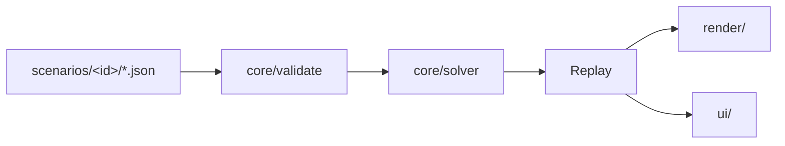

# honviz — Honorverse Battle Viewer: Design

Status: draft for user review
Source spec: `honorverse-master-technical-specification.md` (referred to below as "MTS")
Inputs: Site A (muddy-glade-edee.workers.dev), Site B (ra100x.chatgpt.site), audit reports

## 1. Goal

Build a reusable, scenario-driven web app that collects Honorverse battles. Users can view and explore each battle as a replay: they can scrub the canon timeline, move the camera freely, switch scale views and layers, and inspect ships. The first release ships:

- The Battle of Manticore, complete and corrected against the MTS.
- The catalog shell.
- A small stub scenario that proves the app is reusable.

The app merges B's tactical correctness and scale views with A's visuals: formations, bloom, director camera and the missile-density selector.

Non-goals for v1:
- Interactive "play as commander" gameplay.
- Multiplayer.
- A scenario editor UI.
- A runtime physics simulation.

## 2. Decisions

| Topic | Decision |
|---|---|
| Stack | TypeScript, Vite, three.js, framework-free UI |
| Motion | Precomputed deterministic replay from a scripted canon timeline, built by a kinematic solver and gated by validators |
| Commander picture | In v1, with an Actual / Perceived toggle (MTS §11.1) |
| Scope | Manticore (full) + catalog + stub scenario |
| Deploy | Static build to Cloudflare Pages; git repo |
| Architecture | Layered single Vite app (`core` / `render` / `ui`) plus data packs in `scenarios/` |

## 3. Architecture



```
src/
  core/        # no DOM, no three.js; pure and unit-tested
    units.ts       # km, s, t, km/s²; C_KM_S, G0, LM_KM; conversions
    evidence.ts    # SourceValue<T>, EvidenceLabel P|W|D|S, helpers
    schema.ts      # CelestialBody, Ship, MissileOrPacket, Contact, Event (MTS §12.1)
    tech/          # era-dated presets: missiles, ship classes, EW, defenses
    solver/        # orbits, wedge/sidewall geometry, intercepts, defense channels, damage
    sensors.ts     # perceived contacts: light-lag, detection, uncertainty
    replay.ts      # Replay type and sample(t) interpolation
    validate/      # one module per MTS §12.2 check
    rng.ts         # seeded PRNG (per-event deterministic_seed)
  render/      # three.js
    scales/        # SystemView, EngagementView, ShipView (separate cameras and frames)
    layers/        # one per MTS §11.1 layer
    fx/            # bloom, wedges, beams, blasts, debris (from Site A)
    director.ts    # cinematic camera and shots
  ui/          # vanilla TS components
    catalog/, viewer/, panels/ (forces, cic, inspector), timeline/, menus/
  main.ts      # hash router: #/ and #/battle/<id>
scenarios/
  manticore/   meta.json, bodies.json, forces.json, timeline.json, notes.md
  training/    (stub)
```

Rules:
- `core` never imports from `render` or `ui`.
- A scenario is data only. Code that a scenario needs belongs in `core/tech` or `core/solver`.
- The replay is computed once per scenario load, in a Web Worker if it costs more than 200 ms. The renderer only calls `sample(t)`.

## 4. Data model (MTS §12)

- `SourceValue<T>` has the fields `{ value: T | null, unit, evidence: 'P'|'W'|'D'|'S', source_id, locator?, era?, uncertainty?, status? }`.
- Unknown values are `null`, never `0`. The UI renders them as "unknown".
- Values labelled S are always marked as speculative in the UI and are never presented as canon.
- Ships reference a `classId` and an `era`. Capabilities resolve as preset, then refit, then per-ship override, and each resolved value keeps its provenance.
- Pod inventories store true counts. Controllers are counted separately from attack/EW missiles; for example, Apollo is 7,776 pods, giving 62,208 attack/EW missiles plus 7,776 controllers. Headline vehicle counts exclude controllers.
- `timeline.json` lists canon events (launches, arrivals, losses, maneuvers) with times or windows and a `deterministic_seed`. The solver fills in everything between them.
- Astrography marked provisional is flagged as such, and the Draco/Roc ordering follows the MTS.

## 5. Solver and mechanics corrections

The corrections below fix the errors found in the A/B audit.

- **Missiles**:
  - Each missile generation has its own profile: standard MDM, Mk23 and Apollo-controlled. There is no conflation such as an "85,000 g MDM at 173,000 km/s".
  - Each drive phase (acceleration, coast/ballistic, terminal) is solved toward the intercept.
  - If a canon arrival time cannot be met within the profile's limits, validation fails. Arrival times are never forced, which is the bug behind A's 1.11c missiles.
  - A hard invariant enforces `v < c`.
- **Ships**:
  - Broadsides follow MTS §5: Nike BC is 674.3 g with 25 tubes and 12 grasers per broadside; Saganami-C has 20 tubes per broadside.
  - Keyhole is fitted only where the class and era allow it.
- **Geometry**:
  - Ray tests cover the wedge and the sidewalls.
  - Stellar hyper limits, terminus exclusions and resonance hazards are modelled separately (MTS §2.6). The resonance hazard is drawn as a labelled terminus-to-star direction, never as a fixed-width lethal cone.
- **Defense**:
  - CM and PD are assigned to incoming packets channel by channel, with seeded resolution.
  - EW and decoys reduce the effective number of defense channels.
  - This replaces fixed fate percentages and radius presets.
- **Damage**:
  - Damage is recorded per subsystem: launchers, sidewall generators, alpha/beta nodes, sensors, hull and crew. The status displayed is one of: operational, degraded, mission-kill or destroyed.
- **Timeline**:
  - Total duration follows the sources, which suggest roughly 90 minutes, not a 45-minute script.
  - The title is "Battle of Manticore", kept distinct from "Eighth Battle of Manticore" as MTS §10.1 requires.

## 6. Validators (MTS §12.2)

Each check is a pure function `(scenario, replay) => Issue[]`. The 12 checks are:

1. Unit round trips.
2. Parent frames.
3. Shared projection.
4. Epoch.
5. Weapon counts against class broadsides.
6. Inventory conservation.
7. Guidance (every missile has a controller or a feasible autonomous solution).
8. Light-lag latency.
9. Flight feasibility (`v < c`, burn limits).
10. Geometry (no shots through a wedge).
11. Escape (hyper-limit consistency).
12. Era consistency.

Issue severities are `error`, `warn` and `info`. Any `error` fails Vitest and CI, and the dev overlay lists warnings.

## 7. Rendering and UX

- **Catalog** (`#/`): battle cards showing title, era, combatants and an evidence-quality badge.
- **Viewer** (`#/battle/<id>`):
  - Top bar: scale tabs (System / Engagement / Ship), plus Director/Free camera, reset and fullscreen.
  - Left: forces panel, with fleets, ship status and subsystem pips.
  - Right: CIC log, with filtering by side.
  - Bottom: timeline scrubber with phase markers, speed control (Auto, ¼–240×) and next/prev phase.
  - Menus:
    - Layers (MTS §11.1: celestial, ground truth, commander picture, engagement, protection, comms, damage).
    - The **Actual / Perceived** toggle, with side selection for the perceived view.
    - Missile density (1:1, 1:2, 1:4, 1:8, 1:16), with the sampling ratio always visible. Displayed totals always use true counts.
    - Shots (director presets).
  - Inspector: clicking a ship opens a card showing each value with its evidence label and source tooltip.
  - Dialogs: help (keyboard map: space, arrows, D, Esc, +/-) and scenario notes (sources, caveats).
- **Ship view**: class model with wedge, sidewalls, roll, pod deployment and a broadside demo (from Site B).
- **Commander picture**: contacts are drawn at their last-known position, with timestamp age and an uncertainty ellipsoid. The Actual view shows ground truth.
- **Visual style**: Site A's bloom, wedge glow, formations and blast effects, with the scene scale set per view.

## 8. Testing

- Vitest:
  - Units.
  - Each validator, with positive and negative fixtures.
  - Solver determinism (same seed produces an identical replay hash).
  - No superluminal motion.
  - Inventory conservation.
- Scenario CI: every pack in `scenarios/` must validate with zero errors.
- Playwright smoke tests:
  - The catalog renders.
  - The Manticore viewer loads.
  - Scrubbing to the end does not throw.
  - Toggling scale and perceived mode works.

## 9. Delivery

- `npm run build` produces a static `dist/`, which is deployed with Cloudflare Pages (`wrangler pages deploy dist`).
- The README covers adding a scenario, the evidence-label policy and how to run the validators.

## 10. Risks and open items

- Some MTS values are provisional (Appendix A). They are labelled S or D, and the UI must make this obvious.
- Solver cost for about 70k missiles: the solver works on packets, as MTS §11.3 allows, while keeping true counts. Performance is checked against a budget of under 2 s to precompute on a mid-range laptop.
- Reusing Site A and Site B code: their visual and mechanics ideas are ported into TypeScript modules rather than copying the bundles wholesale.
